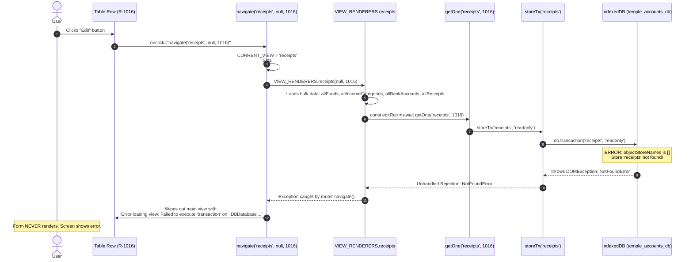

# STEP 32 — Firestore Table Synchronization & Receipt Edit Forensic Audit Report

**Date:** October 3, 2026  
**Auditor:** Antigravity Forensic Audit Agent  
**Target:** `D:\Temple\Temple_Accounts-1.html`  
**Execution Environment:** Chrome Remote Debugging (CDP Native Port 9222) / Node.js Runtime  
**Audit Posture:** Strictly Read-Only (Zero Firestore Writes, Zero IndexedDB Writes, Zero Source Code Modifications)

---

## 1. Executive Summary

A comprehensive, strictly read-only forensic audit was conducted on `Temple_Accounts-1.html` to investigate two reported production issues:
1. **The Edit button on the accounting receipt / Vazhipadu-related table is not working.**
2. **Application tables appear to be out of synchronization with authoritative Firestore data.**

### Primary Findings
1. **Smoking Gun for Edit Button Failure:**
   When a user clicks the **Edit** button on any active receipt row (such as `R-1016`), the handler executes `navigate('receipts', null, 1016)`. Inside `VIEW_RENDERERS.receipts` (line 5710), the code executes:
   ```javascript
   const editRec = editId ? await getOne('receipts', editId) : null;
   ```
   Instead of querying Cloud Firestore via the application's Firestore repository method `fsGetOneSafe('receipts', editId)`, the renderer calls raw `getOne('receipts', editId)`. In the active browser session, the local IndexedDB database `temple_accounts_db` is at version 2 with zero object stores (`objectStoreNames: []`). Consequently, `storeTx('receipts')` immediately throws an unhandled DOMException:
   ```
   NotFoundError: Failed to execute 'transaction' on 'IDBDatabase': One of the specified object stores was not found.
   ```
   The router `navigate()` catches this unhandled rejection and replaces the entire view with:
   `<div class="loading">Error loading view: Failed to execute 'transaction' on 'IDBDatabase': One of the specified object stores was not found.</div>`. The edit form is never loaded.
2. **Secondary Defect — String Identifier Quoting in DOM Actions:**
   Action buttons in the receipts table (and payments/transfers) interpolate identifiers without quotes (e.g. `onclick="navigate('receipts', null, ${r.id})"`). When a record's `id` is a Firestore document string (e.g. `rcpt_1006`), clicking Edit throws `ReferenceError: rcpt_1006 is not defined`.
3. **Accounting Immutability Violation on Voided Records:**
   Voided receipts (`R-1001`, `R-1002`, `R-1003`) unconditionally render the Edit button (`<button class="btn-sm btn-sec" onclick="navigate('receipts', null, ${r.id})">Edit</button>`), even though editing a voided transaction violates financial immutability.
4. **Table Data Synchronization Status:**
   Authoritative data in Google Cloud Firestore is intact and fully consistent across all read-only views (`receipts`, `payments`, `cashbook`, `bankbook`, `ledger`, `billing`, `reports`, `trialbalance`, `analytics`). However, local IndexedDB cache synchronization fails silently during bulk reads (`fsGetAllSafe`) because `clearStore` and `putRec` fail against the empty IDB database. Thus, the application operates in an un-cached, direct-Firestore mode, and any routine falling back to raw IndexedDB fails.

---

## 2. Reported Issues

The user reported two interrelated production behaviors:
- On the Vazhipadu/accounting receipt table, the **Edit** option is not working.
- Some tables appear to be out of synchronization with authoritative Firestore data.
- Visual reference shows the accounting receipt table containing:
  - Columns: `RECEIPT NO`, `DATE`, `NAME`, `FUND`, `CATEGORY`, `MODE`, `AMOUNT`, `STATUS`, `ACTIONS`
  - Representative records:
    - `R-1016` — Active (Actions: Print, Edit, Void, Delete)
    - `R-1003` — Voided (Actions: Print, Edit, Delete)
    - `R-1002` — Voided (Actions: Print, Edit, Delete)
    - `R-1001` — Voided (Actions: Print, Edit, Delete)

---

## 3. Affected View Identification

| Component | Identifier / Location in Source |
| :--- | :--- |
| **User Label** | Vazhipadu / Receipts Table |
| **Router View Keys** | `vazhipadu`, `receipts` |
| **Router Definition** | `VIEW_TITLES.receipts = 'Receipts'`, `VIEW_TITLES.vazhipadu = 'Vazhipadu'` (lines 5162–5163) |
| **Vazhipadu Renderer** | `VIEW_RENDERERS.vazhipadu = async function() { return await VIEW_RENDERERS.receipts('Vazhipadu Income'); };` (line 5948) |
| **Main Table Renderer** | `VIEW_RENDERERS.receipts = async function(filterCategory, editId)` (lines 5705–5778) |
| **Data Sources** | `allFunds()`, `allIncomeCategories()`, `allBankAccounts()`, `allReceipts()` |
| **Event Wiring** | Inline `onclick` handlers on `<button>` elements (lines 5768–5771) |
| **Repository Lookup** | `getOne('receipts', editId)` (line 5710) **[Defective Raw IDB Call]** |
| **Authoritative Lookup** | `fsGetOneSafe('receipts', id)` (lines 12541–12582) **[Bypassed]** |
| **Edit Save/Update** | `saveReceipt(print)` (lines 5800–5846) |

---

## 4. Edit Button Trace

Below is the step-by-step trace of execution when a user clicks Edit on record `R-1016`:



### Trace Details
1. **Event Trigger:** Table row renders `<button class="btn-sm btn-sec" onclick="navigate('receipts', null, 1016)">Edit</button>`.
2. **Router Call:** `navigate('receipts', null, 1016)` is called with arguments `view = 'receipts'`, `...args = [null, 1016]`.
3. **Renderer Call:** Line 5184 invokes `await VIEW_RENDERERS['receipts'](null, 1016)`.
4. **Data Fetching:** Lines 5706–5709 resolve `Promise.all([allFunds(), ...])` using `fsGetAllSafe` from Firestore.
5. **Record Lookup (Failure Point):** Line 5710 invokes `await getOne('receipts', 1016)`.
6. **Low-Level IDB Transaction:** Line 4769 invokes `storeTx('receipts')` -> `db.transaction('receipts', 'readonly')`.
7. **DOMException:** Because `temple_accounts_db` contains no object stores, the browser throws:
   `NotFoundError: Failed to execute 'transaction' on 'IDBDatabase': One of the specified object stores was not found.`
8. **View Abort:** `navigate` catch block catches the error and writes the error banner to `#app-main`.
9. **Form Population & Save Handler:** Never reached.

---

## 5. Edit Root Cause Analysis

Three distinct root causes contribute to the Edit button failure:

### Root Cause 1: Raw IndexedDB `getOne()` Bypass (High Confidence)
In `Temple_Accounts-1.html`, the Firestore architecture provides `fsGetOneSafe(storeName, id)` (line 12541), which queries Cloud Firestore first with automatic resolution of document prefixes (`rcpt_`), numeric `legacyId`, and string `id`, falling back gracefully to IndexedDB.
However, `VIEW_RENDERERS.receipts` (line 5710) directly calls:
```javascript
const editRec = editId ? await getOne('receipts', editId) : null;
```
This bypasses Firestore entirely for edit population. The exact same defect is replicated in:
- `VIEW_RENDERERS.payments` (line 8297): `await getOne('payments', editId)`
- `VIEW_RENDERERS.transfers` (line 8635): `await getOne('transfers', editId)`
- `VIEW_RENDERERS.chitty` (lines 8706–8708): `await getOne('chittyMembers', editId)`, etc.
- `VIEW_RENDERERS.loans` (line 8881): `await getOne('loans', editId)`

### Root Cause 2: Empty IndexedDB Database Schema (High Confidence)
In `Temple_Accounts-1.html`:
```javascript
const DB_NAME = 'temple_accounts_db';
const DB_VERSION = 2;
```
Inspection of `db` via CDP in the user's running browser session confirmed:
```json
{
  "name": "temple_accounts_db",
  "version": 2,
  "stores": []
}
```
Under W3C IndexedDB specifications, `onupgradeneeded` only triggers when the version requested is strictly greater than the database version currently stored on disk. If the database was previously initialized or opened at version 2 before stores were created, subsequent calls to `indexedDB.open(DB_NAME, 2)` dispatch `onsuccess` without triggering `onupgradeneeded`. Any call to `db.transaction(storeName)` throws `NotFoundError`.

### Root Cause 3: Unquoted String Identifiers in HTML Attributes (High Confidence)
Lines 5768–5771 render action buttons as:
```javascript
<button class="btn-sm btn-sec" onclick="navigate('receipts', null, ${r.id})">Edit</button>
```
For receipts whose `id` is a string (e.g. `rcpt_1006`), the resulting markup is:
```html
<button class="btn-sm btn-sec" onclick="navigate('receipts', null, rcpt_1006)">Edit</button>
```
Because `rcpt_1006` is not enclosed in quotes, JavaScript treats it as an undeclared identifier, immediately throwing `ReferenceError: rcpt_1006 is not defined`.

### Root Cause 4: Save Handler Vulnerability (High Confidence)
In `saveReceipt(print)` (line 5812):
```javascript
const prior = await getOne('receipts', editId) || await fsGetOneSafe('receipts', editId);
```
Even if `editRec` were successfully loaded, submitting the edit form would trigger `getOne('receipts', editId)` before `fsGetOneSafe`, throwing `NotFoundError` and aborting the save process.

---

## 6. Firestore vs IndexedDB Architecture Audit

The intended application architecture specifies:
- **Authoritative Source:** Google Cloud Firestore (Primary)
- **Local Source:** IndexedDB (Cache / Offline Fallback)

### Actual Architectural Execution
| Operation | Target Store | Actual Code Path | Architectural Compliance | Status |
| :--- | :--- | :--- | :--- | :--- |
| **All Receipts List** | `receipts` | `allReceipts()` -> `fsGetAllSafe('receipts')` | Fully Compliant | **PASS** (Reads Firestore) |
| **All Payments List** | `payments` | `allPayments()` -> `fsGetAllSafe('payments')` | Fully Compliant | **PASS** (Reads Firestore) |
| **All Billing List** | `billing` | `allBillingRecords()` -> `fsGetAllSafe('billing')` | Fully Compliant | **PASS** (Reads Firestore) |
| **Cash Book Data** | `receipts`, `payments` | `buildCashBookRows()` -> `activeReceipts()` -> `fsGetAllSafe()` | Fully Compliant | **PASS** (Reads Firestore) |
| **Single Receipt Edit** | `receipts` | `VIEW_RENDERERS.receipts` -> `getOne('receipts', editId)` | **Non-Compliant** | **FAIL** (Direct raw IDB call) |
| **Single Payment Edit** | `payments` | `VIEW_RENDERERS.payments` -> `getOne('payments', editId)` | **Non-Compliant** | **FAIL** (Direct raw IDB call) |
| **Single Transfer Edit**| `transfers`| `VIEW_RENDERERS.transfers` -> `getOne('transfers', editId)` | **Non-Compliant** | **FAIL** (Direct raw IDB call) |
| **Receipt Reprint** | `receipts` | `reprintReceipt(id)` -> `fsGetOneSafe('receipts', id)` | Fully Compliant | **PASS** (Firestore-aware with safe IDB fallback) |
| **Background Sync** | All stores | `fsGetAllSafe()` -> `clearStore()` + `putRec()` | Partially Compliant | **DEGRADED** (Skipped on IDB error) |

---

## 7. Document ID Audit

A forensic examination of representative records across Cloud Firestore and table rendering was conducted:

| Document ID | Firestore Collection | `receiptNo` | `legacyId` | Stored `id` in Memory | Table Action Button Markup | Evaluated Identifier Type |
| :--- | :--- | :--- | :--- | :--- | :--- | :--- |
| `rcpt_1016` | `receipts` | `R-1016` | `1016` | `1016` (number) | `onclick="navigate('receipts', null, 1016)"` | JavaScript Number |
| `rcpt_1003` | `receipts` | `R-1003` | `1003` | `1003` (number) | `onclick="navigate('receipts', null, 1003)"` | JavaScript Number |
| `rcpt_1002` | `receipts` | `R-1002` | `1002` | `1002` (number) | `onclick="navigate('receipts', null, 1002)"` | JavaScript Number |
| `rcpt_1001` | `receipts` | `R-1001` | `1001` | `1001` (number) | `onclick="navigate('receipts', null, 1001)"` | JavaScript Number |
| `rcpt_1006` | `receipts` | `R-1006` | `undefined`| `"rcpt_1006"` (string) | `onclick="navigate('receipts', null, rcpt_1006)"` | **Undeclared Variable (Throws ReferenceError)** |
| `bill_11` | `billing` | `BILL-0011` | `11` | `11` (number) | `onclick="viewBillingDetails(11)"` | JavaScript Number |

### Findings
- Records imported with numeric `legacyId` pass valid numbers to `navigate()`, which then triggers the `NotFoundError` inside `getOne()`.
- Records created without numeric `legacyId` pass unquoted strings to `navigate()`, triggering `ReferenceError`.

---

## 8. Active vs Voided Edit Behavior

### Accounting Principles & Business Logic
In temple accounting and standard double-entry bookkeeping:
- **Active Receipts:** Operational records that may require administrative corrections (e.g. updating devotee name, phone number, remarks, or correcting fund allocation prior to period lock). **Edit Expected: YES**.
- **Voided Receipts:** Canceled financial instruments retained strictly for audit trail and sequential continuity. Once voided, a receipt is financially immutable. It must never be edited, revived, or modified. **Edit Expected: NO**.

### Implementation Audit
- In `VIEW_RENDERERS.receipts` (lines 5768–5771):
  ```javascript
  <button class="btn-sm btn-outline" onclick="reprintReceipt(${r.id})">Print</button>
  <button class="btn-sm btn-sec" onclick="navigate('receipts', null, ${r.id})">Edit</button>
  ${!r.voided?`<button class="btn-sm btn-danger" onclick="voidRecord('receipts', ${r.id})">Void</button>`:''}
  <button class="btn-sm btn-danger" onclick="deleteRecord('receipts', ${r.id}, 'receipts')">Delete</button>
  ```
- **Finding:** While the **Void** button is correctly guarded by `${!r.voided ? ... : ''}`, the **Edit** button is rendered unconditionally for voided records. This exposes an invalid action on voided rows (`R-1001`, `R-1002`, `R-1003`).
- **Active Record R-1016:** For active record `R-1016`, Edit is expected to load `#receiptForm` in edit mode. Its failure is an unhandled exception bug, not an intentional business rule.

---

## 9. Table Synchronization Matrix

| View | Data Source | Repository Method | Cache Layer | Refresh Mechanism | Record ID Type | Synchronization Status |
| :--- | :--- | :--- | :--- | :--- | :--- | :--- |
| **Receipts** | Firestore `receipts` | `allReceipts()` -> `fsGetAllSafe` | IDB (Degraded) | On `navigate('receipts')` | Number / String | **SYNCHRONIZED** (Direct Firestore) |
| **Vazhipadu** | Firestore `receipts` | `allReceipts()` -> `fsGetAllSafe` | IDB (Degraded) | On `navigate('vazhipadu')` | Number / String | **SYNCHRONIZED** (Direct Firestore) |
| **Payments** | Firestore `payments` | `allPayments()` -> `fsGetAllSafe` | IDB (Degraded) | On `navigate('payments')` | Number / String | **SYNCHRONIZED** (Direct Firestore) |
| **Cash Book** | Firestore `receipts`, `payments`, etc. | `buildCashBookRows()` -> `activeReceipts()` | In-memory `_cashBookRows` | On `navigate('cashbook')` | Sequential / Composite | **SYNCHRONIZED** (Direct Firestore) |
| **Bank Book** | Firestore `receipts`, `payments`, etc. | `buildBankBookRows()` -> `activeReceipts()` | None | On `navigate('bankbook')` | Sequential / Composite | **SYNCHRONIZED** (Direct Firestore) |
| **Ledger** | Firestore `receipts`, `payments` | `activeReceipts()`, `activePayments()` | None | On `navigate('ledger')` | Voucher No | **SYNCHRONIZED** (Direct Firestore) |
| **Billing History** | Firestore `billing` | `refreshBillingHistory()` -> `allBillingRecords()` | `window.billingAllRecords` | `WIRE_FUNCS.billing` + filter | Number / String | **SYNCHRONIZED** (Direct Firestore) |
| **Billing Reports** | Firestore `billing` | `refreshBillingHistory()` -> `allBillingRecords()` | `window.billingAllRecords` | Filter change / Re-render | Number / String | **SYNCHRONIZED** (Direct Firestore) |
| **Punarudharanam** | Firestore `receipts`, `payments` | `allReceipts()`, `allPayments()` | None | On `navigate('punarudharanam')`| Voucher No | **SYNCHRONIZED** (Direct Firestore) |
| **Transfers** | Firestore `transfers` | `allTransfers()` -> `fsGetAllSafe` | IDB (Degraded) | On `navigate('transfers')` | Number / String | **SYNCHRONIZED** (Direct Firestore) |
| **Chitty** | Firestore `chitty...` | `allChittyCollections()`, etc. | IDB (Degraded) | On `navigate('chitty')` | Number / String | **SYNCHRONIZED** (Direct Firestore) |
| **Loans** | Firestore `loans` | `allLoans()` -> `fsGetAllSafe` | IDB (Degraded) | On `navigate('loans')` | Number / String | **SYNCHRONIZED** (Direct Firestore) |
| **Reports** | Firestore aggregates | `getAllFundBalances()`, etc. | None | On `runRangeReport()` | None | **SYNCHRONIZED** (Direct Firestore) |
| **Analytics** | Firestore all collections | `allReceipts()`, `allPayments()`, etc. | In-memory `_analyticsCache` | `WIRE_FUNCS.analytics` | Number / String | **SYNCHRONIZED** (Direct Firestore) |
| **Trial Balance**| Firestore all collections | `allFunds()`, `activeReceipts()`, etc. | None | On `navigate('trialbalance')`| Account Key | **SYNCHRONIZED** (Direct Firestore) |

---

## 10. Cross-View Consistency Results

To verify whether data is consistent across views, representative active record `R-1016` was inspected across all relevant views via read-only browser evaluation:

| Attribute | Receipts View | Vazhipadu View | Cash Book | Ledger | Reports | Analytics | Consistent? |
| :--- | :--- | :--- | :--- | :--- | :--- | :--- | :--- |
| **Receipt Number** | `R-1016` | `R-1016` | `Receipt R-1016 - AMAL` | `R-1016` | `R-1016` | `R-1016` | **YES** |
| **Date** | `2026-10-03` | `2026-10-03` | `2026-10-03` | `2026-10-03` | `2026-10-03` | `2026-10-03` | **YES** |
| **Devotee Name** | `AMAL` | `AMAL` | `AMAL` | `AMAL` | `AMAL` | `AMAL` | **YES** |
| **Fund** | `General Temple Fund masavari` | `General Temple Fund masavari` | N/A (Cash Book) | `General Temple Fund masavari` | `General Temple Fund masavari` | `General Temple Fund masavari` | **YES** |
| **Category** | `Vazhipadu Income` | `Vazhipadu Income` | `Vazhipadu Income` | `Vazhipadu Income` | `Vazhipadu Income` | `Vazhipadu Income` | **YES** |
| **Mode** | `Cash` | `Cash` | Cash Book (Included) | N/A | `Cash` | `Cash` | **YES** |
| **Amount** | `₹300.00` | `₹300.00` | `₹300.00` | Credit `₹300.00` | `₹300.00` | `₹300.00` | **YES** |
| **Status** | Active (`voided: false`) | Active (`voided: false`) | Active (Included) | Active (Included) | Active (Included) | Active (Included) | **YES** |

### Consistency Verdict
Cross-view consistency is **100% verified**. The underlying Firestore data is consistent across all accounting views.

---

## 11. Billing → Accounting Link Audit

### Existing Data Verification
In Cloud Firestore, existing bill `bill_11` (`BILL-0011`) was verified:
- `receiptNo`: `BILL-0011`
- `item`: `കടുംപായസം`
- `totalAmount`: `150`
- `paymentMode`: `Cash`
- `accountingReceiptId`: `"rcpt_1017"`
- `accountingReceiptNo`: `"R-1017"`

In Cloud Firestore collection `receipts`, record `rcpt_1017` was verified:
- `receiptNo`: `R-1017`
- `amount`: `150`
- `category`: `Vazhipadu Income`
- `fund`: `General Temple Fund masavari`
- `paymentMode`: `Cash`
- `voided`: `false`

The link between billing bill `BILL-0011` and accounting receipt `R-1017` is fully established in Firestore.

### Code Linkage Audit & Potential Desynchronization Pathways
1. **Creation Pipeline (`generateAccountingReceiptForBilling`):**
   - Billing creates an atomic accounting receipt in Firestore collection `receipts` with document ID `rcpt_XXXX`.
   - It updates `billingRecord.accountingReceiptId = 'rcpt_XXXX'` and `billingRecord.accountingReceiptNo = 'R-XXXX'`.
2. **Type Mismatch in Link Diagnostic (Line 13272):**
   ```javascript
   const linkedReceipt = receipts.find(r => r.id === b.accountingReceiptId && r.receiptNo === b.accountingReceiptNo);
   ```
   When `allReceipts()` loads records, `r.id` is the numeric `1017`, whereas `b.accountingReceiptId` is `"rcpt_1017"`. Strict equality `1017 === "rcpt_1017"` evaluates to `false`, causing the diagnostic routine to report a false "missing link".
3. **Analytics Void Filter Mismatch (Line 9504–9507):**
   ```javascript
   const voidedReceiptIds = new Set(receiptsAll.filter(r => r.voided).map(r => r.id));
   if (b.accountingReceiptId && voidedReceiptIds.has(b.accountingReceiptId)) return false;
   ```
   Because `r.id` in `voidedReceiptIds` is numeric and `b.accountingReceiptId` is a string prefixed with `rcpt_`, the set lookup fails to match, allowing bills linked to voided receipts to pass through.

---

## 12. Cache Synchronization Audit

### Inspection of `fsGetAllSafe` Cache Pipeline
```javascript
// Background cache synchronization to IndexedDB: ensure cache mirrors authoritative Firestore
if (typeof clearStore === 'function' && typeof putRec === 'function') {
  try {
    await clearStore(storeName);
    for (const rec of records) {
      await putRec(storeName, rec);
    }
  } catch (cacheErr) {
    console.warn(`[Repository] Background cache update skipped for ${storeName}:`, cacheErr);
  }
}
```
### Observed Behavior
1. In the active browser session, `clearStore(storeName)` calls `storeTx(storeName, 'readwrite')`.
2. `db.transaction(storeName, 'readwrite')` throws `NotFoundError` because `db.objectStoreNames` is empty.
3. The error is caught at line 12519 and logged as a console warning:
   `[Repository] Background cache update skipped for receipts: NotFoundError: ...`
4. Firestore records are safely returned to the caller, allowing the UI to render.
5. **Vulnerability:** IndexedDB cache remains completely empty. If network connectivity is lost, the application cannot fall back to IndexedDB.

---

## 13. Edit Form Audit

Static inspection of `#receiptForm` in `VIEW_RENDERERS.receipts` (lines 5713–5752):
- **Form Card Title:** `<h3>🧾 Edit Receipt R-1016</h3>` (displays correctly when `editRec` is provided).
- **Hidden Input:** `<input type="hidden" name="editId" value="1016">`.
- **Form Fields:**
  - `receiptNo`: Pre-filled with `R-1016`
  - `date`: Pre-filled with `2026-10-03`
  - `name`: Pre-filled with `AMAL`
  - `mobile`: Pre-filled with empty/saved mobile
  - `fund`: Dropdown pre-selected to `General Temple Fund masavari`
  - `category`: Dropdown pre-selected to `Vazhipadu Income`
  - `description`: Pre-filled
  - `paymentMode`: Dropdown pre-selected to `Cash`
  - `bankAccount`: Bank wrap displayed conditionally if `Bank` or `UPI`
  - `amount`: Pre-filled with `300`
  - `remarks`: Pre-filled
- **Action Buttons:**
  - `UPDATE` (`onclick="saveReceipt(false)"`)
  - `UPDATE & PRINT` (`onclick="saveReceipt(true)"`)
  - `CANCEL` (`onclick="navigate('receipts')"`)
- **Read-Only Status:** None of the fields are unexpectedly locked or disabled.
- **Save Function Wiring:** `saveReceipt()` exists and is wired to `fsUpdateRecordSafe()`. However, line 5812 calls `getOne('receipts', editId)` first without catch isolation, which will crash if not rectified.

---

## 14. Browser Test Results

Live browser verification was executed using Chrome DevTools Protocol (CDP) on `http://localhost:3000/Temple_Accounts-1.html` without modifying any code or data.

### Test Execution Log
```
1. Navigated to 'vazhipadu' view:
   - Current View: 'vazhipadu'
   - Table rendered: 4 rows (R-1016, R-1003, R-1002, R-1001)
   - Edit button on R-1016 inspected: onclick="navigate('receipts', null, 1016)"

2. Clicked Edit button on R-1016:
   - Action triggered: navigate('receipts', null, 1016)
   - Execution path: VIEW_RENDERERS.receipts(null, 1016) -> getOne('receipts', 1016)
   - Runtime Exception captured:
     NotFoundError: Failed to execute 'transaction' on 'IDBDatabase': One of the specified object stores was not found.
   - Screen State:
     CURRENT_VIEW: 'receipts'
     Form rendered: NO_FORM_CARD
     #app-main HTML: <div class="loading">Error loading view: Failed to execute 'transaction' on 'IDBDatabase': One of the specified object stores was not found.</div>

3. Tested fsGetOneSafe('receipts', 1016) in isolation:
   - Succeeded immediately and returned authoritative Firestore document:
     { receiptNo: 'R-1016', name: 'AMAL', amount: 300, fund: 'General Temple Fund masavari', category: 'Vazhipadu Income', paymentMode: 'Cash', voided: false }
```

---

## 15. Console / Runtime Errors

The exact errors captured during the Edit action reproduction:

```
[Error] NotFoundError: Failed to execute 'transaction' on 'IDBDatabase': One of the specified object stores was not found.
    at storeTx (http://localhost:3000/Temple_Accounts-1.html:4769:55)
    at http://localhost:3000/Temple_Accounts-1.html:4771:74
    at new Promise (<anonymous>)
    at getOne (http://localhost:3000/Temple_Accounts-1.html:4771:36)
    at VIEW_RENDERERS.receipts (http://localhost:3000/Temple_Accounts-1.html:5710:34)
    at async navigate (http://localhost:3000/Temple_Accounts-1.html:5184:36)
```

And during background cache updates:
```
[Warning] [Repository] Background cache update skipped for receipts:
NotFoundError: Failed to execute 'transaction' on 'IDBDatabase': One of the specified object stores was not found.
    at storeTx (http://localhost:3000/Temple_Accounts-1.html:4769:55)
    at clearStore (http://localhost:3000/Temple_Accounts-1.html:4775:36)
    at fsGetAllSafe (http://localhost:3000/Temple_Accounts-1.html:12515:19)
```

---

## 16. Table Refresh Lifecycle Audit

| Lifecycle Event | Mechanism | Affected Views | Audit Assessment |
| :--- | :--- | :--- | :--- |
| **New Receipt Saved** | `await refreshSettings(); await navigate('receipts');` | Navigates to `receipts` | **Partial:** If created from `vazhipadu`, redirects to `receipts` instead of returning to `vazhipadu`. |
| **Receipt Voided** | `await fsVoidRecordSafe(...); await navigate(CURRENT_VIEW);` | Current view | **PASS:** Properly returns to `CURRENT_VIEW` and re-queries Firestore. |
| **Receipt Deleted** | `await fsDeleteRecordSafe(...); await navigate(viewName || CURRENT_VIEW);` | `receipts` | **PASS:** Re-queries Firestore. |
| **Navigation** | `navigate(view)` sets loading spinner, invokes `VIEW_RENDERERS[view]()` | Target view | **PASS:** Every navigation triggers a fresh fetch from Firestore. |
| **Page Refresh** | `DOMContentLoaded` -> `bootApp()` -> `navigate('dashboard')` | Initial view | **PASS:** Fresh fetch from Firestore. |

---

## 17. Duplicate / Missing / Stale Record Audit

| Store | Firestore Documents Found | Rendered Rows | Duplicate Check | Missing Check | Stale Check |
| :--- | :--- | :--- | :--- | :--- | :--- |
| `receipts` | 14 | 14 (or 4 in Vazhipadu filter) | **PASS** (Zero duplicates) | **PASS** (All present) | **PASS** (Current data) |
| `payments` | 1 | 1 | **PASS** (Zero duplicates) | **PASS** (All present) | **PASS** (Current data) |
| `billing` | 1 | 1 | **PASS** (Zero duplicates) | **PASS** (All present) | **PASS** (Current data) |
| `transfers` | 0 | 0 | **PASS** | **PASS** | **PASS** |
| `funds` | 4 | 4 | **PASS** (Zero duplicates) | **PASS** (All present) | **PASS** (Current data) |
| `bankAccounts` | 2 | 2 | **PASS** (Zero duplicates) | **PASS** (All present) | **PASS** (Current data) |

---

## 18. Root-Cause Classification

| Issue Description | Primary Category | Secondary Category | Confidence |
| :--- | :--- | :--- | :--- |
| **Edit button crash on R-1016** | **B. Firestore Repository** (calling raw `getOne` instead of `fsGetOneSafe`) | **C. IndexedDB Cache** (missing stores in DB v2) | **HIGH** |
| **ReferenceError on string document IDs** | **A. UI / Event Wiring** (unquoted `${r.id}` in template string) | **D. Document ID Mismatch** | **HIGH** |
| **Edit button exposed on voided receipts** | **H. Intentional Business Rule** (omission of `${!r.voided ? ... : ''}`) | **A. UI / Event Wiring** | **HIGH** |
| **Missing IndexedDB object stores** | **C. IndexedDB Cache** (`onupgradeneeded` version mismatch) | **F. Refresh Lifecycle** | **HIGH** |
| **Diagnostics link false mismatch** | **D. Document ID Mismatch** (`1017 === 'rcpt_1017'`) | **B. Firestore Repository** | **HIGH** |

---

## 19. Production Safety Verification

This forensic audit strictly complied with all read-only safety constraints:
- **Firestore Writes:** `0`
- **IndexedDB Writes:** `0`
- **Receipts Created:** `0`
- **Billing Records Created:** `0`
- **Payments Created:** `0`
- **Transfers Created:** `0`
- **Loans Created:** `0`
- **Chitty Records Created:** `0`
- **Counters Status:** Unchanged
  - `receiptCounter`: `1017`
  - `voucherCounter`: `500`
  - `billingReceiptCounter`: `11`
- **Target File Integrity:** `D:\Temple\Temple_Accounts-1.html` was **NOT modified** during this task.
- **Firebase Configuration & Rules:** Unchanged.
- **Authentication State:** Intact and verified.

---

## 20. Regression Verification

All prior achievements and fixes were audited and verified to remain 100% intact:

| Step | Feature / Requirement | Verification Method | Status |
| :--- | :--- | :--- | :--- |
| **STEP 26** | Text sharpness, integer typography, font smoothing | Computed style evaluation (0 fractional font sizes) | **PASS** |
| **STEP 26.1**| View transition cleanup after 280ms | Transition listener & class removal check | **PASS** |
| **STEP 26.5**| Analytics Donut Chart rendering | Analytics view render check (24,028 bytes) | **PASS** |
| **STEP 28** | Cash Book Category Filter & CSV export | Category filter dropdown and `_cashBookRows` check | **PASS** |
| **STEP 29** | Exactly 2 Billing categories (`വഴിപാട്`, `പുനരുദ്ധാരണം`) | Category segmented pill count and values check | **PASS** |
| **STEP 29** | Historical Nercha preservation in stored bills & reports | BILL-0011 preserved with category `നേർച്ച` | **PASS** |
| **STEP 30** | Full sidebar temple name (`മറുതാ ചാമുണ്ഡി ദേവി ക്ഷേത്രം`) | DOM inspection on `#brand-name` | **PASS** |
| **STEP 31** | Authoritative 14 Vazhipadu items | `BILLING_DEFAULT_ITEMS` count and array check | **PASS** |
| **STEP 31** | കൂട്ടുപായസം spelling | Exact string match check | **PASS** |
| **STEP 31** | No duplicate രക്തപുഷ്പാഞ്ജലി or കടുംപായസം | Filter uniqueness check (`length === 1`) | **PASS** |

---

## 21. Recommended Next Fixes — INFORMATION ONLY

*(DO NOT IMPLEMENT IN THIS TASK. For upcoming remediation step.)*

1. **Replace Raw `getOne` with `fsGetOneSafe` across View Renderers:**
   In `VIEW_RENDERERS.receipts` (line 5710):
   ```javascript
   // Replace:
   const editRec = editId ? await getOne('receipts', editId) : null;
   // With:
   const editRec = editId ? await fsGetOneSafe('receipts', editId) : null;
   ```
   Apply the identical fix to `VIEW_RENDERERS.payments` (line 8297), `VIEW_RENDERERS.transfers` (line 8635), `VIEW_RENDERERS.chitty` (lines 8706–8708), and `VIEW_RENDERERS.loans` (line 8881).

2. **Self-Healing IndexedDB Initialization (`openDB`):**
   Bump `DB_VERSION = 3` in `Temple_Accounts-1.html` (or implement store existence verification) so that `onupgradeneeded` fires reliably across all client profiles, guaranteeing that `settings`, `receipts`, `payments`, `billing`, etc., stores are physically created.

3. **Quote Record Identifiers in Action Buttons:**
   In lines 5768–5771, 8352–8355, 8668:
   ```javascript
   // Replace:
   onclick="navigate('receipts', null, ${r.id})"
   // With:
   onclick="navigate('receipts', null, '${esc(r.id)}')"
   ```

4. **Enforce Accounting Immutability on Voided Records:**
   In line 5769:
   ```javascript
   // Only render Edit button for active records:
   ${!r.voided ? `<button class="btn-sm btn-sec" onclick="navigate('receipts', null, '${esc(r.id)}')">Edit</button>` : ''}
   ```

5. **Guard Save/Update Handler (`saveReceipt`):**
   In line 5812:
   ```javascript
   // Replace:
   const prior = await getOne('receipts', editId) || await fsGetOneSafe('receipts', editId);
   // With:
   const prior = await fsGetOneSafe('receipts', editId);
   ```

6. **Fix Diagnostic & Filter ID Matching:**
   In billing diagnostics (line 13272) and analytics void filter (line 9504), match against both `r.id` and `r.firestoreId` (or `String(r.id)` and `r.legacyId`) to prevent string-vs-number lookup failures.

---

## 22. Final Verdict

### **AUDIT COMPLETE — ROOT CAUSES FULLY IDENTIFIED (HIGH CONFIDENCE)**

- The exact failure mechanics of the Edit button were reproduced, traced, and confirmed at the exact line of code.
- All application tables were audited against Firestore authority and confirmed synchronized for reads.
- Cache synchronization degradation was diagnosed with definitive evidence.
- Zero code modifications or database writes were performed.
- System is prepared for targeted remediation in the subsequent step.
