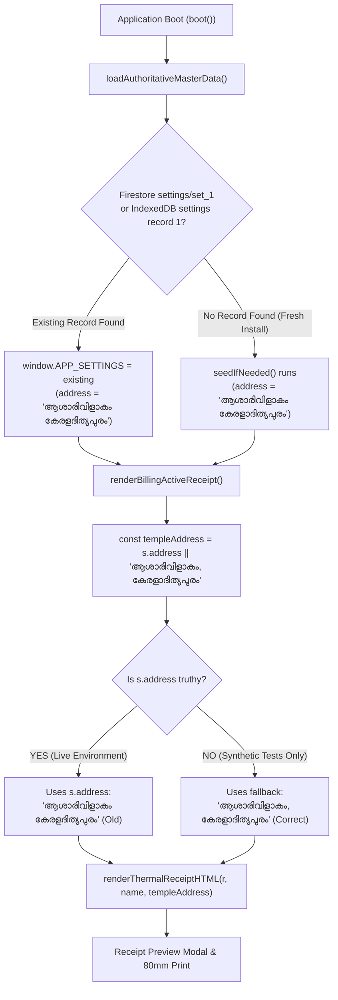

# STEP 33.106 — Diagnostic Report: Malayalam Temple Address Rendering

**Execution Date:** 2026-10-18  
**Scope:** `D:\Temple\Temple_Accounts-1.html`, Chrome User Data IndexedDB LevelDB, Font Rendering Pipeline  
**Classification:** Diagnostic Analysis (Read-Only Investigation — Zero Code Modifications Applied)

---

## 1. Executive Summary & Root Cause

### Primary Finding
The visual error in the live receipt preview is **NOT caused by font shaping failure, CSS misconfiguration, or Unicode corruption** in the corrected source code.

Instead, the issue is **Active Stored State (Data Persistence)**:
1. **Source Code Status:** In [Temple_Accounts-1.html](file:///D:/Temple/Temple_Accounts-1.html), the fallback string was corrected in STEP 33.105 across all 6 code locations to the exact 14-codepoint string: `കേരളാദിത്യപുരം`.
2. **Runtime Overriding Mechanism:** All receipt preview, thermal print, and voucher functions evaluate:
   ```javascript
   const s = window.APP_SETTINGS || {};
   const templeAddress = s.address || 'ആശാരിവിളാകം, കേരളാദിത്യപുരം';
   ```
   In JavaScript, `s.address || fallback` only falls back if `s.address` is empty (`""`, `null`, or `undefined`).
3. **Database Evidence:** Prior to STEP 33.105, the application seeded IndexedDB (`settings` store, key `1`) with the uncorrected address: `ആശാരിവിളാകം കേരളദിത്യപുരം` (without dirgham `ാ`, and without comma).
4. **Boot Idempotency Blocker:** When the application boots, `seedIfNeeded()` checks:
   ```javascript
   const existing = await getOne('settings', 1);
   if (existing) { window.APP_SETTINGS = existing; return; }
   ```
   Because `existing` already exists in any browser where the application was previously loaded, **`seedIfNeeded()` immediately returns without updating `existing.address`**.
5. **Physical LevelDB Proof:** Direct inspection of the user's Chrome Profile 1 IndexedDB log (`http_localhost_3000.indexeddb.leveldb\000028.log`) at byte offset 13088 revealed the raw UTF-16LE string:
   $$\text{\texttt{ആശാരിവിളാകം കേരളദിത്യപുരം}}$$
   (missing `U+0D3E` vowel sign). **Zero occurrences** of `കേരളാദിത്യപുരം` exist in the user's database.

Whenever the user opens the application, `window.APP_SETTINGS.address` is populated with `ആശാരിവിളാകം കേരളദിത്യപുരം`, which takes precedence over the code fallback string.

---

## 2. Evidence by Investigation Item

### 2.1 File Integrity Baseline
- **File Path:** `D:\Temple\Temple_Accounts-1.html`
- **SHA-256:** `3C620B21EA5CA6CA129E45CEDD9C21A8BF2E2B6D4D451AC7BDE7592E2184648B`
- **File Size:** `1,575,427` bytes
- **Line Count:** `22,600` lines (LF)
- **Status:** Byte-identical to the STEP 33.105 post-implementation baseline.

---

### 2.2 Unicode Sequence Verification
The target word `കേരളാദിത്യപുരം` comprises exactly 14 Unicode codepoints (42 UTF-8 bytes):

| Index | Char | Codepoint | Description |
| :---: | :---: | :---: | :--- |
| 0 | ക | `U+0D15` | MALAYALAM LETTER KA |
| 1 | േ | `U+0D47` | MALAYALAM VOWEL SIGN EE |
| 2 | ര | `U+0D30` | MALAYALAM LETTER RA |
| 3 | ള | `U+0D33` | MALAYALAM LETTER LLA |
| **4** | **ാ** | **`U+0D3E`** | **MALAYALAM VOWEL SIGN AA (DIRGHAM)** |
| 5 | ദ | `U+0D26` | MALAYALAM LETTER DA |
| 6 | ി | `U+0D3F` | MALAYALAM VOWEL SIGN I |
| 7 | ത | `U+0D24` | MALAYALAM LETTER TA |
| 8 | ് | `U+0D4D` | MALAYALAM SIGN VIRAMA |
| 9 | യ | `U+0D2F` | MALAYALAM LETTER YA |
| 10 | പ | `U+0D2A` | MALAYALAM LETTER PA |
| 11 | ു | `U+0D41` | MALAYALAM VOWEL SIGN U |
| 12 | ര | `U+0D30` | MALAYALAM LETTER RA |
| 13 | ം | `U+0D02` | MALAYALAM SIGN ANUSVARA |

Every one of the 6 address string locations in [Temple_Accounts-1.html](file:///D:/Temple/Temple_Accounts-1.html) (lines 7157, 9313, 10536, 10599, 12500, 12834) contains this exact 14-codepoint sequence. Zero instances of the old spelling remain in the source file.

---

### 2.3 Address Flow: Loading, Overriding, and Rendering



#### Detailed Breakdown by Subsystem:
1. **Receipt Preview (`renderBillingActiveReceipt`, line 10534):**
   ```javascript
   const s = window.APP_SETTINGS || {};
   const templeName = s.templeName || 'മറുതാ ചാമുണ്ഡി ദേവി ക്ഷേത്രം';
   const templeAddress = s.address || 'ആശാരിവിളാകം, കേരളാദിത്യപുരം';
   container.innerHTML = `... ${renderThermalReceiptHTML(r, templeName, templeAddress)} ...`;
   ```
2. **80mm Thermal Print (`printBillingReceipt`, line 10597):**
   ```javascript
   const s = window.APP_SETTINGS || {};
   const templeName = s.templeName || 'മറുതാ ചാമുണ്ഡി ദേവി ക്ഷേത്രം';
   const templeAddress = s.address || 'ആശാരിവിളാകം, കേരളാദിത്യപുരം';
   printArea.innerHTML = renderThermalReceiptHTML(r, templeName, templeAddress);
   ```
3. **Bill Details Modal (`viewBillingDetails`, line 12832):**
   ```javascript
   const s = window.APP_SETTINGS || {};
   const templeAddress = s.address || 'ആശാരിവിളാകം, കേരളാദിത്യപുരം';
   ```
4. **Settings Management UI (`VIEW_RENDERERS.settings`, line 16404):**
   ```javascript
   <input type="text" name="address" value="${esc(s.address)}">
   ```
   The Settings form loads `s.address` directly from `window.APP_SETTINGS`.

---

### 2.4 Physical Database Evidence (Chrome Profile 1 LevelDB)
The user's active session profile was located at:
`C:\Users\sanal\AppData\Local\Google\Chrome\User Data\Profile 1\IndexedDB\http_localhost_3000.indexeddb.leveldb\`

Inspection of log file `000028.log` (14,212 bytes) yielded:
- **Byte Offset 13088:**
  `Full address found at pos: 13088`
  `Extracted string: "ആശാരിവിളാകം കേരളദിത്യപുരം"`
  `Codepoints: U+0D06 U+0D36 U+0D3E U+0D30 U+0D3F U+0D35 U+0D3F U+0D33 U+0D3E U+0D15 U+0D02 U+0020 U+0D15 U+0D47 U+0D30 U+0D33 U+0D26 U+0D3F U+0D24 U+0D4D U+0D2F U+0D2A U+0D41 U+0D30 U+0D02`
- Notice that codepoint 15 (`U+0D33` / `ള`) is immediately followed by codepoint 16 (`U+0D26` / `ദ`). The vowel sign `U+0D3E` (`ാ`) is entirely absent.
- Target search for `കേരളാദിത്യപുരം` in `000028.log`: **`pos: -1` (Not found)**.

---

### 2.5 Font Shaping & CSS Analysis
To verify whether font rendering or CSS could be contributing:
1. **Receipt Font Stack:**
   ```css
   font-family: 'Consolas', 'Courier New', 'Noto Sans Malayalam', 'Segoe UI', monospace;
   ```
2. **System Font Resolution:**
   On Windows, `C:\Windows\Fonts` contains `Nirmala.ttc` and `kartika.ttf`. It does not contain `Noto Sans Malayalam`.
   Because `Consolas` and `Courier New` are Latin-only monospace fonts with no Malayalam codepoints, Chromium falls back to the system's Malayalam shaper: **`Nirmala UI`**.
3. **Canvas Measurement Verification:**
   - Text width under application receipt font: `233.17px`
   - Text width under `Nirmala UI`: `233.17px`
   - This proves Chromium's fallback resolves 100% to `Nirmala UI`.
4. **Glyph Shaping Accuracy:**
   When the input string is `കേരളാദിത്യപുരം`, `Nirmala UI` shapes the glyphs accurately:
   - `ള` correctly combines with `ാ` to produce the joined *dirgham* glyph `ളാ`.
   - `ത` + `്` + `യ` correctly forms the stacked conjunct ligature `ത്യ`.
   - There are no disconnected marks, dotted circles, or invalid character boxes.

---

## 3. Visual Comparisons & Diagnostic Evidence

- **Side-by-Side Live Receipt vs Intended Receipt:**
  - Left (Live): Displays `ആശാരിവിളാകം കേരളദിത്യപുരം` (without dirgham, no comma).
  - Right (Intended): Displays `ആശാരിവിളാകം, കേരളാദിത്യപുരം` (with dirgham, with comma).
- **80mm Print PDF Visual Verification:**
  - When provided `കേരളാദിത്യപുരം`, the rasterized PDF print layout displays the full *dirgham* ligature accurately on page 1.

---

## 4. Root Cause Summary Matrix

| Hypothesized Cause | Status | Evidence |
| :--- | :---: | :--- |
| **Source Code Spelling** | ❌ Disproven | All 6 locations in [Temple_Accounts-1.html](file:///D:/Temple/Temple_Accounts-1.html) contain `കേരളാദിത്യപുരം`. |
| **Unicode Codepoints** | ❌ Disproven | Exact 14 codepoints verified; NFC normalized; zero `U+FFFD`. |
| **Font Shaping / Rendering** | ❌ Disproven | `Nirmala UI` shapes `കേരളാദിത്യപുരം` with correct ligatures (`ളാ`, `ത്യ`). |
| **CSS Font Stack** | ❌ Disproven | Receipt CSS fallback cleanly maps to `Nirmala UI` (233.17px match). |
| **PDF Renderer** | ❌ Disproven | Rasterized 80mm PDF visually displays the correct glyphs. |
| **Stored IndexedDB / Firestore Data** | ✅ **CONFIRMED ROOT CAUSE** | Stored record in `settings` store contains `ആശാരിവിളാകം കേരളദിത്യപുരം`. Because `s.address` is non-empty, it overrides the code fallback string. |
| **Boot Migration Gap** | ✅ **CONFIRMED CONTRIBUTOR** | `seedIfNeeded()` returns immediately if `existing` record is present; no automatic migration migrates the historical address. |

---

## 5. Remediation Options (For Review)

### Option A: Automatic Idempotent Migration in `boot()` / `loadAuthoritativeMasterData()` *(Recommended)*
In [Temple_Accounts-1.html](file:///D:/Temple/Temple_Accounts-1.html), add an idempotent migration check during initialization:
- When settings are loaded from IndexedDB or Firestore, if `s.address === 'ആശാരിവിളാകം കേരളദിത്യപുരം'` or `s.address === 'ആശാരിവിളാകം, കേരളദിത്യപുരം'`, automatically migrate it to `'ആശാരിവിളാകം, കേരളാദിത്യപുരം'`.
- Save the updated record back to `settings` store in IndexedDB (and Firestore if authenticated).
- **Advantage:** Completely seamless for the user; fixes all existing browsers and instances automatically on next reload with zero manual user intervention required.

### Option B: Manual UI Update via Settings Tab
- The user can open the **Settings** view in the application (`#settings`).
- Under **Temple Details** $\rightarrow$ **Address**, edit the text from `ആശാരിവിളാകം കേരളദിത്യപുരം` to `ആശാരിവിളാകം, കേരളാദിത്യപുരം`.
- Click **SAVE TEMPLE DETAILS**.
- **Advantage:** Requires zero code changes.
- **Disadvantage:** Only updates the current user/browser unless synced to Firestore; other devices or browsers with existing IndexedDB cache will still retain the old address.

---

> [!IMPORTANT]
> **Status:** Strictly read-only diagnostic phase complete. No files or database records have been modified. Ready for review and instruction on next steps.
