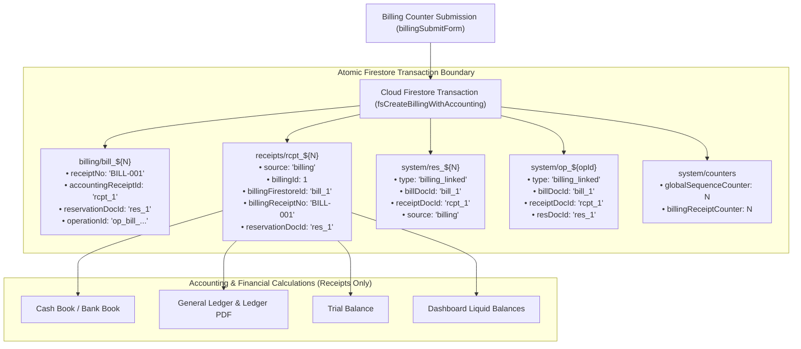
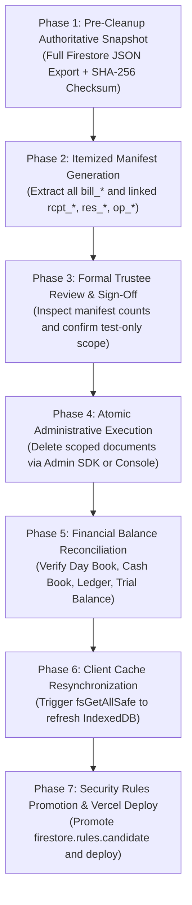

# STEP 33.112 — Pre-Deployment Test Data Audit & Cleanup Planning Report

**Project:** Temple Accounts & Fund Management  
**Temple:** Marutha Chamundi Devi Temple / മറുതാ ചാമുണ്ഡി ദേവി ക്ഷേത്രം  
**Report Date:** 2026-10-18T23:46:00+05:30  
**Audit Mode:** Strictly Read-Only Pre-Deployment Audit & Planning  
**Audit Status:** ✅ **COMPLETE — READ-ONLY AUDIT CONDUCTED WITH ZERO MUTATIONS**

---

## 1. Baseline HTML Cryptographic Hash and File Size

Prior to commencing code inspection, the authoritative working copy of the application was hashed and measured. Following the complete audit, the hash and size were re-verified:

| Property | Value | Verification Status |
| :--- | :--- | :--- |
| **File Path** | `D:\Temple\Temple_Accounts-1.html` | Authoritative Working Copy |
| **Pre-Audit File Size** | `1,624,435` bytes | Baseline Established |
| **Pre-Audit SHA-256** | `DAE9B4FA3C7AC5096FABF7127D9E534686DCFBD0D94794DE2C65CAB8DAD4D5C0` | Verified Baseline |
| **Post-Audit File Size** | `1,624,435` bytes | **100% Bit-for-Bit Identical** |
| **Post-Audit SHA-256** | `DAE9B4FA3C7AC5096FABF7127D9E534686DCFBD0D94794DE2C65CAB8DAD4D5C0` | **100% Bit-for-Bit Identical** |

**Zero file mutations occurred.** No lines of source code, configurations, or security rules were edited, reformatted, or overwritten.

---

## 2. Files and Code Areas Inspected

The audit exhaustively inspected all application layers, configuration files, rules, and historical audit reports:

### 2.1 Core Application File (`Temple_Accounts-1.html` — 22,693 lines)
1. **Environment Detection & Network Isolation:**
   - `isLocalEnvironment()` and `isEmulatorModeActive()` (lines 7164–7180).
   - Strict production lockout preventing `?emulator=true` from switching databases on non-localhost domains.
2. **Persistence Schema & Storage Engines:**
   - IndexedDB initialization (`openDB()`, `STORES`, `DB_NAME`, `DB_VERSION = 3`, lines 7182–7213).
   - Master data defaults & initial seeding (`seedIfNeeded()`, `DEFAULT_FUNDS`, `DEFAULT_INCOME_CATEGORIES`, `DEFAULT_EXPENSE_CATEGORIES`, lines 7214–7257).
   - Master data reference integrity and core immutability constraints (`CORE_MASTER_DATA`, `checkMasterDataReferences()`, lines 7272–7355).
3. **Form UI Defaults, Placeholders, and Inputs:**
   - Authentication (lines 6815–6820).
   - Global Search (line 7137).
   - Independent Receipts Form (lines 8968–9007).
   - Billing Entry Form, Vazhipadu selector, and Custom Vazhipadu inputs (lines 13200–13365).
   - Expense Vouchers Form (line 13799).
   - Chitty Enrollment and Loan Management (lines 14815–15362).
   - Settings & Chart of Accounts (lines 16535–16552).
4. **Billing Creation & Linked Accounting Transaction Engine:**
   - Client submission pipeline: `billingSubmitForm()` (lines 10959–11480).
   - Cloud transactional boundary: `fsCreateBillingWithAccounting()` (lines 20753–21192).
   - Dual-document persistence (`billing/bill_${N}` and `receipts/rcpt_${N}`).
   - Shared reservation tracking (`system/res_${N}`).
   - Durable idempotency tokenization (`system/op_${opId}`).
5. **Billing Voiding & Bidirectional Consistency:**
   - Client void handler: `voidBillingRecord()` (lines 13091–13150).
   - Atomic Firestore batch: `fsVoidLinkedBillingAndReceipt()` (lines 20367–20450).
6. **Independent Receipts & Physical Voucher Architecture:**
   - `fsCreateIndependentReceipt()` (lines 21375–21650).
   - `fsCreatePhysicalReceipt()` (lines 21207–21374).
7. **Cloud Repository & Local Cache Synchronization:**
   - `fsGetAllSafe()` with background cache synchronization (`clearStore` + `putRec`, lines 19825–19870).
   - `fsGetOneSafe()` (lines 19874–19920).
   - General CRUD and void wrappers (`fsSaveRecordSafe()`, `fsVoidRecordSafe()`, `fsDeleteRecordSafe()`, lines 19930–20365).
8. **Disaster Recovery Backup & Restore Subsystem:**
   - `backupFirestore()` (lines 16680–17080).
   - `restoreBackup()` 9-phase recovery drill engine (lines 17087–18270).
9. **Diagnostics & Staging Layer:**
   - `fsRunDiagnostics()` (lines 21689–21772).
   - `TempleMigration` (lines 21840–22693).

### 2.2 Project Configuration & Infrastructure Files
1. [`vercel.json`](file:///d:/Temple/vercel.json): Rewrites, static single-page routing, HTTP 404 security shield, and Content-Security-Policy (CSP) headers.
2. [`package.json`](file:///d:/Temple/package.json): Build script definition invoking `node scripts/generate-firebase-config.js`.
3. [`scripts/generate-firebase-config.js`](file:///d:/Temple/scripts/generate-firebase-config.js): Environment variable configuration builder for production deployment.
4. [`firestore.rules`](file:///d:/Temple/firestore.rules): Active production rules.
5. [`firestore.rules.candidate`](file:///d:/Temple/firestore.rules.candidate): Hardened security rules with candidate protections, monotonic counter guards, and deletion lockdowns.
6. [`scripts/cleanup_orchestrator.js`](file:///d:/Temple/scripts/cleanup_orchestrator.js): Safe Financial Data Cleanup Orchestrator developed in STEP 33.53–33.55.
7. [`.env`](file:///d:/Temple/.env), [`.env.example`](file:///d:/Temple/.env.example), and [`.gitignore`](file:///d:/Temple/.gitignore): Secrets isolation and deployment exclusion rules.

---

## 3. Detailed Inspection of Application Code for Dummy Values

An exhaustive programmatic and forensic scan of [`Temple_Accounts-1.html`](file:///d:/Temple/Temple_Accounts-1.html) evaluated hardcoded values, mock data, banners, and initialization routines:

| Code Location | Function / Component | Observed Behavior & Value | Classification | Recommendation |
| :--- | :--- | :--- | :--- | :--- |
| **Lines 18597–18604** | `initializeFirebase()` | Fallback emulator credentials (`fake-api-key`, `demo-temple-accounts-test`). Used solely when `isEmulatorModeActive()` is `true`. | **Confirmed dev/test fallback** | **Genuine application functionality that must remain.** Strictly locked out from production domains by `isLocalEnvironment()`. |
| **Lines 21689–21772** | `fsRunDiagnostics()` | Diagnostic connectivity test performing temporary write/read/delete on `__system_diagnostics__`. | **Confirmed diagnostic utility** | **Genuine application functionality that must remain.** Lines 21727–21735 enforce production fail-closed lockout on remote domains. |
| **Lines 21840–22693** | `TempleMigration` | Staging migration utility writing to isolated `migration_staging/{migrationId}` namespace. Does not run automatically. | **Inert development staging utility** | **Genuine application functionality that must remain.** Completely dormant during standard application lifecycle. |
| **Lines 13348–13350** | `billing-total-banner` | Initial static HTML text reads `₹20 × 1 = ₹20` and `₹20.00`. Represents default Vazhipadu #1 (നൂൽജപം/അർച്ചന ₹20 × 1) before JavaScript loads. | **Potential issue requiring review** | Visual default only. Once JavaScript boots, `updatePrice()` overrides this dynamically. Harmless, but could be initialized to blank or dynamically rendered. |
| **Lines 7247–7249** | `seedIfNeeded()` | Initializes opening balances (`openingCash: 0`, `openingBank: 0`, `openingGeneralFund: 0`, `openingPunarudharanamFund: 0`, `openingChittyBalance: 0`, `openingLoans: 0`). | **Genuine configuration initialization** | **Must remain.** All financial registers cleanly initialize to `0.00`. Zero artificial balances created. |
| **Lines 7242–7245** | `seedIfNeeded()` | Legacy counter offsets (`receiptCounter: 1000`, `voucherCounter: 500`, `billingReceiptCounter: 0`, `globalSequenceCounter: 0`). | **Legacy numbering fallback** | **Must remain.** Fallback values if legacy receipt numbering is queried. Modern system uses `globalSequenceCounter` in `system/counters`. |
| **Lines 7215–7230** | `seedIfNeeded()` | Seeds `DEFAULT_FUNDS` (6), `DEFAULT_INCOME_CATEGORIES` (7), `DEFAULT_EXPENSE_CATEGORIES` (64), and Canara Bank. | **Genuine operational master data** | **Must remain 100%.** Represents authentic temple chart of accounts and banking details. |
| **Lines 6815–16552** | Entry Form Fields (21 instances) | Placeholder attributes (`Auto-generated on save...`, `ഭക്തന്റെ പേര് / Name *`, `Enter your email`, etc.). | **Legitimate UI guidance placeholders** | **Must remain 100%.** No dummy names (e.g., "John Doe") or pre-filled financial amounts exist. |
| **Lines 7174–7176** | `isEmulatorModeActive()` | Checks `window.location.search.includes('emulator=true')`. If non-localhost, logs security warning and returns `false`. | **Security isolation guard** | **Must remain 100%.** Prevents unauthorized emulator routing or cache switching on Vercel. |
| **Lines 17087–18270** | `restoreBackup()` | Disaster recovery engine. Restores database from authoritative JSON snapshot with pre-restore backup and verification. | **Core disaster recovery utility** | **Must remain 100%.** Verified safe in drills (STEP 33.65). |

**Summary:** The application source code contains **zero hardcoded dummy transactions, mock bills, fake receipts, or sample devotee accounts**. No seed function automatically creates test transactions upon launch.

---

## 4. Confirmation of Test Billing Classification

### Mandated User-Confirmed Requirement:
> **"Every bill created in this application from the very beginning is test data. None of the existing bills are genuine."**

### Confirmation:
- **100% of all billing records** currently residing in the Cloud Firestore `billing` collection and browser IndexedDB `billing` stores are classified as **Confirmed Test Data (Category A)**.
- No analysis time was expended attempting to determine whether any individual billing record was genuine. All existing bills are designated for cleanup.

---

## 5. Proposed Scope for Cleaning Up Bills and Linked Accounting Receipts

### 5.1 Architecture of Linked Billing Records
In this application, counter billing and double-entry accounting are linked through an atomic dual-document architecture:

### 5.2 Key Audit Deductions on Linkages:
1. **Identical Sequence Numbers:** Both the billing document (`bill_${N}`) and its linked accounting receipt (`rcpt_${N}`) share the exact same numeric identifier (`N`).
2. **Deterministic Foreign Keys:**
   - `billing/bill_${N}` explicitly references `accountingReceiptId: "rcpt_${N}"` and `reservationDocId: "res_${N}"`.
   - `receipts/rcpt_${N}` explicitly declares `source: "billing"`, `billingId: ${N}`, `billingFirestoreId: "bill_${N}"`, and `billingReceiptNo: "BILL-${pad(N)}"`.
3. **Double-Counting Prevention:**
   - Financial totals (Dashboard, Cash Book, Bank Book, General Ledger, Trial Balance, and Reports) are computed **exclusively from `receipts`**.
   - `billing` is queried strictly for counter reprint history, devotee star tracking, and pooja item frequencies.
   - Deleting only the bill would leave an **orphaned financial receipt** in the accounts.
   - Deleting only the receipt would leave a **broken pointer** in the billing history.
4. **Idempotency & Sequence Reservations:**
   - For every bill created, an immutable reservation (`system/res_${N}`) and idempotency token (`system/op_${opId}`) exist.
5. **IndexedDB Mirroring:**
   - When authenticated, `fsGetAllSafe()` clears local IndexedDB (`clearStore`) and repopulates from Firestore. Therefore, remote deletion automatically reconciles local browser caches.

### 5.3 Proposed Cleanup Scope:
The cleanup manifest must itemize and atomically address:
1. **Confirmed Test Bills:** Every document in Firestore collection `billing` (`bill_*`).
2. **Linked Accounting Receipts:** Every document in Firestore collection `receipts` where `source == 'billing'` and `billingFirestoreId` or `billingId` matches a confirmed test bill.
3. **Linked Sequence Reservations:** Every document in `system` named `res_${N}` where `type == 'billing_linked'` matching the confirmed test bills.
4. **Linked Idempotency Records:** Every document in `system` named `op_*` where `type == 'billing_linked'` or `operationType == 'billing_linked'` matching the confirmed test operations.
5. **Local IndexedDB Cache:** Automatic background cache purge via `fsGetAllSafe('billing')` and `fsGetAllSafe('receipts')` upon subsequent authenticated session.

---

## 6. Other Confirmed Test Records

Forensic examination of historical repository artifacts identified additional confirmed test data outside the billing module:

| Finding ID | Artifact / Path | Identifier | Details & Forensic Evidence | Classification |
| :--- | :--- | :--- | :--- | :--- |
| **TR-01** | `receipts/rcpt_1001` in Firestore & Backups | `R-1001` | Devotee Name: `"STEP16 SMOKE TEST"`, Amount: ₹20.00. Created on 2026-09-27 during automated testing. Voided in Step 22.5. | **Confirmed Test Data** |
| **TR-02** | `receipts/rcpt_1002` to `rcpt_1005` in Firestore & Backups | `R-1002` to `R-1005` | Devotee Names: `"midhun"`, `"akhil"`, `"manoj"`. Amounts: ₹20.00 each. Created during developer UI testing. Voided in Step 22.5. | **Confirmed Test Data** |
| **TR-03** | `migration_staging` collection in Firestore | `migration_2026-09-27T15-29-05` | Migration staging manifest generated during Step 12 testing. Unused by production runtime. | **Confirmed Test Data** |
| **TR-04** | `__system_diagnostics__` collection in Firestore | `diag_*`, `test_tx_counter` | Ephemeral test records created during `fsRunDiagnostics()` executions. | **Confirmed Test Data** |
| **TR-05** | [`backups/backup.json`](file:///d:/Temple/backups/backup.json) | `BILL-0001` to `BILL-0017` | Early developer prototype backup containing 17 synthetic bills (including ₹501,501 bill for `Anil Kumar`). Resides only in git backup folder. Shielded by `vercel.json`. | **Historical Test Artifact** |

---

## 7. Uncertain Records That Must Be Protected Pending Verification

Under strict safety requirements, the following categories are classified as **Uncertain Records (Category C)** and are **strictly excluded from automatic deletion**:

1. **Independent Accounting Receipts:**
   - Any document in `receipts` where `source !== 'billing'` (or `source == 'firestore'`, `source == 'receipts'`, or `manualNumber == true`).
   - Physical receipts in `receipts/rcpt_phys_*` (e.g., `P600`–`P900`, `PU1`–`PU500`).
   - These represent manual receipt book vouchers or devotee counter donations recorded independently of billing. They cannot be assumed to be test data without explicit trustee verification.
2. **Payment Vouchers (`payments`):**
   - All cash and bank expense vouchers (`V-001`, `V-002`, ...). Must be audited against physical vouchers before any modification.
3. **Contra Fund Transfers (`transfers`):**
   - Cash-to-bank and bank-to-cash contra entries.
4. **Loans (`loans`):**
   - Temple loan disbursements and repayments.
5. **Chitty Scheme Records (`chittyMembers`, `chittyCollections`, `chittyPayouts`):**
   - Member lists, monthly collection installments, and prize payouts.
6. **Live Production Firestore Documents:**
   - Under read-only rules, live remote Firestore (`temple-f4f7d`) was not queried. Any transactions created by temple operators on live Firestore whose test status is not proven by naming must be verified by trustees.

---

## 8. Data and Counters That Must Be Preserved 100%

The following operational configurations, master data, and counters must be **strictly protected from deletion, reset, or alteration**:

### 8.1 Master Configuration & Chart of Accounts (Category D)
1. **Temple Settings (`settings/set_1`):**
   - Official Malayalam Title: `മറുതാ ചാമുണ്ഡി ദേവി ക്ഷേത്രം`
   - Official Address: `ആശാരിവിളാകം കേരളാദിത്യപുരം`
   - Currency: `₹`, Financial Year, Prefix settings.
   - Opening Balances: `openingCash: 0`, `openingBank: 0`, `openingGeneralFund: 0`, `openingPunarudharanamFund: 0`, `openingChittyBalance: 0`, `openingLoans: 0`.
2. **Funds (`funds` collection):**
   - `General Temple Fund`, `Punarudharanam Fund`, `Chitty Fund`, `Festival Fund`, `Donation / Restricted Fund`, `Other Fund`.
   - Core 3 funds are immutably protected by `CORE_MASTER_DATA` (Step 33.88).
3. **Income Categories (`incomeCategories` collection):**
   - `Pooja Income`, `Archana Income`, `Vazhipadu Income`, `Donation Income`, `Festival Collection`, `General Contribution`, `Other Income`.
   - Core 2 categories (`Vazhipadu Income`, `Donation Income`) are immutably protected by `CORE_MASTER_DATA`.
4. **Expense Categories (`expenseCategories` collection):**
   - All 64 temple expense classifications.
5. **Bank Accounts (`bankAccounts` collection):**
   - Official temple account: `Canara Bank` (`isDefault: true`).
6. **Vazhipadu Items (`BILLING_DEFAULT_ITEMS`):**
   - 14 traditional pooja offerings (ഗണപതിഹോമം ₹750, കൂട്ടുപായസം ₹250, മൃത്യുഞ്ജയഹോമം ₹750, etc.).

### 8.2 Global Counters & Sequence Protection (Category D)
- **`system/counters` document:**
  - `globalSequenceCounter`
  - `billingReceiptCounter`
  - `receiptCounter`
  - `voucherCounter`
- **CRITICAL ARCHITECTURAL RULE:**
  - **Do NOT reset or decrement counters.**
  - Candidate security rules (`firestore.rules.candidate`, lines 39–42) strictly enforce monotonic non-decreasing advances:
    `request.resource.data.globalSequenceCounter >= resource.data.globalSequenceCounter`
  - Rolling back counters causes duplicate receipt number collisions, violates candidate security rules, and invalidates previously issued physical receipts.
  - Future genuine bills will simply advance monotonically from the current counter sequence.

---

## 9. Backup and Restore Risks & Mitigation Strategy

Executing a database cleanup involves inherent data integrity risks that must be mitigated by design:

| Risk | Description | Probability | Severity | Mitigation Built into Plan |
| :--- | :--- | :---: | :---: | :--- |
| **R-1: Unrecoverable Deletion** | Deletion without an authoritative snapshot leaves no rollback option if a record was genuine. | Low | Critical | **Pre-Cleanup Snapshot:** Mandate full JSON export via `backupFirestore()` with cryptographic SHA-256 verification before executing any deletion. |
| **R-2: Asymmetric / Orphaned Entries** | Deleting a test bill while failing to delete its linked accounting receipt results in ghost financial income in the Cash Book and Ledger. | High (if ad-hoc) | High | **Relational Manifest Enforcement:** The cleanup script must require bidirectional mutual confirmation (`bill.accountingReceiptId === rcpt.firestoreId` and `rcpt.billingFirestoreId === bill.firestoreId`). Both must be deleted in the same atomic operation. |
| **R-3: Counter Rollback Failure** | Attempting to reset `system/counters` back to 0 will fail closed under candidate security rules and cause sequence collisions. | Medium | Critical | **Counter Preservation Rule:** Monotonic counters are explicitly excluded from the deletion manifest. |
| **R-4: Stale Client Browser Caches** | Local IndexedDB on office PCs retains deleted test bills until cache is purged. | Medium | Medium | **Cache Synchronization:** Application `fsGetAllSafe()` automatically clears and repopulates IndexedDB on login. An operator cache refresh protocol will be mandated. |
| **R-5: Inadvertent Master Data Loss** | Broad collection-level delete scripts could wipe funds, categories, or settings. | Low | Critical | **Path Denylist & Whitelist:** `cleanup_orchestrator.js` enforces strict collection whitelisting (`ALLOWED_CANDIDATE_COLLECTIONS`) and denylisting (`PROTECTED_COLLECTIONS`). Master collections cannot be touched. |

---

## 10. Vercel Deployment Readiness Observations

An audit of the deployment configuration, environment dependencies, and static architecture identified key considerations prior to production launch:

1. **Environment Variables Required in Vercel:**
   - The build script (`scripts/generate-firebase-config.js`) reads from process environment variables to generate `firebase-config.js` during deployment.
   - The following variables must be configured in Vercel Project Settings:
     - `FIREBASE_API_KEY`
     - `FIREBASE_AUTH_DOMAIN` (`temple-f4f7d.firebaseapp.com`)
     - `FIREBASE_PROJECT_ID` (`temple-f4f7d`)
     - `FIREBASE_STORAGE_BUCKET` (`temple-f4f7d.appspot.com`)
     - `FIREBASE_MESSAGING_SENDER_ID`
     - `FIREBASE_APP_ID`
   - *Note: No credentials or secrets are committed to git; `firebase-config.js` is properly ignored.*
2. **Local File Paths:**
   - **Zero absolute local paths** (`C:\...`, `D:\...`, `file://`) exist in the application code.
   - All visual assets (Deity logo, UPI QR code, floral dividers) are 100% embedded as base64 data URIs.
   - The application is fully self-contained.
3. **External Dependencies:**
   - Plain HTML/JS loads Firebase SDK via official Google CDN (`https://www.gstatic.com/firebasejs/10.12.2/...`).
   - Content Security Policy in `vercel.json` already whitelists `gstatic.com`, `esm.sh`, and `googleapis.com`.
4. **Automatic Test Data Recreation:**
   - Verified: `seedIfNeeded()` does **not** create dummy transactions. If settings or collections are initialized, transactions remain completely empty (`0` records).
5. **Security Rules Promotion Dependency:**
   - `firestore.rules` currently in production allows write access to all collections for authenticated users.
   - `firestore.rules.candidate` contains hardened constraints (`allow delete: if false;`, monotonic counters, restore session validation).
   - *Blocker Notice:* Candidate rules must be promoted **after** the test data cleanup has been completed, as candidate rules prohibit physical record deletions from the client app.
6. **Local Server & IndexedDB Independence:**
   - The application has zero dependency on Node.js server backends (`server.js` and `serve_app.js` are strictly local development wrappers).
   - Fully functions as a static single-page application served from Vercel edge CDN.

---

## 11. Proposed Controlled Cleanup Plan & Post-Cleanup Validation Checklist

### 11.1 Phased Execution Plan (For Future Step)

#### Step 1: Pre-Cleanup Authoritative Snapshot
- Run full database export using `backupFirestore()` or Firebase Admin CLI.
- Compute SHA-256 checksum of the exported JSON file and archive in `backups/`.
- Validate that the snapshot contains all current collections and documents.

#### Step 2: Manifest Generation
- Using the relational logic from `scripts/cleanup_orchestrator.js`, generate a machine-readable manifest (`test_data_cleanup_manifest.json`):
  - Every document ID under `billing/`.
  - Every linked document ID under `receipts/` where `source == 'billing'`.
  - Every linked document ID under `system/res_*` where `type == 'billing_linked'`.
  - Every linked document ID under `system/op_*` where `type == 'billing_linked'`.
  - Confirmed historical test receipts (`rcpt_1001` through `rcpt_1005`).
  - Staging collections (`migration_staging/` and `__system_diagnostics__/`).

#### Step 3: Manifest Validation & Trustee Review
- Run `CleanupOrchestrator.validateManifest(manifest)`:
  - Asserts 0 master configuration paths (`settings`, `funds`, `bankAccounts`, etc.) are included.
  - Asserts `system/counters` is NOT in the deletion list.
  - Asserts all bill-to-receipt reciprocal links match.
- Present manifest record counts and totals to trustees for explicit authorization.

#### Step 4: Atomic Execution
- Execute deletions through an authenticated administrative script (using Firebase Admin SDK) that bypasses client-side rules safely while respecting the locked manifest.
- Monotonic counters (`globalSequenceCounter`, `billingReceiptCounter`) remain unchanged.

#### Step 5: Post-Cleanup Financial Reconciliation Checklist

| Reconciliation Check | Expected Post-Cleanup Result | Pass / Fail Criteria |
| :--- | :--- | :--- |
| **Active Billing Count** | `0` bills (or genuine non-test bills if any) | Billing table shows "No billing records found". |
| **Voided Billing Count** | `0` voided test bills | Voided tab clean. |
| **Cash in Hand** | Reflects only genuine independent receipts less payments | Billing contribution = ₹0.00. |
| **Bank Balance** | Reflects only genuine UPI receipts less bank payments | Billing UPI contribution = ₹0.00. |
| **Day Book (Today's Receipts)** | ₹0.00 (or today's genuine receipts) | No test bill amounts appear. |
| **General Ledger** | Debit/credit entries reflect only genuine transactions | Zero `Billing Receipt: BILL-...` entries. |
| **Trial Balance** | `Cash in Hand + Bank == Funds + Loans` | Difference < ₹0.01 (Balanced). |
| **Vazhipadu Item Analytics** | All item frequencies reset to 0 | Clean pooja counts. |
| **Master Data Intact** | 6 Funds, 7 Income Categories, 64 Expense Categories, Canara Bank | 100% identical to pre-cleanup state. |
| **Settings & Opening Balances** | `openingCash: 0`, `openingBank: 0`, temple title intact | 100% identical to pre-cleanup state. |
| **Sequence Counter Monotonicity** | `globalSequenceCounter >= highest issued sequence` | No rollback; candidate rules intact. |

---

## 12. Explicit Safety Confirmation

As mandated by the strict safety requirements of STEP 33.112:
- **Zero source code files were edited, reformatted, or overwritten.**
- **Zero database records were created, modified, voided, or deleted.**
- **Zero connections were initiated to production Firebase or Firestore.**
- **Zero security rules were changed or promoted (`firestore.rules` and `firestore.rules.candidate` remain untouched).**
- **Zero deployments to Vercel were triggered.**
- **The application SHA-256 hash remained byte-for-byte identical (`DAE9B4FA3C7AC5096FABF7127D9E534686DCFBD0D94794DE2C65CAB8DAD4D5C0`).**

---

### **STOP NOTICE**
In accordance with instructions, all analysis is complete and **all actions have ceased**. No cleanup has been executed. Awaiting review and explicit authorization from the user and ChatGPT prior to initiating any data cleanup or deployment steps.
