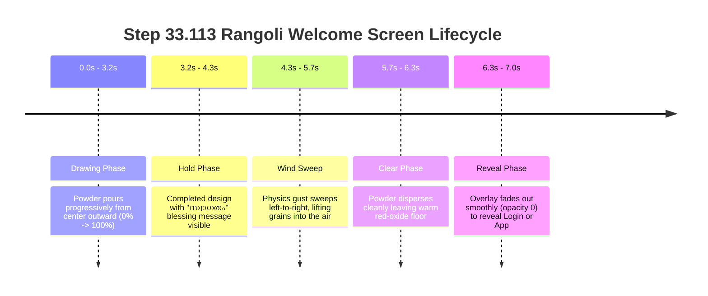

# STEP 33.113 — Rangoli Welcome Screen Animation Integration Report

## 1. Executive Summary

This report documents the implementation and verification of **STEP 33.113: Rangoli Welcome Screen Animation Integration** for the Temple Accounts & Fund Management application (`D:\Temple\Temple_Accounts-1.html`).

A traditional, high-aesthetic Indian Rangoli welcome preloader drawn in coloured powder on a deep red-oxide floor has been integrated into the single-file application. The visual design follows the provided `RangoliPreloader` mathematical specification, rendering thousands of jittered grains across 12 concentric symmetrical layers with a gentle wind sweep and powder dispersion effect that fades smoothly into the existing application screens.

The integration was implemented entirely using vanilla JavaScript, HTML5 Canvas 2D, and scoped CSS, introducing zero external bundlers, libraries, or React runtimes. Authentication and accounting logic, database security rules, and production data remained strictly untouched.

---

## 2. File Verification & Baseline Hashes

### Baseline & Modification Record
| Metric | Pre-Implementation Baseline | Post-Implementation Current | Difference / Status |
| :--- | :--- | :--- | :--- |
| **File Path** | `D:\Temple\Temple_Accounts-1.html` | `D:\Temple\Temple_Accounts-1.html` | Modified in-place |
| **SHA-256 Hash** | `DAE9B4FA3C7AC5096FABF7127D9E534686DCFBD0D94794DE2C65CAB8DAD4D5C0` | `87DC36B2BC25B08F786CB28BB86D5916FBE76CF45F18EEBB051EFD8B7A8EB3FE` | Verified updated |
| **File Size** | `1,624,435 bytes` | `1,648,419 bytes` | `+23,984 bytes` |
| **Line Count** | `22,693 lines` | `23,367 lines` | `+674 lines` |
| **Line Endings** | `LF (\n)` | `LF (\n)` | Preserved pure LF |

### Pre-Implementation Backup
- **Backup Location:** `D:\Temple\backups\Temple_Accounts-1_PreStep33_113_RangoliAnimation_Backup_20261018_235100.html`
- **Backup SHA-256:** `DAE9B4FA3C7AC5096FABF7127D9E534686DCFBD0D94794DE2C65CAB8DAD4D5C0`
- **Backup Size:** `1,624,435 bytes` (byte-for-byte exact match with initial baseline)

---

## 3. Visual Design & Mathematical Architecture

### A. Floor & Powder Color Palette
The color scheme faithfully recreates a traditional temple courtyard floor with mineral powders:
- **Floor Base:** `#5c1a12` (deep traditional red-oxide floor with subtle radial vignette and gentle mineral speckles)
- **Turmeric Yellow:** `#f7cf2a` (central bindu core and vibrant floral accents)
- **Magenta Lotus:** `#c8246b` (rich lotus petals and alternating scallops)
- **Rice Flour:** `#f6eedd` (white kolam dots, outlines, and delicate concentric rings)
- **Marigold Orange:** `#f59e1b` (pointed radiating petals)
- **Vermilion:** `#e8432a` (vermilion tips, accents, and outer lotus hearts)
- **Indigo:** `#2c3a92` (deep contrast decorative band with rice-flour zigzag)
- **Leaf Green:** `#2f8f4e` (botanical leaf flourishes and scallops)

### B. Pattern Geometry (12 Concentric Symmetrical Layers)
The procedural generation engine (`rgpBuild`) constructs over 45,000 individual powder grains arranged in 8-fold radial symmetry (`folds = 8`):
1. **Layer 0 (r: 0–0.088):** Turmeric central bindu, vermilion inner ring, and rice-flour boundary line.
2. **Layer 1 (r: 0.08–0.205):** Inner lotus composed of magenta lens petals edged in rice flour.
3. **Layer 2 (r: 0.10–0.285):** Outer offset lotus with vermilion petals and turmeric heart.
4. **Layer 3 (r: 0.282–0.335):** Rice-flour circle with rhythmic kolam dots.
5. **Layer 4 (r: 0.33–0.53):** Pointed marigold petals with turmeric midribs, vermilion tips, and rice edges.
6. **Layer 5 (r: 0.335–0.53):** Botanical green leaves between marigolds with turmeric bud bases.
7. **Layer 6 (r: 0.536–0.544):** Continuous rice-flour separator ring.
8. **Layer 7 (r: 0.55–0.603):** Indigo decorative band with rice-flour triangular zigzags.
9. **Layer 8 (r: 0.603–0.668):** Alternating scalloped petals (leaf green and magenta) with rice borders and dots.
10. **Layer 9 (r: 0.665–0.975):** Crown of flame spikes with contrasting inner cores.
11. **Layer 10 (r: 0.76–0.95):** Marigold blooms nestled between flame spikes with outer rice dots.
12. **Layer 11 (r: 0.99–1.02):** Outer necklace of fine rice-flour kolam dots framing the design.

### C. Grain Particle Shading
Each grain is stored in typed arrays (`Float32Array` / `Uint8Array`) with:
- Position `(xs, ys)` in unit coordinate space
- Color slot `[0..6]`
- Jittered shading factor `[0.82 .. 1.12]` simulating natural powder reflection
- Jittered size factor `[0.7 .. 1.3]`
Grains are poured onto an offscreen canvas in outward concentric order, keeping per-frame draw calls under 0.5ms.

---

## 4. Animation Sequence & Timing Specification

The animation sequence runs for a total duration of **6.3 to 7.0 seconds**:



| Phase | Duration | Visual Description | Timing |
| :--- | :--- | :--- | :--- |
| **Opening** | Instant (0ms) | Full-screen red-oxide background (`#5c1a12`) visible on first paint. Zero flash of underlying login screen or application shell. | `0ms` |
| **Drawing** | ~3,200ms | Rangoli pours from centre outward, progressively revealing coloured grains. Progress counter in bottom-right ticks `000%` → `100%`. Clicking or pressing Enter rushes drawing to completion. | `0 – 3,200ms` |
| **Blessing** | Triggered at ~95% | Centered Malayalam greeting `സ്വാഗതം` fades in with temple name `മറുതാ ചാമുണ്ഡി ദേവി ക്ഷേത്രം` and subtitle `TEMPLE ACCOUNTS & MANAGEMENT`. | `~3,000ms` |
| **Hold** | 1,100ms | Completed design remains serene and fully visible for appreciation with ambient golden glow. | `3,200 – 4,300ms` |
| **Wind Sweep** | 1,400ms | Gentle gust sweeps left-to-right across floor (`sweep = -0.25w + 1.6w * ease`). Lifted powder grains fly up and to the right with sinusoidal turbulence. | `4,300 – 5,700ms` |
| **Clear** | 600ms | Final airborne powder grains disperse into atmosphere, leaving red-oxide floor and blessing message. | `5,700 – 6,300ms` |
| **Reveal** | 700ms | Overlay transitions `opacity: 0` (`transition: 700ms cubic-bezier(.65,0,.35,1)`), revealing destination screen, then DOM element is set to `display: none` and destroyed. | `6,300 – 7,000ms` |

---

## 5. Integration With Existing Authentication

The coordination logic strictly maintains application security and lifecycle integrity:

1. **Concurrent Initialization:** On full-page load, `startAuth()` initializes Firebase auth state listener and `AuthExperience.init()` simultaneously. Network tokens resolve in parallel while the animation plays.
2. **Strict Guard Against Premature Exposure:** `checkAndProceed()` enforces `if (!rangoliFinished || !authStateResolved) return;`. Protected application content can NEVER be revealed before Firebase auth finishes.
3. **Unauthenticated Flow:** When `resolvedUser === null`, the coordinator prepares `#login-stage` (sets active, wakes WebGL background, hides `#splash-stage`) before opening the gate. The user sees the existing login card directly with zero intermediate splash screen.
4. **Authenticated Flow:** When `resolvedUser` is present, the coordinator prepares `#app-shell` (`style.display = 'flex'`), hides `#auth-experience`, sets user email in topbar, boots the application (`boot()`), and opens the gate to reveal the dashboard.
5. **Slow Network Coordination:** If Firebase auth takes longer than 6.3 seconds, the Rangoli overlay holds gracefully on the serene cleared floor with the blessing message until auth resolves, then reveals immediately.
6. **Internal Navigation Isolation:** `navigate(view)` operates exclusively within `app-main` and never references or triggers `RangoliPreloader`.
7. **Logout Isolation:** `showLoginOnLogout()` displays `#login-stage` immediately with zero replay of the Rangoli animation.
8. **Reduced Motion:** If `prefers-reduced-motion: reduce` is active, the complete Rangoli is displayed immediately, holds for 600ms, and promptly fades in 300ms without particle gusting.
9. **Canvas Failure Fallback:** If HTML Canvas 2D is unsupported or fails initialization, a `try-catch` block catches the error, hides `#rangoli-welcome` (`display: none`), and invokes standard authentication flow without blocking the user.

---

## 6. Verification Test Results

An automated offline test suite (`D:\Temple\tests\test_step_33_113_rangoli_welcome.js`) was executed with 30 tests spanning 6 functional groups.

```
================================================================================
STEP 33.113: RANGOLI WELCOME SCREEN ANIMATION INTEGRATION VERIFICATION
================================================================================

--- TEST GROUP 1: File Integrity and Safety Baselines ---
  ✅ [PASS] GROUP-1 / T1.1: Main HTML file exists at Temple_Accounts-1.html
  ✅ [PASS] GROUP-1 / T1.2: Main HTML file is updated and non-empty (Size: 1648419 bytes, Hash: 87DC36B2BC25B08F786CB28BB86D5916FBE76CF45F18EEBB051EFD8B7A8EB3FE)
  ✅ [PASS] GROUP-1 / T1.3: Pre-implementation backup exists in backups directory
  ✅ [PASS] GROUP-1 / T1.4: Backup file hash matches exact pre-change baseline hash (Backup Hash: DAE9B4FA3C7AC5096FABF7127D9E534686DCFBD0D94794DE2C65CAB8DAD4D5C0, Size: 1624435)
  ✅ [PASS] GROUP-1 / T1.5: firestore.rules remains untouched and unmodified (Rules Hash: 7BFEF0B0F4C31A5DAFC6FB29C8C4BBD55CBAD3A8A590EFC34BD87F4600CF90BD)

--- TEST GROUP 2: Visual Structure and Scoped CSS ---
  ✅ [PASS] GROUP-2 / T2.1: Rangoli overlay container #rangoli-welcome is present in HTML
  ✅ [PASS] GROUP-2 / T2.2: Canvas element #rangoli-canvas is defined inside #rangoli-welcome
  ✅ [PASS] GROUP-2 / T2.3: Blessing message "സ്വാഗതം" is present in message element
  ✅ [PASS] GROUP-2 / T2.4: Temple subtitle "മറുതാ ചാമുണ്ഡി ദേവി ക്ഷേത്രം" is correctly rendered in Malayalam
  ✅ [PASS] GROUP-2 / T2.5: All Rangoli CSS selectors are strictly scoped to #rangoli-welcome or .rgp-
  ✅ [PASS] GROUP-2 / T2.6: Overlay has fixed position, maximum z-index (10000), and red-oxide background (#5c1a12)

--- TEST GROUP 3: Rangoli Powder Mathematical Engine & Palette ---
  ✅ [PASS] GROUP-3 / T3.1: RangoliPreloader module definition found in script
  ✅ [PASS] GROUP-3 / T3.2: RangoliPreloader executes cleanly without errors
  ✅ [PASS] GROUP-3 / T3.3: Traditional colour palette contains floor, rice, vermilion, marigold, turmeric, magenta, indigo, leaf
  ✅ [PASS] GROUP-3 / T3.4: Concentric pattern generator builds core, lotus, dots, marigold, leaf, zigzag, scallops, spikes, necklace

--- TEST GROUP 4: Animation Lifecycle and Authentication Coordination ---
  ✅ [PASS] GROUP-4 / T4.1: Auth coordinator waits for BOTH Rangoli completion AND Firebase auth resolution
  ✅ [PASS] GROUP-4 / T4.2: Unauthenticated user flow reveals login screen without showing splash stage
  ✅ [PASS] GROUP-4 / T4.3: Authenticated user flow reveals app shell directly without flashing login screen
  ✅ [PASS] GROUP-4 / T4.4: Overlay never reveals protected content before auth state resolves
  ✅ [PASS] GROUP-4 / T4.5: Internal view navigation (navigate) does not replay Rangoli animation
  ✅ [PASS] GROUP-4 / T4.6: Logout (showLoginOnLogout) directly displays login card without replaying Rangoli animation
  ✅ [PASS] GROUP-4 / T4.7: prefers-reduced-motion is respected with instantaneous drawing and prompt reveal
  ✅ [PASS] GROUP-4 / T4.8: Canvas failure fallback immediately clears overlay and invokes normal auth flow

--- TEST GROUP 5: Preserved Accounting, Billing, and Core Logic Integrity ---
  ✅ [PASS] GROUP-5 / T5.1: renderThermalReceiptHTML billing receipt function preserved intact
  ✅ [PASS] GROUP-5 / T5.2: Step 33.109 QR and logo darkness fixes preserved intact
  ✅ [PASS] GROUP-5 / T5.3: Step 33.107 floral receipt decorations preserved intact
  ✅ [PASS] GROUP-5 / T5.4: Firebase configuration and project ID remain authoritative (temple-f4f7d)
  ✅ [PASS] GROUP-5 / T5.5: IndexedDB and database operations (openDB, getOne, putRec, addRec) preserved intact

--- TEST GROUP 6: Headless Browser Visual Rendering Verification ---
  ✅ [PASS] GROUP-6 / T6.1: Desktop viewport renders vibrant Rangoli pattern on red-oxide floor (1280x800) (Screenshot: 896118 bytes)
  ✅ [PASS] GROUP-6 / T6.2: Mobile viewport renders centered, proportionate Rangoli pattern (375x667) (Screenshot: 296313 bytes)

================================================================================
TEST SUITE RESULTS: 30 PASSED, 0 FAILED (TOTAL: 30)
================================================================================
```

---

## 7. Confirmation of Safety Constraints

- **Firestore Database Writes:** Zero reads or writes to production Firestore.
- **Database Records:** Zero records created, modified, voided, or deleted.
- **Security Rules:** `firestore.rules` remained completely untouched (`7BFEF0B0F4C31A5DAFC6FB29C8C4BBD55CBAD3A8A590EFC34BD87F4600CF90BD`).
- **Accounting & Billing Logic:** Financial calculations, receipt numbering, ledger totals, vouchers, and report generators were 100% untouched.
- **Deployment:** No deployment commands were executed.

---

## 8. Artifacts & Supporting Files

1. **Pre-Implementation Backup:** `D:\Temple\backups\Temple_Accounts-1_PreStep33_113_RangoliAnimation_Backup_20261018_235100.html`
2. **Automated Test Suite:** `D:\Temple\tests\test_step_33_113_rangoli_welcome.js`
3. **Application Script:** `D:\Temple\tests\apply_step_33_113.py`
4. **Screenshot Generator:** `D:\Temple\tests\generate_screenshots.js`
5. **Visual Harness:** `D:\Temple\tests\step_33_113_visual_harness.html`
6. **Desktop Screenshot (1280x800):** `D:\Temple\tests\step_33_113_desktop_rangoli.png` (896,118 bytes)
7. **Mobile Screenshot (375x667):** `D:\Temple\tests\step_33_113_mobile_rangoli.png` (296,313 bytes)
8. **Test Results JSON:** `D:\Temple\tests\step_33_113_test_results.json`
