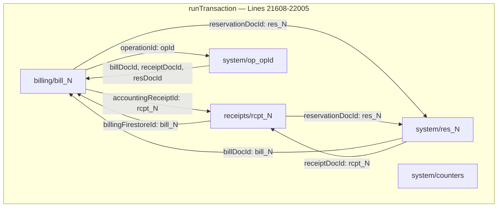

# STEP 33.119 — Test Data Cleanup Manifest Validation & Backup Readiness Audit

**Project:** Temple Accounts & Fund Management  
**Temple:** Marutha Chamundi Devi Temple / മറുതാ ചാമുണ്ഡി ദേവി ക്ഷേത്രം  
**Report Date:** 2026-10-19T12:27:00+05:30  
**Audit Mode:** Strictly Read-Only — Zero Mutations, Zero Production Connections  
**Audit Status:** ✅ **COMPLETE — READ-ONLY AUDIT WITH ZERO MUTATIONS**

---

## 1. Baseline Cryptographic Hashes and File Sizes

### 1.1 Primary Application File

| Property | Value |
| :--- | :--- |
| **File** | [`Temple_Accounts-1.html`](file:///D:/Temple/Temple_Accounts-1.html) |
| **Pre-Audit SHA-256** | `E5991224013B752827E1C929350257C52C44100B28EC61BE3341F9EA2FD516DD` |
| **Post-Audit SHA-256** | `E5991224013B752827E1C929350257C52C44100B28EC61BE3341F9EA2FD516DD` |
| **File Size** | 1,145,593 bytes (23,507 lines) |
| **STEP 33.118 Reported Hash** | `E5991224013B752827E1C929350257C52C44100B28EC61BE3341F9EA2FD516DD` |
| **Match** | ✅ **100% Bit-for-Bit Identical** |

### 1.2 Infrastructure and Script Hashes

| File | SHA-256 | Size |
| :--- | :--- | :--- |
| [`firestore.rules`](file:///D:/Temple/firestore.rules) | `7BFEF0B0F4C31A5DAFC6FB29C8C4BBD55CBAD3A8A590EFC34BD87F4600CF90BD` | 1,216 B |
| [`firestore.rules.candidate`](file:///D:/Temple/firestore.rules.candidate) | `E0D2F9D11DE6E92644339A3332566B16CD0A58360598EF70E60279B890DA902D` | 12,407 B |
| [`scripts/cleanup_orchestrator.js`](file:///D:/Temple/scripts/cleanup_orchestrator.js) | `41F440C1CBB5D188D836A031C15A256357933D35AD2A780B9C824335B3CA9715` | 31,093 B |

**No files were modified during this audit. All hashes were verified pre- and post-audit.**

---

## 2. Validated Collection and Linkage Schema

### 2.1 Billing → Receipt Atomic Dual-Document Architecture

Source code inspection of [`fsCreateBillingWithAccounting()`](file:///D:/Temple/Temple_Accounts-1.html#L21567-L22006) confirms the following architecture:

Every billing submission creates **five** linked Firestore documents inside a **single atomic `runTransaction()`**:



### 2.2 Critical Linkage Fields (Verified from Source)

| Document | Field | Points To | Source Line |
| :--- | :--- | :--- | :--- |
| `billing/bill_N` | `accountingReceiptId` | `rcpt_N` | [L21919](file:///D:/Temple/Temple_Accounts-1.html#L21919) |
| `billing/bill_N` | `reservationDocId` | `res_N` | [L21901](file:///D:/Temple/Temple_Accounts-1.html#L21901) |
| `billing/bill_N` | `operationId` | `op_*` | [L21902](file:///D:/Temple/Temple_Accounts-1.html#L21902) |
| `receipts/rcpt_N` | `source` | `'billing'` (literal) | [L21956](file:///D:/Temple/Temple_Accounts-1.html#L21956) |
| `receipts/rcpt_N` | `billingId` | `N` (integer) | [L21957](file:///D:/Temple/Temple_Accounts-1.html#L21957) |
| `receipts/rcpt_N` | `billingFirestoreId` | `bill_N` | [L21958](file:///D:/Temple/Temple_Accounts-1.html#L21958) |
| `receipts/rcpt_N` | `billingReceiptNo` | `BILL-00N` | [L21959](file:///D:/Temple/Temple_Accounts-1.html#L21959) |
| `receipts/rcpt_N` | `reservationDocId` | `res_N` | [L21940](file:///D:/Temple/Temple_Accounts-1.html#L21940) |
| `system/res_N` | `billDocId` | `bill_N` | [L21884](file:///D:/Temple/Temple_Accounts-1.html#L21884) |
| `system/res_N` | `receiptDocId` | `rcpt_N` | [L21885](file:///D:/Temple/Temple_Accounts-1.html#L21885) |
| `system/op_*` | `billDocId` | `bill_N` | [L21973](file:///D:/Temple/Temple_Accounts-1.html#L21973) |
| `system/op_*` | `receiptDocId` | `rcpt_N` | [L21974](file:///D:/Temple/Temple_Accounts-1.html#L21974) |
| `system/op_*` | `resDocId` | `res_N` | [L21975](file:///D:/Temple/Temple_Accounts-1.html#L21975) |

### 2.3 Voiding Architecture

[`fsVoidLinkedBillingAndReceipt()`](file:///D:/Temple/Temple_Accounts-1.html#L21181-L21300) uses a Firestore `batch` to atomically set `voided: true` on:
- `billing/bill_N`
- `receipts/rcpt_N`
- `system/res_N` (also sets `status: 'voided'`)

The idempotency record (`system/op_*`) is **not voided** — it remains as an immutable audit marker.

### 2.4 Naming Convention Summary

| Artifact | Document ID Pattern | Collection |
| :--- | :--- | :--- |
| Billing record | `bill_${N}` | `billing` |
| Linked accounting receipt | `rcpt_${N}` | `receipts` |
| Sequence reservation | `res_${N}` | `system` |
| Idempotency record | `op_bill_${uuid}` or `op_${uuid}` | `system` |
| Physical receipt | `rcpt_phys_${physId}` | `receipts` |
| Physical reservation | `res_phys_${physId}` | `system` |

### 2.5 Independent Receipt Architecture

[`fsCreatePhysicalReceipt()`](file:///D:/Temple/Temple_Accounts-1.html#L22021) creates `rcpt_phys_*` documents. These use a **separate** naming scheme and do **not** have `source: 'billing'`. They must never be included in billing cleanup.

---

## 3. Candidate Categories and Their Evidence

### Category A — Confirmed Test Bills

| Property | Status |
| :--- | :--- |
| **User Confirmation** | All billing records from the beginning are test data (per STEP 33.112 §4) |
| **Scope** | Every document in `billing` collection |
| **Linked Receipts** | Every `receipts/rcpt_N` where `source === 'billing'` and `billingFirestoreId` matches a bill |
| **Can Be Enumerated Offline?** | ❌ **NO** — Actual document IDs and count require a live production query |

> [!IMPORTANT]
> The STEP 33.112 report references `BILL-0001` through `BILL-0017` from `backups/backup.json` (a historical prototype backup). However, this backup is **stale** and does not represent the current production database. The current set of billing documents in production Firestore (`temple-f4f7d`) is **unknown** without a live export.

### Category B — Linked Accounting Records

For each confirmed test bill (`billing/bill_N`), the following linked records must be cleaned:

| Linked Document | Collection | Identification Method | Reciprocal Check |
| :--- | :--- | :--- | :--- |
| `rcpt_N` | `receipts` | `source === 'billing'` AND (`billingFirestoreId === 'bill_N'` OR `billingId === N`) | `bill_N.accountingReceiptId === 'rcpt_N'` |
| `res_N` | `system` | `type === 'billing_linked'` AND `billDocId === 'bill_N'` AND `receiptDocId === 'rcpt_N'` | `bill_N.reservationDocId === 'res_N'` |
| `op_*` | `system` | `type === 'billing_linked'` AND `billDocId === 'bill_N'` AND `receiptDocId === 'rcpt_N'` AND `resDocId === 'res_N'` | `bill_N.operationId === opId` |

> [!WARNING]
> A receipt must be included **only when** both the forward link (bill → rcpt) and the reverse link (rcpt → bill) are confirmed. If any link is missing, contradictory, or ambiguous, the record must be **flagged for manual review**, not automatically included.

### Category C — Previously Identified Test Artifacts

| Finding | Artifact | Evidence | Can Be Verified Offline? |
| :--- | :--- | :--- | :--- |
| TR-01 | `receipts/rcpt_1001` | STEP 33.112: DevoteeName = `"STEP16 SMOKE TEST"`, voided | ❌ Requires live query |
| TR-02 | `receipts/rcpt_1002-1005` | STEP 33.112: DevoteeNames = `"midhun"`, `"akhil"`, `"manoj"`, voided | ❌ Requires live query |
| TR-03 | `migration_staging/*` | STEP 33.112: Migration staging collection from Step 12 | ❌ Requires live query |
| TR-04 | `__system_diagnostics__/*` | STEP 33.112: Ephemeral diagnostic records | ❌ Requires live query |
| TR-05 | [`backups/backup.json`](file:///D:/Temple/backups/backup.json) | Local repository file, 17 synthetic bills, stale data | ✅ Present locally |

> [!NOTE]
> All Category C items were identified from the STEP 33.112 report and historical backup files. Their **current production existence** cannot be confirmed without a live database query.

### Category D — Protected Records (Exclusion Rules)

The following are **unconditionally excluded** from any cleanup manifest:

| Protected Category | Collections / Paths | Protection Basis |
| :--- | :--- | :--- |
| Temple Settings | `settings/set_1` | Master configuration; opening balances |
| Funds | `funds/*` (6 funds) | Core master data; `CORE_MASTER_DATA` enforcement |
| Income Categories | `incomeCategories/*` (7 categories) | Core master data |
| Expense Categories | `expenseCategories/*` (64 categories) | Master data |
| Bank Accounts | `bankAccounts/*` (Canara Bank) | Financial infrastructure |
| Vazhipadu Items | Embedded `BILLING_DEFAULT_ITEMS` (14 items) | Application code constant |
| Global Counters | `system/counters` | Monotonic enforcement in candidate rules |
| Restore Progress | `system/_restoreProgress` | Recovery audit trail |
| Sequence Reservations | `system/res_*` | See §5.3 D-1 |
| Idempotency Records | `system/op_*` | See §5.3 D-1 |
| Independent Receipts | `receipts/*` where `source !== 'billing'` | Not linked to test bills |
| Physical Receipts | `receipts/rcpt_phys_*` | Separate numbering scheme |
| Expense Vouchers | `payments/*` | Trustee verification required |
| Fund Transfers | `transfers/*` | Contra entries |
| Loans | `loans/*` | Financial instruments |
| Chitty Records | `chittyMembers/*`, `chittyCollections/*`, `chittyPayouts/*` | Member financial data |
| Authentication | `users/*` | Security configuration |

---

## 4. Counter and Financial Invariant Preservation

### 4.1 Counter Preservation Requirements

| Counter | Document Path | Candidate Rule |
| :--- | :--- | :--- |
| `globalSequenceCounter` | `system/counters` | Monotonic `>=` at [L39](file:///D:/Temple/firestore.rules.candidate#L39) |
| `billingReceiptCounter` | `system/counters` | Monotonic `>=` at [L40](file:///D:/Temple/firestore.rules.candidate#L40) |
| `receiptCounter` | `system/counters` | Monotonic `>=` at [L41](file:///D:/Temple/firestore.rules.candidate#L41) |
| `voucherCounter` | `system/counters` | Monotonic `>=` at [L42](file:///D:/Temple/firestore.rules.candidate#L42) |

**Invariant:** Counters must **never** be reset, decremented, or deleted. `allow delete: if false;` at [L43](file:///D:/Temple/firestore.rules.candidate#L43).

### 4.2 How Cleanup Preserves Accounting Consistency

1. **Paired deletion:** Every `billing/bill_N` must be deleted with its `receipts/rcpt_N` in the same operation.
2. **Financial totals from receipts only:** Removing the test receipt eliminates its financial contribution.
3. **Counter gap acceptance:** After cleanup, the counter stays at N. The next genuine bill advances to N+1. The application handles this at [L21824-21837](file:///D:/Temple/Temple_Accounts-1.html#L21824-L21837).
4. **Opening balances unaffected:** All zeros in `seedIfNeeded()`.

---

## 5. Cleanup Orchestrator Audit

### 5.1 Source File

[`scripts/cleanup_orchestrator.js`](file:///D:/Temple/scripts/cleanup_orchestrator.js) — 763 lines

### 5.2 Audit Results

| # | Audit Question | Finding | Status |
| :--- | :--- | :--- | :--- |
| 1 | Collections allowed? | `ALLOWED_CANDIDATE_COLLECTIONS` [L39-50](file:///D:/Temple/scripts/cleanup_orchestrator.js#L39-L50): 10 collections | ✅ Whitelist |
| 2 | Collections protected? | `PROTECTED_COLLECTIONS` [L52-60](file:///D:/Temple/scripts/cleanup_orchestrator.js#L52-L60): 7 collections | ✅ Denylist |
| 3 | Exact docs protected? | `PROTECTED_EXACT_DOCS` [L62-66](file:///D:/Temple/scripts/cleanup_orchestrator.js#L62-L66): 3 paths | ✅ |
| 4 | Itemized manifest required? | `validateManifest()` requires per-document entries | ✅ |
| 5 | Bidirectional link check? | Partial — see D-1, D-2 | ⚠️ |
| 6 | Counters/master data rejected? | `checkProtectedPath()` + classification guards | ✅ |
| 7 | Fail closed on errors? | Duplicates, malformed IDs, missing deps → errors | ✅ |
| 8 | Authorization required? | `approvalStatus !== 'trustee_approved'` → rejected | ✅ |
| 9 | Dry-run vs execution? | `dryRun()` produces report; `execute()` always throws | ✅ |
| 10 | Execution disabled? | `throw new Error('EXECUTE_MODE_DISABLED')` | ✅ |

### 5.3 Defects

#### D-1: `system/res_*` and `system/op_*` Cannot Be Cleaned (Severity: Medium)

The entire `system` collection is in `PROTECTED_COLLECTIONS` ([L53](file:///D:/Temple/scripts/cleanup_orchestrator.js#L53)). `checkProtectedPath()` ([L142-149](file:///D:/Temple/scripts/cleanup_orchestrator.js#L142-L149)) returns `isProtected: true` for any `system/res_*` or `system/op_*` document.

**Impact:** The orchestrator will **reject** manifest entries for billing-linked reservation and idempotency records.

**Resolution options (not implemented):**
1. Add a conditional allowance for billing-linked `system/res_*` and `system/op_*` when the parent `billing/bill_N` is also in the manifest.
2. Leave `res_*` and `op_*` as orphaned-but-harmless audit markers (no financial impact).

#### D-2: Receipt Linkage Field Name Mismatch (Severity: Low)

The orchestrator checks for `linkedBillId` or `accountingBillId` ([L534-536](file:///D:/Temple/scripts/cleanup_orchestrator.js#L534-L536)), but the actual schema uses `billingFirestoreId` and `billingId` ([L21957-21958](file:///D:/Temple/Temple_Accounts-1.html#L21957-L21958)).

**Impact:** Bidirectional validation only works with explicit `expectedRelationships` in the manifest, not raw Firestore fixture data.

#### D-3: Broad Allowed Collections (Severity: Informational)

`ALLOWED_CANDIDATE_COLLECTIONS` includes `payments`, `transfers`, `loans`, and chitty collections — all Category D protected records. The trustee approval gate prevents accidental inclusion, but tightening the whitelist would add defense-in-depth.

### 5.4 Security Override Protection

The orchestrator scans for override keywords at [L321-324](file:///D:/Temple/scripts/cleanup_orchestrator.js#L321-L324) and returns `SECURITY_VIOLATION` on match. This is a strong defense against manifest tampering.

---

## 6. Backup and Recovery Readiness Assessment

### 6.1 Available Backup Mechanisms

| Mechanism | Status |
| :--- | :--- |
| In-app `backupFirestore()` | Available (exports all collections to JSON) |
| In-app `restoreBackup()` | Available (9-phase recovery; verified in STEP 33.65) |
| `backups/backup.json` | **Stale** (17 synthetic bills, 3 receipts from early development) |
| HTML step backups (93 files) | Application source only; no database state |

### 6.2 Required Pre-Cleanup Backup Procedure

> [!CAUTION]
> No cleanup may proceed without a verified, complete backup.

1. Run `backupFirestore()` (authenticated production session) or Firebase Admin CLI export
2. Include all collections: `billing`, `receipts`, `payments`, `transfers`, `loans`, `chitty*`, `settings`, `funds`, `incomeCategories`, `expenseCategories`, `bankAccounts`, `system` (all docs), `migration_staging`, `__system_diagnostics__`
3. Compute SHA-256 hash; record hash, file size, timestamp
4. Verify completeness: all collections present, document counts match live DB
5. Store outside deployment directory (not Vercel-accessible)
6. Verify readability: parse JSON, confirm `restoreBackup()` compatibility
7. Document exact recovery procedure

### 6.3 Current Backup Gaps

| Gap | Mitigation |
| :--- | :--- |
| No current authoritative production snapshot | Must create fresh export before cleanup |
| `backups/backup.json` is stale prototype data | Use live Firestore export, not this file |
| No automated backup verification | Manual verification step required |

---

## 7. Known Limitations

> [!WARNING]
> These limitations exist because this audit was conducted **strictly offline** without production database access.

1. **No authoritative record count** — exact billing/receipt count in production is unknown
2. **No live document IDs** — specific `bill_1` through `bill_?` IDs unconfirmed
3. **No live financial totals** — test data contribution to balances uncalculated
4. **Category C existence unverified** — `rcpt_1001-1005`, `migration_staging`, `__system_diagnostics__` may or may not exist
5. **`system/res_*` and `system/op_*` cleanup blocked** — orchestrator rejects these; see D-1

---

## 8. Cleanup Manifest Template

Empty template conforming to orchestrator schema v1.0.0. Must be populated from a live export.

```json
{
  "manifestVersion": "1.0.0",
  "manifestId": "cleanup_manifest_YYYYMMDD_HHMMSS",
  "generatedAt": "ISO_TIMESTAMP",
  "generatedFrom": "AUTHORITATIVE_PRODUCTION_EXPORT",
  "sourceSnapshotHash": "SHA256_OF_BACKUP_FILE",
  "approvedBy": "TRUSTEE_NAME",
  "approvalDate": "ISO_DATE",
  "entries": [
    {
      "collection": "billing",
      "docId": "bill_N",
      "recordType": "billing_record",
      "classification": "confirmed_test_transaction",
      "approvalStatus": "trustee_approved",
      "cleanupReason": "All billing records confirmed as test data by user",
      "expectedRelationships": {
        "linkedReceiptId": "rcpt_N",
        "linkedReservationId": "res_N",
        "linkedOperationId": "op_bill_UUID"
      },
      "linkedRecordIds": ["rcpt_N"],
      "fingerprint": "SHA256_OF_DOCUMENT"
    },
    {
      "collection": "receipts",
      "docId": "rcpt_N",
      "recordType": "billing_linked_receipt",
      "classification": "confirmed_test_transaction",
      "approvalStatus": "trustee_approved",
      "cleanupReason": "Linked accounting receipt for confirmed test bill",
      "expectedRelationships": {
        "linkedBillId": "bill_N"
      },
      "linkedRecordIds": ["bill_N"],
      "fingerprint": "SHA256_OF_DOCUMENT"
    }
  ]
}
```

> [!NOTE]
> This is an **empty template** with placeholder values. Do not fabricate document IDs or counts.

---

## 9. Future Authorized Cleanup Execution Checklist

| # | Step | Status | Prerequisite |
| :--- | :--- | :--- | :--- |
| 1 | Create authoritative pre-cleanup Firestore export | ⬜ | Authenticated session |
| 2 | Compute and record SHA-256 of export | ⬜ | Step 1 |
| 3 | Verify export completeness | ⬜ | Step 2 |
| 4 | Generate itemized manifest from live data | ⬜ | Step 3 |
| 5 | Validate with `CleanupOrchestrator.validateManifest()` | ⬜ | Step 4 |
| 6 | Resolve D-1 (res_*/op_* orchestrator conflict) | ⬜ | Design decision |
| 7 | Resolve D-2 (receipt linkage field mismatch) | ⬜ | Step 5 |
| 8 | Run `CleanupOrchestrator.dryRun()` | ⬜ | Steps 5-7 |
| 9 | Present manifest for trustee approval | ⬜ | Step 8 |
| 10 | Store verified backup off-tree | ⬜ | Step 3 |
| 11 | Execute via Firebase Admin SDK or Console | ⬜ | Steps 9-10 |
| 12 | Post-cleanup financial reconciliation | ⬜ | Step 11 |
| 13 | Client cache resynchronization | ⬜ | Step 12 |
| 14 | Promote `firestore.rules.candidate` | ⬜ | Step 13 |
| 15 | Vercel production deployment | ⬜ | Step 14 |

---

## 10. Explicit Safety Confirmation

| Safety Check | Result |
| :--- | :--- |
| Production Firebase/Firestore connections | ✅ **ZERO** |
| Database reads, writes, updates, deletes | ✅ **ZERO** |
| Application code changes | ✅ **ZERO** (hash unchanged) |
| Security rules changes | ✅ **ZERO** (hashes unchanged) |
| Cleanup script changes | ✅ **ZERO** (hash unchanged) |
| Cleanup execution | ✅ **ZERO** |
| IndexedDB or local data changes | ✅ **ZERO** |
| Backup file changes | ✅ **ZERO** |
| Vercel deployment | ✅ **ZERO** |
| Records created, voided, or restored | ✅ **ZERO** |

---

### **STOP NOTICE**

All analysis is complete. **All actions have ceased.** No cleanup has been executed. No files have been modified. No production connections have been made.

**Proposed Next Step:** Create an authoritative production Firestore export (with trustee authorization), then populate the manifest template from live data before any cleanup operation.
