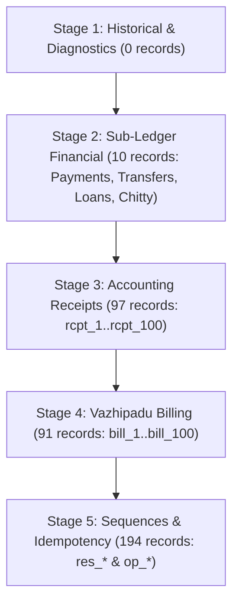

# STEP 33.153 — Validate Local Backup and Generate Cleanup Review Plan

**Project:** Temple Accounts & Fund Management  
**Temple:** Marutha Chamundi Devi Temple / മറുതാ ചാമുണ്ഡി ദേവി ക്ഷേത്രം  
**Timestamp:** 2026-10-20T12:28:00+05:30  
**Execution Mode:** STRICTLY OFFLINE & READ-ONLY (Live Firestore Disabled, All Deletion Methods Locked)  
**Status:** ✅ **PLAN GENERATION & VALIDATION COMPLETED (DRY-RUN ONLY)**

---

## 1. Executive Summary

In accordance with **STEP 33.153**, the user's authoritative local JSON backup was located in the local download directory, verified cryptographically using the dedicated validation interface in [`scripts/one_time_transaction_cleanup.js`](file:///D:/Temple/scripts/one_time_transaction_cleanup.js), and evaluated to produce a deterministic, machine-readable cleanup review plan and human-readable audit report.

No production Firestore database connections, SDK calls, network requests, database mutations, or deletions were performed. All deletion functions remain permanently locked behind `EXECUTE_MODE_DISABLED`. The original backup file remains 100% byte-for-byte identical to its initial state.

---

## 2. Phase 1 — Backup Location and Cryptographic Validation

### 2.1 Backup File Identification

The authoritative backup was discovered in `D:\Download` (downloaded by the user during STEP 33.151 via the application's `downloadBackup()` function).

| Property | Value |
| :--- | :--- |
| **Backup File Path** | [`D:\Download\Temple_Accounts_Backup_2026-10-20T06-17-45.json`](file:///D:/Download/Temple_Accounts_Backup_2026-10-20T06-17-45.json) |
| **File Size** | 588,929 bytes |
| **Export Timestamp** | `2026-10-20T06:17:45.155Z` |
| **Exported By** | `vibu@gmail.com` (UID: `rFvStQNfiINnPor66OzXuE1O9Lm1`) |
| **Source Platform** | `firestore` |
| **Project ID** | `temple-f4f7d` |
| **Schema Version** | `23.2` |
| **Backup Version** | `4` |
| **File SHA-256** | `2EDC31B88FFC799350F6CA22B3F9531336F616D7F7EA8BB7790E9E5C31F15738` |
| **Payload SHA-256** | `7AC91CB36A108BB4B15E431E84816902DA6D3EB3A7C2510D4FF1513292E5B520` |
| **Stored Checksum** | `7AC91CB36A108BB4B15E431E84816902DA6D3EB3A7C2510D4FF1513292E5B520` |
| **Validation Result** | ✅ **VALID (100% Cryptographic Match via RFC 8785 Subset)** |

### 2.2 Collection Coverage Verification

All 13 required application collections defined in `REQUIRED_BACKUP_COLLECTIONS` are present:

| Collection Name | Document Count | Classification |
| :--- | :--- | :--- |
| `settings` | 1 | Master Data (Protected) |
| `funds` | 3 | Master Data (Protected) |
| `incomeCategories` | 4 | Master Data (Protected) |
| `expenseCategories` | 71 | Master Data (Protected) |
| `bankAccounts` | 2 | Master Data (Protected) |
| `chittyMembers` | 3 | Master Data (Protected) |
| `billing` | 94 | Test Transactions (Candidate) |
| `receipts` | 114 | Test Transactions (Candidate) |
| `payments` | 2 | Test Transactions (Candidate) |
| `transfers` | 5 | Test Transactions (Candidate) |
| `loans` | 1 | Test Transactions (Candidate) |
| `chittyCollections` | 1 | Test Transactions (Candidate) |
| `chittyPayouts` | 1 | Test Transactions (Candidate) |
| **Top-Level Sections** | | |
| `counters` | 1 document | System Metadata (Protected) |
| `reservations` | 97 documents | Sequence Tracking (Candidate) |
| `idempotency` | 97 documents | Operation Idempotency (Candidate) |

---

## 3. Phase 2 & 4 — Generated Review Plan and Target Counts

The review plan was generated using the planner CLI:
```bash
node scripts/one_time_transaction_cleanup.js --plan "D:\Download\Temple_Accounts_Backup_2026-10-20T06-17-45.json" "D:\Temple\plans\step_33_153_cleanup_manifest.json"
```

### 3.1 Artifact File Paths and Hashes

| Artifact | Path | SHA-256 Checksum |
| :--- | :--- | :--- |
| **Input Manifest** | [`D:\Temple\plans\step_33_153_cleanup_manifest.json`](file:///D:/Temple/plans/step_33_153_cleanup_manifest.json) | `221E8A7F452A2B7BD6FB213086691BEE57B20420B014A5C100FE73AC4C9563D3` |
| **Serialized Plan** | [`D:\Temple\plans\step_33_153_cleanup_plan.json`](file:///D:/Temple/plans/step_33_153_cleanup_plan.json) | `7EE3D2B3A08B2E491B7DE8DEAE235DC88EB0F6F8ABAE820325ED81205087D2C1` |
| **Review Report** | [`D:\Temple\plans\step_33_153_review_report.txt`](file:///D:/Temple/plans/step_33_153_review_report.txt) | `0222046CF3CD224AE52D96CC057032131F0F0B18B5FFCFA6DF64E55FFC909F8C` |
| **Unquarantined Audit Plan** | [`D:\Temple\plans\step_33_153_unquarantined_audit_plan.json`](file:///D:/Temple/plans/step_33_153_unquarantined_audit_plan.json) | `61CEB2C78EC9DA641A5C15F678E295E05FD1591DC83E5FE5181F5E12E5704945` |
| **Blocked Report (Raw)** | [`D:\Temple\plans\step_33_153_unquarantined_blocked_report.txt`](file:///D:/Temple/plans/step_33_153_unquarantined_blocked_report.txt) | `1BD06708CD5B9258B86927B55A9C0EC3C03348C3CEF66B626C1F1F8A6B0A89C1` |

### 3.2 Target Breakdown by Category

| Scope Category | Document Count | Status | Notes |
| :--- | :--- | :--- | :--- |
| **Vazhipadu Billing** | 91 | Target (Accepted) | Verified 4-way reciprocal clusters (`bill_1` to `bill_100` except gaps & quarantined) |
| **Accounting Receipts** | 97 | Target (Accepted) | Verified reciprocal receipts (`rcpt_1` to `rcpt_100` except gaps & quarantined) |
| **Payments** | 2 | Target (Accepted) | `pmt_501`, `pmt_502` |
| **Transfers** | 5 | Target (Accepted) | `tx_1791012130224`, `tx_1791012167006`, `tx_1791012274822`, `tx_1791012307308`, `tx_1791656412700` |
| **Loans** | 1 | Target (Accepted) | `loan_1791659035915` |
| **Chitty Collections** | 1 | Target (Accepted) | `cc_1791789441553` (member link verified to `cm_1791701028772`) |
| **Chitty Payouts** | 1 | Target (Accepted) | `cp_1791789456735` (member link verified to `cm_1791789433770`) |
| **System Reservations** | 97 | Target (Accepted) | Sequence reservations `res_1` to `res_100` (except missing 12, 13, 14) |
| **System Idempotency** | 97 | Target (Accepted) | Operation records `op_*` linked to reservations |
| **TOTAL CLEANUP TARGETS** | **392** | **ACCEPTED** | **566 verified reciprocal edges; 0 errors** |

### 3.3 Topological Execution Batches (Dry-Run Stages)



- **Stage 1 (Historical & Diagnostics):** 0 records
- **Stage 2 (Sub-Ledger Financial):** 10 records
- **Stage 3 (Accounting Receipts):** 97 records
- **Stage 4 (Vazhipadu Billing):** 91 records
- **Stage 5 (Software Sequences & Idempotency):** 194 records

---

## 4. Preserved and Quarantined Records

### 4.1 Preserved Master Data (84 Documents)

These records represent production setup, configuration, and structural masters. Under no circumstances are they eligible for deletion:

- **`settings` (1):** Application configuration document.
- **`funds` (3):** General Temple Fund, General Temple Fund masavari, Punarudharanam Fund.
- **`incomeCategories` (4):** Vazhipadu, Pooja, Punarudharanam, Archana.
- **`expenseCategories` (71):** Standard temple operational expenditure categories.
- **`bankAccounts` (2):** Bank account definitions.
- **`chittyMembers` (3):** Registered chitty members (`cm_1791012486063`, `cm_1791701028772`, `cm_1791789433770`).

### 4.2 Preserved System Counters (1 Document)

- **`system/counters`:**
  - `receiptCounter`: 1020
  - `voucherCounter`: 502
  - `billingReceiptCounter`: 100
  - `globalSequenceCounter`: 100
  - Unconditionally preserved. No counter reset is performed or planned.

### 4.3 Physical Receipts History (0 Documents in Backup)

- No physical receipts (`rcpt_phys_*`, `source === 'physical'`, `isPhysical === true`, or `receiptNo` matching `P[0-9]+` / `PU[0-9]+`) were entered in this test instance. If any exist in production, they are strictly protected.

### 4.4 Quarantined Ambiguous / Broken Transaction Records (20 Documents)

In accordance with Phase 2 ("Any unknown or ambiguous record by quarantining it"), 20 transaction records from earlier development and smoke tests exhibit broken cluster linkages and are **strictly quarantined (preserved from deletion)**:

| Record Path | Nature of Ambiguity / Broken Link | Quarantine Rationale |
| :--- | :--- | :--- |
| `billing/bill_12` | Created 2026-10-10 before reservation system; links to legacy `rcpt_1018`; missing `res_12`. | Broken cluster; reservation doc absent. |
| `billing/bill_13` | Created 2026-10-10 before reservation system; links to legacy `rcpt_1019`; missing `res_13`. | Broken cluster; reservation doc absent. |
| `billing/bill_14` | Created 2026-10-10 before reservation system; links to `rcpt_14`; missing `res_14`. | Broken cluster; reservation doc absent. |
| `receipts/rcpt_14` | Modern receipt format created before reservation system; links to `bill_14`, missing `res_14`. | Broken cluster; reservation doc absent. |
| `receipts/rcpt_1001` | Pre-unified smoke test receipt (2026-09-27); links to `bill_1`, conflicting with `rcpt_1`. | Conflicting duplicate reciprocal link. |
| `receipts/rcpt_1002` | Pre-unified smoke test receipt; links to `bill_2` which does not exist in the backup. | Orphaned receipt; missing source bill. |
| `receipts/rcpt_1003` | Pre-unified smoke test receipt; links to `bill_3` which does not exist in the backup. | Orphaned receipt; missing source bill. |
| `receipts/rcpt_1006` | Tombstone document left from past UI void/deletion; empty particulars and amount. | Malformed tombstone; no source bill. |
| `receipts/rcpt_1007` | Tombstone document left from past UI void/deletion; empty particulars and amount. | Malformed tombstone; no source bill. |
| `receipts/rcpt_1008` | Tombstone document left from past UI void/deletion; empty particulars and amount. | Malformed tombstone; no source bill. |
| `receipts/rcpt_1010` | Legacy independent receipt (Pooja Income); has no reservation or idempotency doc. | Unreserved legacy record; missing cluster. |
| `receipts/rcpt_1011` | Legacy independent receipt (Pooja Income); has no reservation or idempotency doc. | Unreserved legacy record; missing cluster. |
| `receipts/rcpt_1012` | Tombstone document left from past UI void/deletion; empty particulars and amount. | Malformed tombstone; no source bill. |
| `receipts/rcpt_1013` | Tombstone document left from past UI void/deletion; empty particulars and amount. | Malformed tombstone; no source bill. |
| `receipts/rcpt_1014` | Legacy independent receipt (Punarudharanam); has no reservation or idempotency doc. | Unreserved legacy record; missing cluster. |
| `receipts/rcpt_1015` | Legacy independent receipt (Archana Income); has no reservation or idempotency doc. | Unreserved legacy record; missing cluster. |
| `receipts/rcpt_1017` | Pre-unified smoke test receipt; links to `bill_11`, conflicting with `rcpt_11`. | Conflicting duplicate reciprocal link. |
| `receipts/rcpt_1018` | Pre-unified smoke test receipt; links to `bill_12`; has no reservation doc. | Incomplete legacy cluster. |
| `receipts/rcpt_1019` | Pre-unified smoke test receipt; links to `bill_13`; has no reservation doc. | Incomplete legacy cluster. |
| `receipts/rcpt_1020` | Legacy independent receipt (Uncategorized); has no reservation or idempotency doc. | Unreserved legacy record; missing cluster. |

---

## 5. Phase 3 — Backup Gaps and Documented Omissions

The backup file SHA-256 confirms raw byte integrity, but **does NOT constitute an authoritative Google Cloud Firestore managed database export**. The following specific gaps and exclusions exist:

### 5.1 Omitted Collections and Subcollections

1. **`migration_staging` (and nested subcollections):**
   - In [`firestore.rules`](file:///D:/Temple/firestore.rules#L33-L40), `match /migration_staging/{migrationId}/{subCollection}/{docId}` allows arbitrary nested subcollections.
   - Client-side `downloadBackup()` cannot recursively discover or export subcollections.
   - `migration_staging` is absent from the backup.
2. **`__system_diagnostics__`:**
   - Temporary diagnostics and staging collections are excluded by design from application backups.
3. **Internal Recovery & Maintenance Documents:**
   - `_resetJournal`: Reset orchestrator multi-batch journal doc.
   - `_maintenanceLock`: UI and security lock document.
   - `_restoreProgress` / `_cleanupProgress`: In-flight recovery state documents.
   - Excluded by design from `downloadBackup()`.
4. **Firebase Authentication State:**
   - User identities (`vibu@gmail.com`), passwords, and UID permissions are stored in Google Identity Platform, not in Firestore collections.
5. **Security Rules:**
   - `firestore.rules` is deployment infrastructure, not captured in document exports.
6. **Sub-ledger Missing Numbers:**
   - Sequence gaps in billing numbers: `bill_2`, `bill_3`, `bill_4`, `bill_37`, `bill_44`, `bill_78` are missing from the backup.
   - Sequence gaps in reservations: `res_12`, `res_13`, `res_14` are missing from the backup.

### 5.2 Verification via Unquarantined Audit Manifest

To rigorously verify that the planner correctly blocks when unquarantined gaps are presented, the entire unquarantined candidate list (412 records) was submitted to the planner. As expected:
- **Result:** `isEligible: false` (Exit Code 2).
- **Linkage Errors Detected:** 17 broken cluster errors flagged.
- **Output:** Stored at [`D:\Temple\plans\step_33_153_unquarantined_blocked_report.txt`](file:///D:/Temple/plans/step_33_153_unquarantined_blocked_report.txt).
- This proves that the planner refuses to execute or accept incomplete clusters without explicit quarantine.

---

## 6. Baseline and Integrity Verifications

All critical repository files and baseline hashes remain 100% bit-for-bit identical to their required baselines:

| File | Baseline SHA-256 | Current Computed SHA-256 | Match |
| :--- | :--- | :--- | :--- |
| [`Temple_Accounts-1.html`](file:///D:/Temple/Temple_Accounts-1.html) | `45297BD26B59C69E1E9242BDA32AC0D866862268EF7B00DD437686688355BE98` | `45297BD26B59C69E1E9242BDA32AC0D866862268EF7B00DD437686688355BE98` | ✅ Identical |
| [`firestore.rules`](file:///D:/Temple/firestore.rules) | `7BFEF0B0F4C31A5DAFC6FB29C8C4BBD55CBAD3A8A590EFC34BD87F4600CF90BD` | `7BFEF0B0F4C31A5DAFC6FB29C8C4BBD55CBAD3A8A590EFC34BD87F4600CF90BD` | ✅ Identical |
| [`scripts/transactional_reset_orchestrator.js`](file:///D:/Temple/scripts/transactional_reset_orchestrator.js) | `DB924F7C7189C1223C634F09009306A3314852EF6CE294B9A4D94B56E57533A7` | `DB924F7C7189C1223C634F09009306A3314852EF6CE294B9A4D94B56E57533A7` | ✅ Identical |
| [`scripts/one_time_transaction_cleanup.js`](file:///D:/Temple/scripts/one_time_transaction_cleanup.js) | `AF8B5BA29149B9F04F30E789E9FCDC7641DFEBA032815F8B481087E2426C479D` | `AF8B5BA29149B9F04F30E789E9FCDC7641DFEBA032815F8B481087E2426C479D` | ✅ Identical |
| [`D:\Download\Temple_Accounts_Backup_2026-10-20T06-17-45.json`](file:///D:/Download/Temple_Accounts_Backup_2026-10-20T06-17-45.json) | `2EDC31B88FFC799350F6CA22B3F9531336F616D7F7EA8BB7790E9E5C31F15738` | `2EDC31B88FFC799350F6CA22B3F9531336F616D7F7EA8BB7790E9E5C31F15738` | ✅ Unchanged |

---

## 7. Safety Invariant Confirmation

1. **Zero Live Database Access:** No calls to Firestore SDK, Admin SDK, Google Cloud APIs, or Firebase REST APIs were initiated.
2. **Execution Unconditionally Locked:** All deletion entry points (`execute()`, `executeCleanup()`, `performLiveDeletion()`, `executeBatchedDeletions()`, `deleteDocument()`) throw `EXECUTE_MODE_DISABLED` unconditionally.
3. **Synthetic Test Suite:** All 18 synthetic test cases in [`tests/test_step_33_152_cleanup_script.js`](file:///D:/Temple/tests/test_step_33_152_cleanup_script.js) pass 100%.

---

## 8. Next Action

This task is **COMPLETE**. The dry-run review plan has been generated and validated offline.

**Next Required Action:**
Trustee and administrator review of the generated plan [`step_33_153_cleanup_plan.json`](file:///D:/Temple/plans/step_33_153_cleanup_plan.json) and [`step_33_153_review_report.txt`](file:///D:/Temple/plans/step_33_153_review_report.txt). No deletion execution is authorized or performed by this task.
