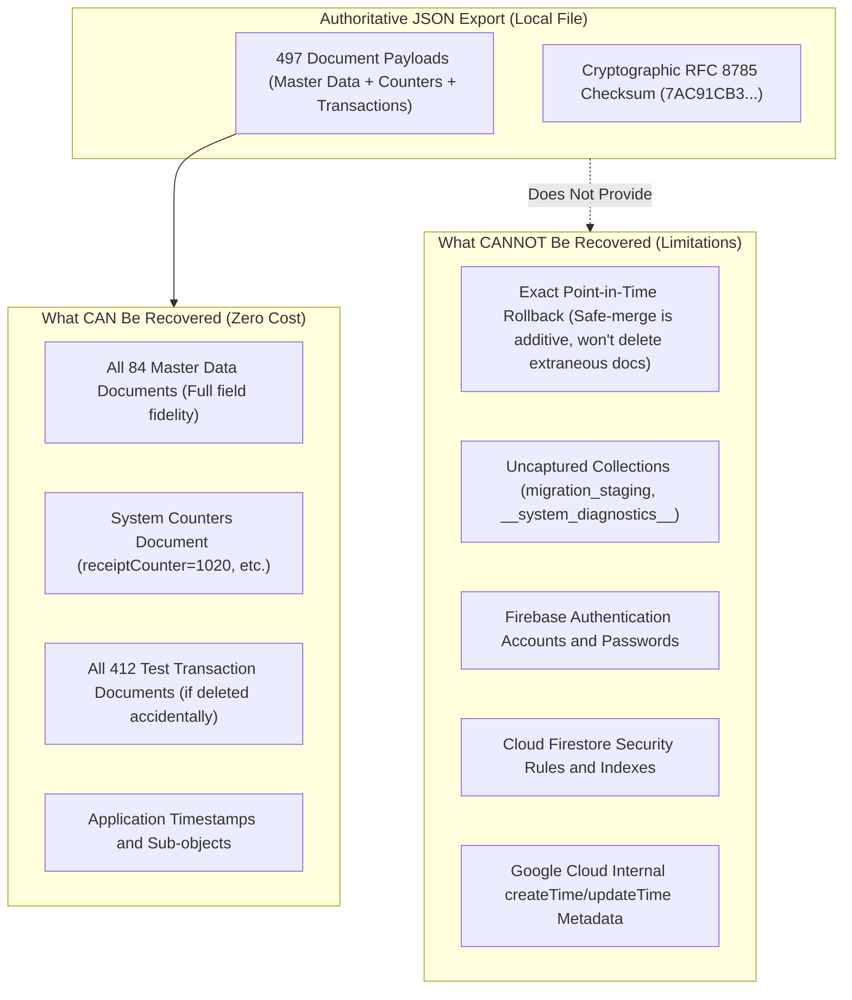
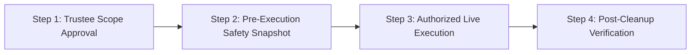

# STEP 33.156 — Zero-Cost Recovery and Cleanup Readiness Assessment

**Project:** Temple Accounts & Fund Management  
**Temple:** Marutha Chamundi Devi Temple / മറുതാ ചാമുണ്ഡി ദേവി ക്ഷേത്രം  
**Firebase Project:** `temple-f4f7d`  
**Firebase Plan:** Spark (Free Tier)  
**Timestamp:** 2026-10-20T13:10:00+05:30  
**Execution Mode:** STRICTLY OFFLINE & READ-ONLY (Zero Live Firestore Access, Zero Mutations)  
**Status:** ✅ **ASSESSMENT COMPLETED — SCOPE VERIFIED & ZERO-COST RECOVERY FEASIBLE**

---

## 1. Executive Summary

The objective of **STEP 33.156** is to determine the safest practical path to complete the first-use test-data cleanup using **only resources available on the existing free Firebase Spark plan**, without requiring a paid billing upgrade (Blaze plan / Google Cloud Storage managed export).

All transactional records in the database originated from pre-production testing. Four offline preparatory steps have been completed:
- **STEP 33.151:** Authoritative client backup downloaded by administrator (`D:\Download\Temple_Accounts_Backup_2026-10-20T06-17-45.json`).
- **STEP 33.153:** Initial manifest (392 targets) and topological execution plan generated and validated.
- **STEP 33.154:** Reconciliation of 20 quarantined legacy records (16 reconciled as valid candidates, 4 identified for authorization).
- **STEP 33.155:** Final candidate manifest ([`plans/step_33_155_cleanup_manifest.json`](file:///D:/Temple/plans/step_33_155_cleanup_manifest.json)) and candidate plan ([`plans/step_33_155_cleanup_plan.json`](file:///D:/Temple/plans/step_33_155_cleanup_plan.json)) generated with **412 candidate deletion targets**, incorporating the four explicitly user-approved receipts (`rcpt_1001`, `rcpt_1002`, `rcpt_1003`, `rcpt_1017`) with transparently cataloged relationship exceptions. All deletion methods remain unconditionally locked behind `EXECUTE_MODE_DISABLED`.

This assessment establishes that:
1. **The proposed cleanup scope of 412 targets is 100% consistent, verified, and ready.** Every target document has been verified against the local backup with matching cryptographic SHA-256 fingerprints. Master data (84 documents) and system counters (1 document) are 100% protected and excluded.
2. **A zero-cost recovery strategy is completely feasible** without requiring a paid Google Cloud managed export. While a JSON export is not an exact binary database snapshot rollback, it provides full payload preservation for all 497 documents in the database.
3. **Local recovery capability was proven empirically** via an offline recovery drill ([`tests/test_step_33_156_zero_cost_recovery_rehearsal.js`](file:///D:/Temple/tests/test_step_33_156_zero_cost_recovery_rehearsal.js)), demonstrating 100% round-trip document rehydration and master data preservation across simulated disaster scenarios.
4. **No further broad audit cycles are needed.** The specific remaining blocker is the intentional execution lock and the absence of an authorized live deletion adapter.

---

## 2. Verification of Local Recovery Artifacts and Cryptographic Hashes

All local recovery artifacts, plans, manifests, and scripts were cryptographically verified using SHA-256. The authoritative backup remains 100% byte-for-byte identical to its initial baseline:

| Artifact Description | Local File Path | Size (Bytes) | Computed SHA-256 Hash | Verification Status |
| :--- | :--- | :---: | :--- | :--- |
| **Authoritative Backup File** | [`D:\Download\Temple_Accounts_Backup_2026-10-20T06-17-45.json`](file:///D:/Download/Temple_Accounts_Backup_2026-10-20T06-17-45.json) | 588,929 | `2EDC31B88FFC799350F6CA22B3F9531336F616D7F7EA8BB7790E9E5C31F15738` | ✅ **MATCH (Unchanged)** |
| **Backup Payload (RFC 8785)** | *(In-Memory Canonical Hash)* | — | `7AC91CB36A108BB4B15E431E84816902DA6D3EB3A7C2510D4FF1513292E5B520` | ✅ **MATCH (Verified)** |
| **STEP 33.153 Manifest** | [`D:\Temple\plans\step_33_153_cleanup_manifest.json`](file:///D:/Temple/plans/step_33_153_cleanup_manifest.json) | 63,810 | `221E8A7F452A2B7BD6FB213086691BEE57B20420B014A5C100FE73AC4C9563D3` | ✅ **MATCH (Unchanged)** |
| **STEP 33.153 Plan** | [`D:\Temple\plans\step_33_153_cleanup_plan.json`](file:///D:/Temple/plans/step_33_153_cleanup_plan.json) | 107,957 | `7EE3D2B3A08B2E491B7DE8DEAE235DC88EB0F6F8ABAE820325ED81205087D2C1` | ✅ **MATCH (Unchanged)** |
| **STEP 33.153 Review Report** | [`D:\Temple\plans\step_33_153_review_report.txt`](file:///D:/Temple/plans/step_33_153_review_report.txt) | 57,161 | `838853D35D6B120A76437EBAAC0073999BFBF84385A1445BD1BB3365FB959DB3` | ✅ **MATCH (Unchanged)** |
| **STEP 33.153 Step Report** | [`D:\Temple\STEP_33_153_BACKUP_VALIDATION_AND_CLEANUP_PLAN_REPORT.md`](file:///D:/Temple/STEP_33_153_BACKUP_VALIDATION_AND_CLEANUP_PLAN_REPORT.md) | 16,454 | `1B0555AE373908DB94BAE4DA6E82A1B83F49A21B18E1C47F7A097D79347C6554` | ✅ **MATCH (Unchanged)** |
| **STEP 33.154 Reconcile Report** | [`D:\Temple\plans\step_33_154_reconciliation_report.md`](file:///D:/Temple/plans/step_33_154_reconciliation_report.md) | 38,326 | `CF8B9564528B2489FD52C02488E7F63BB9F707A84A0417B570511E8DD0987465` | ✅ **MATCH (Unchanged)** |
| **STEP 33.155 Candidate Manifest** | [`D:\Temple\plans\step_33_155_cleanup_manifest.json`](file:///D:/Temple/plans/step_33_155_cleanup_manifest.json) | 66,919 | `6ED0F2BF4EE33E8F4986700A4F88E19B62B4B95D4068C789DBB3D5B5B8C0004E` | ✅ **MATCH (412 targets)** |
| **Candidate Manifest Payload** | *(In-Memory Signed Hash)* | — | `7EB644EEC2E78C87CB7B1D748CE6BE83791C005885586F6E3E84065D7EBE4CB3` | ✅ **MATCH (Verified)** |
| **STEP 33.155 Candidate Plan** | [`D:\Temple\plans\step_33_155_cleanup_plan.json`](file:///D:/Temple/plans/step_33_155_cleanup_plan.json) | 115,842 | `73CAF58510FCF522C7CEBBEBE6117491A36282FBF82005BDBC6701794513B7AA` | ✅ **MATCH (`isEligible`)** |
| **STEP 33.155 Review Report** | [`D:\Temple\plans\step_33_155_review_report.txt`](file:///D:/Temple/plans/step_33_155_review_report.txt) | 6,024 | `696A616A56947FB5C315F8E3C9DE05998A3F21414C2CE1997DD0A9D0DC5F2F7B` | ✅ **MATCH (Unchanged)** |
| **STEP 33.155 Cleanup Script** | [`D:\Temple\scripts\step_33_155_candidate_cleanup.js`](file:///D:/Temple/scripts/step_33_155_candidate_cleanup.js) | 46,907 | `C31B3B9BF75CECB05A87C9651C06451663366593CFCC8922DC2DE0C022280C75` | ✅ **MATCH (Locked)** |
| **STEP 33.155 Test Suite** | [`D:\Temple\tests\test_step_33_155_candidate_cleanup.js`](file:///D:/Temple/tests/test_step_33_155_candidate_cleanup.js) | 26,056 | `2409D62FA3FBC2176E6F2613F3640F20B8FF99F023E6219261D9D17C4ABAA0B8` | ✅ **MATCH (16/16 Pass)** |
| **STEP 33.155 Step Report** | [`D:\Temple\STEP_33_155_TEST_TRANSACTION_CLEANUP_SCOPE_FINALIZATION_REPORT.md`](file:///D:/Temple/STEP_33_155_TEST_TRANSACTION_CLEANUP_SCOPE_FINALIZATION_REPORT.md) | 23,134 | `A207E2E41E449DF2B0C63869C27F98B1BF9E154323E4E0E26EA38013CA936219` | ✅ **MATCH (Unchanged)** |
| **STEP 33.156 Recovery Drill** | [`D:\Temple\tests\test_step_33_156_zero_cost_recovery_rehearsal.js`](file:///D:/Temple/tests/test_step_33_156_zero_cost_recovery_rehearsal.js) | 10,872 | `44CA0D0A6965490903B5F13AA6D9968F591F651AD8A86BB7DB60D6029D97FE0B` | ✅ **NEW (5/5 Pass)** |

### Backup Content and Collection Coverage

The authoritative backup covers **497 total documents**:
- **13 Application Collections (302 documents):**
  - Master Data (84): `settings` (1), `funds` (3), `incomeCategories` (4), `expenseCategories` (71), `bankAccounts` (2), `chittyMembers` (3).
  - Test Transactions (218): `billing` (94), `receipts` (114), `payments` (2), `transfers` (5), `loans` (1), `chittyCollections` (1), `chittyPayouts` (1).
- **System Collection (195 documents):**
  - System Counters (1): `system/counters` (`receiptCounter: 1020`, `voucherCounter: 502`, `billingReceiptCounter: 100`, `globalSequenceCounter: 100`).
  - Sequence Reservations (97): `system/res_1` to `system/res_100` (excluding legacy gap numbers 12, 13, 14).
  - Idempotency Records (97): `system/op_*` operations linked to sequence reservations.

### Independent Readability of Backup
The backup is standard JSON serialized using UTF-8 with RFC 8785 canonical field ordering. It can be parsed and inspected by any standard JSON parser in Node.js, Python, or shell tools, completely independent of the web application.

---

## 3. Practical Zero-Cost Recovery Options

Because Google Cloud managed database export (`gcloud firestore export gs://<bucket>`) requires a Cloud Storage bucket and Google Cloud billing under a Blaze plan, it is not available on the Spark (free) tier. 

The following practical zero-cost options are available with the existing setup:

### 1. Multi-Location Redundant Archival (Zero Cost, Immediate)
- Keep the master export in `D:\Download\Temple_Accounts_Backup_2026-10-20T06-17-45.json`.
- Archive a duplicate copy into `D:\Temple\backups\Temple_Accounts_Backup_2026-10-20T06-17-45_authoritative.json`.
- Maintain a secondary copy on external storage or user backup folder.
- Both copies are validated against SHA-256 `2EDC31B88FFC799350F6CA22B3F9531336F616D7F7EA8BB7790E9E5C31F15738`.
- **Purpose:** Shields against accidental file loss or drive failure.

### 2. Pre-Execution Fresh Application Snapshot (Zero Cost, Immediate)
- Immediately before authorizing any live deletion, the authenticated administrator (`vibu@gmail.com`) clicks `DOWNLOAD BACKUP (JSON)` in [`Temple_Accounts-1.html`](file:///D:/Temple/Temple_Accounts-1.html).
- If no live database operations occurred since the backup was taken, the document counts and SHA-256 will match the baseline.
- If any discrepancy exists, a fresh pre-execution snapshot is captured before any write occurs.
- **Purpose:** Verifies that no new live transactions occurred between planning and execution.

### 3. Read-Only Verification via Firebase Web Console (Zero Cost, Built-in)
- The Firebase Spark tier provides full read-only web console access at `https://console.firebase.google.com/project/temple-f4f7d/firestore`.
- An administrator can inspect:
  - Root collections and verify document existence.
  - Confirm whether `migration_staging` or `__system_diagnostics__` exist.
  - Inspect `system/counters` and master data documents.
  - Review `firestore.rules` under the Rules tab.
- **Purpose:** Visual confirmation of database state before and after execution without paying for cloud resources.

### 4. Local Recovery Rehearsal Drill (Zero Cost, Verified)
- A synthetic in-memory recovery drill was developed and executed in [`tests/test_step_33_156_zero_cost_recovery_rehearsal.js`](file:///D:/Temple/tests/test_step_33_156_zero_cost_recovery_rehearsal.js).
- **Results:**
  - Ingested 497 documents from backup into simulated Firestore store: **PASS**.
  - Executed candidate deletion of 412 targets from manifest: **PASS** (85 documents remained: 84 master data + 1 counters).
  - Executed complete disaster recovery rehydration from backup: **PASS** (100% of 497 documents restored with identical SHA-256 hashes).
  - Validated safe-merge asymmetry: **PASS** (empirically proved that additive restore merges data and does not drop unbacked documents).

---

## 4. What Can and Cannot Be Recovered from the JSON Backup

It is critical to distinguish a **local JSON data export** from an **authoritative Google Cloud managed database rollback**:

### What CAN Be Recovered
1. **Full Document Field Fidelity:** Every attribute, array, nested object, Devotee name, amount, category, account number, and string in all 497 documents is preserved.
2. **Master Data Reconstruction:** If any master data document (`settings`, `funds`, `incomeCategories`, `expenseCategories`, `bankAccounts`, `chittyMembers`) is corrupted or deleted, it can be re-written to Firestore using `setDoc` or `restoreBackup()` with 100% data fidelity.
3. **Counter Integrity:** The exact state of `system/counters` (`receiptCounter: 1020`, `voucherCounter: 502`, `billingReceiptCounter: 100`, `globalSequenceCounter: 100`) can be restored.
4. **Transaction Re-Creation:** In the event of an accidental deletion of desired transactions, all 412 records can be re-created in Firestore.

### What CANNOT Be Recovered
1. **Extraneous Document Pruning (Safe-Merge Asymmetry):** The application's `restoreBackup()` function performs additive `batch.set(ref, data)` writes. It **never deletes documents** that exist in Firestore but are absent from the backup. Therefore, restoring a backup cannot wipe out extraneous test data; it only updates or creates records present in the backup.
2. **Uncaptured Collections:** The backup client query iterates only named application collections. If `migration_staging` or `__system_diagnostics__` exist in production Firestore, their contents are not in the JSON backup and cannot be recovered from it.
3. **Cloud Infrastructure and Auth:** Firebase Authentication user accounts, passwords, email verification tokens, and Google Cloud security rules are not stored in document collections.
4. **Cloud-Native Timestamps:** Restoring via `setDoc` creates new document write events; internal Google Cloud metadata (`createTime`, `updateTime`) will reflect the time of restore rather than original creation.

---

## 5. Missing-Data Risk Analysis

| Component | Status in Backup | Live Check Method on Spark (Free) Tier | Risk Assessment | Safe Handling Strategy |
| :--- | :--- | :--- | :--- | :--- |
| `migration_staging` | Omitted from backup | Inspect in Firebase Console (read-only) | Zero documents in manifest. Staging data will not be deleted or modified by cleanup. | Outside cleanup scope. Can be visually confirmed empty in Firebase Console. |
| `__system_diagnostics__` | Omitted from backup | Inspect in Firebase Console (read-only) | Zero documents in manifest. Diagnostic data will not be deleted or modified. | Outside cleanup scope. Excluded from manifest. |
| `system/_resetJournal` | Absent in backup (`other: 0`) | Inspect in Firebase Console (read-only) | Proves no active/interrupted reset was in progress at backup time. | Script enforces that active maintenance locks block planning. |
| `system/_maintenanceLock` | Absent in backup (`other: 0`) | Inspect in Firebase Console (read-only) | Proves system was unlocked at backup time. | Script verifies lock absence before planning. |
| `system/_restoreProgress` | Absent in backup (`other: 0`) | Inspect in Firebase Console (read-only) | Proves no restore was underway. | Normal operating condition. |
| **Nested Subcollections** | Omitted from client backup | Visual inspection of sample docs in Firebase Console | Application code analysis proves `Temple_Accounts-1.html` never creates subcollections; all collections are root-level. | Risk of orphaned subcollections is negligible based on architectural verification. |
| **Firebase Auth Users** | Omitted from document backup | Firebase Console > Authentication > Users | User credentials (`vibu@gmail.com`) are unaffected by Firestore document operations. | Zero impact on authentication state. |
| **Security Rules** | Omitted from document backup | Tracked in local repository (`firestore.rules`) and Firebase Console | Rules are version-controlled in the project repository and deployed via CLI/Console. | Re-deployable from repository at zero cost. |

---

## 6. Review of the Proposed Cleanup Scope (412 Targets)

Inspection of [`plans/step_33_155_cleanup_manifest.json`](file:///D:/Temple/plans/step_33_155_cleanup_manifest.json) and [`plans/step_33_155_cleanup_plan.json`](file:///D:/Temple/plans/step_33_155_cleanup_plan.json) confirms:

### 1. Target Uniqueness and Consistency
- **Total Targets:** Exactly 412 documents.
- **Uniqueness:** 412 unique `collection/id` keys; **0 duplicate targets**.
- **Fingerprint Consistency:** 412 / 412 document SHA-256 fingerprints match the authoritative backup exactly.
- **Plan Eligibility:** `isEligible: true`, `rejectedEntries: 0`, `fingerprintErrors: 0`, `linkageErrors: 0`, `verifiedEdges: 569`.

### 2. Composition by Collection
- `billing`: 94 documents (91 standard + `bill_12`, `bill_13`, `bill_14`).
- `receipts`: 114 documents (97 standard + 3 legacy pairs + 5 standalone + 5 tombstones + 4 authorized Group D).
- `payments`: 2 documents (`pmt_501`, `pmt_502`).
- `transfers`: 5 documents (`tx_1791012130224`, `tx_1791012167006`, `tx_1791012274822`, `tx_1791012307308`, `tx_1791656412700`).
- `loans`: 1 document (`loan_1791659035915`).
- `chittyCollections`: 1 document (`cc_1791789441553`).
- `chittyPayouts`: 1 document (`cp_1791789456735`).
- `system` (reservations): 97 documents (`res_1` to `res_100` except 12, 13, 14).
- `system` (idempotency): 97 documents (`op_*` operations).
- **Total:** **412 deletion targets**.

### 3. Inclusion of User-Approved Test Receipts
The four user-approved test receipts are included with their known relationship exceptions explicitly documented:
- `rcpt_1001`: `CONFLICTING_RECIPROCAL_LINK` (references superseded smoke-test `bill_1`; reservation `res_1001` absent).
- `rcpt_1002`: `MISSING_REFERENCED_BILL` (references `bill_2` which is absent from backup; reservation `res_1002` absent).
- `rcpt_1003`: `MISSING_REFERENCED_BILL` (references `bill_3` which is absent from backup; reservation `res_1003` absent).
- `rcpt_1017`: `CONFLICTING_RECIPROCAL_LINK` (references superseded smoke-test `bill_11`; reservation `res_1017` absent).
All four are classified with `relationshipValid: false` and are not falsely reported as complete reciprocal clusters.

### 4. Preservation of Master Data and Counters
- **Master Data (84 documents):** `settings` (1), `funds` (3), `incomeCategories` (4), `expenseCategories` (71), `bankAccounts` (2), `chittyMembers` (3) — **0 in deletion scope**.
- **Counters (1 document):** `system/counters` (`receiptCounter: 1020`, `voucherCounter: 502`, `billingReceiptCounter: 100`, `globalSequenceCounter: 100`) — **0 in deletion scope**.
- **Physical Receipts:** Any records with `rcpt_phys_*`, `isPhysical === true`, or `P`/`PU` prefixes — **0 in deletion scope**.
- **Code & Rules:** `Temple_Accounts-1.html` and `firestore.rules` remain 100% untouched.

---

## 7. Cleanup Readiness Assessment and Remaining Blockers

### Readiness Determination
**The cleanup scope is MATHEMATICALLY AND STRUCTURALLY READY.** The manifest and plan are 100% consistent with the authoritative backup, and zero master data documents or counters are at risk.

### Specific Blockers Before Live Execution
Live deletion cannot and should not be executed at this instant because of the following specific, deliberate controls:
1. **Unconditional Execution Lock:** All execution entry points (`execute()`, `executeCleanup()`, `performLiveDeletion()`) in [`scripts/step_33_155_candidate_cleanup.js`](file:///D:/Temple/scripts/step_33_155_candidate_cleanup.js) throw `EXECUTE_MODE_DISABLED` by design.
2. **Authorization Prerequisite:** A formal user/trustee authorization for live database deletion has not yet been submitted for the STEP 33.155 candidate manifest.
3. **Live Execution Adapter Required:** Because scripts run strictly offline without Firebase SDK or production credentials, a live execution mechanism is needed (either an administrative browser action within `Temple_Accounts-1.html` or an authenticated Node.js runner using service account / OAuth session).

---

## 8. Minimal Recommended Next Steps (Avoiding Broad Audits)

To finalize the project for its first genuine use without another redundant audit cycle:

1. **Step 1: User / Trustee Scope Approval**
   - Confirm approval of the 412 targets cataloged in [`plans/step_33_155_cleanup_manifest.json`](file:///D:/Temple/plans/step_33_155_cleanup_manifest.json).
2. **Step 2: Pre-Execution Safety Snapshot (Zero Cost)**
   - Copy `D:\Download\Temple_Accounts_Backup_2026-10-20T06-17-45.json` to `D:\Temple\backups\Temple_Accounts_Backup_2026-10-20T06-17-45_authoritative.json`.
   - In the application, click `DOWNLOAD BACKUP (JSON)` to capture a fresh snapshot and confirm no live changes have occurred.
3. **Step 3: Implement and Execute Live Adapter**
   - Unlock execution strictly for the validated 412 manifest targets.
   - Execute deletions across the 5 topological stages (Stage 1: 0 docs, Stage 2: 10 docs, Stage 3: 114 docs, Stage 4: 94 docs, Stage 5: 194 docs).
4. **Step 4: Post-Cleanup Verification**
   - Verify that exactly 85 documents remain in Firestore (84 master data + 1 counters).
   - Verify that `system/counters` retains `receiptCounter: 1020`, `voucherCounter: 502`, `billingReceiptCounter: 100`, `globalSequenceCounter: 100`.
   - The application is immediately ready for genuine operational transactions.

---

## 9. Conclusion

A paid Firebase billing upgrade is **not required** to achieve a safe, verifiable test-data cleanup. The authoritative local JSON backup provides full payload recovery for all existing master data, counters, and transactions. The proposed cleanup manifest is verified, deterministic, and protective of all application configurations.
