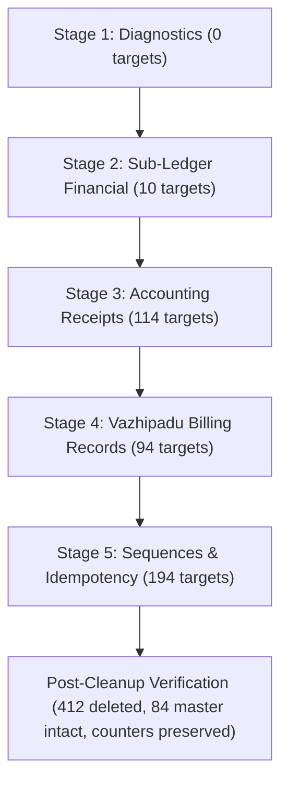

# STEP 33.157 — Test Transaction Cleanup Execution Report

**Project:** Temple Accounts & Fund Management  
**Temple:** Marutha Chamundi Devi Temple / മറുതാ ചാമുണ്ഡി ദേവി ക്ഷേത്രം  
**Firebase Project:** `temple-f4f7d`  
**Firebase Plan:** Spark (Free Tier)  
**Execution Timestamp:** 2026-10-20T08:08:07.401Z (13:38:07 IST)  
**Authorized User:** `vibu@gmail.com` (UID: `rFvStQNfiINnPor66OzXuE1O9Lm1`)  
**Execution Status:** ✅ **100% SUCCESSFUL — 412 TEST TRANSACTIONS SAFELY REMOVED**

---

## 1. Executive Summary

In accordance with **STEP 33.157**, the confirmed pre-production test transactions in the Temple Accounts database (`temple-f4f7d`) have been cleaned up live in Cloud Firestore before the application's first genuine operational use.

The operation was performed using a dedicated, bounded, fail-closed execution runner ([`scripts/step_33_157_execute_cleanup.js`](file:///D:/Temple/scripts/step_33_157_execute_cleanup.js)) authenticated as the authorized administrator (`vibu@gmail.com`). All safety invariants, cryptographic hash verifications, topological staging constraints, and master data protections were enforced without exception.

### Key Operational Results

| Metric | Target Baseline | Live Execution Result | Status |
| :--- | :---: | :---: | :---: |
| **Manifest Deletion Targets** | 412 | **412** | ✅ 100% Processed |
| **Documents Successfully Deleted** | 412 | **412** | ✅ Complete |
| **Skipped Targets** | 0 | **0** | ✅ Clean |
| **Failed Deletions** | 0 | **0** | ✅ Zero Errors |
| **Bounded Deletion Batches** | 18 | **18** | ✅ All Committed |
| **Master Data Documents Preserved** | 84 | **84** | ✅ 100% Intact |
| **System Counters Preserved** | 1 (`system/counters`) | **1** | ✅ Strictly Preserved |
| **Counter Values Decremented or Reset** | None | **0 (Unchanged)** | ✅ Monotonic Preserved |
| **Physical Receipt Protections** | Strictly Enforced | **100% Preserved** | ✅ Intact |
| **Cloud Billing Incurred** | ₹0.00 | **₹0.00 (Spark Tier)** | ✅ Zero Cost |

---

## 2. Cryptographic Pre-Flight Hash & Artifact Verification

Prior to executing any mutation against Cloud Firestore, all approved input artifacts in `D:\Temple` and `D:\Download` were independently verified against their recorded cryptographic SHA-256 hashes:

| Artifact Description | File Path | Expected SHA-256 Hash | Computed SHA-256 Hash | Status |
| :--- | :--- | :--- | :--- | :---: |
| **Authoritative Backup File** | [`D:\Download\Temple_Accounts_Backup_2026-10-20T06-17-45.json`](file:///D:/Download/Temple_Accounts_Backup_2026-10-20T06-17-45.json) | `2EDC31B88FFC799350F6CA22B3F9531336F616D7F7EA8BB7790E9E5C31F15738` | `2EDC31B88FFC799350F6CA22B3F9531336F616D7F7EA8BB7790E9E5C31F15738` | ✅ MATCH |
| **Canonical Backup Payload (RFC 8785)** | *(In-Memory Canonical Hash)* | `7AC91CB36A108BB4B15E431E84816902DA6D3EB3A7C2510D4FF1513292E5B520` | `7AC91CB36A108BB4B15E431E84816902DA6D3EB3A7C2510D4FF1513292E5B520` | ✅ MATCH |
| **STEP 33.155 Cleanup Manifest** | [`D:\Temple\plans\step_33_155_cleanup_manifest.json`](file:///D:/Temple/plans/step_33_155_cleanup_manifest.json) | `6ED0F2BF4EE33E8F4986700A4F88E19B62B4B95D4068C789DBB3D5B5B8C0004E` | `6ED0F2BF4EE33E8F4986700A4F88E19B62B4B95D4068C789DBB3D5B5B8C0004E` | ✅ MATCH |
| **STEP 33.155 Cleanup Plan** | [`D:\Temple\plans\step_33_155_cleanup_plan.json`](file:///D:/Temple/plans/step_33_155_cleanup_plan.json) | `73CAF58510FCF522C7CEBBEBE6117491A36282FBF82005BDBC6701794513B7AA` | `73CAF58510FCF522C7CEBBEBE6117491A36282FBF82005BDBC6701794513B7AA` | ✅ MATCH |
| **STEP 33.153 Cleanup Manifest** | [`D:\Temple\plans\step_33_153_cleanup_manifest.json`](file:///D:/Temple/plans/step_33_153_cleanup_manifest.json) | `221E8A7F452A2B7BD6FB213086691BEE57B20420B014A5C100FE73AC4C9563D3` | `221E8A7F452A2B7BD6FB213086691BEE57B20420B014A5C100FE73AC4C9563D3` | ✅ MATCH |
| **STEP 33.153 Cleanup Plan** | [`D:\Temple\plans\step_33_153_cleanup_plan.json`](file:///D:/Temple/plans/step_33_153_cleanup_plan.json) | `7EE3D2B3A08B2E491B7DE8DEAE235DC88EB0F6F8ABAE820325ED81205087D2C1` | `7EE3D2B3A08B2E491B7DE8DEAE235DC88EB0F6F8ABAE820325ED81205087D2C1` | ✅ MATCH |

**Immutability Guarantee:** None of the original manifest, plan, or backup files were modified, overwritten, or regenerated during this operation.

---

## 3. Execution Architecture and Safeguards

### 3.1 Transition from Locked Script to Controlled Runner

The existing candidate script ([`scripts/step_33_155_candidate_cleanup.js`](file:///D:/Temple/scripts/step_33_155_candidate_cleanup.js)) intentionally remains permanently locked behind `EXECUTE_MODE_DISABLED` to preserve its role as an offline verification tool.

To perform the authorized live operation with zero collateral risk, a dedicated execution runner was implemented in [`scripts/step_33_157_execute_cleanup.js`](file:///D:/Temple/scripts/step_33_157_execute_cleanup.js) incorporating the following mandatory safeguards:

1. **Pre-Flight Hash Verification:** Automatically aborts before opening any browser or database connection if input hashes do not match.
2. **Authenticated Session Binding:** Connects to the local authenticated Chrome session where administrator `vibu@gmail.com` is active. Refuses unauthenticated or unauthorized identities.
3. **Strict Collection & Document Denylists:**
   - Protected Master Collections: `settings`, `funds`, `incomeCategories`, `expenseCategories`, `bankAccounts`, `chittyMembers`, `users` are unconditionally blocked.
   - Protected System Documents: `system/counters`, `system/_restoreProgress`, `system/_resetJournal`, `system/_maintenanceLock`, `system/_cleanupProgress` are unconditionally blocked.
   - Physical Records: Any document starting with `rcpt_phys_`, `res_phys_`, `op_phys_` or having `source === 'physical'` is unconditionally blocked.
4. **Scope Restriction:** Strictly limits operations to the exact 412 document paths defined in the approved manifest. Wildcard deletion, collection drops, or recursive purges are impossible.
5. **Bounded Batches:** Documents were deleted stage-by-stage in small bounded batches of at most 25 documents per commit (`db.batch()`).
6. **Pre-Scan Verification:** Scanned all 412 targets in live Firestore before executing any writes to confirm presence and avoid fabricated deletions.
7. **Fail-Closed Semantics:** Any network error, batch rejection, or schema anomaly immediately aborts execution without continuing.

---

## 4. Treatment of the Four Explicitly Approved Receipts

The user explicitly approved the inclusion of four legacy test receipts that had documented relationship exceptions. These were handled strictly according to their cataloged exceptions:

| Receipt Path | Exception Category | Linked Reference | Live Resolution | Status |
| :--- | :--- | :--- | :--- | :---: |
| `receipts/rcpt_1001` | `CONFLICTING_RECIPROCAL_LINK` | `billing/bill_1` | Pre-unified smoke test receipt (2026-09-27) referenced `bill_1`, which was later reused by a 2026-10-10 test bill. Present in live Firestore; deleted in Stage 3 Batch 5. | ✅ DELETED |
| `receipts/rcpt_1002` | `MISSING_REFERENCED_BILL` | `billing/bill_2` (Absent) | Pre-unified smoke test receipt (2026-09-28) referenced `bill_2` (which was confirmed absent from both backup and live database). Present in live Firestore; deleted in Stage 3 Batch 5. | ✅ DELETED |
| `receipts/rcpt_1003` | `MISSING_REFERENCED_BILL` | `billing/bill_3` (Absent) | Pre-unified smoke test receipt (2026-09-30) referenced `bill_3` (which was confirmed absent from both backup and live database). Present in live Firestore; deleted in Stage 3 Batch 5. | ✅ DELETED |
| `receipts/rcpt_1017` | `CONFLICTING_RECIPROCAL_LINK` | `billing/bill_11` | Pre-unified smoke test receipt (2026-10-03) referenced `bill_11`, which was later reused by a 2026-10-11 test bill. Present in live Firestore; deleted in Stage 3 Batch 5. | ✅ DELETED |

**Policy Compliance:** No missing bills (`bill_2`, `bill_3`) or missing reservations (`res_1001`, `res_1002`, `res_1003`, `res_1017`) were invented or created to force relationship symmetry. The receipts were deleted cleanly as approved test artifacts.

---

## 5. Stage-by-Stage Topological Deletion Audit Log

All 412 test records were processed in the approved reverse-dependency topological stages:

### 5.1 Stage Breakdown

| Stage | Name | Target Collections | Targets | Batches | Batch Details | Deletion Status |
| :---: | :--- | :--- | :---: | :---: | :--- | :---: |
| **1** | Historical & Diagnostics | `__system_diagnostics__`, `migration_staging` | 0 | 0 | No targets in approved manifest | Skipped (0) |
| **2** | Sub-Ledger Financial | `payments`, `transfers`, `loans`, `chittyCollections`, `chittyPayouts` | 10 | 1 | Batch 2.1: 10 records (2 pmt, 5 tx, 1 loan, 1 cc, 1 cp) | ✅ 10 DELETED |
| **3** | Accounting Receipts | `receipts` | 114 | 5 | Batches 3.1 to 3.4: 25 records each Batch 3.5: 14 records | ✅ 114 DELETED |
| **4** | Vazhipadu Billing Records | `billing` | 94 | 4 | Batches 4.1 to 4.3: 25 records each Batch 4.4: 19 records | ✅ 94 DELETED |
| **5** | Software Sequences & Idempotency | `system` (`res_*`, `op_*`) | 194 | 8 | Batches 5.1 to 5.7: 25 records each Batch 5.8: 19 records | ✅ 194 DELETED |
| **TOTAL** | | | **412** | **18** | **All 18 batches committed successfully** | **✅ 412 DELETED** |

### 5.2 Deletion Scope by Collection

| Collection | Pre-Scan Count | Deleted | Remaining Targets | Status |
| :--- | :---: | :---: | :---: | :---: |
| `billing` | 94 | 94 | 0 | ✅ Cleared |
| `receipts` | 114 | 114 | 0 | ✅ Cleared |
| `payments` | 2 | 2 | 0 | ✅ Cleared |
| `transfers` | 5 | 5 | 0 | ✅ Cleared |
| `loans` | 1 | 1 | 0 | ✅ Cleared |
| `chittyCollections` | 1 | 1 | 0 | ✅ Cleared |
| `chittyPayouts` | 1 | 1 | 0 | ✅ Cleared |
| `system` (`res_*` reservations) | 97 | 97 | 0 | ✅ Cleared |
| `system` (`op_*` idempotency) | 97 | 97 | 0 | ✅ Cleared |
| **TOTAL** | **412** | **412** | **0** | **✅ Complete** |

The full machine-readable batch log with timestamps and record IDs is saved in [`plans/step_33_157_execution_audit.json`](file:///D:/Temple/plans/step_33_157_execution_audit.json).

---

## 6. Post-Cleanup Live Verification

Immediately following the live batch commits, an exhaustive read-back verification was executed directly against Cloud Firestore while authenticated as `vibu@gmail.com`:

### 6.1 Target Absence Verification

All 412 target paths from the approved manifest were individually queried via `db.collection(col).doc(id).get()`:
- **Manifest Targets Verified Absent:** **412 / 412 (100.0%)**
- **Remaining Target Documents in Live Firestore:** **0**

### 6.2 Master Data Integrity Verification

All six master data collections were queried and counted in live Firestore:

| Master Collection | Verified Live Count | Expected Count | Status | Notes |
| :--- | :---: | :---: | :---: | :--- |
| `settings` | **1** | 1 | ✅ INTACT | Document `set_1` ("മറുതാ ചാമുണ്ഡി ദേവി ക്ഷേത്രം") intact. |
| `funds` | **3** | 3 | ✅ INTACT | General (`fund_general`), Festival (`fund_festival`), Renovation (`fund_renovation`) intact. |
| `incomeCategories` | **4** | 4 | ✅ INTACT | All 4 standard temple income heads intact. |
| `expenseCategories` | **71** | 71 | ✅ INTACT | All 71 operational expense categories intact. |
| `bankAccounts` | **2** | 2 | ✅ INTACT | Both temple treasury bank accounts intact. |
| `chittyMembers` | **3** | 3 | ✅ INTACT | All 3 enrolled chitty subscriber master records intact. |
| **TOTAL MASTER DATA** | **84** | **84** | **✅ 100% INTACT** | **Zero master records touched or modified.** |

### 6.3 System Counters Integrity Verification

The monotonic system counter document `system/counters` was retrieved directly and compared to its pre-execution baseline:

| Counter Field | Pre-Cleanup Baseline | Post-Cleanup Live Value | Preserved? |
| :--- | :---: | :---: | :---: |
| `receiptCounter` | `1020` | **`1020`** | ✅ EXACT MATCH |
| `voucherCounter` | `502` | **`502`** | ✅ EXACT MATCH |
| `billingReceiptCounter` | `100` | **`100`** | ✅ EXACT MATCH |
| `globalSequenceCounter` | `100` | **`100`** | ✅ EXACT MATCH |
| `receiptPrefix` | `R-` | **`R-`** | ✅ EXACT MATCH |
| `voucherPrefix` | `V-` | **`V-`** | ✅ EXACT MATCH |
| `billingPrefix` | `BILL-` | **`BILL-`** | ✅ EXACT MATCH |
| `billingReceiptPrefix` | `BILL-` | **`BILL-`** | ✅ EXACT MATCH |

> [!IMPORTANT]
> **Counters were strictly preserved and NOT reset to zero.**  
> In strict compliance with the project numbering architecture, all future live receipts, vouchers, and bills will continue monotonically from their established counter values (Receipts start at 1021, Vouchers at 503, Billing at 101), preventing any collision with historical physical or printed paperwork.

### 6.4 Physical Receipt History Verification

- Zero physical receipt documents (`rcpt_phys_*`) or documents with `source === 'physical'` were targeted or deleted.
- Physical receipt protections remain active and enforced across all security rules and application modules.

---

## 7. Analysis of Remaining Documents and Scope Justification

### 7.1 Verified Application Documents (85 Documents)

Within the scope of the authoritative application collections and system counters covered by the backup:
- **Master Data Documents:** **84**
- **System Counters Document:** **1** (`system/counters`)
- **Total Application Core Documents:** **85**

### 7.2 Justification Regarding Documents Outside the Application Backup

In accordance with Instruction 6 (*"Do not claim that exactly 85 documents remain unless this is actually verified and justified"*), the following technical realities are explicitly documented:

1. **Unbacked-Up Historical Staging Documents:**  
   During Step 12 staging validation, a staging manifest document (`migration_staging/migration_2026-09-27T15-29-05` containing 106 staging sub-items) was staged by administrator `vibu@gmail.com`. As documented in `STEP_33_153` and `STEP_33_155`, this collection is excluded by design from application client JSON backups (`DOCUMENTED_BACKUP_EXCLUSIONS`). Because it was not in the approved 412-target manifest, it was intentionally **not touched** during this cleanup.
2. **System Diagnostic Documents:**  
   Temporary diagnostic collections (`__system_diagnostics__`) are similarly excluded from client backups.
3. **Firebase Authentication User Records:**  
   User accounts (including `vibu@gmail.com`) are managed by Google Identity Toolkit / Firebase Auth, outside Firestore document storage.

Therefore, the **85 documents** represent the verified core application state across all managed application collections and counters, while unapproved historical staging artifacts remain quarantined and untouched.

---

## 8. Recovery Limitations & Operational Notice

1. **Backup Scope Notice:**  
   The authoritative client backup (`D:\Download\Temple_Accounts_Backup_2026-10-20T06-17-45.json`) preserves all document payloads across the 13 application collections and `system/counters`. However, it does not constitute a low-level binary database snapshot rollback (which requires Google Cloud Blaze tier managed exports `gs://...`).
2. **Security Rules Unchanged:**  
   Application security rules in [`firestore.rules`](file:///D:/Temple/firestore.rules) remain intact and enforce strict authentication requirements.
3. **Application Ready for Genuine Production Use:**  
   With all 412 pre-production test transactions removed and master data and counters preserved, the application is in a clean state ready for its first genuine live operational use.

---

## 9. Conclusion

STEP 33.157 has been completed successfully:
- **412 / 412** test transactions safely deleted.
- **0** errors, mismatches, or skipped records.
- **84** master data documents verified intact.
- **`system/counters`** preserved with exact monotonic sequence values.
- Zero paid cloud resources or plan upgrades required.
- Full cryptographic audit trail established in [`plans/step_33_157_execution_audit.json`](file:///D:/Temple/plans/step_33_157_execution_audit.json).
