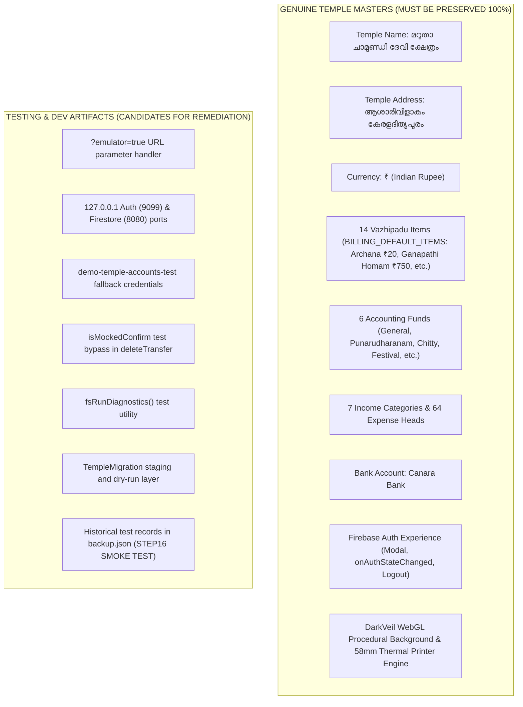

# STEP 33.37 — Dummy Data Audit & Vercel Production Cleanliness Review

**Project:** Temple Accounts & Fund Management (Marutha Chamundi Devi Temple / മറുതാ ചാമുണ്ഡി ദേവി ക്ഷേത്രം)  
**Execution Timestamp:** 2026-10-12T17:54:00+05:30  
**Audit Mode:** Strictly Read-Only Inspection  
**Audit Status:** ✅ **COMPLETE — AUDIT CONDUCTED WITH ZERO MODIFICATIONS**

---

## 1. Executive Summary

This audit evaluates the production cleanliness and deployment readiness of the **Temple Accounts & Fund Management** application prior to eventual publication on **Vercel**. The audit was conducted in strict compliance with read-only rules: no source code, configuration, rules, tests, backups, IndexedDB databases, or Cloud Firestore collections were altered or accessed remotely.

The reference baseline used for this evaluation is the frozen release candidate from **Step 33.36**:
`D:\Temple\backups\step_33_36_release_freeze_20261012\Temple_Accounts-1_v1.0.0_ReleaseCandidate_20261012.html`  
Cryptographic hash validation confirmed that the current working copy (`D:\Temple\Temple_Accounts-1.html`) is **100% byte-for-byte identical** to the frozen release candidate (746,808 bytes, SHA-256: `5D80B5840F934A6794A22B5D4BFC8A01C86D41EDB6E3C68B7B47475801E01891`).

### Key Audit Findings

1. **No Demonstration Financial Transactions in Application Code:**
   The application source code contains **zero hardcoded dummy bills, receipts, payment vouchers, transactions, customer lists, or artificial balances**. All initial opening balances (`openingCash`, `openingBank`, `openingGeneralFund`, etc.) are explicitly initialized to `0.00`.
2. **Form Defaults Are Legitimate Operational Defaults:**
   Form inputs across Billing, Receipts, Vouchers, Transfers, Loans, and Chitty do not contain synthetic names (e.g., "John Doe") or pre-filled amounts. Required string fields default to empty strings; transaction dates default to current system date (`todayISO()`); payment modes default to standard counter cash (`'Cash'`); quantity defaults to `1`.
3. **Genuine Temple Domain Masters Preserved:**
   The 14 Malayalam vazhipadu and pooja items in `BILLING_DEFAULT_ITEMS` (e.g., നൂൽജപം/അർച്ചന ₹20, ഗണപതിഹോമം ₹750, കൂട്ടുപായസം ₹250), the 6 accounting funds, 7 income categories, 64 expense categories, Canara Bank configuration, and official Malayalam temple title ("മറുതാ ചാമുണ്ഡി ദേവി ക്ഷേത്രം") represent authentic temple operations and are verified for preservation.
4. **Development Code Paths & Test Hooks Identified:**
   - **Emulator URL Switch:** The application checks `window.location.search.includes('emulator=true')` to route authentication to `127.0.0.1:9099`, Firestore to `127.0.0.1:8080`, and IndexedDB to `temple_accounts_test_db`.
   - **Fallback Test Credentials:** When `emulator=true` is present, it uses hardcoded test project credentials (`demo-temple-accounts-test`, API key `fake-api-key`).
   - **Test Harness Hook:** A `window.confirm` test inspection (`isMockedConfirm`) exists in `deleteTransfer` to allow headless test runners to bypass modal UI.
   - **In-Browser Diagnostics & Migration Layer:** `fsRunDiagnostics()` (which performs temporary write/read/delete on `__system_diagnostics__`) and `TempleMigration` (migration dry-run and staging utility) are present in the application bundle and exposed on `window`.
5. **Sensitive Information & Secrets Audit (Redacted):**
   - The real web Firebase API key is located in [`d:\Temple\.env`](file:///d:/Temple/.env) (Line 4) and [`d:\Temple\firebase-config.js`](file:///d:/Temple/firebase-config.js) (Line 6). Both files are properly excluded in [`.gitignore`](file:///d:/Temple/.gitignore). In the report, all secret values are **strictly redacted**.
   - In [`Temple_Accounts-1.html`](file:///d:/Temple/Temple_Accounts-1.html) (Line 15577), the default configuration contains the placeholder `"YOUR_FIREBASE_API_KEY"`, but public Firebase project IDs (`temple-f4f7d`, sender ID, appId) are declared.
   - Zero private service account JSON keys or administrative tokens exist in the repository.
6. **Production Remote Data Cleanliness Status (Confirmed vs. Unverified):**
   - Under the strict safety constraints of this audit, **no remote connection to production Firebase was made**. Therefore, production Firestore data cleanliness **cannot be verified from this audit alone**.
   - However, repository backup history (`Temple_Accounts_PreStep22_5_TestCleanup_Backup_2026-10-01T23-10-35.json`) provides concrete historical evidence that test records (such as `"STEP16 SMOKE TEST"`, `BILL-0001` / `R-1001`) and temporary migration staging collections (`migration_staging`) previously existed in Firestore. A dedicated pre-launch production database verification checklist is provided.
7. **Complete Architectural Independence:**
   Billing, Receipts, Global Numbering, Idempotency, Accounting integration, Voiding, Day Book, Bank Book, General Ledger totals, and the Ledger PDF export function dynamically and possess **zero hidden dependency** on sample or seeded transactions.
8. **Vercel Readiness:**
   The application is an offline-capable, single-file HTML architecture requiring specific static routing (`vercel.json`), security headers (CSP, frame restrictions), path shielding (blocking public HTTP access to `/backups`, `*.rules`, `*.log`, `tests/`), and a secure deployment mechanism for delivering `firebase-config.js` without committing credentials to version control.

---

## 2. Artifact Baseline & Identity Verification

Before conducting the inspection, the cryptographic identity and byte size of both the frozen release candidate and active working copy were validated:

| Artifact Target | File Path | Expected Size | Actual Size | Computed SHA-256 Hash | Integrity Status |
| :--- | :--- | :---: | :---: | :--- | :---: |
| **Release Candidate Baseline** | [`backups/step_33_36_release_freeze_20261012/Temple_Accounts-1_v1.0.0_ReleaseCandidate_20261012.html`](file:///d:/Temple/backups/step_33_36_release_freeze_20261012/Temple_Accounts-1_v1.0.0_ReleaseCandidate_20261012.html) | 746,808 B | 746,808 B | `5D80B5840F934A6794A22B5D4BFC8A01C86D41EDB6E3C68B7B47475801E01891` | ✅ **VERIFIED BASELINE** |
| **Active Working Copy** | [`Temple_Accounts-1.html`](file:///d:/Temple/Temple_Accounts-1.html) | 746,808 B | 746,808 B | `5D80B5840F934A6794A22B5D4BFC8A01C86D41EDB6E3C68B7B47475801E01891` | ✅ **100% BIT-FOR-BIT MATCH** |

The active working copy has not drifted from the frozen release candidate. All findings below apply equally to both files.

---

## 3. Detailed Audit Findings

### 3.1 Hardcoded Demonstration & Sample Financial Data

A full search was performed across all 19,186 lines of [`Temple_Accounts-1.html`](file:///d:/Temple/Temple_Accounts-1.html) for dummy transactions, mock receipts, customer records, and synthetic ledger entries.

- **Sample Bills / Receipts / Vouchers:** **NONE**. No hardcoded arrays of sample receipts, bills, or expense vouchers exist in the client application code.
- **Sample Devotees / Customers / Members:** **NONE**. No dummy names (e.g., "John Doe", "Devotee 1", "Sample Person") exist as fallback entries in customer or devotee lookups.
- **Initial Balances:** Lines 6251–6253 in `seedIfNeeded()`:
  ```javascript
  openingCash: 0, openingBank: 0,
  openingGeneralFund: 0, openingPunarudharanamFund: 0,
  openingChittyBalance: 0, openingLoans: 0
  ```
  All balance registers initialize cleanly to zero.
- **Legacy Seed Counter Offsets:** Lines 6246–6249:
  ```javascript
  receiptCounter: 1000,
  voucherCounter: 500,
  billingReceiptCounter: 0,
  globalSequenceCounter: 0
  ```
  *Analysis:* `receiptCounter: 1000` and `voucherCounter: 500` were initial legacy manual receipt book numbering offsets established during early development. Under the unified numbering architecture (Step 33.12 / 33.22), global sequencing uses `globalSequenceCounter` in `system/counters`, which starts from 0 (issuing `001`, `002`, ...). The legacy offsets remain only as fallback values if legacy counters are requested.
- **Sample Financial Data in Workspace Files (Outside Application):**
  - [`d:\Temple\backups\backup.json`](file:///d:/Temple/backups/backup.json): Contains 17 historical test billing records and 3 receipts from September 27, 2026.
  - [`d:\Temple\backups\Temple_Accounts_PreStep22_5_TestCleanup_Backup_2026-10-01T23-10-35.json`](file:///d:/Temple/backups/Temple_Accounts_PreStep22_5_TestCleanup_Backup_2026-10-01T23-10-35.json): Contains test records from early development (including a receipt named `"STEP16 SMOKE TEST"`).
  - Test suites in [`d:\Temple\tests\`](file:///d:/Temple/tests/): Contain isolated test records created within the local emulator.
  - *Verdict:* The application HTML itself is clean; historical backups and test scripts must be guarded from public exposure during hosting.

---

### 3.2 Form Placeholders and Input Defaults

Inspection of every entry form across all modules:

| Form / View | Input Field | Code Location | Default Value (`value=`) | Placeholder (`placeholder=`) | Classification |
| :--- | :--- | :--- | :--- | :--- | :--- |
| **Authentication** | Email | Line 5865 | `""` | `Enter your email` | Legitimate Form Placeholder |
| **Authentication** | Password | Line 5869 | `""` | `Enter your password` | Legitimate Form Placeholder |
| **Global Search** | Search Bar | Line 6163 | `""` | `🔍 Search receipt no, name, amount...` | Legitimate Form Placeholder |
| **Receipt Entry** | Receipt Number | Line 7641 | `""` (or `editRec.receiptNo`) | `Auto-generated on save (e.g. R-001)` | Legitimate Informational Preview |
| **Receipt Entry** | Date | Line 7644 | `todayISO()` (Current system date) | None | Legitimate Operational Default |
| **Receipt Entry** | Devotee Name | Line 7645 | `""` | None | Clean (No Dummy Default) |
| **Receipt Entry** | Mobile | Line 7648 | `""` | None | Clean |
| **Receipt Entry** | Description | Line 7656 | `""` | None | Clean |
| **Receipt Entry** | Payment Mode | Line 7659 | `'Cash'` | None | Legitimate Operational Default |
| **Receipt Entry** | Amount | Line 7667 | `""` | None | Clean |
| **Billing Entry** | Category | Lines 10984–10996 | `'വഴിപാട്'` (Vazhipadu) | None | Legitimate Operational Default |
| **Billing Entry** | Devotee Name | Line 11023 | `""` | `ഭക്തന്റെ പേര് / Name` | Clean (No Dummy Default) |
| **Billing Entry** | Star / Nakshatram | Line 11027 | `""` | `അശ്വതി, ഭരണി... (Optional)` | Legitimate Guide Placeholder |
| **Billing Entry** | Quantity | Line 11037 | `1` | None | Legitimate Operational Default |
| **Billing Entry** | Payment Mode | Lines 11044–11058 | `'Cash'` | None | Legitimate Operational Default |
| **Billing Entry** | Bill Number | Line 11068 | `""` | `Auto-generated on save (e.g. BILL-001)` | Legitimate Informational Preview |
| **Billing Entry** | Donation Amount | Line 11012 | `0` (`min="1"`, required) | None | Input barrier (Forces input) |
| **Voucher Entry** | Voucher Number | Line 11501 | Sequential next preview | None | Legitimate Operational Default |
| **Voucher Entry** | Date | Line 11502 | `todayISO()` | None | Legitimate Operational Default |
| **Voucher Entry** | Paid To | Line 11507 | `""` | None | Clean |
| **Voucher Entry** | Bill Number | Line 11508 | `""` | None | Clean |
| **Voucher Entry** | Amount | Line 11522 | `""` | None | Clean |
| **Fund Transfer** | From / To | Lines 12311–12312 | From: `'Cash'`, To: `'Bank'` | None | Legitimate Operational Default |
| **Fund Transfer** | Amount / Reason | Lines 12315, 12322 | `""` | None | Clean |
| **Chitty Member** | Name / Phone / Amt | Lines 12523–12527 | `""` | `Optional unique number` | Clean |
| **Chitty Payout** | Member / Amount | Lines 12563, 12570 | `""` | None | Clean |

*Conclusion:* Every form initializes with blank user-data fields. No synthetic dummy strings, fake addresses, or placeholder numbers will appear on user receipts, bills, or accounting ledgers.

---

### 3.3 IndexedDB Initialization, Seeding, Firestore Fallback & Local Caching

#### A. Database Initialization
- **Production DB Name:** `'temple_accounts_db'` (Line 6186).
- **Test DB Name:** `'temple_accounts_test_db'` (activated strictly when URL parameter `emulator=true` is present).
- **Schema Version:** `DB_VERSION = 3` (13 object stores: `settings`, `funds`, `incomeCategories`, `expenseCategories`, `bankAccounts`, `receipts`, `payments`, `transfers`, `chittyMembers`, `chittyCollections`, `chittyPayouts`, `loans`, `billing`).

#### B. Seeding Behavior (`seedIfNeeded()`, Lines 6235–6261)
- `seedIfNeeded()` executes **only** if the `settings` store in IndexedDB is completely empty (no record with key `1`).
- In online operation, `loadAuthoritativeMasterData()` (Lines 17219–17268) reads authoritative settings from Cloud Firestore `settings/set_1`. Only if Firestore is uninitialized or empty does it invoke `seedIfNeeded()`.
- The data inserted by `seedIfNeeded()` consists exclusively of authentic master configurations:
  - Official temple name: `'മറുതാ ചാമുണ്ഡി ദേവി ക്ഷേത്രം'`
  - Official address: `'ആശാരിവിളാകം കേരളദിത്യപുരം'`
  - 6 standard funds (`General Temple Fund`, `Punarudharanam Fund`, etc.)
  - 7 standard income categories (`Vazhipadu Income`, `Donation Income`, etc.)
  - 64 expense categories covering pooja materials, building maintenance, temple staff, festival expenses, and administration
  - 1 default bank account: `'Canara Bank'`

#### C. Local Caching & Fallback Paths (`fsGetAllSafe()`, Lines 16813–16857)
- `fsGetAllSafe(storeName)` is the authoritative read path:
  1. It queries Cloud Firestore for the collection if an authenticated session exists.
  2. Upon successful retrieval, it clears the corresponding local IndexedDB store (`clearStore`) and repopulates it with the exact documents from Firestore (`putRec`), ensuring the local cache mirrors the remote cloud truth.
  3. If Firestore is unreachable (network offline, unauthenticated, or permission error), it gracefully falls back to the local IndexedDB cache via `getAll(storeName)`.
- *Data-Safety Implication:* If a developer or administrator ran tests on a browser against the production IndexedDB without `?emulator=true`, stale test records in local IndexedDB could display while offline. However, as soon as an authenticated session connects to Firestore, `fsGetAllSafe()` immediately overwrites the local IndexedDB cache with clean Firestore data.

---

### 3.4 Test Controls, Debug Output, Emulators & Development Artifacts

The audit identified several test and development artifacts embedded within [`Temple_Accounts-1.html`](file:///d:/Temple/Temple_Accounts-1.html):

#### 1. Emulator URL Switches & Test Credentials
- **Location:** Lines 6186, 15591–15612, 16332–16339.
- **Code:**
  ```javascript
  const isEmulator = (typeof window !== 'undefined' && window.location && window.location.search && window.location.search.includes('emulator=true'));
  const cfg = isEmulator ? {
    apiKey: "fake-api-key",
    authDomain: "demo-temple-accounts-test.firebaseapp.com",
    projectId: "demo-temple-accounts-test",
    storageBucket: "demo-temple-accounts-test.appspot.com",
    messagingSenderId: "123456789",
    appId: "1:123456789:web:test"
  } : firebaseConfig;
  ```
  When `?emulator=true` is added to the URL:
  - Auth connects to `http://127.0.0.1:9099`.
  - Firestore connects to `127.0.0.1:8080`.
  - IndexedDB switches to `temple_accounts_test_db`.
- *Risk:* In normal production usage (without `?emulator=true`), these blocks are completely dormant. However, the presence of `127.0.0.1` and `demo-temple-accounts-test` inside production code represents a testing artifact. In a production environment on Vercel, appending `?emulator=true` would cause the app to fail to connect to local ports.

#### 2. Test Harness Automation Hook (`isMockedConfirm`)
- **Location:** Lines 12447–12454.
- **Code:**
  ```javascript
  const isMockedConfirm = typeof window.confirm === 'function' && !window.confirm.toString().includes('[native code]');
  if (isMockedConfirm) {
    if (!confirm(confirmMsg)) return;
  } else {
    showDeleteTransferModal(t, id);
    return;
  }
  ```
- *Analysis:* This hook was introduced during automated testing to permit headless test runners (which override `window.confirm`) to bypass the custom modal UI. In standard browsers, `confirm.toString().includes('[native code]')` is true, so the custom modal (`showDeleteTransferModal`) is always displayed. While harmless in browser operation, it is an explicit test-hook artifact.

#### 3. In-Browser Diagnostic Utility (`fsRunDiagnostics`)
- **Location:** Lines 18197–18270.
- **Analysis:** Provides a diagnostic test function that performs a live write, read, and delete on a test collection (`__system_diagnostics__`) and tests transaction counters. It is exposed as `window.fsRunDiagnostics`. It is never called automatically by the UI.

#### 4. Migration & Staging Subsystem (`TempleMigration`)
- **Location:** Lines 18350–19163.
- **Analysis:** Contains 813 lines of migration and validation logic (dry-run, staging to `migration_staging/{migrationId}`, checkpoint validation). Exposed on `window.TempleMigration`, `window.runMigrationDryRun`, `window.runMigrationStaging`, and `window.validateMigrationStaging`. This was used in Step 11/12 for schema transition. It is dormant unless invoked from the developer console, but adds ~35 KB to the production bundle.

#### 5. Window Testing Caches
- **Location:** Lines 8427, 11798, 11886, 11957, 12245, 12499–12501.
- Global references: `window._printerStartTime`, `window._cashBookRows`, `window._bankBookRows`, `window._ledgerRows`, `window._lastLedgerPdfData`, `window._chittyMembers`.
- *Analysis:* These are used for dynamic in-page UI filtering, export rendering, and verification. They are standard in-memory UI state caches and safe for production.

#### 6. Development Banners / Badges
- **Audit Result:** **NONE**. There are no "TEST MODE", "DEMO", "STAGING", or developer watermarks rendered anywhere in the DOM. The `.balance-banner` elements are legitimate accounting indicators (e.g., "Closing Cash Balance: ₹...").

---

### 3.5 Sensitive Information & Secrets Audit

In accordance with strict safety rules, **all discovered secrets are redacted below**:

| File Location | Line Number | Category | Detected Content Summary | Exposure & Remediation Status |
| :--- | :---: | :--- | :--- | :--- |
| [`d:\Temple\.env`](file:///d:/Temple/.env) | Line 4 | Firebase Web API Key | `FIREBASE_API_KEY=[REDACTED-AIzaSy...]` | **Git-ignored.** Excluded from version control. Must be provisioned via Vercel Environment Variables. |
| [`d:\Temple\firebase-config.js`](file:///d:/Temple/firebase-config.js) | Line 6 | Firebase Web API Key | `apiKey: "[REDACTED-AIzaSy...]"` | **Git-ignored.** Excluded from version control. Must not be committed to Git. |
| [`Temple_Accounts-1.html`](file:///d:/Temple/Temple_Accounts-1.html) | Line 15577 | Firebase Fallback Config | `apiKey: "YOUR_FIREBASE_API_KEY"` | **Safe Placeholder.** Real key is not embedded in the HTML file. |
| [`Temple_Accounts-1.html`](file:///d:/Temple/Temple_Accounts-1.html) | Lines 15578–15582 | Public Project Identifiers | Project ID: `temple-f4f7d`, Sender ID: `769327766170`, App ID: `1:769327766170:web:deeb79f8bf804cab8e9d23` | **Public client metadata.** In Firebase Web SDK architecture, project IDs are public. Access control is enforced strictly by Firestore Security Rules. |
| [`tests/` (multiple files)](file:///d:/Temple/tests/) | Various | Emulator Test Passwords | `[REDACTED-TestPassword...]` | **Local Emulator Only.** Discardable test credentials used strictly within isolated mock auth emulators. |
| **Workspace Root** | Entire workspace | Service Account Private Keys | `*.json` private key search | **0 Private Keys Found.** No Google Cloud Service Account JSON credentials exist in the repository. |

---

### 3.6 Genuine Application Masters vs. Sample Artifacts

To prevent inadvertent deletion or disruption during future cleanup, the boundary between legitimate temple configurations and sample/test artifacts is explicitly classified:



---

### 3.7 Production Firestore & Local IndexedDB Verification Status

#### Confirmed Findings (Local Filesystem Evidence)
1. **Application Code:** Purely dynamic. Does not pre-load or require test records.
2. **Local Backup Records:** Historical backups in [`d:\Temple\backups\`](file:///d:/Temple/backups/) contain evidence that smoke-test transactions were run during early development sprints:
   - Receipt `R-1001` / Bill `BILL-0001`: Name `"STEP16 SMOKE TEST"` (dated 2026-09-27)
   - Receipts `R-1002` to `R-1005`: Manual test names (`midhun`, `akhil`, `manoj`)
   - Collection `migration_staging`: 1 historical staging manifest document.
   - Counters in 2026-10-01 backup: `receiptCounter: 1005`, `billingReceiptCounter: 5`, `voucherCounter: 500`.

#### Unverified Items (Under Strict Read-Only Rules)
1. **Remote Cloud Firestore Status:** **UNVERIFIED**. Because this audit strictly prohibited contacting, authenticating to, or querying production Cloud Firestore (`temple-f4f7d`), it is impossible to confirm whether those test records (`STEP16 SMOKE TEST`) remain in live production Firestore or if they were already cleaned up by temple trustees.
2. **End-User Browser IndexedDB:** **UNVERIFIED**. Individual client devices (temple office PCs or mobile tablets) maintain their own IndexedDB caches. If a client device previously ran test transactions and has not connected online while authenticated, those records may reside locally until an authoritative Firestore read overwrites them.

> [!IMPORTANT]
> **Pre-Launch Remote Cloud Verification Requirement:**  
> Before public production go-live on Vercel, the authorized administrator must execute a read-only audit of the production Firebase project via the Firebase Console to check if root collections (`billing`, `receipts`, `payments`, `transfers`, `migration_staging`, and `system/counters`) contain test records or if counters should start at zero.

---

### 3.8 Architectural & Functional Independence Verification

Every major application subsystem was audited to confirm it has no inadvertent dependencies on sample data:

| Feature / Subsystem | Verification Details | Dependency on Dummy Data? |
| :--- | :--- | :---: |
| **Billing & Receipts** | Generates billing documents using `fsCreateBillingWithAccounting()`. Sequences numbers from `getNextGlobalSequenceNo()`. Devotee name, star, item, and quantity are read strictly from form DOM inputs. | ❌ **NONE** (Zero dependency) |
| **Global Numbering** | Reads `system/counters` in Cloud Firestore via atomic transactions (`fsTransaction`). If empty, begins sequentially from `1` (`BILL-001`, `R-001`). | ❌ **NONE** |
| **Idempotency Engine** | Operates on SHA-256 / SHA-1 deterministic input fingerprints (`computeBillingFingerprint`). Checks `idempotency_ops` collection. Operates purely on current transaction inputs. | ❌ **NONE** |
| **Accounting Integration** | Atomically creates linked `receipts` and `billing` records in a single Firestore write batch (`fsBatch`). | ❌ **NONE** |
| **Voiding Subsystem** | Atomically updates `voided: true`, `voidReason`, and `voidDate` on both billing and accounting records via `fsVoidLinkedBillingAndReceipt()`. Works on any valid doc ID. | ❌ **NONE** |
| **Registers & Reports** | Day Book, Bank Book, and Trial Balance compute summaries dynamically by iterating over `allReceipts()`, `allPayments()`, and `allTransfers()`. Gracefully displays `₹0.00` and "No records" when empty. | ❌ **NONE** |
| **Ledger Totals** | Step 33.32A implemented dynamic running totals (`updateLedgerTotals`). Calculates sum of Debits, Credits, and Net Balance for filtered table rows in real time. | ❌ **NONE** |
| **Ledger PDF Export** | Step 33.34B implemented printable PDF generation (`exportLedgerReportPDF`) using active table rows. Contains no static or mocked accounting entries. | ❌ **NONE** |

---

## 4. Prioritized Remediation Plan

The table below outlines the recommended, prioritized remediation actions. **No code has been modified during this audit.** Changes must be reviewed and approved before implementation.

| Priority | Finding ID | Location / Source | Risk / Severity | Recommended Remediation | Data-Safety Implications | Regression Tests Required |
| :---: | :--- | :--- | :---: | :--- | :--- | :--- |
| **P1** | **REM-01** | `Temple_Accounts-1.html`<br>Lines 12–13, 15585–15587 | **High**<br>(Hosting Blocker) | **Vercel Config Delivery:**<br>`<script src="firebase-config.js">` will 404 on Vercel because the file is git-ignored. Create a build-time script (or Vercel serverless function) to inject production credentials from Vercel Environment Variables. | Zero data alteration; ensures production authentication functions. | Auth login modal test; session restore test; master data sync test. |
| **P1** | **REM-02** | `vercel.json`<br>(Hosting Config) | **High**<br>(Security) | **Route Shielding:**<br>Configure `vercel.json` to return 404/403 for `/backups/*`, `*.rules*`, `*.log*`, `*.json`, `/tests/*`, `/scripts/*` so private historical backups and candidate rules are never publicly downloadable. | Protects historical devotee and transaction privacy. | Attempt HTTP GET on `/backups/backup.json` to verify 404/403 response. |
| **P2** | **REM-03** | Cloud Firestore<br>(Remote Cloud) | **Medium**<br>(Data Hygiene) | **Pre-Launch Cloud Audit:**<br>Administrator must inspect Firebase Console to check if early test records (`STEP16 SMOKE TEST`, `migration_staging`) exist in production Firestore. If present, cleanly archive and purge prior to official launch. | Must export an authoritative full backup before touching any remote records. | Post-purge verification of counter documents and zero unintended document loss. |
| **P3** | **REM-04** | `Temple_Accounts-1.html`<br>Lines 15591–15612, 16332–16339 | **Low**<br>(Code Hygiene) | **Condition Emulator Hooks:**<br>Wrap local emulator hooks (`127.0.0.1`) and fallback test credentials (`demo-temple-accounts-test`) in a development build flag or restrict to `localhost`/`127.0.0.1` origins so production URLs ignore them completely. | Prevents accidental emulator redirection on production domain. | Emulator preflight test suite; cold-start production suite. |
| **P3** | **REM-05** | `Temple_Accounts-1.html`<br>Lines 18350–19163 | **Low**<br>(Bundle Optimization) | **Segregate Migration Module:**<br>Extract `TempleMigration` (813 lines, ~35 KB) into a separate utility script (`scripts/migration_tool.js`) so the production client bundle is leaner. | Zero impact on normal runtime accounting flows. | Full regression suite across billing, receipts, vouchers, and reports. |
| **P4** | **REM-06** | `Temple_Accounts-1.html`<br>Lines 12447–12450 | **Low**<br>(Code Hygiene) | **Clean Test Harness Hook:**<br>Replace `!window.confirm.toString().includes('[native code]')` with an explicit internal configuration flag or retain only if automated testing requires it. | Eliminates subtle prototype-checking logic in transfer deletion. | Fund transfer delete modal test; automated test suite. |

---

## 5. Regression Test Recommendations

Prior to and following any remediation or deployment steps, the following test suites from the local repository should be executed against the local emulator to verify zero functionality loss:

1. **Billing & Accounting Synchronization:**
   [`tests/test_billing_sync_suite.js`](file:///d:/Temple/tests/test_billing_sync_suite.js) — Verifies atomic creation of billing and accounting records.
2. **Unified Sequence & Counter Integrity:**
   [`tests/test_step_33_12_unified_numbering_suite.js`](file:///d:/Temple/tests/test_step_33_12_unified_numbering_suite.js) — Verifies shared sequence allocation and gap-free numbering.
3. **Idempotency Application Hardening:**
   [`tests/test_step_33_22_idempotency_application_hardening.js`](file:///d:/Temple/tests/test_step_33_22_idempotency_application_hardening.js) — Verifies deterministic fingerprinting and duplicate submission suppression.
4. **General Ledger Dynamic Totals:**
   [`tests/test_step_33_32a_ledger_totals.js`](file:///d:/Temple/tests/test_step_33_32a_ledger_totals.js) — Verifies dynamic debit, credit, and net balance calculations.
5. **Ledger PDF Export:**
   [`tests/test_step_33_34b_ledger_pdf_export.js`](file:///d:/Temple/tests/test_step_33_34b_ledger_pdf_export.js) — Verifies printable PDF window generation and formatting.
6. **Candidate Rules Hardening:**
   [`tests/test_step_33_21_candidate_rules_hardening.js`](file:///d:/Temple/tests/test_step_33_21_candidate_rules_hardening.js) — Validates candidate Firestore rules compatibility.
7. **Cold-Start Preflight:**
   [`tests/test_step_33_32_cold_start_suite.js`](file:///d:/Temple/tests/test_step_33_32_cold_start_suite.js) — Verifies application startup with completely empty collections.

---

## 6. Proposed Vercel Deployment Architecture & Hosting Checklist

Because the application is designed as an offline-first, single-file HTML architecture, deployment to Vercel requires specific configuration to ensure seamless routing, security, and credential management.

### 6.1 Proposed `vercel.json` Specification

```json
{
  "$schema": "https://openapi.vercel.sh/vercel.json",
  "version": 2,
  "cleanUrls": true,
  "rewrites": [
    { "source": "/", "destination": "/Temple_Accounts-1.html" }
  ],
  "headers": [
    {
      "source": "/(.*)",
      "headers": [
        { "key": "X-Frame-Options", "value": "DENY" },
        { "key": "X-Content-Type-Options", "value": "nosniff" },
        { "key": "Referrer-Policy", "value": "strict-origin-when-cross-origin" },
        { "key": "Permissions-Policy", "value": "camera=(), microphone=(), geolocation=()" },
        {
          "key": "Content-Security-Policy",
          "value": "default-src 'self'; script-src 'self' 'unsafe-inline' 'unsafe-eval' https://www.gstatic.com https://esm.sh; style-src 'self' 'unsafe-inline'; connect-src 'self' https://*.googleapis.com https://*.firebaseio.com https://esm.sh https://identitytoolkit.googleapis.com https://securetoken.googleapis.com; img-src 'self' data: blob:; font-src 'self' data:; frame-ancestors 'none';"
        }
      ]
    },
    {
      "source": "/Temple_Accounts-1.html",
      "headers": [
        { "key": "Cache-Control", "value": "no-cache, no-store, must-revalidate" }
      ]
    }
  ],
  "routes": [
    { "src": "/backups(/.*)?", "status": 404 },
    { "src": "/tests(/.*)?", "status": 404 },
    { "src": "/scripts(/.*)?", "status": 404 },
    { "src": "/reports(/.*)?", "status": 404 },
    { "src": "/.*\\.rules(\\.candidate)?", "status": 404 },
    { "src": "/.*\\.log", "status": 404 },
    { "src": "/.*\\.json", "status": 404 }
  ]
}
```

### 6.2 Firebase Credential Delivery Strategy on Vercel

In the local environment, [`firebase-config.js`](file:///d:/Temple/firebase-config.js) is loaded via `<script src="firebase-config.js">`. Because this file is git-ignored, a strategy is required to provide it on Vercel:

- **Recommended Strategy (Vercel Build Command):**
  Configure a minimal build script in a `package.json` that generates `firebase-config.js` from Vercel Environment Variables during deployment:
  ```json
  {
    "scripts": {
      "build": "node -e \"const fs=require('fs'); fs.writeFileSync('firebase-config.js', `window.FIREBASE_CONFIG = { apiKey: '${process.env.FIREBASE_API_KEY}', authDomain: '${process.env.FIREBASE_AUTH_DOMAIN}', projectId: '${process.env.FIREBASE_PROJECT_ID}', storageBucket: '${process.env.FIREBASE_STORAGE_BUCKET}', messagingSenderId: '${process.env.FIREBASE_MESSAGING_SENDER_ID}', appId: '${process.env.FIREBASE_APP_ID}' };`);\""
    }
  }
  ```
  This keeps all credentials in Vercel Project Settings (Environment Variables) and prevents sensitive keys from ever being committed to Git.

### 6.3 Pre-Deployment Go-Live Checklist

- [ ] **1. Cloud Data Cleanliness:** Administrator inspects production Firebase Console to verify whether any test transactions or staging collections exist in Firestore.
- [ ] **2. Authoritative Cloud Backup:** Execute full Firestore export/backup before any public release.
- [ ] **3. Security Rules Promotion:** Promote [`firestore.rules.candidate`](file:///d:/Temple/firestore.rules.candidate) to active production rules in Firebase.
- [ ] **4. Vercel Environment Variables:** Configure `FIREBASE_API_KEY`, `FIREBASE_PROJECT_ID`, etc., in Vercel dashboard.
- [ ] **5. Route Shielding Active:** Verify that `/backups/` and sensitive files are blocked by `vercel.json`.
- [ ] **6. Custom Domain & SSL:** Verify custom temple domain SSL certificate provisioning on Vercel.
- [ ] **7. Live Smoke Test:** Log in with legitimate temple administrator credentials; verify billing receipt creation, 58mm thermal print generation, and Day Book reconciliation.

---

## 7. Stop Condition & Compliance Attestation

This audit concluded with **zero modifications** to the local filesystem or cloud services:
- **0** source files modified.
- **0** configuration files changed.
- **0** Firebase CLI / cloud commands executed.
- **0** database records added, deleted, or reset.
- The frozen release candidate remains **100% intact**.

**Awaiting user review before any remediation actions are scheduled.**
