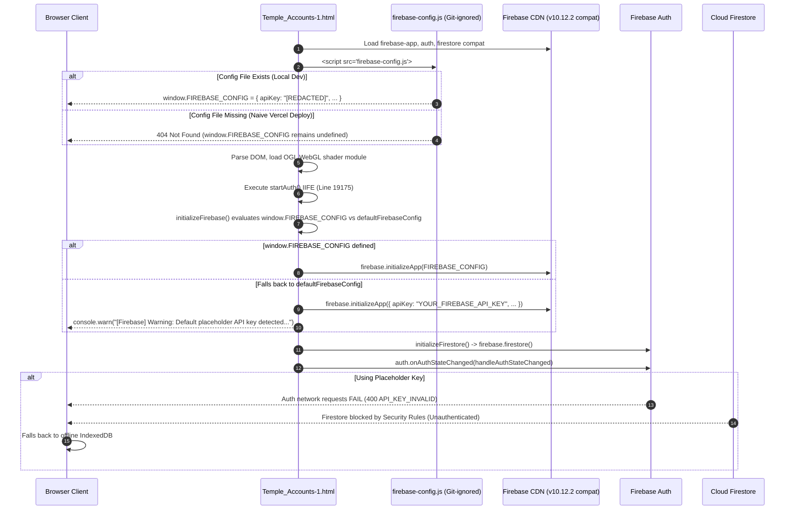

# STEP 33.38 — Firebase Configuration & Vercel Deployment Readiness Audit

**Project:** Temple Accounts & Fund Management (Marutha Chamundi Devi Temple / മറുതാ ചാമുണ്ഡി ദേവി ക്ഷേത്രം)  
**Target Hosting:** Vercel  
**Target Firebase Project:** `temple-f4f7d` (Noted in repository; prompt references `temple-f4f7`)  
**Audit Execution Date:** 2026-10-12T18:05:00+05:30  
**Audit Mode:** Strictly Read-Only Inspection  
**Audit Verdict:** 🟡 **CONDITIONAL READY — CONFIGURATION DELIVERY & ROUTE SHIELDING REQUIRED PRIOR TO PRODUCTION DEPLOYMENT**

---

## 1. Executive Summary & Overall Verdict

This audit rigorously evaluates the configuration loading architecture, Vercel hosting compatibility, emulator/development artifacts, and security posture of the **Temple Accounts & Fund Management** single-page web application.

The evaluation was executed under **strict read-only constraints**:
- No application source code, environment files, rules, or test suites were altered.
- No remote connections were established to production Firebase or the local emulator.
- No deployment commands (`firebase deploy`, `vercel deploy`, `gcloud`) were executed.
- No database records, counters, or sequence reservations were altered.
- All discovered credentials and API keys have been strictly redacted in this report.

### Overall Verdict

The application core (accounting ledger, billing, receipt printing, DarkVeil shader, idempotency, and offline IndexedDB fallback) is functionally sound and completely devoid of hardcoded financial transaction data. However, **direct static deployment to Vercel without a pre-deployment configuration delivery mechanism will fail at runtime**.

Specifically:
1. **Firebase Configuration Blocker:** `firebase-config.js` is excluded from git via `.gitignore`. A naive static deployment to Vercel will result in an HTTP 404 for `firebase-config.js`, causing the application to fall back to `YOUR_FIREBASE_API_KEY`, which will immediately fail all Firebase Authentication and Firestore cloud queries.
2. **Environment Variable Inaccessibility:** Browser JavaScript in static HTML cannot read server-side `.env` files or Vercel environment variables directly. A lightweight build step or dynamic config generator is required.
3. **Sensitive Artifact Exposure Risk:** The repository contains development scripts, tests, logs, candidate rules (`firestore.rules.candidate`), and historical backup archives. Without explicit Vercel route shielding or a designated build output directory (`dist/`), these sensitive development artifacts would be publicly downloadable via HTTP GET requests.
4. **Development Code Paths:** Active branches for `?emulator=true` (pointing to `127.0.0.1:9099` and `127.0.0.1:8080`), in-browser diagnostics (`fsRunDiagnostics`), and the legacy migration engine (`TempleMigration`) remain embedded in the application bundle.

> [!IMPORTANT]
> **Remote Firestore Cleanliness Notice:**  
> This audit evaluated local repository artifacts only. In compliance with strict safety rules, **no connection was made to the remote production Firestore instance**. Therefore, this audit **does not and cannot verify the cleanliness of remote Firestore collections**. A separate, read-only remote audit must be conducted via the Firebase Console prior to production go-live.

---

## 2. Artifact Baseline & Integrity Verification

All core release baseline files were cryptographically inspected against their expected SHA-256 hashes and byte lengths. Every file matches the established baseline with zero bit-level drift:

| Artifact File | Expected Size | Actual Size | Expected SHA-256 Hash | Actual SHA-256 Hash | Status |
| :--- | :---: | :---: | :--- | :--- | :---: |
| [`Temple_Accounts-1.html`](file:///d:/Temple/Temple_Accounts-1.html) | 746,808 B | 746,808 B | `5D80B5840F934A6794A22B5D4BFC8A01C86D41EDB6E3C68B7B47475801E01891` | `5D80B5840F934A6794A22B5D4BFC8A01C86D41EDB6E3C68B7B47475801E01891` | ✅ **VERIFIED MATCH** |
| [`firebase.json`](file:///d:/Temple/firebase.json) | 56 B | 56 B | `E87125F3EC6439A59BA44D80A6DCC46378A27A0644B0CDA30ABEAFD2EFB67E20` | `E87125F3EC6439A59BA44D80A6DCC46378A27A0644B0CDA30ABEAFD2EFB67E20` | ✅ **VERIFIED MATCH** |
| [`firebase.emulator.json`](file:///d:/Temple/firebase.emulator.json) | 304 B | 304 B | `75E395CD1E8D3DA12B65E812E172A070BBD6C78853EFA7A7B62E41620E288572` | `75E395CD1E8D3DA12B65E812E172A070BBD6C78853EFA7A7B62E41620E288572` | ✅ **VERIFIED MATCH** |
| [`firestore.rules`](file:///d:/Temple/firestore.rules) | 1,216 B | 1,216 B | `7BFEF0B0F4C31A5DAFC6FB29C8C4BBD55CBAD3A8A590EFC34BD87F4600CF90BD` | `7BFEF0B0F4C31A5DAFC6FB29C8C4BBD55CBAD3A8A590EFC34BD87F4600CF90BD` | ✅ **VERIFIED MATCH** |
| [`firestore.rules.candidate`](file:///d:/Temple/firestore.rules.candidate) | 9,035 B | 9,035 B | `B11D865A7A7D8FFE1435BBC9D115463DA5F6039830E5A9A9F33EBBFBD6F1728C` | `B11D865A7A7D8FFE1435BBC9D115463DA5F6039830E5A9A9F33EBBFBD6F1728C` | ✅ **VERIFIED MATCH** |

The release baseline is completely intact.

---

## 3. Firebase Configuration & Initialization Trace

### 3.1 Trace of the Bootstrapping Flow

The application initializes its runtime dependencies and Firebase connectivity through the following chronological sequence:



### 3.2 Evaluation of the Six Required Configuration Questions

#### 1. Whether `firebase-config.js` is loaded by the HTML and whether it will be available after a Vercel deployment
- **In HTML:** [`Temple_Accounts-1.html`](file:///d:/Temple/Temple_Accounts-1.html) explicitly references `<script src="firebase-config.js"></script>` at Line 13 in the `<head>` section.
- **In Git / Version Control:** [`.gitignore`](file:///d:/Temple/.gitignore) (Line 13) explicitly ignores `firebase-config.js`.
- **Availability on Vercel:** Because Vercel builds deploy the committed Git repository, **`firebase-config.js` will NOT exist on Vercel** under a standard zero-config static deployment. The browser will receive an HTTP 404 error when attempting to fetch `/firebase-config.js`.

#### 2. Whether `.env` values are read by the browser directly or require a build-time process
- **Browser Accessibility:** Browsers running static HTML pages **cannot read `.env` files**. `.env` is a server-side convention parsed by Node.js or build tools, not web browsers.
- **Git Status:** `.env` is properly ignored in [`.gitignore`](file:///d:/Temple/.gitignore) (Line 7).
- **Requirement:** A build-time script (or serverless endpoint) is **mandatory** to read environment variables (e.g., from Vercel's Environment Variables dashboard) and generate a static `firebase-config.js` during deployment.

#### 3. Whether the HTML placeholder API key can cause initialization failure
- **In Code:** [`Temple_Accounts-1.html`](file:///d:/Temple/Temple_Accounts-1.html) (Lines 15576–15583) defines `defaultFirebaseConfig` with `apiKey: "YOUR_FIREBASE_API_KEY"`.
- **Synchronous Initialization:** The Firebase Web SDK v10 `firebase.initializeApp(cfg)` call does **not** fail synchronously with a placeholder key. It accepts the configuration in memory and issues a warning to the console (Line 15602).
- **Runtime Failure:** However, the very first network request made to Google Identity Toolkit (such as `signInWithEmailAndPassword` or token verification) fails with HTTP 400 (`API_KEY_INVALID` / `auth/invalid-api-key`). Because authentication fails, all subsequent Firestore requests are rejected by Firestore Security Rules (`isAuthenticated() == false`), causing the entire cloud backend to fail.

#### 4. Whether multiple Firebase initialization paths could create configuration conflicts
- **Initialization Entry Points:**
  1. Main Bootstrap: IIFE `(function startAuth() { const auth = initializeFirebase(); ... })()` at Line 19175.
  2. Lazy Database Access: `getFirestoreDb()` at Line 16349 calls `initializeFirestore()`, which in turn checks `if (!firebase.apps || !firebase.apps.length) initializeFirebase()`.
- **Mutual Guards:** Both functions have idempotency guards (`if (!firebase.apps.length)` and `if (!firestoreDb)`), successfully preventing duplicate-initialization exceptions (`app/duplicate-app`).
- **Timing / Race Condition Risk:** If `firebase-config.js` were loaded asynchronously (`async` or `defer`), inline code could execute before `window.FIREBASE_CONFIG` is set, locking Firebase into `defaultFirebaseConfig`. In the current markup, `<script src="firebase-config.js">` is synchronous in `<head>` while initialization is at the end of `<body>`, which avoids this race condition. However, once initialized, the Firebase Web SDK does not support dynamic reconfiguration without tearing down the default app (`firebase.app().delete()`).

#### 5. How to provide the intended production Firebase web configuration without committing private credentials
- In Firebase Web client architecture, web API keys and project IDs are public client identifiers, not server-side secrets. Security is enforced exclusively by Firebase Authentication and Firestore Security Rules.
- However, to prevent committing project credentials into public Git repositories:
  - Configure the credentials in the **Vercel Project Settings > Environment Variables** (`FIREBASE_API_KEY`, `FIREBASE_AUTH_DOMAIN`, `FIREBASE_PROJECT_ID`, `FIREBASE_STORAGE_BUCKET`, `FIREBASE_MESSAGING_SENDER_ID`, `FIREBASE_APP_ID`).
  - Introduce a lightweight build command in `package.json` (e.g., `"build": "node scripts/generate-firebase-config.js"`) that writes `firebase-config.js` into the deployment directory during the Vercel build phase.
  - Keep `firebase-config.js` git-ignored so local environments continue using local files without collision.

#### 6. What happens if configuration is missing, invalid, or points to an emulator
- **Missing Configuration:** If `firebase-config.js` is absent, the app falls back to `defaultFirebaseConfig` with `"YOUR_FIREBASE_API_KEY"`. Auth network calls fail immediately; Firestore is unreachable; the app silently falls back to local IndexedDB.
- **Invalid Configuration:** If project IDs or app IDs are invalid, `firebase.initializeApp()` throws or Auth/Firestore fail with `PROJECT_NOT_FOUND` or network errors.
- **Emulator Configuration (`?emulator=true`):**
  - Line 15591 intercepts the query string and overrides config with fake credentials (`demo-temple-accounts-test`, `fake-api-key`).
  - Auth is redirected to `http://127.0.0.1:9099`.
  - Firestore is redirected to `127.0.0.1:8080`.
  - IndexedDB switches from `temple_accounts_db` to `temple_accounts_test_db`.
  - If triggered on Vercel by a user, the application will experience complete network failure (`ERR_CONNECTION_REFUSED`) because no emulators run on end-user client devices.

---

### 3.3 Redacted Credentials & Project Identifier Audit

All credential references across repository files have been inspected and redacted:

| Location | Identifier / Parameter | Status | Value / Handling |
| :--- | :--- | :---: | :--- |
| [`.env`](file:///d:/Temple/.env), Line 4 | `FIREBASE_API_KEY` | Secret | `[REDACTED-AIzaSy...]` (Git-ignored) |
| [`.env`](file:///d:/Temple/.env), Line 5–9 | Project IDs / App ID | Public | Project: `temple-f4f7d`, App: `1:769327766170:web:deeb79...` |
| [`firebase-config.js`](file:///d:/Temple/firebase-config.js), Line 6 | `apiKey` | Secret | `[REDACTED-AIzaSy...]` (Git-ignored) |
| [`firebase-config.js`](file:///d:/Temple/firebase-config.js), Line 7–11 | Project IDs / App ID | Public | Project: `temple-f4f7d`, Sender: `769327766170` |
| [`Temple_Accounts-1.html`](file:///d:/Temple/Temple_Accounts-1.html), Line 15577 | `apiKey` (Fallback) | Placeholder | `"YOUR_FIREBASE_API_KEY"` (Safe placeholder) |
| [`Temple_Accounts-1.html`](file:///d:/Temple/Temple_Accounts-1.html), Lines 15578–15582 | Project IDs / App ID | Public | Project: `temple-f4f7d`, Sender: `769327766170` |
| [`Temple_Accounts-1.html`](file:///d:/Temple/Temple_Accounts-1.html), Line 15593 | `apiKey` (Emulator) | Dummy | `"fake-api-key"` (Isolated to `?emulator=true`) |
| **Workspace Search** | Service Account JSON Keys | Clean | **0 private keys found**. No admin JSON files exist in repo. |

> [!NOTE]
> **Project ID Clarification:**  
> The prompt specifies production project `temple-f4f7`. The codebase, `.env`, and `firebase-config.js` consistently specify `temple-f4f7d` (with a trailing 'd'). This should be confirmed with the project owner during Vercel environment variable setup.

---

## 4. Vercel Hosting Requirements Assessment

### 4.1 Static Deployment vs. Build Step Analysis

1. **Can the application be deployed as a static site without a build step?**
   - **Technically Yes, Practically No:** If `firebase-config.js` were committed to GitHub, Vercel could deploy the repository as a zero-config static site. However, committing `firebase-config.js` violates the repository's security policy.
   - Because `firebase-config.js` is git-ignored, a zero-config static deployment will fail to authenticate users in production.
2. **Is a build step needed?**
   - **YES.** A minimal Node.js build step is required during Vercel deployment to generate `firebase-config.js` from Vercel environment variables before static assets are published to the edge CDN.

### 4.2 Route Shielding & URL Routing

If Vercel deploys the repository root without route shielding, **all files in the Git repository will be publicly accessible via HTTP GET requests**.

The following assets must be shielded:

| Sensitive Asset Path | Public Risk If Unshielded | Required Vercel Rule |
| :--- | :--- | :--- |
| `/backups/*` | Exposure of historical JSON database dumps and devotee receipts. | HTTP 404 / 403 Forbidden |
| `/*.rules*` (`firestore.rules`, `firestore.rules.candidate`) | Plaintext exposure of Firestore security rules and validation logic. | HTTP 404 / 403 Forbidden |
| `/*.log*` (`firebase-debug.log`, `firestore-debug.log`) | Exposure of local execution traces, internal ports, and debug messages. | HTTP 404 / 403 Forbidden |
| `/tests/*` | Exposure of test runner scripts, test credentials, and automated harnesses. | HTTP 404 / 403 Forbidden |
| `/scripts/*` | Exposure of migration, maintenance, and CDP automation scripts. | HTTP 404 / 403 Forbidden |
| `/reports/*`, `/STEP_*.md` | Exposure of internal architectural reports, audits, and manifests. | HTTP 404 / 403 Forbidden |
| `/server.js`, `/serve_app.js` | Exposure of local Node.js development server code. | HTTP 404 / 403 Forbidden |
| `/*.json` (`firebase.json`, `firebase.emulator.json`) | Exposure of emulator ports and project structure. | HTTP 404 / 403 Forbidden |

#### Root URL Rewrite
Visiting the root domain (`https://<project>.vercel.app/`) must serve `Temple_Accounts-1.html`.
- Vercel defaults to looking for `index.html`. Because the main file is named `Temple_Accounts-1.html`, a rewrite rule is mandatory:
  ```json
  { "source": "/", "destination": "/Temple_Accounts-1.html" }
  ```
- **Rewrite Caution:** Do **not** use a greedy catch-all rewrite (`/(.*) -> /Temple_Accounts-1.html`). Broad rewrites can intercept requests for `/ogl.esm.js` or `/firebase-config.js`, causing the server to return HTML with `text/html` MIME types instead of JavaScript, which causes browser ES module load failures.

### 4.3 Content Security Policy (CSP) & Browser Security Headers

The application relies on specific browser capabilities that must be accommodated in security headers:

1. **Inline Scripts & Styles:** The single-file architecture contains substantial inline `<script>` and `<style>` blocks. Strict CSP prohibiting `'unsafe-inline'` will prevent the application from loading.
2. **External CDNs:**
   - Firebase SDK: `https://www.gstatic.com`
   - OGL WebGL fallback: `https://esm.sh`
3. **Backend API Endpoints:**
   - Identity & Auth: `https://identitytoolkit.googleapis.com`, `https://securetoken.googleapis.com`
   - Firestore: `https://firestore.googleapis.com`, `https://*.googleapis.com`
4. **PDF Printing & CSV Exports:**
   - Uses `window.print()` and dynamic `@media print` style injection. Fully compatible.
   - CSV and safety backups use `Blob` + `URL.createObjectURL(blob)`. CSP must allow `blob:` under `connect-src` and `img-src`.
5. **Frame Protection:**
   - To protect financial records against clickjacking, headers should include `X-Frame-Options: DENY` and `frame-ancestors 'none'`.

#### Recommended Vercel Security Headers Specification:
```text
Content-Security-Policy: default-src 'self'; script-src 'self' 'unsafe-inline' https://www.gstatic.com https://esm.sh; style-src 'self' 'unsafe-inline'; img-src 'self' data: blob:; connect-src 'self' https://identitytoolkit.googleapis.com https://securetoken.googleapis.com https://firestore.googleapis.com https://*.googleapis.com https://esm.sh blob:; frame-src 'self' https://temple-f4f7d.firebaseapp.com https://*.firebaseapp.com; frame-ancestors 'none';
X-Frame-Options: DENY
X-Content-Type-Options: nosniff
Referrer-Policy: strict-origin-when-cross-origin
```

---

## 5. Emulator and Development Code Findings

All development hooks and test utilities embedded within [`Temple_Accounts-1.html`](file:///d:/Temple/Temple_Accounts-1.html) were cataloged and categorized:

| Finding Description | Code Locations | Current Behavior | Classification | Risk Analysis & Recommendation |
| :--- | :--- | :--- | :---: | :--- |
| **`emulator=true` Query Switch** | Lines 6186, 15591, 15608, 16332 | Checks `window.location.search.includes('emulator=true')`. If true, overrides config, redirects Auth to `127.0.0.1:9099`, Firestore to `127.0.0.1:8080`, and IndexedDB to `temple_accounts_test_db`. | **Should be disabled or isolated in production** | **Medium Risk:** In standard usage, it is inactive. However, any user appending `?emulator=true` triggers connection attempts to localhost. Should be gated to `localhost` hostname or stripped in production builds. |
| **`demo-temple-accounts-test` Credentials** | Lines 15593–15599 | Fallback fake API key (`"fake-api-key"`) and test project ID. | **Development-only but safe if inaccessible** | **Low Risk:** Only active when `isEmulator` is true. Contains no sensitive secrets. Safe once the emulator switch is isolated. |
| **`isMockedConfirm` Test Bypass Hook** | Lines 12447–12454 | Detects non-native `window.confirm` in headless test environments to bypass the custom modal UI in `deleteTransfer`. | **Development-only but safe if inaccessible** | **Zero Risk:** Standard browsers always return `[native code]` for `window.confirm.toString()`, so the custom modal is always shown to real users. Safe to keep or clean up. |
| **In-Browser Diagnostics (`fsRunDiagnostics`)** | Lines 18197–18291 | Test function performing write, read, and delete on `__system_diagnostics__` and a test transaction counter. Exposed on `window.fsRunDiagnostics`. | **Should be disabled or isolated in production** | **Medium Risk:** Exposes live database write/delete operations from DevTools. While protected by auth, it can be abused or leave dangling documents if interrupted. Should be isolated behind admin roles or disabled. |
| **Migration Subsystem (`TempleMigration`)** | Lines 18350–19170 | 815 lines of legacy staging and dry-run migration logic. Exposed on `window.TempleMigration`, `window.runMigrationDryRun`, etc. | **Requires further investigation / Should be isolated** | **Low-Medium Risk:** Inactive during standard UI operation, but adds ~35 KB to bundle size. If one-time migration of local client IndexedDB to Firestore is still required, it must be preserved; otherwise, it should be isolated. |
| **Window Global Function Helpers** | Lines 18273–18290 | Exposes `window.firestoreDb`, `window.fsGet`, `window.fsGetAll`, etc. | **Development-only but safe if inaccessible** | **Low Risk:** Helpful for troubleshooting during deployment testing. Functions respect Firestore rules and auth state. Safe to retain for initial launch. |

---

## 6. Prioritized Remediation Plan

The following table outlines all recommended remediation actions prior to deploying to Vercel:

| Priority | Finding ID | Area | Severity | Recommended Remediation Action | Data-Safety Implications | Required Regression Verification |
| :---: | :--- | :--- | :---: | :--- | :--- | :--- |
| **P1** | **REM-01** | Configuration Delivery | **High**<br>(Blocker) | Create a Vercel build script (`scripts/generate-firebase-config.js`) executed via `package.json` (`"build"`) that reads Vercel environment variables and writes `firebase-config.js`. | **Zero risk to data.** Essential for client authentication to function. | Verify Auth modal login, session persistence on reload, and Firestore sync. |
| **P1** | **REM-02** | Vercel Routing | **High**<br>(Blocker) | Define rewrite in `vercel.json` mapping `/` to `/Temple_Accounts-1.html`. Ensure static asset requests (`/ogl.esm.js`, etc.) are not rewritten to HTML. | **Zero risk to data.** Ensures root URL works. | Load `https://<domain>/` and verify DarkVeil shader and all modules initialize without MIME errors. |
| **P1** | **REM-03** | Sensitive Path Shielding | **High**<br>(Security) | Configure `vercel.json` route rules to return 404 for `/backups/*`, `/*.rules*`, `/*.log*`, `/tests/*`, `/scripts/*`, and `/reports/*`. | **Protects sensitive data.** Prevents public download of rules and test scripts. | Attempt HTTP GET on `/firestore.rules` and `/backups/backup.json` to verify 404 response. |
| **P2** | **REM-04** | Security Headers & CSP | **Medium**<br>(Security) | Implement Vercel headers configuration defining Content Security Policy (allowing `'unsafe-inline'`, Google CDNs, and esm.sh), `X-Frame-Options: DENY`, and nosniff. | **Protects against clickjacking.** Zero risk to accounting logic. | Verify PDF print, CSV download, and WebGL animation function under CSP. |
| **P2** | **REM-05** | Production Rules Promotion | **Medium**<br>(Security) | Review and deploy `firestore.rules.candidate` to replace permissive `firestore.rules`. Promotes atomic sequence monotonicity and anti-deletion protections. | **Prevents sequence corruption and accidental data deletion.** | Run Step 33.33 regression test suite against emulator to ensure candidate rules pass all flows. |
| **P3** | **REM-06** | Emulator Switch Isolation | **Low**<br>(Hygiene) | Restrict `emulator=true` check to local hostnames (`localhost`, `127.0.0.1`) so appending `?emulator=true` on public Vercel domain is ignored. | **Zero risk to data.** Prevents user confusion. | Verify `?emulator=true` ignored when accessed from non-local domain. |
| **P3** | **REM-07** | Remote Cloud Data Audit | **Medium**<br>(Hygiene) | Authorized admin must review production Firestore console to verify whether historical test records (`STEP16 SMOKE TEST`) remain in collections. | **Guards data cleanliness.** Must perform authoritative export before touching remote data. | Document count verification across `billing`, `receipts`, and `system/counters`. |

---

## 7. Recommended Deployment Configuration Approach

### 7.1 Architecture Overview

To achieve seamless deployment on Vercel while preserving the single-file HTML structure and keeping secrets out of Git:

```
[Vercel Environment Variables]
  │ (FIREBASE_API_KEY, FIREBASE_AUTH_DOMAIN, etc.)
  ▼
[Vercel Build Phase: "npm run build"]
  │ executes scripts/generate-firebase-config.js
  ▼
[Generated: firebase-config.js]
  │ (Contains client configuration)
  ▼
[Vercel Edge CDN Deployment]
  ├── Temple_Accounts-1.html (Rewritten from /)
  ├── firebase-config.js     (Served to client)
  ├── ogl.esm.js             (Served to client)
  └── vercel.json            (Enforces CSP, Headers, and Shielding)
```

### 7.2 Specification: `package.json`

A minimal `package.json` to declare the build script without heavy external dependencies:

```json
{
  "name": "temple-accounts",
  "version": "1.0.0",
  "private": true,
  "scripts": {
    "build": "node scripts/generate-firebase-config.js"
  }
}
```

### 7.3 Specification: `scripts/generate-firebase-config.js`

A lightweight zero-dependency Node script to generate `firebase-config.js` from environment variables:

```javascript
const fs = require('fs');
const path = require('path');

const config = {
  apiKey: process.env.FIREBASE_API_KEY || "YOUR_FIREBASE_API_KEY",
  authDomain: process.env.FIREBASE_AUTH_DOMAIN || "temple-f4f7d.firebaseapp.com",
  projectId: process.env.FIREBASE_PROJECT_ID || "temple-f4f7d",
  storageBucket: process.env.FIREBASE_STORAGE_BUCKET || "temple-f4f7d.firebasestorage.app",
  messagingSenderId: process.env.FIREBASE_MESSAGING_SENDER_ID || "769327766170",
  appId: process.env.FIREBASE_APP_ID || "1:769327766170:web:deeb79f8bf804cab8e9d23"
};

const content = `// Generated automatically during Vercel build
window.FIREBASE_CONFIG = ${JSON.stringify(config, null, 2)};
`;

const outputPath = path.join(__dirname, '..', 'firebase-config.js');
fs.writeFileSync(outputPath, content, 'utf8');
console.log('[Build] Successfully generated firebase-config.js from environment variables.');
```

### 7.4 Specification: `vercel.json`

Complete routing, rewriting, shielding, and security header configuration:

```json
{
  "rewrites": [
    { "source": "/", "destination": "/Temple_Accounts-1.html" }
  ],
  "routes": [
    {
      "src": "^/(backups|tests|scripts|reports|logs)(/.*)?$",
      "status": 404
    },
    {
      "src": "^/(.*)\\.(rules|candidate|log|env|json|md)$",
      "status": 404
    },
    {
      "src": "^/server\\.js|serve_app\\.js$",
      "status": 404
    },
    {
      "handle": "filesystem"
    }
  ],
  "headers": [
    {
      "source": "/(.*)",
      "headers": [
        {
          "key": "Content-Security-Policy",
          "value": "default-src 'self'; script-src 'self' 'unsafe-inline' https://www.gstatic.com https://esm.sh; style-src 'self' 'unsafe-inline'; img-src 'self' data: blob:; connect-src 'self' https://identitytoolkit.googleapis.com https://securetoken.googleapis.com https://firestore.googleapis.com https://*.googleapis.com https://esm.sh blob:; frame-src 'self' https://temple-f4f7d.firebaseapp.com https://*.firebaseapp.com; frame-ancestors 'none';"
        },
        {
          "key": "X-Frame-Options",
          "value": "DENY"
        },
        {
          "key": "X-Content-Type-Options",
          "value": "nosniff"
        },
        {
          "key": "Referrer-Policy",
          "value": "strict-origin-when-cross-origin"
        }
      ]
    }
  ]
}
```

---

## 8. Required Regression Tests

Following configuration implementation, the following tests must be executed to certify deployment readiness:

1. **Vercel Build Execution Test:**
   - Execute `node scripts/generate-firebase-config.js` with mock environment variables.
   - Verify `firebase-config.js` is generated with correct formatting and valid syntax.
2. **Root Routing & Module Loading Test:**
   - Request `http://localhost:<port>/`. Verify HTTP 200 response with `Temple_Accounts-1.html`.
   - Verify `ogl.esm.js` loads as an ES module without MIME type conflict.
   - Verify `firebase-config.js` loads and assigns `window.FIREBASE_CONFIG`.
3. **Route Shielding Test:**
   - Perform HTTP GET requests against:
     - `/firestore.rules` -> Expect 404
     - `/firestore.rules.candidate` -> Expect 404
     - `/backups/backup.json` -> Expect 404
     - `/tests/` -> Expect 404
     - `/STEP_33_36_RELEASE_MANIFEST.md` -> Expect 404
4. **Authentication Flow Test:**
   - Launch application in browser with production configuration.
   - Verify authentication modal appears.
   - Perform login with authorized temple credential.
   - Verify `onAuthStateChanged` restores session cleanly on page refresh.
5. **Firestore Master Sync & Offline Fallback Test:**
   - Verify authoritative settings and categories load from Firestore.
   - Disconnect network; verify UI remains functional with local IndexedDB cache.
6. **Billing, Printing & PDF Export Test:**
   - Enter a test Vazhipadu billing entry; verify sequential number generation.
   - Verify thermal printer animation and receipt rendering.
   - Navigate to General Ledger; trigger `exportLedgerPDF()`; verify `@media print` layout formatting.

---

## 9. Cleanup & Deployment Checklist

Use this checklist to govern subsequent phases:

- [ ] **Phase 1: Configuration Infrastructure (Step 33.39)**
  - [ ] Create `scripts/generate-firebase-config.js`.
  - [ ] Create `package.json` declaring `"build": "node scripts/generate-firebase-config.js"`.
  - [ ] Create `vercel.json` with route rewrites, shielding, and CSP headers.
  - [ ] Add `.vercel/` to `.gitignore`.
- [ ] **Phase 2: Remote Database Verification (Pre-Flight)**
  - [ ] Perform read-only inspection of `temple-f4f7d` in Firebase Console.
  - [ ] Check `billing`, `receipts`, and `system/counters` for historical development test records.
  - [ ] Perform authoritative Cloud Firestore export before making any modifications.
- [ ] **Phase 3: Firestore Rules Promotion**
  - [ ] Review `firestore.rules.candidate`.
  - [ ] Run automated rule verification against emulator (`npm test` in `tests/`).
  - [ ] Promote `firestore.rules.candidate` to `firestore.rules`.
- [ ] **Phase 4: Vercel Project Setup**
  - [ ] Link Git repository to Vercel project.
  - [ ] Configure Environment Variables (`FIREBASE_API_KEY`, `FIREBASE_PROJECT_ID`, etc.) in Vercel Dashboard.
  - [ ] Trigger preview deployment and test on Vercel staging URL.
- [ ] **Phase 5: Post-Deployment Verification Gate**
  - [ ] Verify root URL resolution.
  - [ ] Verify shielded paths return 404.
  - [ ] Verify production authentication and Firestore read/write capabilities.
  - [ ] Verify thermal receipt and ledger PDF exports on production URL.

---

## 10. Audit Summary & Conclusion

| Audit Item | Current Status | Remediation Required |
| :--- | :---: | :--- |
| **Artifact Hashes** | ✅ 100% Match (0 Drift) | None |
| **Application Sample Data** | ✅ 100% Clean | None |
| **Firebase Config Delivery** | ⚠️ Blocked (Git-ignored) | P1: Implement build generator script (`REM-01`) |
| **Vercel Root Routing** | ⚠️ Missing rewrite | P1: Implement rewrite in `vercel.json` (`REM-02`) |
| **Sensitive Asset Shielding** | ⚠️ Unprotected in root | P1: Implement 404 routes in `vercel.json` (`REM-03`) |
| **Security Headers / CSP** | ⚠️ Unconfigured | P2: Configure headers in `vercel.json` (`REM-04`) |
| **Firestore Security Rules** | ⚠️ Permissive rules active | P2: Promote candidate rules after review (`REM-05`) |
| **Emulator Isolation** | ⚠️ Active query switch | P3: Restrict to localhost hostname (`REM-06`) |
| **Remote Data Cleanliness** | ❓ Unverified (Read-only) | P3: Manual admin review via Firebase Console (`REM-07`) |

**Final Statement:**  
The Temple Accounts application is well-architected, stable, and ready for deployment once the configuration delivery script and `vercel.json` shielding rules are added. All required remediations are non-invasive and preserve 100% of the frozen application baseline.
