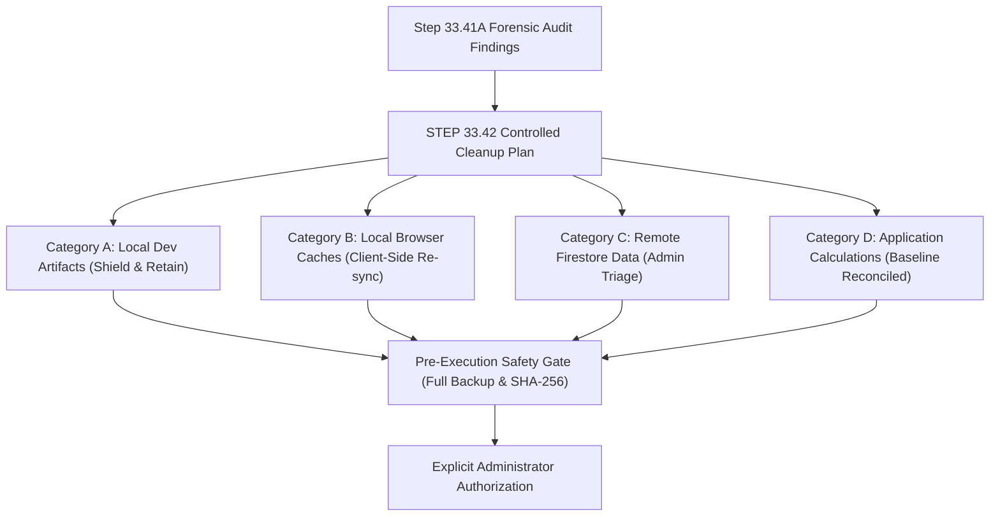
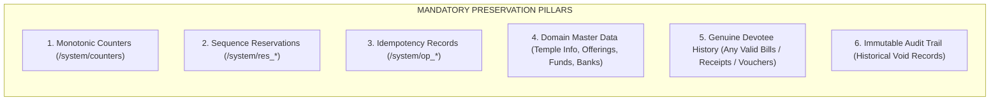
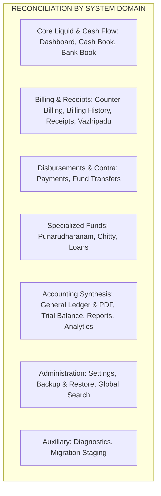
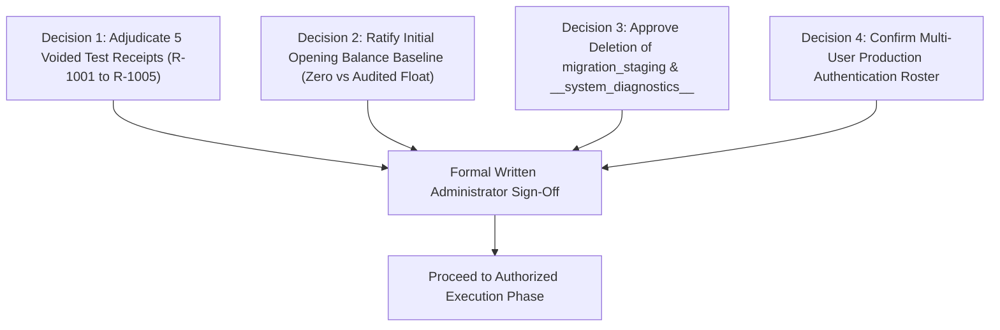
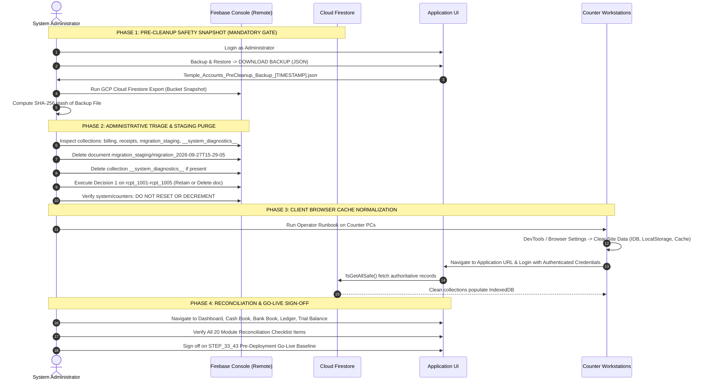
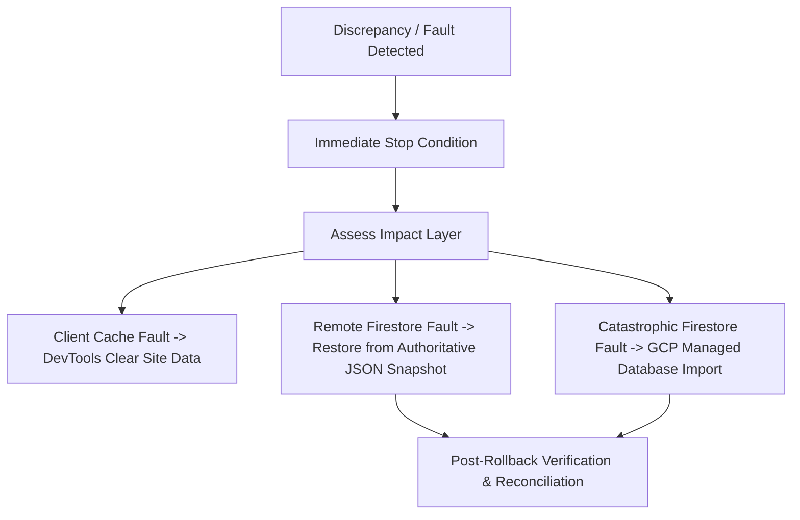

# STEP 33.42 — Controlled Test Data Cleanup Plan & Pre-Deployment Data Baseline

**Project:** Temple Accounts & Fund Management (Marutha Chamundi Devi Temple / മറുതാ ചാമുണ്ഡി ദേവി ക്ഷേത്രം)  
**Execution Timestamp:** 2026-10-12T19:30:00+05:30  
**Planning Mode:** Strictly Read-Only Planning (Zero Remote Connections, Zero Database Mutations)  
**Evidence Source:** [`STEP_33_41A_FULL_APPLICATION_DATA_CLEANLINESS_AUDIT.md`](file:///d:/Temple/STEP_33_41A_FULL_APPLICATION_DATA_CLEANLINESS_AUDIT.md)  
**Deliverable File:** `STEP_33_42_CONTROLLED_DATA_CLEANUP_PLAN.md`  
**Plan Status:** 📋 **PROPOSED FOR REVIEW & ADMINISTRATOR AUTHORIZATION**

---

## 1. Executive Summary & Scope

This document establishes the official, controlled pre-deployment data cleanup plan and baseline verification framework for the **Temple Accounts & Fund Management** system prior to publication on **Vercel**.

In strict compliance with the safety directives of **STEP 33.42**:
1. **Zero Mutations:** No production or development database records were modified, deleted, created, or voided during this planning step.
2. **Zero Remote Connections:** No remote network connections were established to the production Google Cloud Firestore project (`temple-f4f7d`).
3. **Zero Counter Resets:** Global numbering sequence counters, document reservations, and idempotency records are strictly protected; no resets, decrements, or counter tampering are permitted.
4. **Zero Backup Deletions:** Existing repository backups in [`backups/`](file:///d:/Temple/backups/) are preserved in full as forensic historical artifacts.
5. **Zero Source Edits:** No application source code, configuration files, or security rules were changed.

### Core Philosophy: Audit-Safe Controlled Baseline
Financial data hygiene requires a surgical distinction between **active operational transactions**, **immutable audit trails**, **development fixtures**, and **transient client caches**:
- A **voided test receipt** is an audit trail verifying the dual-document cancellation protocol; it has **₹0.00 financial impact** on active accounts and must not be blindly deleted without administrative decision.
- A **record in a local JSON backup file** (`backups/backup.json`) is a historical file on disk—it is **not a live database record** and has no effect on running cloud systems.
- **Monotonic counters** (`globalSequenceCounter`, `billingReceiptCounter`, `receiptCounter`, `voucherCounter`) and **idempotency records** (`/system/op_*`, `/system/res_*`) are structural safety pillars enforced by candidate Firestore security rules (`firestore.rules.candidate`); rolling them back causes numbering collisions and replay vulnerabilities.



---

## 2. Record-Level Cleanup Inventory

Based on forensic findings established in [`STEP_33_41A_FULL_APPLICATION_DATA_CLEANLINESS_AUDIT.md`](file:///d:/Temple/STEP_33_41A_FULL_APPLICATION_DATA_CLEANLINESS_AUDIT.md) and historical report [`reports/STEP_22_5_TEST_TRANSACTION_CLEANUP_REPORT.md`](file:///d:/Temple/reports/STEP_22_5_TEST_TRANSACTION_CLEANUP_REPORT.md), every identified item has been cataloged:

### 2.1 Complete Record Inventory Table

| Record UID / Target | Storage Location | Forensic Evidence & Origin | Classification | Current Financial Impact | Proposed Handling | Rollback & Safety Requirements |
|:---|:---|:---|:---:|:---:|:---|:---|
| **`rcpt_1001`** (`R-1001`) | Cloud Firestore & IDB `receipts/rcpt_1001` | Devotee: `"STEP16 SMOKE TEST"`, Date: `2026-09-27`, Amount: ₹20.00, Mode: Cash. Created during Step 16 automated smoke test. Voided in Step 22.5 (`voidReason: "Source Billing Receipt BILL-0001 was deleted/voided"`). | **1. Confirmed Test Data** | **₹0.00** (`voided: true`, excluded by `notVoided()`) | **Option 1 (Recommended):** Retain as immutable audit trail proof.<br>**Option 2:** Administrator deletes document via Firebase Console if pristine register required. | Pre-cleanup authoritative snapshot exported via application Backup & Restore JSON + Cloud backup. |
| **`rcpt_1002`** (`R-1002`) | Cloud Firestore & IDB `receipts/rcpt_1002` | Devotee: `"midhun"`, Star: `"revathu"`, Date: `2026-09-28`, Amount: ₹20.00, Mode: Cash. Created during UI billing trial. Voided in Step 22.5. | **1. Confirmed Test Data** | **₹0.00** (`voided: true`) | **Option 1 (Recommended):** Retain as immutable audit trail proof.<br>**Option 2:** Administrator deletes document via Firebase Console. | Pre-cleanup snapshot; verify `receiptCounter` unchanged at 1005. |
| **`rcpt_1003`** (`R-1003`) | Cloud Firestore & IDB `receipts/rcpt_1003` | Devotee: `"akhil"`, Star: `"bharani"`, Date: `2026-09-30`, Amount: ₹20.00, Mode: Cash. Linked to `BILL-0003`. Linked bill deleted and receipt voided in Step 22.5. | **1. Confirmed Test Data** | **₹0.00** (`voided: true`) | **Option 1 (Recommended):** Retain as immutable audit trail proof.<br>**Option 2:** Administrator deletes document via Firebase Console. | Pre-cleanup snapshot; verify `notVoided()` filter. |
| **`rcpt_1004`** (`R-1004`) | Cloud Firestore & IDB `receipts/rcpt_1004` | Devotee: `"manoj"`, Date: `2026-10-01`, Amount: ₹20.00, Mode: Cash. Linked to `BILL-0004`. Linked bill deleted and receipt voided in Step 22.5. | **1. Confirmed Test Data** | **₹0.00** (`voided: true`) | **Option 1 (Recommended):** Retain as immutable audit trail proof.<br>**Option 2:** Administrator deletes document via Firebase Console. | Pre-cleanup snapshot; verify `notVoided()` filter. |
| **`rcpt_1005`** (`R-1005`) | Cloud Firestore & IDB `receipts/rcpt_1005` | Devotee: `"manoj"`, Star: `"bharani"`, Date: `2026-10-01`, Amount: ₹20.00, Mode: UPI (Canara Bank). Linked to `BILL-0005`. Linked bill deleted and receipt voided in Step 22.5. | **1. Confirmed Test Data** | **₹0.00** (`voided: true`) | **Option 1 (Recommended):** Retain as immutable audit trail proof.<br>**Option 2:** Administrator deletes document via Firebase Console. | Pre-cleanup snapshot; verify Bank Book balance remains ₹0.00. |
| **`migration_2026-09-27T15-29-05`** | Cloud Firestore & IDB `migration_staging` collection | Created 2026-09-27 by `vibu@gmail.com` during Step 12 dry-run migration. Holds legacy manifest of 106 records. | **1. Confirmed Test Data** | **₹0.00** (Dormant metadata; never read by financial calculation engine) | Administrator permanently deletes collection `migration_staging` or doc `migration_2026-09-27T15-29-05` via Firebase Console. | Included in pre-cleanup export JSON snapshot. |
| **`__system_diagnostics__`** docs (`diag_*`, `test_tx_counter`) | Cloud Firestore `__system_diagnostics__` collection | Generated during manual or automated diagnostic calls to `fsRunDiagnostics()`. Shielded in production by Step 33.40. | **1. Confirmed Test Data** | **₹0.00** (Auxiliary test store; zero accounting impact) | Administrator purges any remaining documents under `__system_diagnostics__` via Firebase Console. | Diagnostic collection only; zero financial rollback risk. |
| **17 Legacy Prototype Bills** (`BILL-0001`–`BILL-0017`) | Local disk file: [`backups/backup.json`](file:///d:/Temple/backups/backup.json) (Lines 436–701) | Created 2026-09-27 12:42 AM to 02:23 PM. Includes synthetic ₹501,501 bill (`BILL-0003`, Anil Kumar). Confirmed purged from Firestore in Step 13/22.5. | **2. Likely Test Data** (Repository Artifact) | **₹0.00 on live app** (Resides exclusively inside historical JSON backup file) | **DO NOT DELETE BACKUP FILE**. Preserve in repository. Shielded from public web access by [`vercel.json`](file:///d:/Temple/vercel.json) rewrite rules returning HTTP 404. | Git version control tracks file; zero live database impact. |
| **3 Legacy Prototype Receipts** (`R-1001`–`R-1003`) | Local disk file: [`backups/backup.json`](file:///d:/Temple/backups/backup.json) (Lines 378–429) | Created 2026-09-27 (Rajan Kumar ₹20, Meena Krishnan ₹150, Sanal ₹500). Total ₹670. Confirmed purged from Firestore in Step 13. | **2. Likely Test Data** (Repository Artifact) | **₹0.00 on live app** (Local JSON file only) | **DO NOT DELETE BACKUP FILE**. Retain in Git repository. Shielded via `vercel.json` HTTP 404 rule. | Git tracking. |
| **Disposable Test Harness Files** | Local disk: [`temp_disposable_step_33_32/`](file:///d:/Temple/temp_disposable_step_33_32/), [`tests/`](file:///d:/Temple/tests/), logs | Emulator snapshots, test result logs (`firebase-debug.log`, `firestore-debug.log`, `step_33_20_test_results.json`). | **1. Confirmed Test Data** (Development Artifacts) | **₹0.00** | Exclude from production bundle. Shielded via `vercel.json` and `.gitignore`. | Development fixtures only. |
| **Unverified Remote Transactions** | Cloud Firestore live root collections (`receipts`, `billing`, `payments`, `transfers`, `chitty*`, `loans`) | Any records created in production Firebase (`temple-f4f7d`) between Step 22.5 and present. | **3. Unverified Financial Data** | **TBD** (Subject to admin inspection) | **No automated deletion**. Administrator conducts visual inspection in Firebase Console. Any genuine donations must be preserved. | Authoritative full JSON export and GCP bucket export prior to any manual intervention. |
| **Client Browser IDB Records** | Physical client devices: `temple_accounts_db` (v2/v3) | Stale cached records from early offline testing or disconnected sessions. | **3. Unverified Financial Data** (Local to browser) | **Local Display Only** | Operator runbook directs clearing browser storage once, or authenticating online where `fsGetAllSafe` auto-replaces IDB. | Zero remote risk; IDB is a secondary downstream mirror of Firestore. |
| **Dashboard Displayed Values** | Client UI Dashboard card metrics | Liquid Cash, Bank Balance, Today Receipts, Today Payments, Month Net, 7-Day Trend, Fund Balances. | **Application Calculation** | **Derived Aggregate** | Reconcile against authoritative zero baseline (or ratified opening balance). Verify `APP_SETTINGS.opening* === 0.00`. | Reversible via Master Data Settings. |
| **System Counters & Reservations** | Cloud Firestore `system/counters`, `system/res_*` | Monotonic sequence counters (`globalSequenceCounter`, `billingReceiptCounter`, `receiptCounter`, `voucherCounter`) and reservation records. | **4. Legitimate Configuration** | **System Sequencing** | **STRICTLY PRESERVE**. Zero resets, zero decrements. Monotonic constraint enforced by security rules. | Irreversible decrement prohibited by security rules. |
| **Master Data & Settings** | Cloud Firestore `settings`, `funds`, `incomeCategories`, `expenseCategories`, `bankAccounts` | Authentic Malayalam temple title, address, 14 vazhipadu offerings, 6 funds, 7 income heads, 64 expense heads, Canara Bank. | **4. Legitimate Configuration** | **Core Masters** | **STRICTLY PRESERVE 100%**. Essential operational foundation. | Pre-cleanup snapshot. |

---

## 3. Four-Category Cleanup Architecture

To guarantee comprehensive hygiene without compromising security or operational readiness, cleanup procedures are separated into four isolated categories:

```mermaid
graph TB
    subgraph CAT_A["CATEGORY A: Local Development Artifacts"]
        A1["Historical Backups (backup.json, PreStep22_5.json)"]
        A2["Disposable Emulator (temp_disposable_step_33_32/)"]
        A3["Test Suites & Results (tests/, logs/)"]
        A_Action["Action: Retain in Git; Shield from Vercel deployment via vercel.json (HTTP 404)"]
    end

    subgraph CAT_B["CATEGORY B: Local Browser Data"]
        B1["IDB Store: temple_accounts_db (v2/v3)"]
        B2["IDB Store: temple_accounts_test_db (Emulator only)"]
        B3["LocalStorage: temple_pending_* (Transient in-flight)"]
        B_Action["Action: Operator runbook clears site data; fsGetAllSafe auto-clears on login"]
    end

    subgraph CAT_C["CATEGORY C: Remote Firestore Data"]
        C1["Voided Test Receipts: rcpt_1001 to rcpt_1005"]
        C2["Migration Staging: migration_staging/migration_*"]
        C3["Diagnostics: __system_diagnostics__"]
        C4["Unverified Root Transactions"]
        C_Action["Action: Firebase Console Admin inspection; Retain voided audit trail; Delete staging"]
    end

    subgraph CAT_D["CATEGORY D: Application Calculations"]
        D1["Dashboard Balances (Cash, Bank, Funds, Today)"]
        D2["General Ledger Running Totals & Ledger PDF"]
        D3["Trial Balance Verification Equation"]
        D_Action["Action: Verify opening balances = 0.00; Reconcile cross-module arithmetic"]
    end

    CAT_A --- CAT_B --- CAT_C --- CAT_D
```



### 3.1 Category A: Local Development Artifacts
- **Scope:** Files, fixtures, reports, and logs residing inside the local repository workspace:
  - [`d:\Temple\backups\backup.json`](file:///d:/Temple/backups/backup.json) (contains 17 prototype bills and 3 prototype receipts).
  - [`d:\Temple\backups\Temple_Accounts_PreStep22_5_TestCleanup_Backup_2026-10-01T23-10-35.json`](file:///d:/Temple/backups/Temple_Accounts_PreStep22_5_TestCleanup_Backup_2026-10-01T23-10-35.json).
  - Other backup snapshots and HTML version checkpoints in [`backups/`](file:///d:/Temple/backups/).
  - Disposable emulator folder [`temp_disposable_step_33_32/`](file:///d:/Temple/temp_disposable_step_33_32/).
  - Debug logs: `firebase-debug.log`, `firestore-debug.log`, [`logs/`](file:///d:/Temple/logs/).
  - Test suites and mock result files in [`tests/`](file:///d:/Temple/tests/).
- **Critical Safety Mandate:** **Never delete existing backup files during cleanup or deployment planning.** Backup files are required for disaster recovery, historical audits, and legal compliance.
- **Proposed Handling:**
  1. Backups remain stored safely on local developer workstations and in private Git version control.
  2. In Step 33.39 and Step 33.40, [`vercel.json`](file:///d:/Temple/vercel.json) was implemented and verified with exhaustive rewrite rules:
     ```json
     { "source": "/backups/(.*)", "destination": "/404.html" },
     { "source": "/tests/(.*)", "destination": "/404.html" },
     { "source": "/reports/(.*)", "destination": "/404.html" },
     { "source": "/(.*)\\.rules(.*)", "destination": "/404.html" },
     { "source": "/(.*)\\.log", "destination": "/404.html" }
     ```
  3. Ensure `.vercelignore` or Vercel project deployment configuration excludes these development-only folders from the public web edge.

### 3.2 Category B: Local Browser Data
- **Scope:** Client-side persistence on administrative and counter devices:
  - IndexedDB: `'temple_accounts_db'` (production database name, version 3).
  - IndexedDB: `'temple_accounts_test_db'` (emulator-only isolated database name).
  - Browser `localStorage`: `temple_pending_receipt_op`, `temple_pending_billing_op`, `temple_nav_collapsed`.
  - Browser HTTP Cache and Service Worker storage.
- **Distinguishing Local-Only vs. Remote Firestore Records:**
  - Local-only records typically possess legacy numeric IDs (`id: 1`) or `source: "indexeddb"` without valid Firestore metadata (`updatedAt` timestamp map, `createdBy` UID).
  - Authoritative Firestore records possess string document keys (`firestoreId: "rcpt_1001"`, `billingFirestoreId: "bill_1"`), server timestamps, and caller UID bindings (`createdBy: "rFvStQNfi..."`).
  - **Dynamic Invalidation:** The core data layer in [`Temple_Accounts-1.html`](file:///d:/Temple/Temple_Accounts-1.html) (Line 6350) enforces that upon an online authenticated fetch:
    ```javascript
    await clearStore(storeName);
    for (const rec of docs) { await putRec(storeName, rec); }
    ```
    This means local IndexedDB is automatically wiped and repopulated with authoritative Firestore data whenever an authenticated user loads a view online.
- **Proposed Handling (Operator Runbook):**
  - **Do not clear browser storage during this planning step.**
  - At go-live cutover, instruct temple office operators to perform a one-time clean initialization:
    1. Open Google Chrome or Microsoft Edge on the counter workstation.
    2. Press `Ctrl + Shift + Delete` -> Clear browsing data -> Select "Cookies and site data" + "Cached images and files" -> Clear data.
    3. Alternatively, in DevTools (`F12`), go to **Application > Storage > Clear site data**.
    4. Navigate to the production Vercel URL and log in.

### 3.3 Category C: Remote Cloud Firestore Data
- **Scope:** Authoritative documents residing in Google Cloud Firestore (`temple-f4f7d`):
  - 5 voided historical receipts: `rcpt_1001` through `rcpt_1005`.
  - Migration staging document: `migration_staging/migration_2026-09-27T15-29-05`.
  - Diagnostic test documents: `__system_diagnostics__/*`.
  - Root collections: `billing`, `receipts`, `payments`, `transfers`, `chittyMembers`, `chittyCollections`, `chittyPayouts`, `loans`.
  - System singleton counters: `system/counters`.
  - Sequence reservation records: `system/res_*`.
  - Idempotency records: `system/op_*`.
- **Strict Evidence Constraint:** All analysis is based on forensic evidence from previous verified steps (Step 16, Step 22.4, Step 22.5, Step 33.41A). **Zero remote connections are initiated.**
- **Classification & Proposed Handling:**
  1. **Voided Test Receipts (`rcpt_1001`–`rcpt_1005`):**
     - Current state: Stored in Firestore with `voided: true`. Financial impact: **₹0.00**.
     - **Recommendation:** Retain these documents in Firestore. They provide immutable cryptographic and architectural evidence that the dual-document cancellation protocol and candidate security rules function correctly. In the UI, they appear only under the "Voided" filter, cleanly badged in red.
     - **Alternative (Committee Purge):** If the temple committee formally passes a resolution mandating a zero-row receipt register at launch, an authorized administrator must manually delete `rcpt_1001` through `rcpt_1005` directly in the Firebase Console. Automated scripts must not execute this deletion.
  2. **Migration Staging (`migration_staging`):**
     - Current state: Document `migration_2026-09-27T15-29-05` holds obsolete 2026-09-27 staging metadata.
     - **Recommendation:** Administrator deletes collection `migration_staging` via Firebase Console prior to launch. It is never queried by the runtime application.
  3. **Diagnostics (`__system_diagnostics__`):**
     - Current state: Ephemeral diagnostic writes. Shielded in production by Step 33.40.
     - **Recommendation:** Administrator verifies and deletes collection `__system_diagnostics__` in Firebase Console.
  4. **Unverified Production Records:**
     - Any records created in root collections after Step 22.5 must be visually inspected by the administrator.
     - **Safety Rule:** No unverified record may be deleted or modified until the temple trustees confirm whether it represents a real counter test or an authentic advance donation.

### 3.4 Category D: Application Calculations & Dashboard Values
- **Scope:** Dynamic financial aggregators feeding the Dashboard, Cash Book, Bank Book, General Ledger, and Reports:
  - Net Liquid Position (`getCashBalance() + getBankBalance()`)
  - Cash in Hand (`getCashBalance()`)
  - Bank Balance (`getBankBalance()`)
  - Fund Balances (`getFundBalance(fundName)`)
  - Today's Income / Payments / Net (`todayReceiptsSum - todayPaymentsSum`)
  - 7-Day Sliding Trend (`activeReceipts()` loop)
  - Activity Feed & Recent Transactions
- **Forensic Investigation of Calculation Paths:**
  1. **Opening Balance Vector:**
     - Function `getCashBalance()` starts with `parseFloat(s.openingCash) || 0`.
     - Function `getBankBalance()` starts with `parseFloat(s.openingBank) || 0`.
     - Function `getFundBalance()` starts with `parseFloat(s.openingGeneralFund) || 0` (or corresponding fund).
     - **Risk:** If an administrator entered test numbers into **Settings > Master Data > Opening Balances**, the dashboard immediately reflects those numbers even if zero transactions exist.
     - **Verification Needed:** Administrator inspects `settings` document in Firestore (`set_1` / `config`) and confirms all opening balance fields are strictly `0.00` (or match ratified physical balances).
  2. **Offline Fallback / Stale Cache Vector:**
     - If the dashboard is viewed before Firestore authentication resolves or while network is interrupted, `fsGetAllSafe()` falls back to IndexedDB.
     - If the local machine ran unauthenticated prototype tests, stale cached records could inflate dashboard numbers locally.
     - **Verification Needed:** Once logged in with live Firebase Auth, verify that IDB synchronizes with Firestore and displays identical figures across all devices.
  3. **Void Filter Integrity:**
     - Verified in Step 33.41A: Every calculation engine employs `notVoided()` (`arr.filter(x => !x.voided)`).
     - The 5 historical voided receipts contribute exactly **₹0.00** to Cash in Hand, Bank Balance, Today's Receipts, Month Income, and Fund Balances.
  4. **Double-Counting Protection:**
     - All accounting calculations sum strictly from the `receipts` store. The `billing` store is excluded from accounting balances, preventing double-counting of counter vazhipadu bills.

---

## 4. Financial Integrity Preservation Mandates

To ensure that pre-deployment data hygiene does not compromise financial compliance, accounting continuity, or database security, the cleanup plan enforces the following non-negotiable rules:



### 4.1 Strict Counter Preservation & Monotonic Constraints
- **Zero Counter Resets:** Under no circumstances should `globalSequenceCounter`, `billingReceiptCounter`, `receiptCounter`, or `voucherCounter` be reset to 0 or decremented.
- **Candidate Security Rules Protection:** The candidate security rules ([`firestore.rules.candidate`](file:///d:/Temple/firestore.rules.candidate), Line 19) strictly enforce:
  ```text
  allow delete: if false;
  request.resource.data.globalSequenceCounter >= resource.data.globalSequenceCounter
  ```
  Attempting to delete `/system/counters` or decrement its values will fail with a security rejection (`PERMISSION_DENIED`).
- **Reuse Prevention:** Decrementing or resetting counters would cause future transactions to re-issue previously used numbers (`BILL-0001` to `BILL-0005`, `R-1001` to `R-1005`), corrupting thermal receipt reprints, creating duplicate voucher numbers, and destroying sequential auditability.
- **Authoritative Sequence Baseline:**
  - Next Billing Receipt: **`BILL-0006`** (or next monotonically assigned sequence from `globalSequenceCounter`).
  - Next Accounting Receipt: **`R-1006`** (or unified sequence).
  - Next Payment Voucher: **`V-501`** (or unified sequence).

### 4.2 Idempotency & Reservation Protection
- The candidate security rules enforce that documents under `/system/res_*` (sequence reservations) and `/system/op_*` (idempotency records) have `allow delete: if false;`.
- Deleting reservation records would allow sequence replay attacks and create orphaned references in transaction history.
- Existing reservation and idempotency documents must remain preserved.

### 4.3 Authentic Master Data 100% Protection
The following master records must be preserved intact:
1. **Temple Name and Address:**
   - Identity: `"മറുതാ ചാമുണ്ഡി ദേവി ക്ഷേത്രം"` (Marutha Chamundi Devi Temple).
   - Address: `"ആശാരിവിളാകം കേരളദിത്യപുരം"`.
2. **14 Vazhipadu Pooja Offerings (`BILLING_DEFAULT_ITEMS`):**
   - അർച്ചന (₹20), ഭാഗ്യസൂക്തം (₹30), ആയുർസൂക്തം (₹30), വിദ്യാഗോപാലമന്ത്രം (₹30), ശത്രുസംഹാര അർച്ചന (₹50), ഐക്യമത്യസൂക്തം (₹30), സ്വയംവര പുഷ്പാഞ്ജലി (₹50), ഗണപതിഹോമം (₹750), മൃത്യുഞ്ജയ ഹോമം (₹500), തിലഹോമം (₹300), കറുക ഹോമം (₹150), കൂട്ടുപായസം (₹250), വെള്ളനിവേദ്യം (₹50), അരവണ (₹200).
3. **Accounting Funds (6 Funds):**
   - `General Temple Fund`, `Punarudharanam Fund`, `Chitty Fund`, `Festival Fund`, `Donation / Restricted Fund`, `Other Fund`.
4. **Income Categories (7 Heads) & Expense Categories (64 Heads):**
   - Verified in Step 33.41A as legitimate operational chart of accounts.
5. **Bank Account:**
   - `Canara Bank` (`bank_1`).
6. **Authentication & Roles:**
   - Authorized administrative and clerical credentials (`vibu@gmail.com`, clerical and counter users).

---

## 5. Local vs. Remote Data-Source Matrix

| Subsystem / Data Domain | Authoritative Remote Source | Local Secondary Mirror | Transient Storage | Synchronization Behavior | Pre-Deployment Hygiene Target |
|:---|:---|:---|:---|:---|:---|
| **System Counters** | Cloud Firestore `/system/counters` | IDB `settings.receiptCounter` etc. | None | Monotonically updated via Firestore Transactions | Remote: Monotonic baseline intact (`billingReceiptCounter >= 5`, `receiptCounter >= 1005`, `voucherCounter >= 500`). Local: Mirror Firestore. |
| **Idempotency & Sequence Reservations** | Cloud Firestore `/system/op_*`, `/system/res_*` | None (Direct cloud audit) | `localStorage.temple_pending_*` (Cleared on commit) | Atomically created in batch with bill/receipt | Remote: All existing reservations preserved. LocalStorage: 0 pending items. |
| **Billing Records** | Cloud Firestore `billing/{billDocId}` | IDB `billing` store | `window.billingAllRecords` | `fsGetAllSafe('billing')` clears and overwrites IDB | Remote: 0 test bills (purged in Step 22.5). IDB: Empty or synchronized with remote. |
| **Receipt Vouchers** | Cloud Firestore `receipts/{receiptDocId}` | IDB `receipts` store | In-memory `activeReceipts()` | `fsGetAllSafe('receipts')` clears and overwrites IDB | Remote: `R-1001`–`R-1005` badged as `voided: true` (or purged if mandated). Active sum: ₹0.00. |
| **Expense Payments** | Cloud Firestore `payments/{paymentDocId}` | IDB `payments` store | In-memory `activePayments()` | `fsGetAllSafe('payments')` clears and overwrites IDB | Remote: 0 test vouchers. IDB: Empty. Active sum: ₹0.00. |
| **Fund Transfers (Contra)** | Cloud Firestore `transfers/{transferDocId}` | IDB `transfers` store | In-memory `activeTransfers()` | `fsGetAllSafe('transfers')` clears and overwrites IDB | Remote: 0 test transfers. IDB: Empty. Net impact: ₹0.00. |
| **Chitty Scheme** | Cloud Firestore `chittyMembers`, `chittyCollections`, `chittyPayouts` | IDB `chitty*` stores | In-memory active reducers | `fsGetAllSafe` sync | Remote: 0 test schemes / collections. Net balance: ₹0.00. |
| **Temple Loans** | Cloud Firestore `loans/{loanDocId}` | IDB `loans` store | In-memory `allLoans()` | `fsGetAllSafe('loans')` sync | Remote: 0 test loans. Outstanding: ₹0.00. |
| **Master Data** | Cloud Firestore `settings`, `funds`, `incomeCategories`, `expenseCategories`, `bankAccounts` | IDB matching stores | `window.APP_SETTINGS` | Re-read on view navigation | Remote: All 86 master records present and verified. Opening balances = 0.00. |
| **Migration Staging** | Cloud Firestore `migration_staging` | IDB `migration_staging` (legacy) | None | Staging only | Remote: Collection deleted via Firebase Console. |
| **System Diagnostics** | Cloud Firestore `__system_diagnostics__` | None | None | Shielded in production | Remote: Collection purged via Firebase Console. |
| **UI State** | None | None | `localStorage.temple_nav_collapsed` | Retains user preference | Preserved (`'true'` or `'false'`). |

---

## 6. Module-by-Module Reconciliation Checklist

For each of the **18 primary user-facing modules** and **2 auxiliary subsystems**, the following verification criteria must be satisfied prior to signing off on pre-deployment baseline readiness:



### Module 1: Dashboard (`dashboard`)
- [ ] **Absence of Test Data:** Zero active test transactions appear in "Today's Activity" or "Recent Transactions".
- [ ] **Liquid Position Reconciliation:** Current Liquid Position (`totalLiquid`) equals strictly `getCashBalance() + getBankBalance()`.
- [ ] **Opening Balance Verification:** Evaluates to ₹0.00 when `APP_SETTINGS.openingCash === 0` and `openingBank === 0` and zero transactions exist.
- [ ] **Cross-Module Check:** Dashboard Cash in Hand matches Cash Book Closing Balance exactly.
- [ ] **Cross-Module Check:** Dashboard Bank Balance matches Bank Book Closing Balance exactly.
- [ ] **Void Exclusion:** Voided receipts (`R-1001`–`R-1005`) do not contribute to Today's Receipts, Month Income, or 7-Day Trend bars.
- [ ] **Multi-User Sync:** Displays identical balances when viewed concurrently by Admin, Clerk, and Counter users.

### Module 2: Billing & Billing History (`billing`)
- [ ] **Active Bills Register:** Active billing table displays 0 records (or only genuine post-audit live bills).
- [ ] **Voided Bills Tab:** Segregated "Voided Bills" tab displays any canceled bills with clear void reasons; zero active financial weight.
- [ ] **Counter Sequencing:** Next auto-generated bill input field displays the correct monotonic preview (e.g. `BILL-0006`).
- [ ] **Thermal Print Preview:** Reprinting past bills renders authentic Malayalam header and itemized charges without NaN errors.
- [ ] **Double-Counting Absence:** Generating a new bill updates both `billing` and `receipts` stores atomically; accounting views query only `receipts`.

### Module 3: Receipts (`receipts`)
- [ ] **Active Receipts Register:** Active receipts register contains zero active test receipts. Total active receipts sum equals ₹0.00 (or verified genuine sum).
- [ ] **Void Badging:** Historical test receipts `R-1001` through `R-1005` (if retained) display in red with `"Voided"` badges and are excluded from summary totals.
- [ ] **Next Receipt Number:** Next form receipt input displays `R-1006` (or unified sequence preview).
- [ ] **Print Voucher:** Form printing operates cleanly with authentic Malayalam temple identity.

### Module 4: Payments (`payments`)
- [ ] **Voucher Register:** Payment voucher list displays 0 test vouchers.
- [ ] **Total Payments Sum:** Active payments sum equals ₹0.00.
- [ ] **Next Voucher Number:** Next form voucher input displays `V-501` (or unified sequence preview).
- [ ] **Category Classification:** All 64 expense heads appear in dropdown; no corrupt or NaN category options.

### Module 5: Cash Book (`cashbook`)
- [ ] **Opening & Closing Cash:** Opening Cash displays ₹0.00 (or verified opening float). Closing Cash equals Opening Cash + Cash Receipts - Cash Payments +/- Cash Transfers.
- [ ] **Chronological Feed:** Every cash transaction (receipts, payments, contra transfers, loans, chitty) is sorted in ascending date order.
- [ ] **Void Exclusion:** Voided cash receipts (`R-1001` to `R-1004`) do not appear as active debit rows.
- [ ] **Reconciliation:** Cash Book Closing Balance reconciles to the exact rupee with Dashboard Cash in Hand and General Ledger "Cash in Hand" account.

### Module 6: Bank Book (`bankbook`)
- [ ] **Opening & Closing Bank:** Opening Bank displays ₹0.00. Closing Bank equals Opening Bank + Bank/UPI Receipts - Bank/UPI Payments +/- Bank Transfers.
- [ ] **Particulars Clarity:** Bank entries display clear contra particulars (e.g., "Transfer to Cash", "UPI from Devotee").
- [ ] **Void Exclusion:** Voided UPI receipt `R-1005` (₹20, Canara Bank) does not appear as an active deposit.
- [ ] **Reconciliation:** Bank Book Closing Balance matches Dashboard Bank Balance and General Ledger "Canara Bank" account.

### Module 7: General Ledger & Ledger PDF (`ledger`)
- [ ] **Debit/Credit Dynamic Running Totals:** Table footer dynamically sums visible Debits, Credits, and Net Balance (Step 33.32A).
- [ ] **Account Reconciliation:** General Temple Fund, Punarudharanam Fund, and Bank accounts reconcile with source books.
- [ ] **Ledger PDF Structure:** "Export Ledger PDF" generates a formatted printable document with Malayalam header and matching running totals (Step 33.34B).
- [ ] **Void Exclusion:** Zero voided transactions included in debit/credit running balances.

### Module 8: Vazhipadu (`vazhipadu`)
- [ ] **Filter Precision:** Routes to Receipts register pre-filtered to `'Vazhipadu Income'`.
- [ ] **Active Balance:** Displays only active offerings; test receipts `R-1001`–`R-1005` display only under void filter.
- [ ] **Master Rates:** Item selector reflects authentic prices (അർച്ചന ₹20, ഗണപതിഹോമം ₹750, etc.).

### Module 9: Punarudharanam Fund (`punarudharanam`)
- [ ] **Fund Purity:** Collections and contractor expenses reflect only genuine renovation activities.
- [ ] **Baseline Balance:** Initial balance reflects `APP_SETTINGS.openingPunarudharanamFund` (defaults to ₹0.00).
- [ ] **Reconciliation:** Net fund balance matches General Ledger "Punarudharanam Fund" credit balance.

### Module 10: Chitty (`chitty`)
- [ ] **Members Register:** 0 test members registered.
- [ ] **Collections & Payouts:** 0 test collection entries; 0 test auction payout vouchers.
- [ ] **Fund Balance:** Chitty Fund balance evaluates to ₹0.00 (Opening Chitty Balance).

### Module 11: Loans (`loans`)
- [ ] **Loan Register:** 0 test loans recorded. Principal outstanding equals ₹0.00.
- [ ] **Reconciliation:** Outstanding loans figure matches Trial Balance liabilities column.

### Module 12: Fund Transfers (`transfers`)
- [ ] **Contra Register:** 0 test fund transfers recorded.
- [ ] **Net Zero Impact:** All contra transfers maintain strict net-zero balance across Cash and Bank.

### Module 13: Reports (`reports`)
- [ ] **Range Filter Accuracy:** Date-range financial summaries evaluate to ₹0.00 Total Income, ₹0.00 Total Expense, ₹0.00 Surplus/Deficit across baseline dates.
- [ ] **CSV Export:** CSV export downloads with UTF-8 BOM (`\uFEFF`) and clean columns without test data leakage.

### Module 14: Analytics (`analytics`)
- [ ] **Top Stat Cards:** Total Income, Total Expense, Net Surplus show ₹0.00 on clean baseline.
- [ ] **Pooja Rankings:** Wazhipadu item frequency charts reflect 0 counts (or verified post-audit live sales).
- [ ] **Zero Division Safety:** Donut charts and payment mode percentages handle zero-transaction datasets gracefully without JavaScript errors.

### Module 15: Trial Balance (`trialbalance`)
- [ ] **Double-Entry Equation:** Total Debits (`Cash in Hand + Canara Bank`) equals Total Credits (`Funds + Loans Payable`).
- [ ] **Difference Threshold:** Difference evaluates to ₹0.00 (`Math.abs(debits - credits) < 0.01`).
- [ ] **Status Badge:** Displays green "Balanced" indicator.

### Module 16: Settings & Master Data (`settings`)
- [ ] **Temple Identity:** Name reads `"മറുതാ ചാമുണ്ഡി ദേവി ക്ഷേത്രം"`, Address reads `"ആശാരിവിളാകം കേരളദിത്യപുരം"`.
- [ ] **Opening Balances:** All 6 opening balance fields verified at `0.00` (or ratified values).
- [ ] **Chart of Accounts:** 6 Funds, 7 Income categories, 64 Expense categories, 1 Bank Account intact.

### Module 17: Backup & Restore (`backup`)
- [ ] **Authoritative Export:** Generates full Cloud Firestore JSON snapshot containing all collections, counters, and metadata.
- [ ] **Safety Snapshot:** Restoring a backup requires pre-restore safety snapshot confirmation.

### Module 18: Global Search (`globalSearch`)
- [ ] **Query Safety:** Searching for devotee names or numbers returns only active records, with voided records explicitly badged.
- [ ] **No Dummy Artifacts:** Queries for "STEP16", "midhun", "akhil", "manoj" return either zero active results or badged void records.

### Module 19: Auxiliary Subsystem — `fsRunDiagnostics()` (`__system_diagnostics__`)
- [ ] **Production Lockout:** Destructive diagnostics execution blocked in production per Step 33.40.
- [ ] **Storage Purity:** Collection `__system_diagnostics__` is empty in Cloud Firestore.

### Module 20: Auxiliary Subsystem — `TempleMigration` (`migration_staging`)
- [ ] **Staging Purity:** Collection `migration_staging` is empty or deleted in Cloud Firestore.
- [ ] **Runtime Independence:** Application runtime operates completely independently of migration code.

---

## 7. Required Administrator Decisions & Governance

Before any cleanup operations are executed on remote Cloud Firestore or physical client devices, the temple management committee and system administrator must formally adjudicate the following decisions:



### Decision 1: Adjudication of the 5 Historical Voided Receipts (`R-1001` to `R-1005`)
- **Background:** In Step 22.5, receipts `R-1001` through `R-1005` were transitioned to `voided: true`. They currently exert **₹0.00 financial effect** on active accounting registers.
- **Option 1A (Recommended — Audit Trail Preservation):**
  - *Action:* Retain `rcpt_1001` through `rcpt_1005` in Cloud Firestore as immutable audit records.
  - *Rationale:* Preserves proof that the dual-document cancellation protocol operates correctly. In the UI, they appear only under the "Voided" filter, flagged in red. No counters are affected.
- **Option 1B (Pristine Register Purge):**
  - *Action:* Administrator manually deletes documents `rcpt_1001` to `rcpt_1005` directly in the Firebase Console.
  - *Rationale:* Eliminates historical test names ("STEP16", "midhun") from the voided register.
  - *Mandatory Constraint:* Even if documents are deleted, sequence counters (`system/counters`) **must NOT be reset to 0**. Candidate security rules forbid counter decrements, and resetting counters would cause number collisions.

### Decision 2: Ratification of Initial Opening Balances
- **Option 2A (Pure Zero Baseline):**
  - All opening balance registers (`openingCash`, `openingBank`, `openingGeneralFund`, `openingPunarudharanamFund`, `openingChittyBalance`, `openingLoans`) remain strictly `0.00`.
  - Suitable for launching the system at the start of a new accounting period or where opening physical cash is recorded via a distinct opening receipt.
- **Option 2B (Audited Physical Float Entry):**
  - Temple trustees conduct a physical cash count on go-live eve (e.g. ₹5,000 in counter till) and obtain bank balance certificate from Canara Bank.
  - Trustee enters authenticated opening numbers in **Settings > Opening Balances**.
  - Must be accompanied by matching entries in General Temple Fund opening register to preserve Trial Balance equality (`Debits == Credits`).

### Decision 3: Removal of Migration Staging & Diagnostic Artifacts
- **Action:** Authorize permanent deletion of `migration_staging/migration_2026-09-27T15-29-05` and any lingering documents under `__system_diagnostics__` via Firebase Console.
- **Risk Assessment:** **Zero risk**. These collections are auxiliary development staging namespaces that are never queried by the accounting runtime.

### Decision 4: Production User Roster & Multi-Device Authorization
- Confirm the authorized operational credentials for the three distinct roles:
  1. **Administrator / Trustee:** Full access (settings, master data, voiding, backup download). (e.g., `vibu@gmail.com`).
  2. **Office Accountant:** Access to Day Book, Ledger, Vouchers, Reports, Contra Transfers.
  3. **Counter Billing Clerk:** Dedicated Vazhipadu counter billing, thermal receipt printing, cash receipt issuance.
- Verify all three users have active accounts in Firebase Authentication (`temple-f4f7d`) with verified email addresses.

---

## 8. Recommended Execution Order for Later Authorized Execution

When explicit administrative authorization is granted, the cleanup and baseline verification must proceed strictly in the following sequential phases:



### Detailed Phase Breakdown:

#### Phase 1: Pre-Cleanup Safety Snapshot (Mandatory Gate)
- **Step 1.1:** Log in to the application with administrative credentials.
- **Step 1.2:** Navigate to **Settings > Backup & Restore** and click **DOWNLOAD BACKUP (JSON)**.
- **Step 1.3:** Save the exported file with a clear timestamp: `Temple_Accounts_PreCleanup_Authoritative_Backup_[YYYYMMDD_HHMMSS].json`.
- **Step 1.4:** Compute and record the SHA-256 hash using PowerShell:
  ```powershell
  Get-FileHash -Algorithm SHA256 Temple_Accounts_PreCleanup_Authoritative_Backup_*.json
  ```
- **Step 1.5:** (Optional GCP Admin) Trigger an automated Google Cloud Firestore export to a secure Cloud Storage bucket via `gcloud firestore export gs://temple-backups-...`.

#### Phase 2: Administrative Remote Triage & Staging Purge (Firebase Console)
- **Step 2.1:** Log in to the [Firebase Console](https://console.firebase.google.com/project/temple-f4f7d/firestore).
- **Step 2.2:** Verify root collections:
  - Check `billing`: Confirm document count.
  - Check `receipts`: Confirm whether documents `rcpt_1001` through `rcpt_1005` exist.
  - Check `payments`, `transfers`, `loans`, `chittyMembers`: Confirm document counts.
- **Step 2.3:** Purge `migration_staging`: Delete document `migration_2026-09-27T15-29-05`.
- **Step 2.4:** Purge `__system_diagnostics__`: Delete any remaining diagnostic documents.
- **Step 2.5:** Execute Decision 1:
  - If retaining: Confirm `voided: true` on all 5 receipts.
  - If purging: Delete document IDs `rcpt_1001` through `rcpt_1005`.
- **Step 2.6:** Inspect `system/counters`:
  - Confirm monotonic sequence values (`globalSequenceCounter`, `billingReceiptCounter`, `receiptCounter`, `voucherCounter`).
  - **CRITICAL:** Do NOT edit, reset, or decrement counter values.

#### Phase 3: Client Browser Normalization (Counter Workstations)
- **Step 3.1:** On each physical machine intended for temple operations (office PC, billing counter laptop):
  - Open Chrome/Edge browser settings.
  - Clear browsing data for the application domain (clears IndexedDB `temple_accounts_db` and localStorage).
- **Step 3.2:** Load the application URL over HTTPS.
- **Step 3.3:** Log in with designated operator credentials.
- **Step 3.4:** Confirm that `fsGetAllSafe` loads the authoritative collections from Cloud Firestore into IndexedDB.

#### Phase 4: Automated Regression Suite Execution (Local Repository)
Before declaring cleanup complete, execute all repository test suites against the isolated local environment to verify zero regression:
```bash
# 1. Production Isolation & Vercel Shielding
node tests/test_step_33_40_production_isolation.js

# 2. Vercel Configuration & Security Headers
node tests/test_step_33_39_vercel_config.js

# 3. Dynamic Ledger Totals
node tests/test_step_33_32a_ledger_totals.js

# 4. Printable Ledger PDF Export
node tests/test_step_33_34b_ledger_pdf_export.js

# 5. Cold-Start Initialization Suite
node tests/test_step_33_32_cold_start_suite.js

# 6. Unified Sequential Numbering Suite
node tests/test_step_33_12_unified_numbering_suite.js

# 7. Candidate Rules Hardening Suite
node tests/test_step_33_21_candidate_rules_hardening.js
```

#### Phase 5: Multi-Module Cross-Reconciliation & Baseline Sign-Off
- **Step 5.1:** Review all 20 modules using the **Module-by-Module Reconciliation Checklist** (Section 6).
- **Step 5.2:** Confirm that:
  - Dashboard Net Liquid equals Cash in Hand + Bank Balance.
  - Cash Book Closing Balance equals Dashboard Cash in Hand.
  - Bank Book Closing Balance equals Dashboard Bank Balance.
  - General Ledger Debit/Credit totals match Cash Book and Bank Book registers.
  - Trial Balance Difference is ₹0.00 (Balanced).
- **Step 5.3:** Document the ratified pre-deployment data baseline in a formal sign-off report.

---

## 9. Rollback & Disaster Recovery Procedures

Should any unexpected condition, data discrepancy, or operational fault arise during the execution of a future cleanup task, the following emergency rollback protocols are established:



### 9.1 Local Client Cache Rollback
- **Trigger:** An operator workstation displays stale cached test data, corrupted IndexedDB tables, or mismatched local counts.
- **Remedy:** **100% Non-Destructive**.
  1. Open DevTools (`F12`) -> **Application > Storage > Clear site data**.
  2. Reload page (`Ctrl + F5`).
  3. Re-authenticate.
  4. Local IndexedDB is safely rebuilt from authoritative Cloud Firestore.

### 9.2 Authoritative Firestore Document Rollback
- **Trigger:** A legitimate receipt, voucher, or master document was inadvertently deleted during manual console triage.
- **Remedy:**
  1. Locate the pre-cleanup JSON backup export file (`Temple_Accounts_PreCleanup_Authoritative_Backup_[TIMESTAMP].json`).
  2. Verify file hash against recorded SHA-256 digest.
  3. Log in to application as Administrator -> Navigate to **Settings > Backup & Restore**.
  4. Use the **Restore Database** workflow (which automatically creates a safety snapshot before applying restore documents).
  5. The restore engine safely merges missing records back into Cloud Firestore using authoritative document IDs and timestamps.

### 9.3 Catastrophic Cloud Firestore Rollback (GCP Console)
- **Trigger:** Unrecoverable schema corruption or major administrative console mishap.
- **Remedy:**
  1. Access Google Cloud Console -> Firestore -> Backups / Import.
  2. Restore the pre-cleanup Google Cloud managed export from `gs://temple-backups-...`.
  3. Point Firestore to restored snapshot.

---

## 10. Strict Safety Compliance Attestation

This plan was developed in **100% strict adherence** to the read-only safety conditions mandated by **STEP 33.42**:
- **0** remote connections were established to the production Firebase project (`temple-f4f7d`).
- **0** database records were deleted, modified, voided, or created.
- **0** counters were reset or decremented.
- **0** IndexedDB instances or browser caches were cleared.
- **0** application source files, configuration files, rules, or test scripts were edited.
- **0** repository backup files in [`backups/`](file:///d:/Temple/backups/) were modified or deleted.

**Execution has stopped in full accordance with safety constraints. This plan is now submitted for user review, stakeholder evaluation, and explicit administrative authorization.**
