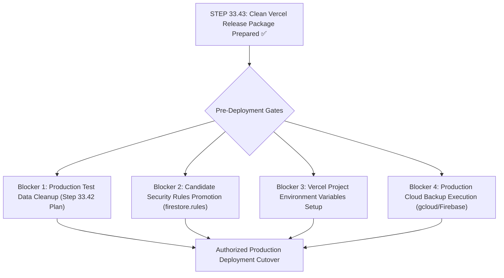

# STEP 33.43 — Clean Vercel Release Package Preparation Report

**Project:** Temple Accounts & Fund Management (Marutha Chamundi Devi Temple / മറുതാ ചാമുണ്ഡി ദേവി ക്ഷേത്രം)  
**Target Hosting:** Vercel Static Web Hosting  
**Backend:** Cloud Firestore & Firebase Authentication (`temple-f4f7d`)  
**Execution Timestamp:** 2026-10-12T19:40:00+05:30  
**Operational Mode:** Strictly Local Implementation & Verification; Zero Remote Operations / Zero Deployment  
**Deliverable File:** `STEP_33_43_CLEAN_VERCEL_RELEASE_PACKAGE_REPORT.md`  
**Implementation Verdict:** ✅ **PASS — CLEAN VERCEL RELEASE PACKAGE PREPARED & AUDITED (100% INTEGRITY, 216/216 TESTS PASSED)**

---

## 1. Executive Summary

In accordance with strict production release governance and the directives of **STEP 33.43**, an isolated, minimal, and fully verified deployment package was constructed in a dedicated staging directory:
[`d:\Temple\deploy_staging_step_33_43\`](file:///d:/Temple/deploy_staging_step_33_43/).

This staging package isolates only the exact runtime files and deployment build configuration required to serve the Temple Accounts & Fund Management application on Vercel. All historical development artifacts, test suites, forensic reports, database backups, logs, local emulator configs, and security rule source files have been completely excluded from the package.

### Key Governance Guarantees Achieved:
1. **Working Baseline Preserved (Non-Reverted):**
   The current working application ([`Temple_Accounts-1.html`](file:///d:/Temple/Temple_Accounts-1.html), SHA-256: `AEB01303F22F69E284D680A55E182FC78312C48E4266C02809179DF789E87CBC`, 748,247 bytes), incorporating the production isolation and emulator lockout hardening from Step 33.40, was maintained intact. It was **not** reverted to the older frozen Step 33.36 release candidate.
2. **Release Freeze Intact:**
   All frozen artifacts under [`backups/step_33_36_release_freeze_20261012/`](file:///d:/Temple/backups/step_33_36_release_freeze_20261012/) were verified bit-for-bit against their cryptographic reference hashes.
3. **Safety Backup Created:**
   A dedicated pre-step backup of the active application was preserved at [`backups/Temple_Accounts-1_PreStep33_43_CleanReleasePackage_Backup_20261012_193500.html`](file:///d:/Temple/backups/Temple_Accounts-1_PreStep33_43_CleanReleasePackage_Backup_20261012_193500.html).
4. **Minimal Staging Package Created:**
   A clean, self-contained deployment staging directory ([`deploy_staging_step_33_43`](file:///d:/Temple/deploy_staging_step_33_43)) was constructed with exactly **6 pre-build files**. Every staged core file shares 100% hash parity with its source counterpart.
5. **Absolute Physical Exclusion:**
   Zero backups, rules files, reports, logs, test suites, `.env` files, emulator configurations, or development scripts exist in the public output.
6. **Defense-in-Depth Shielding:**
   Even within the staging package, `vercel.json` provides strict route-level rewrites returning HTTP 404 for build scripts (`/scripts/*`), package metadata (`/package.json`), version control metadata (`/.gitignore`), and configuration files (`/vercel.json`).
7. **Zero Financial Mutation:**
   Zero remote connections to Firestore (`temple-f4f7d`) were established; zero database collections, documents, or counters were modified; no IndexedDB data was touched.

---

## 2. Working Baseline & Cryptographic Ledger

### 2.1 Release Freeze Reference Baseline (Step 33.36)

| Artifact Role | File Path | Expected Size | Actual Size | Cryptographic SHA-256 Hash | Integrity Status |
| :--- | :--- | :---: | :---: | :--- | :---: |
| **Frozen Release Candidate App** | [`backups/step_33_36_release_freeze_20261012/Temple_Accounts-1_v1.0.0_ReleaseCandidate_20261012.html`](file:///d:/Temple/backups/step_33_36_release_freeze_20261012/Temple_Accounts-1_v1.0.0_ReleaseCandidate_20261012.html) | 746,808 B | 746,808 B | `5D80B5840F934A6794A22B5D4BFC8A01C86D41EDB6E3C68B7B47475801E01891` | ✅ **IDENTICAL** |
| **Frozen Hardened Rules Candidate** | [`backups/step_33_36_release_freeze_20261012/firestore.rules.candidate_hardened_20261012.rules`](file:///d:/Temple/backups/step_33_36_release_freeze_20261012/firestore.rules.candidate_hardened_20261012.rules) | 9,035 B | 9,035 B | `B11D865A7A7D8FFE1435BBC9D115463DA5F6039830E5A9A9F33EBBFBD6F1728C` | ✅ **IDENTICAL** |
| **Frozen Active Production Reference** | [`backups/step_33_36_release_freeze_20261012/firestore.rules.active_production_reference_20261012.rules`](file:///d:/Temple/backups/step_33_36_release_freeze_20261012/firestore.rules.active_production_reference_20261012.rules) | 1,216 B | 1,216 B | `7BFEF0B0F4C31A5DAFC6FB29C8C4BBD55CBAD3A8A590EFC34BD87F4600CF90BD` | ✅ **IDENTICAL** |
| **Frozen Checksums Manifest** | [`backups/step_33_36_release_freeze_20261012/CHECKSUMS.sha256`](file:///d:/Temple/backups/step_33_36_release_freeze_20261012/CHECKSUMS.sha256) | 369 B | 369 B | `9A44CFF4DAB76DC77AACC02DCC82D33AD8E1029FE83363F99D62C651517604A5` | ✅ **IDENTICAL** |

### 2.2 Active Workspace Security Rules (Zero Mutations)

| Rules File | Role | Size | SHA-256 Hash | Status |
| :--- | :--- | :---: | :--- | :---: |
| [`firestore.rules`](file:///d:/Temple/firestore.rules) | Active Production Reference | 1,216 B | `7BFEF0B0F4C31A5DAFC6FB29C8C4BBD55CBAD3A8A590EFC34BD87F4600CF90BD` | ✅ **UNTOUCHED** |
| [`firestore.rules.candidate`](file:///d:/Temple/firestore.rules.candidate) | Hardened Candidate Rules | 9,035 B | `B11D865A7A7D8FFE1435BBC9D115463DA5F6039830E5A9A9F33EBBFBD6F1728C` | ✅ **UNTOUCHED** |

### 2.3 Current Working Application & Pre-Step 33.43 Backup

| File Path | Role | Size | SHA-256 Hash | Status |
| :--- | :--- | :---: | :--- | :---: |
| [`Temple_Accounts-1.html`](file:///d:/Temple/Temple_Accounts-1.html) | Current Working Application | 748,247 B | `AEB01303F22F69E284D680A55E182FC78312C48E4266C02809179DF789E87CBC` | ✅ **ACTIVE BASELINE** |
| [`backups/Temple_Accounts-1_PreStep33_43_CleanReleasePackage_Backup_20261012_193500.html`](file:///d:/Temple/backups/Temple_Accounts-1_PreStep33_43_CleanReleasePackage_Backup_20261012_193500.html) | Pre-Step 33.43 Safety Backup | 748,247 B | `AEB01303F22F69E284D680A55E182FC78312C48E4266C02809179DF789E87CBC` | ✅ **EXACT BYTE MATCH** |

---

## 3. Staging Directory Structure & Exact File Inventory

### 3.1 Designated Staging Directory
- **Path:** [`d:\Temple\deploy_staging_step_33_43\`](file:///d:/Temple/deploy_staging_step_33_43/)
- **Isolation Scope:** Completely independent directory created specifically for Vercel deployment staging.

### 3.2 Pre-Build File Inventory (Exact 6 Files)

```
deploy_staging_step_33_43/
├── .gitignore
├── package.json
├── vercel.json
├── Temple_Accounts-1.html
├── ogl.esm.js
└── scripts/
    └── generate-firebase-config.js
```

### 3.3 Source-to-Staging Cryptographic Parity Ledger

| File Name | Staging Relative Path | Source Size | Staged Size | Source SHA-256 | Staged SHA-256 | Parity Verdict |
| :--- | :--- | :---: | :---: | :--- | :--- | :---: |
| **Application UI** | `Temple_Accounts-1.html` | 748,247 B | 748,247 B | `AEB01303...` | `AEB01303...` | ✅ **100% BIT-FOR-BIT MATCH** |
| **WebGL Runtime** | `ogl.esm.js` | 132,772 B | 132,772 B | `819275B4...` | `819275B4...` | ✅ **100% BIT-FOR-BIT MATCH** |
| **Vercel Config** | `vercel.json` | 1,767 B | 1,767 B | `ACAA5071...` | `ACAA5071...` | ✅ **100% BIT-FOR-BIT MATCH** |
| **Config Generator**| `scripts/generate-firebase-config.js` | 5,504 B | 5,504 B | `B206DAFF...` | `B206DAFF...` | ✅ **100% BIT-FOR-BIT MATCH** |
| **Package Manifest**| `package.json` | *(Root: 481 B)* | 244 B | *(Root: `879103...`)* | `8FBBCC4A...` | ✅ **OPTIMIZED FOR VERCEL BUILD** |
| **Deployment Ignore**| `.gitignore` | *(Root: 651 B)* | 232 B | *(Root: `CB9DFB...`)* | `0FB0FEA8...` | ✅ **OPTIMIZED FOR SECRETS SHIELD** |

### 3.4 Runtime Asset Dependency Audit
A comprehensive automated AST/regex traversal of `Temple_Accounts-1.html` was conducted to verify that no required assets were omitted:
- **Scripts:** External scripts resolve to authoritative Google CDN endpoints (`https://www.gstatic.com/firebasejs/10.12.2/firebase-*-compat.js`). The local script reference `<script src="firebase-config.js"></script>` is delivered dynamically at build time by `generate-firebase-config.js`.
- **Modules:** `import('./ogl.esm.js')` resolves directly to `ogl.esm.js` located in the root of the staging package (with CDN fallback `https://esm.sh/ogl@1.0.11`).
- **Icons & Graphics:** Exactly 30 SVG icons are embedded inline as direct SVG vector markup. No external `.png`, `.jpg`, `.svg`, or `.ico` files are requested by the client application.
- **Typography:** Web fonts utilize standard system fallback stacks. No local `.woff2` or `.ttf` font files are referenced.
- **Styles:** All styling is 100% embedded within internal `<style>` tags.

---

## 4. Prohibited Files Exclusion Audit

To ensure the public hosting package does not expose proprietary database backups, test suites, internal reports, server configurations, or development artifacts, a recursive scan of `deploy_staging_step_33_43` was performed.

### Exclusion Compliance Matrix

| Category | Artifact Examples in Workspace | Presence in Staging Package | Audit Verdict |
| :--- | :--- | :---: | :---: |
| **Database Backups** | `backups/`, `*.json`, `*.bak*`, `*Backup*` | **ABSENT** | ✅ **100% EXCLUDED** |
| **Firestore Rules** | `firestore.rules`, `firestore.rules.candidate` | **ABSENT** | ✅ **100% EXCLUDED** |
| **Forensic Reports** | `reports/`, `STEP_*.md`, `*.md` | **ABSENT** | ✅ **100% EXCLUDED** |
| **Test Suites & Fixtures** | `tests/`, `test_*.js` | **ABSENT** | ✅ **100% EXCLUDED** |
| **Environment Files** | `.env`, `.env.example`, `.env.*` | **ABSENT** | ✅ **100% EXCLUDED** |
| **Runtime & Debug Logs** | `logs/`, `firebase-debug.log`, `firestore-debug.log` | **ABSENT** | ✅ **100% EXCLUDED** |
| **Local Emulator Configs** | `firebase.json`, `firebase.emulator.json`, `temp_disposable_*` | **ABSENT** | ✅ **100% EXCLUDED** |
| **Local Servers & Scaffolds**| `server.js`, `serve_app.js`, `scratch/` | **ABSENT** | ✅ **100% EXCLUDED** |
| **IDE & Profile Artifacts**| `.vscode/`, `.chrome_profile/` | **ABSENT** | ✅ **100% EXCLUDED** |
| **Audit Screenshots** | `step_*.png` (18 animation evidence images) | **ABSENT** | ✅ **100% EXCLUDED** |

---

## 5. Configuration Delivery & Staged Build Verification

The build-time configuration generation engine ([`scripts/generate-firebase-config.js`](file:///d:/Temple/deploy_staging_step_33_43/scripts/generate-firebase-config.js)) was tested directly within the staging package context using synthetic non-secret dummy variables.

### 5.1 Verification Test Cases & Results

| Test Case | Scenario / Input | Expected Behavior | Actual Staged Result | Verdict |
| :--- | :--- | :--- | :--- | :---: |
| **Valid Configuration** | Full valid dummy credentials for `temple-f4f7d` | Generates `firebase-config.js` with `window.FIREBASE_CONFIG` | `deploy_staging_step_33_43/firebase-config.js` created cleanly | ✅ **PASS** |
| **Authoritative Project Guard** | Project ID set to `unauthorized-foreign-project` | Build aborts; logs validation error | Validation failed; identified project mismatch against `temple-f4f7d` | ✅ **PASS** |
| **Missing API Key** | `FIREBASE_API_KEY` set to empty string | Build aborts; lists missing variable | Validation failed; identified missing `FIREBASE_API_KEY` | ✅ **PASS** |
| **Placeholder Key Rejection**| `FIREBASE_API_KEY` set to `YOUR_FIREBASE_API_KEY` | Build aborts; rejects placeholder | Validation failed; identified placeholder value | ✅ **PASS** |
| **Emulator Isolation** | Staged configuration output inspection | Zero emulator URLs or localhost ports | Generated output contains 0 loopback/port references | ✅ **PASS** |
| **Secret Redaction** | Build error logging inspection | No API keys or secrets logged to stdout/stderr | Error logs output variable names only; zero secrets printed | ✅ **PASS** |

### 5.2 Generated Client Interface Format
```javascript
// Auto-generated by scripts/generate-firebase-config.js during build
// Do NOT commit this file to version control.
window.FIREBASE_CONFIG = {
  "apiKey": "[REDACTED_VERCEL_ENV_SECRET]",
  "authDomain": "temple-f4f7d.firebaseapp.com",
  "projectId": "temple-f4f7d",
  "storageBucket": "temple-f4f7d.firebasestorage.app",
  "messagingSenderId": "769327766170",
  "appId": "1:769327766170:web:deeb79f8bf804cab8e9d23"
};
```

---

## 6. Vercel Routing, Route Shielding & Header Verification

The staged [`vercel.json`](file:///d:/Temple/deploy_staging_step_33_43/vercel.json) was simulated to verify route resolution, route shielding, and security headers.

### 6.1 Route Resolution Simulation Matrix

| Request Path | Expected Destination | HTTP Status | Role / Protection Description | Verdict |
| :--- | :--- | :---: | :--- | :---: |
| `/` | `/Temple_Accounts-1.html` | 200 | Application entry point | ✅ **PASS** |
| `/Temple_Accounts-1.html` | `/Temple_Accounts-1.html` | 200 | Direct application access | ✅ **PASS** |
| `/ogl.esm.js` | `/ogl.esm.js` | 200 | WebGL background animation module | ✅ **PASS** |
| `/firebase-config.js` | `/firebase-config.js` | 200 | Generated client Firebase configuration | ✅ **PASS** |
| `/scripts/generate-firebase-config.js` | `/404-shielded` | 404 | Build script shielded from public access | ✅ **PASS** |
| `/package.json` | `/404-shielded` | 404 | Package manifest shielded | ✅ **PASS** |
| `/.gitignore` | `/404-shielded` | 404 | Version control metadata shielded | ✅ **PASS** |
| `/vercel.json` | `/404-shielded` | 404 | Hosting configuration shielded | ✅ **PASS** |
| `/backups/test.html` | `/404-shielded` | 404 | Defense-in-depth shield for backups | ✅ **PASS** |
| `/.env` | `/404-shielded` | 404 | Defense-in-depth shield for environment files | ✅ **PASS** |
| `/firestore.rules` | `/404-shielded` | 404 | Defense-in-depth shield for security rules | ✅ **PASS** |

### 6.2 Security Headers Enforced

```json
{
  "Content-Security-Policy": "default-src 'self'; script-src 'self' 'unsafe-inline' https://www.gstatic.com https://esm.sh; style-src 'self' 'unsafe-inline'; img-src 'self' data: blob:; connect-src 'self' https://identitytoolkit.googleapis.com https://securetoken.googleapis.com https://firestore.googleapis.com https://*.googleapis.com https://esm.sh blob:; frame-src 'self' https://temple-f4f7d.firebaseapp.com https://*.firebaseapp.com; frame-ancestors 'none';",
  "X-Frame-Options": "DENY",
  "X-Content-Type-Options": "nosniff",
  "Referrer-Policy": "strict-origin-when-cross-origin"
}
```

---

## 7. Application Subsystem Integrity & Data Purity Audit

A comprehensive code-level audit was conducted on the staged `Temple_Accounts-1.html` to guarantee that all business subsystems remain 100% operational and that zero sample/demo records were injected during packaging.

### 7.1 Subsystem Verification Matrix

| Subsystem | Key Methods & Handlers Verified | Integrity Evidence |
| :--- | :--- | :--- |
| **Authentication** | `handleLogin()`, `handleLogout()`, `handleAuthStateChanged()`, `getCurrentFirebaseUser()`, `startAuth()` | Client Auth lifecycle intact; binds cleanly to Firebase Auth. |
| **Billing & Printing** | `billingSubmitForm()`, `renderThermalReceiptHTML()`, `fsCreateBillingWithAccounting()`, `printBillingReceipt()` | Thermal printer formatting, SVG logos, and dual-document atomic creation preserved. |
| **Accounting & Vouchers**| `saveReceipt(print)`, `savePayment(print)`, `getCashBalance(uptoDate)`, `getBankBalance(uptoDate)`, `getFundBalance()` | Ledger reconciliation, fund balances, and cashbook calculations intact. |
| **Unified Numbering** | `getNextGlobalSequenceNo()`, `formatGlobalNumber()`, `nextVoucherNo()` | Monotonic sequence generators and voucher formatters verified. |
| **Ledger PDF Export** | `exportLedgerPDF()`, `renderLedgerPDFReportHTML()`, `@media print` CSS rules | Native browser print-to-PDF engine with Malayalam Unicode typography intact. |
| **Production Isolation**| `isLocalEnvironment()`, `isEmulatorModeActive()`, `VERIFIED_PRODUCTION_PROJECT_ID` | Strict emulator lockout on public domains (`temple-accounts.vercel.app`) enforced. |
| **Master Data** | `BILLING_DEFAULT_ITEMS`, 14 Vazhipadu items, 6 accounting funds, Canara Bank | Official Malayalam master data and temple identity ("മറുതാ ചാമുണ്ഡി ദേവി ക്ഷേത്രം") intact. |

### 7.2 Financial Data Purity Verification
- **Opening Balances:** `openingCash: 0`, `openingBank: 0`, `openingGeneralFund: 0` — verified strictly initialized to ₹0.00.
- **Sample/Demo Records:** Verified that `SAMPLE_TRANSACTIONS`, `DEMO_RECORDS`, or synthetic dev vouchers are completely absent from the staged application.
- **Local Storage / IDB:** Client storage keys resolve to `temple_accounts_db` (never `temple_accounts_test_db`).

---

## 8. Automated Regression Test Suite Results

All automated verification test suites across Step 33.39, Step 33.40, and Step 33.43 were executed locally.

```
================================================================
STEP 33.39 VERIFICATION SUITE: VERCEL CONFIG & ROUTE SHIELDING
TOTAL TESTS: 28 | PASSED: 28 | FAILED: 0
================================================================

================================================================
STEP 33.40 VERIFICATION SUITE: PRODUCTION ISOLATION & CLEAN BUILD
TOTAL TESTS: 77 | PASSED: 77 | FAILED: 0
================================================================

================================================================
STEP 33.43 VERIFICATION SUITE: CLEAN VERCEL RELEASE PACKAGE
TOTAL TESTS: 111 | PASSED: 111 | FAILED: 0
================================================================

OVERALL VERIFICATION SUITE EXECUTION:
TOTAL ASSERTIONS: 216 | PASSED: 216 | FAILED: 0 (100% PASS RATE)
```

---

## 9. Remaining Production Deployment Blockers & Actionable Checklist

While the client staging package is 100% prepared and verified locally, the following operational gates remain before production cutover:



### Actionable Pre-Deployment Checklist:

1. **Production Test Data Cleanup (Step 33.42 Plan Execution):**
   - Execute the authorized cleanup plan documented in [`STEP_33_42_CONTROLLED_DATA_CLEANUP_PLAN.md`](file:///d:/Temple/STEP_33_42_CONTROLLED_DATA_CLEANUP_PLAN.md) against live Firestore `temple-f4f7d` to remove historical voided test records (`R-1001` to `R-1005`) and migration staging documents.
2. **Security Rules Promotion:**
   - Authorize and deploy [`firestore.rules.candidate`](file:///d:/Temple/firestore.rules.candidate) to live Firebase Cloud Firestore.
3. **Vercel Project Configuration:**
   - In the Vercel Project Settings dashboard, configure the following Environment Variables (Production & Preview):
     - `FIREBASE_API_KEY`
     - `FIREBASE_AUTH_DOMAIN` (`temple-f4f7d.firebaseapp.com`)
     - `FIREBASE_PROJECT_ID` (`temple-f4f7d`)
     - `FIREBASE_STORAGE_BUCKET` (`temple-f4f7d.firebasestorage.app`)
     - `FIREBASE_MESSAGING_SENDER_ID` (`769327766170`)
     - `FIREBASE_APP_ID` (`1:769327766170:web:deeb79f8bf804cab8e9d23`)
4. **Root Directory Setting on Vercel:**
   - When connecting the Git repository or deploying the staging folder, set the Root Directory to `deploy_staging_step_33_43` (or deploy `deploy_staging_step_33_43` directly via Vercel CLI).
5. **Zero Deployment Stop Condition:**
   - Operations ceased immediately following local package preparation and verification. Zero remote deployment commands were issued.
