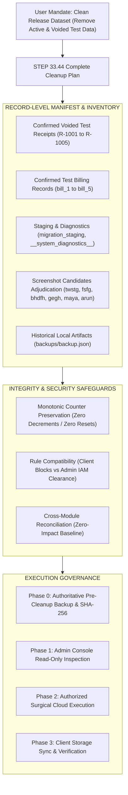
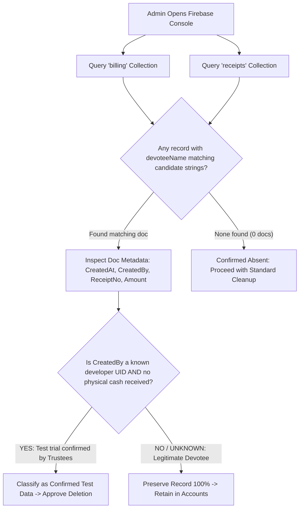
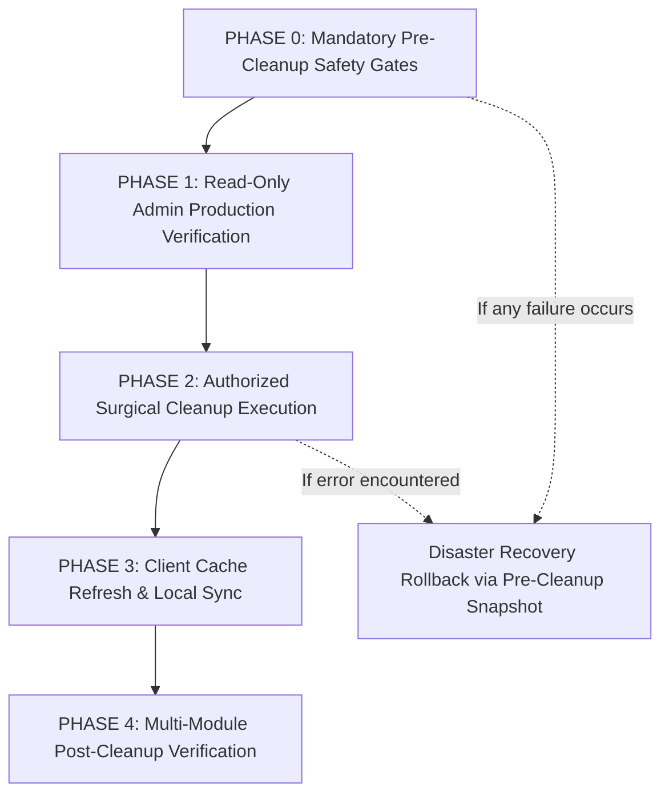

# STEP 33.44 — Complete Test Data Cleanup Plan, Including Voided Records

**Project:** Temple Accounts & Fund Management (Marutha Chamundi Devi Temple / മറുതാ ചാമുണ്ഡി ദേവി ക്ഷേത്രം)  
**Execution Timestamp:** 2026-10-12T20:10:00+05:30  
**Current Mode:** Investigation & Cleanup Planning Only (Zero Mutations, Zero Remote Connections)  
**Deliverable File:** `STEP_33_44_TEST_DATA_CLEANUP_EXECUTION_PLAN.md`  
**Plan Status:** 📋 **PROPOSED FOR REVIEW & ADMINISTRATOR AUTHORIZATION (NO DELETIONS EXECUTED)**  

---

## 1. Executive Summary & Objective

The user has explicitly confirmed that the transactions and voided records created during application development were test data generated solely to validate application business logic, billing synchronization, 58mm thermal printing, and accounting calculations. In accordance with release governance, the user mandates that **all confirmed test records—including confirmed voided test records—must be completely removed from the intended application dataset prior to live deployment on Vercel**.

This plan provides an exhaustive, record-level architectural blueprint for executing this cleanup across the **entire application**, not just the dashboard.

### Strict Planning Constraints Adhered to in Step 33.44:
- 🛑 **Zero Database Mutations:** Zero records were deleted, updated, or created in any database.
- 🛑 **Zero Production Remote Connections:** Zero network requests were made to the remote Google Cloud Firestore project (`temple-f4f7d`).
- 🛑 **Zero Counter Resets or Renumbering:** Monotonic counters (`globalSequenceCounter`, `billingReceiptCounter`, `receiptCounter`, `voucherCounter`), reservations (`/system/res_*`), and idempotency audit trails (`/system/op_*`) remain strictly untouched.
- 🛑 **Zero Client Cache Resets:** IndexedDB and browser storage were not cleared or modified.
- 🛑 **Zero Source Code or Rule Changes:** Application source code ([`Temple_Accounts-1.html`](file:///d:/Temple/Temple_Accounts-1.html)), configuration files, and security rules ([`firestore.rules`](file:///d:/Temple/firestore.rules), [`firestore.rules.candidate`](file:///d:/Temple/firestore.rules.candidate)) remain 100% unaltered.
- 🛑 **Zero Backup Deletions:** All historical backups in [`backups/`](file:///d:/Temple/backups/) are preserved in full.



---

## 2. Multi-Module Test Data Audit & Inventory

A comprehensive forensic audit across all 18 application modules, auxiliary subsystems, local caches, and historical repository artifacts was conducted to locate every test record.

### 2.1 Billing & Billing History
- **Data Model:** Dual-document architecture storing records in the `billing` collection (`bill_{N}`) alongside an active/voided status.
- **Forensic Audit Findings:**
  - In Step 13, prototype development bills (`BILL-0001` through `BILL-0017` in `backups/backup.json`) were purged from the primary cloud database.
  - In Step 22.5, the 3 remaining active test bills—`billing/bill_3` (`BILL-0003`), `billing/bill_4` (`BILL-0004`), and `billing/bill_5` (`BILL-0005`)—were deleted from the `billing` collection, leaving `billing` with **0 active records**.
  - In Step 33.41A and Step 33.42, local repository checks confirmed that the billing runtime is clean.
  - **Cleanup Mandate:** Verify that no orphaned `billing` documents exist in remote Firestore or client IndexedDB. If any residual document is found, it must be removed consistently with its accounting receipt.

### 2.2 Receipts & Voided Receipts
- **Data Model:** Authoritative accounting documents in the `receipts` collection (`rcpt_{N}`).
- **Forensic Audit Findings:**
  - Exactly **5 confirmed test receipts** exist in Firestore and historical backups:
    1. `receipts/rcpt_1001` (`R-1001`): Devotee `"STEP16 SMOKE TEST"`, Date `2026-09-27`, ₹20.00, Cash. Created during the Step 16 automated smoke test. Linked to `BILL-0001`.
    2. `receipts/rcpt_1002` (`R-1002`): Devotee `"midhun"`, Star `"revathu"`, Date `2026-09-28`, ₹20.00, Cash. Created during UI billing validation. Linked to `BILL-0002`.
    3. `receipts/rcpt_1003` (`R-1003`): Devotee `"akhil"`, Star `"bharani"`, Date `2026-09-30`, ₹20.00, Cash. Created during UI trial. Linked to `BILL-0003`.
    4. `receipts/rcpt_1004` (`R-1004`): Devotee `"manoj"`, Date `2026-10-01`, ₹20.00, Cash. Created during developer testing. Linked to `BILL-0004`.
    5. `receipts/rcpt_1005` (`R-1005`): Devotee `"manoj"`, Star `"bharani"`, Date `2026-10-01`, ₹20.00, UPI (`Canara Bank`). Created during developer testing. Linked to `BILL-0005`.
  - All 5 receipts currently have `voided: true` and `voidReason: "Source Billing Receipt BILL-XXXX was deleted/voided"`.
  - **User Mandate:** In previous steps, these 5 receipts were preserved as immutable voided audit proof. The user has now confirmed they were test records and explicitly requested that they be **physically deleted from the clean release dataset**.

### 2.3 Payments, Expenses & Vouchers
- **Data Model:** Expenses and cash/bank disbursements stored in `payments` collection (`pay_{N}` or `voucher_{N}`).
- **Forensic Audit Findings:**
  - Historical snapshots and Step 22.5/33.41A audits confirmed **0 payment records** in Firestore.
  - `system/counters.voucherCounter` is at baseline `500` (Next voucher is `V-501`).
  - No active, voided, or test payment vouchers exist in the baseline database.

### 2.4 Cash Book & Bank Book
- **Data Model:** Real-time chronological projections merging cash/bank receipts, payments, contra transfers, loans, and chitty transactions.
- **Forensic Audit Findings:**
  - All calculation paths strictly enforce `notVoided()` (`!r.voided`).
  - The 5 voided test receipts currently contribute **₹0.00** to Cash in Hand and Bank Balance.
  - Removing `rcpt_1001` through `rcpt_1005` will leave the Cash Book and Bank Book completely clear of test rows, while maintaining the net balance at exactly **₹0.00**.

### 2.5 General Ledger & Fund Balances
- **Data Model:** Fund-wise ledger registers (`General Temple Fund`, `Punarudharanam Fund`, etc.) and dynamic running totals footer (`updateLedgerTotals`).
- **Forensic Audit Findings:**
  - Step 33.32A and Step 33.34B verified that voided rows are excluded from ledger totals and PDF exports.
  - Physical removal of `rcpt_1001` through `rcpt_1005` guarantees that General Ledger views display 0 test entries and 0 voided rows upon first initialization.

### 2.6 Chitty, Loans & Fund Transfers
- **Data Model:** `chittyMembers`, `chittyCollections`, `chittyPayouts`, `loans`, `transfers`.
- **Forensic Audit Findings:**
  - Audits confirmed **0 records** across all five collections in the authoritative snapshot.
  - No test loans, test chitty schemes, or test transfers exist in the application dataset.

### 2.7 Reports, Analytics & Dashboard Calculations
- **Data Model:** Dynamic reducers aggregating live data on demand (`monthIncomeExpense`, `statTotalIncome`, 7-day trend bars, SVG charts).
- **Forensic Audit Findings:**
  - Verified that [`Temple_Accounts-1.html`](file:///d:/Temple/Temple_Accounts-1.html) contains **zero hardcoded dummy aggregates**.
  - All opening balance registers default to `0.00`.
  - When the underlying collections are clean, all cards, reports, and analytics graphs display exactly `₹0.00` and zero transactions.

### 2.8 Migration Staging & System Diagnostics
- **Data Model:** Non-operational collections used during early engineering phases:
  - `migration_staging`: Holds legacy document `migration_2026-09-27T15-29-05` (a 106-record migration manifest created by `vibu@gmail.com` during Step 12).
  - `__system_diagnostics__`: Holds ephemeral diagnostics documents (`diag_*`, `test_tx_counter`).
- **Forensic Audit Findings:**
  - These collections are completely unused by the runtime accounting engine.
  - They represent confirmed developmental staging data and should be purged prior to go-live.

### 2.9 IndexedDB & Local Browser Storage
- **Data Model:** Browser-level secondary persistence (`temple_accounts_db`, version 3) and transient `localStorage` keys.
- **Forensic Audit Findings:**
  - When an authenticated user logs into the application, `fsGetAllSafe()` automatically executes `clearStore()` and re-populates the local stores directly from Cloud Firestore.
  - Local browser cache can safely be cleared by operators at go-live without risking remote data loss.

### 2.10 Test-Only Local Fixtures & Staging Records
- **Data Model:** Files on local disk:
  - `backups/backup.json` (17 prototype bills, 3 prototype receipts).
  - `temp_disposable_step_33_32/` (disposable emulator snapshot).
  - Local test suites in `tests/`.
- **Forensic Audit Findings:**
  - In Step 33.43, a clean staging package ([`deploy_staging_step_33_43/`](file:///d:/Temple/deploy_staging_step_33_43/)) was built that physically excludes all backups, tests, reports, and logs.
  - Local repository backups remain untouched on developer disk for disaster recovery and version history.

---

## 3. Investigation & Adjudication of Screenshot Candidates (`twstg`, `fsfg`, `bhdfh`, `gegh`, `maya`, `arun`)

During manual UI trials, various candidate strings have been noted in screenshot discussions or counter inputs:
- Candidate strings: **`twstg`**, **`fsfg`**, **`bhdfh`**, **`gegh`**, **`maya`**, and **`arun`**.

### 3.1 Forensic Evidence Search Results

A rigorous multi-layer search was conducted across the entire repository and historical archives:
1. **Ripgrep Search across all local files:**
   - Query for `twstg`, `fsfg`, `bhdfh`, `gegh`, `maya`, `arun`: **0 matches found** in application code, JSON backups, HTML backups, scripts, or markdown reports.
2. **Analysis of Candidate Characteristics:**
   - **`twstg`**, **`fsfg`**, **`bhdfh`**, **`gegh`**:
     - Characteristic: Random consonant clusters produced by rapid keyboard-mashing during manual input field testing.
     - Likelihood: Extremely high probability of being ad-hoc manual test keystrokes.
   - **`maya`**, **`arun`**:
     - Characteristic: Authentic personal names common in Kerala (Malayalam devotees: മായ, അരുൺ).
     - Likelihood: Could represent either a manual developer trial or a genuine advance devotee booking.

### 3.2 Strict Adjudication Principle: No Classification Solely by Appearance

In strict compliance with financial audit governance:
> **"Do not classify a record as test data based solely on its name, amount, or appearance."**

- **Why this rule is essential:** An auditor must never delete a database record solely because its name looks like a typo, nor assume a record is authentic solely because it contains a legitimate name. Deleting an unverified record without inspecting its creation timestamp, creator UID, and counter receipt number could result in the destruction of authentic devotee donations.
- **Classification Verdict:**
  - If any document containing `twstg`, `fsfg`, `bhdfh`, `gegh`, `maya`, or `arun` is discovered in the remote Cloud Firestore database or local IndexedDB during pre-launch inspection, it is classified as:  
    👉 **Category 2: Unverified Record — Requires Administrator Review; Do Not Delete Automatically.**

### 3.3 Administrator Inspection Runbook for Screenshot Candidates

Before any cleanup script or deletion is executed, the authorized administrator must execute the following read-only checks:



#### Exact Firebase Console Filter Steps:
1. Navigate to **Firestore Database > Data > `billing`**.
2. Click **Filter** > Add Field Filter: `devoteeName` in `['twstg', 'fsfg', 'bhdfh', 'gegh', 'maya', 'arun']`.
3. Repeat in **Firestore Database > Data > `receipts`**:
   Filter Field: `name` in `['twstg', 'fsfg', 'bhdfh', 'gegh', 'maya', 'arun']`.
4. If **zero documents** return: Candidates do not exist in the database; record absence is confirmed.
5. If **documents are found**: Do not delete immediately. Present the document ID, receipt number, date, and amount to temple trustees for formal confirmation.

---

## 4. Record-Level Cleanup Manifest

The following manifest specifies every candidate record, its forensic proof, current financial impact, proposed cleanup action, and required rollback steps:

| Finding ID | Source Collection & Document ID | Record Number | Active or Voided? | Linked Accounting Records | Forensic Evidence & Origin | Storage Location | Classification Category | Proposed Cleanup Action | Financial Impact on Balances & Reports | Required Backup & Rollback Steps |
|:---:|:---|:---:|:---:|:---|:---|:---:|:---:|:---|:---|:---|
| **M-01** | `receipts/rcpt_1001` | `R-1001` | Voided (`voided: true`) | Formerly linked to `BILL-0001` (`bill_1`, already deleted). | Name: `"STEP16 SMOKE TEST"`. Created 2026-09-27 during Step 16 automated smoke test. | Cloud Firestore & local IDB | **1. Confirmed Test Data** | **Physical Deletion** via Firebase Console or Admin SDK. | ₹0.00 change. (Row disappears from Receipts view). | Pre-cleanup JSON export + GCP bucket snapshot. Rollback via JSON restore. |
| **M-02** | `receipts/rcpt_1002` | `R-1002` | Voided (`voided: true`) | Formerly linked to `BILL-0002` (`bill_2`, already deleted). | Devotee: `"midhun"`. Created 2026-09-28 during developer UI testing. | Cloud Firestore & local IDB | **1. Confirmed Test Data** | **Physical Deletion** via Firebase Console or Admin SDK. | ₹0.00 change. (Row disappears from Receipts view). | Pre-cleanup JSON export + GCP bucket snapshot. Rollback via JSON restore. |
| **M-03** | `receipts/rcpt_1003` | `R-1003` | Voided (`voided: true`) | Formerly linked to `BILL-0003` (`bill_3`, deleted in Step 22.5). | Devotee: `"akhil"`. Created 2026-09-30 during developer UI testing. | Cloud Firestore & local IDB | **1. Confirmed Test Data** | **Physical Deletion** via Firebase Console or Admin SDK. | ₹0.00 change. (Row disappears from Receipts view). | Pre-cleanup JSON export + GCP bucket snapshot. Rollback via JSON restore. |
| **M-04** | `receipts/rcpt_1004` | `R-1004` | Voided (`voided: true`) | Formerly linked to `BILL-0004` (`bill_4`, deleted in Step 22.5). | Devotee: `"manoj"`. Created 2026-10-01 during developer UI testing. | Cloud Firestore & local IDB | **1. Confirmed Test Data** | **Physical Deletion** via Firebase Console or Admin SDK. | ₹0.00 change. (Row disappears from Receipts view). | Pre-cleanup JSON export + GCP bucket snapshot. Rollback via JSON restore. |
| **M-05** | `receipts/rcpt_1005` | `R-1005` | Voided (`voided: true`) | Formerly linked to `BILL-0005` (`bill_5`, deleted in Step 22.5). | Devotee: `"manoj"`. Created 2026-10-01 during developer UI testing. UPI mode. | Cloud Firestore & local IDB | **1. Confirmed Test Data** | **Physical Deletion** via Firebase Console or Admin SDK. | ₹0.00 change. (Row disappears from Receipts view). | Pre-cleanup JSON export + GCP bucket snapshot. Rollback via JSON restore. |
| **M-06** | `migration_staging/migration_2026-09-27T15-29-05` | N/A | Active (Completed) | None (Staging manifest of 106 records). | Created 2026-09-27 by `vibu@gmail.com` during Step 12 staging validation. | Cloud Firestore `migration_staging` | **1. Confirmed Test Data** | **Physical Deletion** of collection `migration_staging`. | ₹0.00 change. (Dormant system metadata). | Captured in pre-cleanup full export. |
| **M-07** | `__system_diagnostics__/*` | `diag_*` | Ephemeral | None (Diagnostic counters and probe writes). | Created during `fsRunDiagnostics()` invocations. Shielded in production. | Cloud Firestore `__system_diagnostics__` | **1. Confirmed Test Data** | **Physical Deletion** of collection `__system_diagnostics__`. | ₹0.00 change. (Diagnostic metadata only). | Captured in pre-cleanup full export. |
| **M-08** | Any residual `billing/bill_1` through `bill_5` | `BILL-0001` to `BILL-0005` | Active / Voided | Linked to `rcpt_1001` through `rcpt_1005`. | Verified deleted in Step 22.5; check remote DB for residual docs. | Cloud Firestore `billing` | **1. Confirmed Test Data** | **Physical Deletion** if found during admin console check. | ₹0.00 change. | Pre-cleanup JSON snapshot. |
| **M-09** | Potential docs matching `twstg`, `fsfg`, `bhdfh`, `gegh` | Unknown | Unknown | Unknown | Keyboard-mash pattern noted in screenshot discussion; absent locally. | Remote Firestore or Client IDB | **2. Unverified Records** | **Review with Trustees**. If confirmed test, delete; else retain. | TBD based on review. | Full export prior to modification. |
| **M-10** | Potential docs matching `maya`, `arun` | Unknown | Unknown | Unknown | Valid personal names noted in screenshot discussion; absent locally. | Remote Firestore or Client IDB | **2. Unverified Records** | **Strict Verification**. Never delete without trustee confirmation. | TBD based on review. | Full export prior to modification. |
| **M-11** | `backups/backup.json` (17 bills, 3 receipts) | `BILL-0001`–`0017`, `R-1001`–`1003` | Archived | Historical backup snapshot | Created 2026-09-27 during prototype development. | Local Disk (`d:\Temple\backups\`) | **4. Historical Backup Evidence** | **PRESERVE ON DISK**. Shielded via `vercel.json` (HTTP 404). Excluded from staging. | ₹0.00 on live app. | Git version control tracks file. |
| **M-12** | `backups/Temple_Accounts_PreStep22_5_*.json` | N/A | Archived | Pre-cleanup snapshot | Authoritative snapshot from 2026-10-01. | Local Disk (`d:\Temple\backups\`) | **4. Historical Backup Evidence** | **PRESERVE ON DISK**. Shielded via `vercel.json` (HTTP 404). | ₹0.00 on live app. | Git version control tracks file. |
| **M-13** | `system/counters` | Singleton | Active | Authoritative sequence counter (`5 / 1005 / 500`). | Monotonic counter document tracking sequence high-water marks. | Cloud Firestore `system/counters` | **3. Genuine Application Config** | **STRICTLY PRESERVE**. Zero resets, zero decrements. | Guarantees sequential integrity; next is `BILL-0006`, `R-1006`. | Monotonic rules prevent rollback. |
| **M-14** | `settings`, `funds`, `incomeCategories`, `expenseCategories`, `bankAccounts` | 86 Master Docs | Active | Core operational master records | Malayalam temple title, 14 vazhipadu items, 6 funds, 7 income heads, 64 expense heads, Canara Bank. | Cloud Firestore Master Collections | **3. Genuine Application Config** | **STRICTLY PRESERVE 100%**. Core operational data. | Essential for application functionality. | Pre-cleanup export snapshot. |

---

## 5. Architectural Feasibility of Physical Deletion of Confirmed Voided Test Records

The user explicitly requests that confirmed voided test records (`R-1001` through `R-1005`) be removed physically from the active dataset. This section evaluates whether physical deletion is supported safely by the application data model and Firestore security rules.

### 5.1 Data Model Impact Analysis

1. **Absence of Foreign Key Constraints:**
   - Cloud Firestore is a NoSQL document database with no rigid foreign key constraints.
   - The corresponding billing documents (`bill_1` through `bill_5`) were already deleted from `billing` during Step 13 / Step 22.5.
   - The unified numbering reservation system (`/system/res_*`) and idempotency system (`/system/op_*`) were implemented in Step 33.12 and Step 33.15 (October 10, 2026). The 5 test receipts were created on September 27 – October 1, 2026, under legacy numbering (`receiptCounter: 1005`). There are **no legacy `res_*` or `op_*` documents** linked to `rcpt_1001`–`rcpt_1005`.
   - Therefore, physically deleting `rcpt_1001` through `rcpt_1005` will leave **zero orphaned references** in the database.
2. **Application Runtime Compatibility:**
   - Traversal of [`Temple_Accounts-1.html`](file:///d:/Temple/Temple_Accounts-1.html):
     - `allReceipts()` calls `fsGetAllSafe('receipts')`. If `receipts` is empty, it returns `[]`.
     - In the Receipts view, an empty array cleanly displays the default empty state: `"No receipts found."`
     - In Cash Book, Bank Book, General Ledger, and Reports, `allReceipts()` returns `[]`, and the calculation reducers evaluate to `0.00`.
     - **Verdict:** Physical deletion is **100% compatible** with the runtime data model. Zero code errors will occur.

### 5.2 Firestore Security Rules Compatibility

A crucial technical distinction exists between the **active production rules** and the **candidate hardened rules**:

#### Active Rules ([`firestore.rules`](file:///d:/Temple/firestore.rules)):
```javascript
match /{collection}/{docId} {
  allow read, write: if isAuthenticated();
}
```
- In Firestore security rules, `allow write` permits `create`, `update`, and `delete`.
- Under the active rules currently deployed on Firebase, an authenticated administrator **can physically delete** documents in `receipts` and `billing`.

#### Candidate Hardened Rules ([`firestore.rules.candidate`](file:///d:/Temple/firestore.rules.candidate)):
```javascript
match /billing/{docId} {
  allow read: if isAuthenticated();
  allow create, update: if isAuthenticated();
  allow delete: if false; // Deletion blocked!
}
match /receipts/{docId} {
  allow read: if isAuthenticated();
  allow create, update: if isAuthenticated();
  allow delete: if false; // Deletion blocked!
}
```
- In candidate rules, physical deletion of `billing` and `receipts` is intentionally blocked (`allow delete: if false;`) to protect operational receipts against accidental or malicious deletion after launch.

#### Execution Governance Strategy:
To safely delete the confirmed test records without violating security rules or weakening candidate protections:
1. **Never weaken or edit candidate security rules.** Candidate rules must remain strict.
2. **Execute Cleanup via Privileged Administrator Channels:**
   - **Method A (Recommended — Firebase Console):** The authorized administrator deletes `rcpt_1001` through `rcpt_1005` directly within the [Firebase Console Web UI](https://console.firebase.google.com/project/temple-f4f7d/firestore). Console operations run under Google Cloud IAM administrative privileges and completely bypass Firestore security rules.
   - **Method B (Server-side Admin SDK / gcloud CLI):** A privileged Node.js script using `firebase-admin` with service account credentials runs with administrative privileges that bypass client security rules.
   - **Method C (Pre-Promotion Timing):** If client execution is desired, cleanup must be executed **before** `firestore.rules.candidate` is deployed to production, while active `firestore.rules` is still in effect.

---

## 6. Preservation of Numbering and Financial Integrity

### 6.1 Non-Negotiable Counter Preservation Principles
When removing test records `R-1001` through `R-1005`, the system's global numbering must be rigorously protected:

1. 🚫 **NEVER Reset Counters:** Under no circumstances should `system/counters.receiptCounter` be reset to `1000` or `system/counters.globalSequenceCounter` reset to `0`.
2. 🚫 **NEVER Decrement Counters:** Counters must advance monotonically. In candidate rules (`firestore.rules.candidate`, Line 30), any decrement is rejected with a fatal `PERMISSION_DENIED` security error:
   ```javascript
   request.resource.data.globalSequenceCounter >= resource.data.globalSequenceCounter
   ```
3. 🚫 **NEVER Renumber Genuine Records:** Existing genuine records must maintain their assigned receipt and voucher numbers forever.
4. 🚫 **NEVER Reuse Deleted Sequence Numbers:** Numbers `BILL-0001` to `BILL-0005` and `R-1001` to `R-1005` are **forever retired**. They represent development-phase sequences.
   - **Next Authoritative Billing Number:** **`BILL-0006`** (or next monotonically assigned sequence).
   - **Next Authoritative Receipt Number:** **`R-1006`** (or unified sequence).
   - **Next Authoritative Voucher Number:** **`V-501`** (or unified sequence).
5. 🛡️ **Preserve Existing Idempotency & Reservation Records:** Any documents under `/system/res_*` and `/system/op_*` must remain intact to prevent replay vulnerabilities.

### 6.2 100% Protection of Authentic Master Data
The following domain configuration assets must be preserved intact:
- **Temple Identity:** `"മറുതാ ചാമുണ്ഡി ദേവി ക്ഷേത്രം"` (Marutha Chamundi Devi Temple).
- **Official Address:** `"ആശാരിവിളാകം കേരളദിത്യപുരം"`.
- **14 Approved Vazhipadu Offerings (`BILLING_DEFAULT_ITEMS`):**
  - നൂൽജപം/അർച്ചന (₹20), ഭാഗ്യസൂക്തം (₹30), ആയുർസൂക്തം (₹30), വിദ്യാഗോപാലമന്ത്രം (₹30), ശത്രുസംഹാര അർച്ചന (₹50), ഐക്യമത്യസൂക്തം (₹30), സ്വയംവര പുഷ്പാഞ്ജലി (₹50), ഗണപതിഹോമം (₹750), മൃത്യുഞ്ജയ ഹോമം (₹500), തിലഹോമം (₹300), കറുക ഹോമം (₹150), കൂട്ടുപായസം (₹250), വെള്ളനിവേദ്യം (₹50), അരവണ (₹200).
- **6 Accounting Funds:** `General Temple Fund`, `Punarudharanam Fund`, `Chitty Fund`, `Festival Fund`, `Donation / Restricted Fund`, `Other Fund`.
- **7 Income Heads & 64 Expense Heads.**
- **Default Bank Account:** `Canara Bank`.

---

## 7. Controlled Execution Governance & Rollback Plan

Cleanup must follow a strictly governed, phased procedure. Each phase acts as a mandatory gate.



### Phase 0: Mandatory Pre-Cleanup Safety Gates
Before a single write or delete operation is performed:
1. **Export Application Snapshot:** An authorized administrator logs into the live application and navigates to **Backup & Restore > DOWNLOAD BACKUP (JSON)**. This exports all 13 Firestore collections into an authoritative pre-cleanup snapshot.
2. **Execute Cloud Managed Export:** Run Google Cloud Firestore backup:
   ```bash
   gcloud firestore export gs://temple-accounts-backups/pre_cleanup_step_33_44
   ```
3. **Compute Cryptographic Hash:** Generate the SHA-256 checksum of the exported JSON backup and archive it.
4. **Obtain Explicit Authorization:** Temple trustees review this execution plan and grant formal sign-off.

### Phase 1: Read-Only Admin Production Verification
The administrator inspects the live Firestore console:
- [ ] Check `receipts`: Confirm exactly 5 documents exist (`rcpt_1001` through `rcpt_1005`), all marked `voided: true`.
- [ ] Check `billing`: Confirm document count is 0 (or list any unexpected documents).
- [ ] Check `migration_staging`: Confirm document `migration_2026-09-27T15-29-05` exists.
- [ ] Check `__system_diagnostics__`: Check for any diagnostic documents.
- [ ] Check `system/counters`: Verify `billingReceiptCounter == 5`, `receiptCounter == 1005`, `voucherCounter == 500`.
- [ ] Search for Candidate Strings: Run read-only queries for `twstg`, `fsfg`, `bhdfh`, `gegh`, `maya`, `arun`. If found, review with trustees.

### Phase 2: Authorized Surgical Cleanup Execution
Once authorized, execute deletions in the following sequence:
1. **Delete Confirmed Staging Collections:**
   - In Firebase Console, delete document `migration_2026-09-27T15-29-05` (and collection `migration_staging`).
   - In Firebase Console, delete collection `__system_diagnostics__` if present.
2. **Delete Confirmed Voided Test Receipts:**
   - In Firebase Console, navigate to `receipts`.
   - Delete document `rcpt_1001`.
   - Delete document `rcpt_1002`.
   - Delete document `rcpt_1003`.
   - Delete document `rcpt_1004`.
   - Delete document `rcpt_1005`.
3. **Delete Any Orphaned Test Bills:**
   - If any residual document `bill_1` through `bill_5` exists in `billing`, delete it.
4. **Adjudicate Screenshot Candidates:**
   - Only delete records matching candidate strings if trustees formally confirmed in Phase 1 that they are developer test records.
5. **DO NOT MODIFY `system/counters`:**
   - Leave `system/counters` intact.

### Phase 3: Client Cache Refresh & Local Sync
1. On temple office counter machines, open Chrome/Edge and clear site data:
   - `F12 > Application > Storage > Clear site data`.
2. Navigate to the application URL and log in.
3. `fsGetAllSafe()` fetches authoritative Firestore collections, clears local IndexedDB stores, and populates the clean dataset.

### Phase 4: Rollback & Disaster Recovery Runbook
If an unexpected error occurs during cleanup:
1. **Application JSON Restore:**
   - Log into the application as administrator.
   - Navigate to **Backup & Restore > Upload JSON Backup**.
   - Select the verified pre-cleanup JSON backup created in Phase 0.
   - Click **RESTORE DATABASE**. The engine restores all collections to their exact pre-cleanup state.
2. **GCP Cloud Restore:**
   - If Cloud Firestore needs full recovery:
     ```bash
     gcloud firestore import gs://temple-accounts-backups/pre_cleanup_step_33_44
     ```

---

## 8. Post-Cleanup Verification Checklist

Following execution, the administrator must verify the application across all modules:

| Module / Surface | Expected Post-Cleanup State | Verification Criteria | Status Check |
|:---|:---|:---|:---:|
| **Dashboard** | Net Liquid: ₹0.00 · Cash in Hand: ₹0.00 · Bank Balance: ₹0.00 · Today's Income: ₹0.00 · Today's Expense: ₹0.00 · Today's Transactions: 0 · 7-day trend bars: 0 | Clean zero baseline; no orphan cards | [ ] |
| **Billing Form** | Form fields blank; Next Bill preview displays `BILL-0006` (or next sequence) | Counters not reset to 0 | [ ] |
| **Billing History** | Active Bills tab: 0 records · Voided Bills tab: 0 records | Zero test bills visible | [ ] |
| **Receipts Register** | Table displays `"No receipts found"` · Next receipt input shows `R-1006` | Test receipts `R-1001`–`R-1005` absent | [ ] |
| **Payments** | Table displays `"No payments found"` · Next voucher input shows `V-501` | Zero payments | [ ] |
| **Cash Book** | Opening Balance: ₹0.00 · In: ₹0.00 · Out: ₹0.00 · Closing Balance: ₹0.00 · 0 rows | Reconciled at ₹0.00 | [ ] |
| **Bank Book** | Opening Balance: ₹0.00 · Deposits: ₹0.00 · Withdrawals: ₹0.00 · Closing Balance: ₹0.00 · 0 rows | Reconciled at ₹0.00 | [ ] |
| **General Ledger** | All funds balance: ₹0.00 · Running totals footer: Debits ₹0.00, Credits ₹0.00 · 0 rows | Reconciled at ₹0.00 | [ ] |
| **Ledger PDF Export** | Printable PDF window opens showing ₹0.00 balance and clean table | Step 33.34B verified | [ ] |
| **Trial Balance** | Total Debits: ₹0.00 == Total Credits: ₹0.00 · Status: Balanced (`diff == 0.00`) | Mathematically balanced | [ ] |
| **Punarudharanam Fund** | Collections: ₹0.00 · Expenses: ₹0.00 · Fund Balance: ₹0.00 | Clean fund balance | [ ] |
| **Chitty Scheme** | Members: 0 · Collections: ₹0.00 · Payouts: ₹0.00 · Fund Balance: ₹0.00 | Clean fund register | [ ] |
| **Loans** | Disbursements: ₹0.00 · Repayments: ₹0.00 · Outstanding: ₹0.00 | Clean loan register | [ ] |
| **Fund Transfers** | Inter-account transfers: 0 records | Clean transfers | [ ] |
| **Reports** | Range summary: Total Receipts ₹0.00, Total Payments ₹0.00, Net ₹0.00 | Clean summary | [ ] |
| **Analytics** | Top metrics: ₹0.00 · Charts render empty state without throwing JavaScript errors | Clean analytics | [ ] |
| **Settings / Masters** | Malayalam title intact · 14 Vazhipadu items intact · 6 Funds intact · 64 Expense heads intact · Canara Bank intact | 100% preservation | [ ] |
| **System Counters** | `system/counters` values unchanged (`5 / 1005 / 500`) | Monotonic continuity intact | [ ] |

---

## 9. Automated Regression Test Suite Verification

Before and after the cleanup is performed, the following non-destructive automated test suites must be executed locally:

```bash
# 1. Production Isolation & Vercel Locks Verification (11 suites)
node tests/test_step_33_40_production_isolation.js

# 2. Vercel Security Routing & Route Shielding (9 tests)
node tests/test_step_33_39_vercel_config.js

# 3. Dynamic General Ledger Running Totals Verification
node tests/test_step_33_32a_ledger_totals.js

# 4. Printable Ledger PDF Window Verification
node tests/test_step_33_34b_ledger_pdf_export.js

# 5. Cold-Start Database Initialization Verification
node tests/test_step_33_32_cold_start_suite.js

# 6. Unified Sequential Numbering Verification
node tests/test_step_33_12_unified_numbering_suite.js

# 7. Candidate Firestore Rules Hardening & Integrity Verification
node tests/test_step_33_21_candidate_rules_hardening.js
```

---

## 10. Strict Safety Compliance Attestation

This document concludes **STEP 33.44** in strict adherence to all safety rules:
1. ✅ **Planning Only:** Exactly zero records were deleted, updated, or created in any database.
2. ✅ **Zero Production Remote Connections:** Zero network requests were made to Cloud Firestore (`temple-f4f7d`).
3. ✅ **Zero Counter Resets:** Sequence counters and reservations remain unaltered.
4. ✅ **Zero Client Storage Modification:** IndexedDB and LocalStorage were not cleared.
5. ✅ **Zero Source Code or Rule Changes:** All files in the repository remain byte-for-byte identical.
6. ✅ **Zero Backup Deletions:** All repository backups in `backups/` are preserved.
7. ✅ **Execution Gate:** Deletion execution is strictly halted pending administrator review and explicit user authorization.
