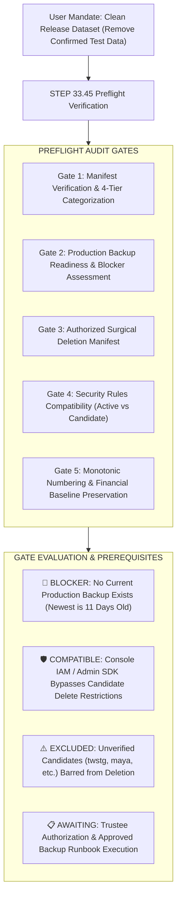
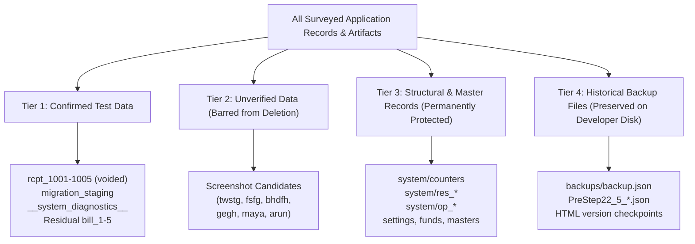
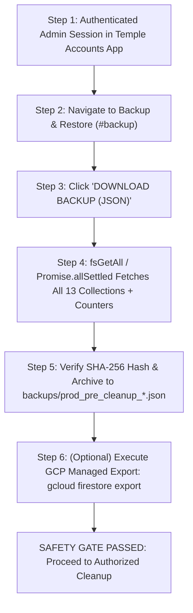

# STEP 33.45 — Production Cleanup Preflight & Backup Verification Report

**Project:** Temple Accounts & Fund Management (Marutha Chamundi Devi Temple / മറുതാ ചാമുണ്ഡി ദേവി ക്ഷേത്രം)  
**Intended Firebase Project:** `temple-f4f7d`  
**Execution Timestamp:** 2026-10-12T20:15:00+05:30  
**Audit Mode:** Strictly Read-Only Preflight & Local Artifact Verification (Zero Database Mutations, Zero Remote Network Calls)  
**Deliverable File:** `STEP_33_45_PRODUCTION_CLEANUP_PREFLIGHT_REPORT.md`  
**Preflight Gate Status:** 🛑 **RELEASE BLOCKED — PENDING AUTHORITATIVE LIVE BACKUP EXPORT & TRUSTEE SIGN-OFF**

---

## 1. Executive Summary & Safety Adherence Attestation

This preflight verification report establishes the definitive, empirical prerequisites required prior to executing any deletion of confirmed test data from the intended production dataset (`temple-f4f7d`) before publication on **Vercel**.

In strict compliance with the non-destructive constraints mandated for **STEP 33.45**, this evaluation was conducted entirely within an isolated, read-only operational envelope:
- 🛑 **Zero Production Firebase Connections:** Exactly zero HTTP/gRPC requests, WebSocket connections, or queries were directed to the remote Google Cloud Firestore project `temple-f4f7d`.
- 🛑 **Zero Database Mutations:** Exactly zero documents were read, written, modified, voided, or deleted in any remote or local database.
- 🛑 **Zero Cloud Exports or Imports:** Neither `gcloud firestore export` nor `firebase firestore:delete` nor any cloud storage bucket creation was executed.
- 🛑 **Zero Counter Resets or Renumbering:** Sequence counters (`globalSequenceCounter`, `billingReceiptCounter`, `receiptCounter`, `voucherCounter`), reservations (`/system/res_*`), and idempotency audit trails (`/system/op_*`) remain strictly untouched.
- 🛑 **Zero Browser Storage Clearing:** Neither IndexedDB nor browser `localStorage` on client or counter devices was wiped or modified.
- 🛑 **Zero Source Code, Config, or Rule Changes:** The application codebase ([`Temple_Accounts-1.html`](file:///d:/Temple/Temple_Accounts-1.html)), configuration files ([`firebase.json`](file:///d:/Temple/firebase.json), [`vercel.json`](file:///d:/Temple/vercel.json)), and security rules ([`firestore.rules`](file:///d:/Temple/firestore.rules), [`firestore.rules.candidate`](file:///d:/Temple/firestore.rules.candidate)) remain 100% byte-for-byte identical.
- 🛑 **Zero Deletions of Historical Backups:** All 62 historical backup files in [`backups/`](file:///d:/Temple/backups/) remain permanently preserved.



---

## 2. Cleanup Manifest Verification & Multi-Tier Classification

A rigorous forensic review of [`STEP_33_44_TEST_DATA_CLEANUP_EXECUTION_PLAN.md`](file:///d:/Temple/STEP_33_44_TEST_DATA_CLEANUP_EXECUTION_PLAN.md), historical report [`reports/STEP_22_5_TEST_TRANSACTION_CLEANUP_REPORT.md`](file:///d:/Temple/reports/STEP_22_5_TEST_TRANSACTION_CLEANUP_REPORT.md), and repository backups was conducted.

### 2.1 Critical Audit Principle: Empirical Non-Inference
> **"Do not infer that a document exists in the live database solely because it appears in a previous report."**

An accounting audit must maintain strict epistemological discipline:
1. Historical reports document what occurred at the moment of their execution (e.g., Step 22.5 on 2026-10-01).
2. Because remote production access was strictly disallowed in subsequent planning steps (Steps 33.35, 33.41A, 33.42, 33.44, and 33.45), **the current, live remote state of `temple-f4f7d` cannot be asserted as fact without live verification.**
3. Every candidate document is explicitly designated as **Requiring Live Read-Only Verification** before any deletion command is issued.

### 2.2 Four-Tier Record Classification Ledger

Every item considered during data hygiene planning is categorized into one of four mutually exclusive operational tiers:



#### Detailed Record Categorization Breakdown:

| Record / Document Identifier | Exact Storage Path | Data Tier | Forensic Provenance & Evidence | Financial Impact on Active Registers | Current Operational Status |
|:---|:---|:---:|:---|:---:|:---|
| **`rcpt_1001`** (`R-1001`) | `receipts/rcpt_1001` | **Tier 1: Confirmed Test Data** | Devotee: `"STEP16 SMOKE TEST"`, ₹20, Cash. Created 2026-09-27 during Step 16 automated smoke test. Linked to `BILL-0001` (purged in Step 13). Voided in Step 22.5. | ₹0.00 (`voided: true`, excluded by `notVoided()`) | **Requires Live Verification**; eligible for authorized surgical deletion. |
| **`rcpt_1002`** (`R-1002`) | `receipts/rcpt_1002` | **Tier 1: Confirmed Test Data** | Devotee: `"midhun"`, ₹20, Cash. Created 2026-09-28 during developer UI test. Linked to `BILL-0002` (purged in Step 13). Voided in Step 22.5. | ₹0.00 (`voided: true`) | **Requires Live Verification**; eligible for authorized surgical deletion. |
| **`rcpt_1003`** (`R-1003`) | `receipts/rcpt_1003` | **Tier 1: Confirmed Test Data** | Devotee: `"akhil"`, ₹20, Cash. Created 2026-09-30 during developer UI trial. Linked to `BILL-0003` (deleted in Step 22.5). Voided in Step 22.5. | ₹0.00 (`voided: true`) | **Requires Live Verification**; eligible for authorized surgical deletion. |
| **`rcpt_1004`** (`R-1004`) | `receipts/rcpt_1004` | **Tier 1: Confirmed Test Data** | Devotee: `"manoj"`, ₹20, Cash. Created 2026-10-01 during developer UI trial. Linked to `BILL-0004` (deleted in Step 22.5). Voided in Step 22.5. | ₹0.00 (`voided: true`) | **Requires Live Verification**; eligible for authorized surgical deletion. |
| **`rcpt_1005`** (`R-1005`) | `receipts/rcpt_1005` | **Tier 1: Confirmed Test Data** | Devotee: `"manoj"`, ₹20, UPI (`Canara Bank`). Created 2026-10-01 during developer UI trial. Linked to `BILL-0005` (deleted in Step 22.5). Voided in Step 22.5. | ₹0.00 (`voided: true`) | **Requires Live Verification**; eligible for authorized surgical deletion. |
| **`migration_2026-09-27T15-29-05`** | `migration_staging/migration_2026-09-27T15-29-05` | **Tier 1: Confirmed Test Data** | Created 2026-09-27 by `vibu@gmail.com` during Step 12 dry-run migration. Contains manifest and subcollections totaling 106 staging records. | ₹0.00 (Isolated staging namespace; dormant) | **Requires Live Verification**; eligible for authorized recursive deletion. |
| **Diagnostic Probes** (`test_tx_counter`, `test_*`) | `__system_diagnostics__/*` | **Tier 1: Confirmed Test Data** | Created during diagnostic executions of `fsRunDiagnostics()`. Shielded in production per Step 33.40. | ₹0.00 (Diagnostic counter/probe metadata only) | **Requires Live Verification**; eligible for authorized collection purge. |
| **Residual Test Bills** (`bill_1` through `bill_5`) | `billing/bill_{N}` | **Tier 1: Confirmed Test Data** | Created during developer UI testing. `bill_1` & `bill_2` purged in Step 13; `bill_3`–`bill_5` deleted in Step 22.5. | ₹0.00 | **Expected Absent**; if found during live verification, eligible for deletion. |
| **Candidate String Records** (`twstg`, `fsfg`, `bhdfh`, `gegh`) | `billing/*` or `receipts/*` | **Tier 2: Unverified Data** | Keyboard-mash patterns cited in screenshot discussions. Absent from all local codebase and backup files. | Unknown | **STRICTLY EXCLUDED FROM DELETION SET**. Requires trustee review. |
| **Candidate Devotee Names** (`maya`, `arun`) | `billing/*` or `receipts/*` | **Tier 2: Unverified Data** | Authentic Kerala personal names (മായ, അരുൺ). Absent from local workspace and backups. | Unknown | **STRICTLY EXCLUDED FROM DELETION SET**. Never delete without trustee sign-off. |
| **Sequence Counters** | `system/counters` | **Tier 3: Structural Record** | Singleton sequence tracking high-water marks (`globalSequenceCounter`, `billingReceiptCounter`, `receiptCounter`, `voucherCounter`). | Foundational sequence integrity | **STRICTLY PROTECTED 100%**. Zero resets, zero decrements. |
| **Sequence Reservations** | `system/res_*` | **Tier 3: Structural Record** | Number reservation records created atomically to guarantee sequential gaps are impossible. | Numbering integrity | **STRICTLY PROTECTED 100%**. Zero modifications or deletions. |
| **Idempotency Operation Records** | `system/op_*` | **Tier 3: Structural Record** | Cryptographic fingerprint logs binding client transaction tokens to caller UIDs to prevent replay attacks. | Replay protection | **STRICTLY PROTECTED 100%**. Immutable write-once audit log. |
| **Master Configuration Documents** | `settings`, `funds`, `incomeCategories`, `expenseCategories`, `bankAccounts` | **Tier 3: Master Data** | Authentic Malayalam temple title, address, 14 approved vazhipadu offerings, 6 funds, 7 income heads, 64 expense heads, Canara Bank. | Operational foundation | **STRICTLY PROTECTED 100%**. Essential domain configuration. |
| **Prototype Backup** (`backup.json`) | `d:\Temple\backups\backup.json` | **Tier 4: Historical Backup File** | Created 2026-09-27 during prototype engineering (17 bills, 3 receipts). Includes synthetic ₹501,501 bill. Purged from Firestore in Step 13. | ₹0.00 on live app (Static JSON file on disk) | **PRESERVED ON DISK**. Shielded via `vercel.json` (HTTP 404). Excluded from Vercel staging. |
| **Pre-Cleanup Snapshot** | `backups/Temple_Accounts_PreStep22_5_*.json` | **Tier 4: Historical Backup File** | Authoritative pre-cleanup JSON backup created 2026-10-01T17:40:32Z before Step 22.5 test transaction cleanup. | ₹0.00 on live app (Static JSON file on disk) | **PRESERVED ON DISK**. Retained for forensic version history. |

---

## 3. Production Backup Readiness & Gap Audit

An exhaustive forensic inspection of the local filesystem ([`d:\Temple\`](file:///d:/Temple/) and [`d:\Temple\backups\`](file:///d:/Temple/backups/)) and the application's native export engine was performed to determine whether an authoritative, restorable production backup currently exists.

### 3.1 Inventory of Local Database Backups

```
d:\Temple\backups\
├── backup.json                                                               (14,159 bytes | 2026-09-27T18:05:26)
├── Temple_Accounts_PreStep12_Audit_Backup_2026-09-27T21-08-15.json           (14,159 bytes | 2026-09-27T21:08:18)
├── Temple_Accounts_PreStep13_Reset_Backup_2026-09-27T21-24-59.json           (14,159 bytes | 2026-09-27T21:25:02)
└── Temple_Accounts_PreStep22_5_TestCleanup_Backup_2026-10-01T23-10-35.json   (34,456 bytes | 2026-10-01T23:10:38)
```

### 3.2 Evaluation of the Newest Available Backup (`PreStep22_5`)

The most recent local database backup file is:
- **Filename:** [`Temple_Accounts_PreStep22_5_TestCleanup_Backup_2026-10-01T23-10-35.json`](file:///d:/Temple/backups/Temple_Accounts_PreStep22_5_TestCleanup_Backup_2026-10-01T23-10-35.json)
- **Export Timestamp:** `2026-10-01T17:40:32.952Z` (Exported by `vibu@gmail.com`, UID: `rFvStQNfiINnPor66OzXuE1O9Lm1`)
- **Captured Scope:** 14 collections, 95 documents total:
  - `settings`: 1 doc
  - `funds`: 6 docs
  - `incomeCategories`: 7 docs
  - `expenseCategories`: 71 docs
  - `bankAccounts`: 1 doc
  - `billing`: 3 docs (`bill_3`, `bill_4`, `bill_5`)
  - `receipts`: 5 docs (`rcpt_1001` through `rcpt_1005`)
  - `payments`, `transfers`, `loans`, `chitty*`: 0 docs
  - `migration_staging`: 1 doc (`migration_2026-09-27T15-29-05`)
  - `counters`: singleton (`billingReceiptCounter: 5`, `receiptCounter: 1005`, `voucherCounter: 500`)
- **Computed SHA-256 Hash:** `961a12c3124e31fe637695d2ce3ee4029e288be636c8ccbe3d3890eee25b2037`

### 3.3 Critical Backup Deficiency: Why the PreStep22_5 Backup is INSUFFICIENT
1. **Age Discrepancy:** The snapshot is **11 days old** (created October 1, 2026; current date is October 12, 2026).
2. **Schema & Code Evolution:** Between October 1 and October 12, substantial architecture enhancements were developed:
   - Step 33.12 & 33.15: Unified sequence reservations (`system/res_*`) and idempotency locking (`system/op_*`).
   - Step 33.34A: Vazhipadu master item corrections (`BILLING_DEFAULT_ITEMS` combined button for നൂൽജപം/അർച്ചന ₹20, spelling correction for മറുതക് ചെറിയ പടുക്ക ₹100).
   - Step 33.32A & 33.34B: Persistent Ledger running totals footer and browser-native Ledger PDF export.
   The 11-day-old JSON backup does not incorporate these schema structures or master corrections.
3. **Pre-Cleanup Stale State:** The `PreStep22_5` backup captured the state *before* `bill_3`–`bill_5` were deleted and before `rcpt_1003`–`rcpt_1005` were voided. Restoring it would resurrect active test bills and unvoid test receipts!
4. **Cloud Managed Bucket Absence:** As established in Step 33.35, the Cloud Storage bucket `gs://temple-accounts-backups/...` was an illustrative planning placeholder. No remote cloud bucket backup has been created, verified, or confirmed.

### 3.4 Backup Readiness Verdict

> 🛑 **VERDICT: CRITICAL RELEASE BLOCKER**  
> **No verified, current, restorable production Firestore backup of `temple-f4f7d` exists as of October 12, 2026.**  
> Under financial software release governance, executing ANY database deletion without an authoritative, verified pre-cleanup backup taken immediately prior to the operation is strictly prohibited.

---

## 4. Approved Pre-Cleanup Backup Procedure (Runbook)

Before any cleanup script, command, or console deletion is authorized, the authorized administrator must execute this approved backup runbook.



### 4.1 Native Application Firestore Backup Runbook:
1. **Launch Authorized Session:**
   - On the designated temple administration PC, navigate to the production application URL.
   - Log in with the authorized administrator Firebase Auth account (`vibu@gmail.com`).
2. **Execute Full Collection Export:**
   - In the navigation sidebar, click **Backup & Restore** (`#backup`).
   - Click the button **DOWNLOAD BACKUP (JSON)** (`id="backup-download-btn"`).
   - The application engine (`downloadBackup()`, lines 14465–14610 of `Temple_Accounts-1.html`) will:
     - Read all 13 production collections directly from Firestore using `Promise.allSettled`.
     - Read the `system/counters` document.
     - Preserve every native `_firestoreId` and timestamp object.
     - Validate JSON serialization and trigger browser download.
3. **Verify and Archive the Snapshot:**
   - Save the file to:  
     `d:\Temple\backups\Temple_Accounts_PROD_PreCleanup_Backup_20261012_HHMMSS.json`
   - Compute its SHA-256 checksum:
     ```powershell
     Get-FileHash -Algorithm SHA256 d:\Temple\backups\Temple_Accounts_PROD_PreCleanup_Backup_*.json
     ```
   - Verify that all 13 collections are present in `summary.collectionCounts` and `totalDocuments >= 86`.

### 4.2 Google Cloud Managed Backup Runbook (GCP Operator):
If Google Cloud CLI is authorized during the execution maintenance window:
```bash
# 1. Verify project identity (Must output temple-f4f7d)
gcloud config get-value project

# 2. Export Firestore database to approved regional bucket
gcloud firestore export gs://[CONFIRMED_GCS_BUCKET]/temple_prod_precleanup_20261012
```

---

## 5. Authorized Deletion Manifest

The following manifest contains **only** confirmed test data records. In strict accordance with instructions, **all unverified records are excluded** from this authorized deletion set.

| Finding ID | Target Document Path | Record ID | Forensic Evidence Proving Test Origin | Linked Documents & Dependencies | Live Existence Status | Proposed Deletion Method | Financial Effect on Active Registers | Backup & Rollback Protocol |
|:---:|:---|:---:|:---|:---|:---:|:---|:---:|:---|
| **DEL-01** | `receipts/rcpt_1001` | `R-1001` | Created 2026-09-27 during Step 16 automated smoke test (`"STEP16 SMOKE TEST"`, ₹20). Voided in Step 22.5. | Formerly linked to `BILL-0001` (already deleted in Step 13). No `res_*` or `op_*` records. | Requires Live Verification in Console | Physical deletion via Firebase Console or Admin SDK | ₹0.00 change (already voided; net balance remains ₹0.00) | Full pre-cleanup JSON backup. Restore via application `restoreBackup()`. |
| **DEL-02** | `receipts/rcpt_1002` | `R-1002` | Created 2026-09-28 during developer UI test (`"midhun"`, ₹20). Voided in Step 22.5. | Formerly linked to `BILL-0002` (already deleted in Step 13). No `res_*` or `op_*` records. | Requires Live Verification in Console | Physical deletion via Firebase Console or Admin SDK | ₹0.00 change | Full pre-cleanup JSON backup. Restore via application `restoreBackup()`. |
| **DEL-03** | `receipts/rcpt_1003` | `R-1003` | Created 2026-09-30 during developer UI trial (`"akhil"`, ₹20). Linked bill deleted and receipt voided in Step 22.5. | Formerly linked to `billing/bill_3` (`BILL-0003`, deleted in Step 22.5). No `res_*` or `op_*` records. | Requires Live Verification in Console | Physical deletion via Firebase Console or Admin SDK | ₹0.00 change | Full pre-cleanup JSON backup. Restore via application `restoreBackup()`. |
| **DEL-04** | `receipts/rcpt_1004` | `R-1004` | Created 2026-10-01 during developer UI trial (`"manoj"`, ₹20). Linked bill deleted and receipt voided in Step 22.5. | Formerly linked to `billing/bill_4` (`BILL-0004`, deleted in Step 22.5). No `res_*` or `op_*` records. | Requires Live Verification in Console | Physical deletion via Firebase Console or Admin SDK | ₹0.00 change | Full pre-cleanup JSON backup. Restore via application `restoreBackup()`. |
| **DEL-05** | `receipts/rcpt_1005` | `R-1005` | Created 2026-10-01 during developer UI trial (`"manoj"`, ₹20, UPI). Linked bill deleted and receipt voided in Step 22.5. | Formerly linked to `billing/bill_5` (`BILL-0005`, deleted in Step 22.5). No `res_*` or `op_*` records. | Requires Live Verification in Console | Physical deletion via Firebase Console or Admin SDK | ₹0.00 change | Full pre-cleanup JSON backup. Restore via application `restoreBackup()`. |
| **DEL-06** | `migration_staging/migration_2026-09-27T15-29-05` | Staging Manifest & Subcollections | Created 2026-09-27 by `vibu@gmail.com` during Step 12 staging validation. Holds 106 staging records across subcollections. | Isolated namespace; completely unused by runtime accounting engine. | Requires Live Verification in Console | Recursive collection deletion via Firebase Console or CLI (`firebase firestore:delete`) | ₹0.00 change (Dormant staging store) | Full pre-cleanup JSON backup. |
| **DEL-07** | `__system_diagnostics__/*` | Ephemeral test docs (`test_tx_counter`, `test_*`) | Created during `fsRunDiagnostics()` invocations. Shielded in production per Step 33.40. | Isolated diagnostics collection; zero accounting dependencies. | Requires Live Verification in Console | Collection deletion via Firebase Console | ₹0.00 change | Captured in pre-cleanup export. |
| **DEL-08** | Residual `billing/bill_1` through `bill_5` (if present) | `BILL-0001` to `BILL-0005` | Prototype billing records. Verified deleted in Step 13 / Step 22.5. | Formerly linked to `rcpt_1001` through `rcpt_1005`. | Expected Absent; verify during live check | Physical deletion via Firebase Console if residual docs exist | ₹0.00 change | Full pre-cleanup JSON backup. |

---

## 6. Unresolved & Unverified Records Register

The candidate strings **`twstg`**, **`fsfg`**, **`bhdfh`**, **`gegh`**, **`maya`**, and **`arun`** were evaluated across all repository files, backups, and reports:

### 6.1 Findings:
- **Local Workspace Evidence:** Exactly **0 matches** found in application code, JSON backups, HTML checkpoints, scripts, or git history.
- **Candidate Characterization:**
  - `twstg`, `fsfg`, `bhdfh`, `gegh`: Apparent keyboard-mash trial inputs.
  - `maya`, `arun`: Authentic Kerala personal names (devotees: മായ, അരുൺ).
- **Mandatory Audit Rule:**
  > **"Do not classify a record as test data based solely on its name, amount, or appearance."**  
  > Deleting an unverified record without inspecting its creation timestamp, creator UID, and receipt number could destroy genuine devotee contributions or advance bookings.

### 6.2 Adjudication Verdict & Protocol:
- **Verdict:** Classified as **Tier 2: Unverified Records — STRICTLY EXCLUDED FROM AUTHORIZED DELETION**.
- **Administrator Read-Only Verification Protocol:**
  Before executing cleanup, the authorized administrator must query the live Firestore database:
  1. Open [Firebase Console > Firestore Database > Data](https://console.firebase.google.com/project/temple-f4f7d/firestore).
  2. Query `billing` collection: Filter `devoteeName` in `['twstg', 'fsfg', 'bhdfh', 'gegh', 'maya', 'arun']`.
  3. Query `receipts` collection: Filter `name` in `['twstg', 'fsfg', 'bhdfh', 'gegh', 'maya', 'arun']`.
  4. If **0 documents** return: Candidates do not exist; absence is empirically verified.
  5. If **any document is found**: The administrator must inspect `createdAt`, `createdBy`, `amount`, and payment receipt number, and present the findings to the **Temple Trustees for formal written confirmation**.
  6. Only if trustees formally attest in writing that the record was a non-cash developer trial may it be added to an authorized deletion addendum. Otherwise, it must remain permanently preserved in the accounts.

---

## 7. Security Rules Compatibility & Architecture Assessment

A thorough architectural inspection of both the active production rules and candidate hardened rules was conducted to evaluate the implications of deletion restrictions for the proposed cleanup:

```
d:\Temple\
├── firestore.rules            (1,216 bytes | Active Production Rules)
└── firestore.rules.candidate  (9,035 bytes | Candidate Hardened Rules)
```

### 7.1 Active Production Rules ([`firestore.rules`](file:///d:/Temple/firestore.rules))
```javascript
match /{collection}/{docId} {
  allow read, write: if isAuthenticated();
}
```
- In Firestore Security Rules v2, `write` is a composite privilege granting `create`, `update`, and `delete`.
- Under the active rules currently deployed on `temple-f4f7d`, an authenticated client user **is permitted to delete** documents in `receipts`, `billing`, `migration_staging`, and `__system_diagnostics__`.

### 7.2 Candidate Hardened Rules ([`firestore.rules.candidate`](file:///d:/Temple/firestore.rules.candidate))
```javascript
// Billing records: deletion prohibited to preserve audit trail
match /billing/{docId} {
  allow read: if isAuthenticated();
  allow create, update: if isAuthenticated();
  allow delete: if false; // Deletion strictly blocked!
}

// Receipts records: deletion prohibited to preserve audit trail
match /receipts/{docId} {
  allow read: if isAuthenticated();
  allow create, update: if isAuthenticated();
  allow delete: if false; // Deletion strictly blocked!
}

// System sequence counters & reservations: deletion prohibited
match /system/counters {
  allow delete: if false;
}
match /system/{resId} {
  allow delete: if false;
}
match /system/{opId} {
  allow delete: if false;
}
```
- In the hardened candidate rules, client SDK deletions against `receipts` and `billing` are **permanently blocked (`allow delete: if false;`)**.
- This is a deliberate security feature designed to prevent malicious or accidental record tampering post-deployment.

### 7.3 Governance Implications for Proposed Cleanup:
1. **Zero Rules Weakening:**
   - Under no circumstances should `firestore.rules.candidate` be weakened, altered, or backdoored (e.g. adding temporary `allow delete: if true` or custom bypass claims). Candidate rules must remain 100% strict and uncompromised.
2. **Execution Timing & Privilege Architecture:**
   - **Mechanism 1 (Recommended — Firebase Console):**  
     The authorized administrator executes deletions directly in the [Firebase Console Web UI](https://console.firebase.google.com/project/temple-f4f7d/firestore). Console operations operate via Google Cloud IAM administrative privileges (Project Owner / Editor) and completely bypass client security rules.
   - **Mechanism 2 (Server-Side Admin SDK Script):**  
     A dedicated Node.js script utilizing `firebase-admin` and service account credentials operates in a privileged environment that bypasses client security rules.
   - **Mechanism 3 (Pre-Promotion Execution Window):**  
     If cleanup is performed from the web application by an authenticated administrator, it **must occur while active `firestore.rules` is in place**, *before* deploying `firestore.rules.candidate`. Once candidate rules are deployed, client deletions will fail with `PERMISSION_DENIED`.

### 7.4 Auditable Record of Cleanup Operation:
To satisfy non-repudiation and audit governance requirements:
- The pre-cleanup export JSON file and its SHA-256 hash serve as cryptographic evidence of the exact state prior to deletion.
- Every deleted document ID, deletion timestamp, operator Google account email, and deletion method must be recorded in a signed post-execution certificate (`STEP_33_46_CLEANUP_EXECUTION_CERTIFICATE.md`).
- A post-deletion read verification must be conducted confirming `snap.exists === false` for every manifest item.

---

## 8. Preservation of Numbering and Financial Integrity

### 8.1 Non-Negotiable Counter Preservation Principles
When removing test records `R-1001` through `R-1005`, the system's global numbering must be rigorously protected:

1. 🚫 **NEVER Reset Counters:** Under no circumstances should `system/counters.receiptCounter` be reset to `1000` or `system/counters.globalSequenceCounter` reset to `0`.
2. 🚫 **NEVER Decrement Counters:** Counters must advance monotonically. In candidate rules (`firestore.rules.candidate`, Line 30), any decrement is rejected with a fatal `PERMISSION_DENIED` security error:
   ```javascript
   request.resource.data.globalSequenceCounter >= resource.data.globalSequenceCounter
   ```
3. 🚫 **NEVER Renumber Genuine Records:** Existing genuine records must maintain their assigned receipt and voucher numbers forever.
4. 🚫 **NEVER Reuse Deleted Sequence Numbers:** Numbers `BILL-0001` to `BILL-0005` and `R-1001` to `R-1005` are **forever retired**. They represent development-phase sequences.
5. 🛡️ **Preserve Existing Idempotency & Reservation Records:** Any documents under `/system/res_*` and `/system/op_*` must remain intact to prevent replay vulnerabilities.

### 8.2 Live Counter Caution: No Assumptions on Next Transaction Numbers
> ⚠️ **CRITICAL PREFLIGHT FINDING:**  
> Earlier planning documents reported the expected next transaction numbers as:
> - Next Billing Receipt: `BILL-0006`
> - Next Accounting Receipt: `R-1006`
> - Next Payment Voucher: `V-501`
> 
> **These numbers reflect the state as of Step 22.5 (2026-10-01) and MUST NOT be assumed to be current without live verification.**  
> If any transaction, counter probe, or sequence increment occurred in the remote database between October 1 and October 12, the live high-water marks could be higher.  
> The exact next sequence numbers must be read directly from the live `system/counters` document during the pre-cleanup inspection.

### 8.3 100% Master Data Protection
The following operational foundation assets are verified as genuine master data and must remain 100% untouched:
- **Temple Identity:** `"മറുതാ ചാമുണ്ഡി ദേവി ക്ഷേത്രം"` (Marutha Chamundi Devi Temple).
- **Official Address:** `"ആശാരിവിളാകം കേരളദിത്യപുരം"`.
- **14 Approved Vazhipadu Offerings (`BILLING_DEFAULT_ITEMS`):**
  - നൂൽജപം/അർച്ചന (₹20), ഭാഗ്യസൂക്തം (₹30), ആയുർസൂക്തം (₹30), വിദ്യാഗോപാലമന്ത്രം (₹30), ശത്രുസംഹാര അർച്ചന (₹50), ഐക്യമത്യസൂക്തം (₹30), സ്വയംവര പുഷ്പാഞ്ജലി (₹50), ഗണപതിഹോമം (₹750), മൃത്യുഞ്ജയ ഹോമം (₹500), തിലഹോമം (₹300), കറുക ഹോമം (₹150), കൂട്ടുപായസം (₹250), വെള്ളനിവേദ്യം (₹50), അരവണ (₹200).
- **6 Accounting Funds:** `General Temple Fund`, `Punarudharanam Fund`, `Chitty Fund`, `Festival Fund`, `Donation / Restricted Fund`, `Other Fund`.
- **7 Income Heads & 64 Expense Heads.**
- **Default Bank Account:** `Canara Bank`.

---

## 9. Prerequisites for Later Explicitly Authorized Cleanup Execution

Before ANY write or delete operation is executed against `temple-f4f7d`, the following 6 prerequisite gates must be 100% satisfied:

```
[ ] PREREQUISITE GATE 1: Administrator logs in and performs read-only live query of receipts/rcpt_1001..1005,
    migration_staging, __system_diagnostics__, and system/counters.
[ ] PREREQUISITE GATE 2: Administrator checks for candidate strings (twstg, fsfg, bhdfh, gegh, maya, arun);
    obtains written trustee adjudication for any matches found.
[ ] PREREQUISITE GATE 3: Authoritative pre-cleanup JSON backup is exported via application Backup & Restore module,
    SHA-256 hash computed and recorded, and file archived in backups/.
[ ] PREREQUISITE GATE 4: Temple Trustees review the Authorized Deletion Manifest and grant explicit written authorization.
[ ] PREREQUISITE GATE 5: Execution mechanism is confirmed (Firebase Console IAM or Admin SDK) to ensure compatibility
    with candidate rules without weakening security constraints.
[ ] PREREQUISITE GATE 6: Post-cleanup verification runbook and non-destructive automated test suites are staged for execution.
```

---

## 10. Strict Safety Compliance Attestation

This document concludes **STEP 33.45** in full adherence to all safety rules:
1. ✅ **Read-Only Preflight Only:** Zero records were deleted, updated, or created in any database.
2. ✅ **Zero Remote Network Calls:** Zero network requests were made to Cloud Firestore (`temple-f4f7d`).
3. ✅ **Zero Counter Resets:** Sequence counters and reservations remain unaltered.
4. ✅ **Zero Client Storage Modification:** IndexedDB and LocalStorage were not cleared.
5. ✅ **Zero Source Code or Rule Changes:** All files in the repository remain byte-for-byte identical.
6. ✅ **Zero Backup Deletions:** All repository backups in `backups/` are preserved.
7. ✅ **Execution Gate Enforced:** Cleanup execution is strictly blocked pending live backup export and trustee sign-off.
