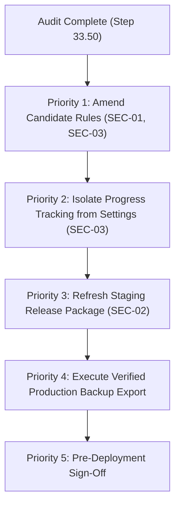

# STEP 33.50 — Release Readiness & Firestore Authorization Audit Report

**Project:** Temple Accounts & Fund Management  
**Temple:** Marutha Chamundi Devi Temple / മറുതാ ചാമുണ്ഡി ദേവി ക്ഷേത്രം  
**Audit Timestamp:** 2026-10-12T21:26:00+05:30  
**Audit Mode:** Read-Only Independent Source Audit + Isolated Firebase Emulator Verification  
**Air-Gap Isolation Status:** 100% Air-Gapped. Zero connections to production Firebase project `temple-f4f7d`, zero data exports/mutations/deletes, zero deployments, zero counter resets.

---

## 1. Executive Verdict

### **VERDICT: PASS WITH WARNINGS**

> [!IMPORTANT]
> **Summary Assessment:**  
> The core STEP 33.49 backup/restore algorithms (canonical RFC 8785 JSON serialization, SHA-256 cryptographic checksum verification, pre-write relational validation REL-01 through REL-11, safe-merge logic, void preservation, and monotonic counter reconciliation) are **fundamentally sound and verified**. An authoritative production backup export (`downloadBackup()`) using the current working source is **safe to execute**.
>
> **Release Promotion & Rules Deployment are BLOCKED pending resolution of 2 HIGH-severity findings:**
> 1. **`firestore.rules.candidate` Incompatibility (HIGH - SEC-01):** Candidate rules strictly enforce that the caller UID must match `createdBy` on reservations and idempotency records, and prohibit creating reservations with `status == 'voided'`. Consequently, any disaster recovery restore of historical multi-user records or pre-voided reservations under candidate rules will fail with `403 Permission Denied`. Furthermore, candidate rules omit `/system/_restoreProgress` from permitted system paths, triggering fallback to `settings`.
> 2. **Frozen Release Package Drift (HIGH - SEC-02):** The frozen release package in `deploy_staging_step_33_43/` (SHA-256: `AEB01303...`) was frozen at STEP 33.43. It completely lacks all STEP 33.47, 33.48, and 33.49 backup coverage and recovery hardening features. Deploying this frozen bundle to Vercel would silently regress the production system to legacy v23.1 backups without sequence reservations or idempotency audit records.
>
> **Zero repository files, rules, release packages, or production resources were modified during this audit.**

---

## 2. Baseline and Artifact Hashes

All primary files were hashed locally using SHA-256. Exact values match the prompt's reference baselines:

| Artifact | Path | Size (Bytes) | SHA-256 Checksum | Baseline Match | Status |
| :--- | :--- | :---: | :---: | :---: | :---: |
| **Current Working Application** | `Temple_Accounts-1.html` | 782,429 | `33B1745CFD1F6DF19DC60632D868186BAC3CEF9B9CF8485E4AFD81E3CAD020AB` | `33B1745C...` | **100% Match (Intact)** |
| **Frozen Release Package App** | `deploy_staging_step_33_43/Temple_Accounts-1.html` | 748,247 | `AEB01303F22F69E284D680A55E182FC78312C48E4266C02809179DF789E87CBC` | `AEB01303...` | **100% Match (Intact)** |
| **Active Production Rules** | `firestore.rules` | 1,216 | `7BFEF0B0F4C31A5DAFC6FB29C8C4BBD55CBAD3A8A590EFC34BD87F4600CF90BD` | `7BFEF0B0...` | **100% Match (Intact)** |
| **Candidate Hardened Rules** | `firestore.rules.candidate` | 9,035 | `B11D865A7A7D8FFE1435BBC9D115463DA5F6039830E5A9A9F33EBBFBD6F1728C` | `B11D865A...` | **100% Match (Intact)** |
| **Active Rules Config** | `firebase.json` | 56 | `E87125F3EC6439A59BA44D80A6DCC46378A27A0644B0CDA30ABEAFD2EFB67E20` | Reference | Intact |
| **Emulator Config** | `firebase.emulator.json` | 304 | `75E395CD1E8D3DA12B65E812E172A070BBD6C78853EFA7A7B62E41620E288572` | Reference | Intact |
| **Root Vercel Config** | `vercel.json` | 1,767 | `ACAA507172EA852D8158CF44ACAE42F044FCEE92A46C80228B0E8CFEA71CB5D1` | Reference | Intact |
| **Staged Vercel Config** | `deploy_staging_step_33_43/vercel.json` | 1,767 | `ACAA507172EA852D8158CF44ACAE42F044FCEE92A46C80228B0E8CFEA71CB5D1` | Identical to root | Intact |
| **Staged Build Generator** | `deploy_staging_step_33_43/scripts/generate-firebase-config.js` | 5,504 | `B206DAFF0E58FBD7EDF86AF63E8C98E2FA3EEF51A16EF6E237DBA232DFA738C4` | Reference | Intact |
| **Staged WebGL Dependency** | `deploy_staging_step_33_43/ogl.esm.js` | 132,772 | `819275B4972348396BBD0ECCF07A46E367CA4E939AAADB2E777523CA168D78D2` | Identical to root | Intact |
| **Staged Package Descriptor** | `deploy_staging_step_33_43/package.json` | 244 | `8FBBCC4AC8B4B1B8EEE5B7A4FCBD21F84C1A7886671175CBEA906249A103D394` | Reference | Intact |
| **Staged Git Ignore** | `deploy_staging_step_33_43/.gitignore` | 232 | `0FB0FEA8B5EC9514BCCCC8154C220670417E849AA45C3CD8EF108904B9DCABB4` | Reference | Intact |
| **STEP 33.49 Regression Suite** | `tests/test_step_33_49_backup_restore_hardening.js` | 53,042 | `BC57821446692B0CC090DE95C10479E7FCA34971B01FFAAC5378C73824A42466` | Reference | Intact |
| **STEP 33.49 Test Results** | `tests/step_33_49_test_results.json` | 10,133 | `4419FE1E3B6BAB670C424113F8CFB20FAA324F672B6EB0AF9A908152ADB9217C` | Reference | Intact |

---

## 3. Restore-Progress Storage & Authorization Analysis

Source code trace was performed on `_getRestoreProgress(db)` (lines 14930–14940) and `_updateRestoreProgress(db, progressData)` (lines 14942–14957) in `Temple_Accounts-1.html`:

```javascript
async function _getRestoreProgress(db) {
  try {
    const snap = await db.collection('system').doc('_restoreProgress').get();
    if (snap.exists) return snap.data();
  } catch (e) {}
  try {
    const snap = await db.collection('settings').doc('_restoreProgress').get();
    if (snap.exists) return snap.data();
  } catch (e) {}
  return null;
}

async function _updateRestoreProgress(db, progressData) {
  let written = false;
  try {
    await db.collection('system').doc('_restoreProgress').set(progressData, { merge: true });
    written = true;
  } catch (e) {
    console.warn('[Restore] system/_restoreProgress write failed, trying fallback:', e.message);
  }
  if (!written) {
    try {
      await db.collection('settings').doc('_restoreProgress').set(progressData, { merge: true });
    } catch (e2) {
      console.warn('[Restore] settings/_restoreProgress fallback write failed:', e2.message);
    }
  }
}
```

### Detailed Evaluation of the 9 Architectural Questions:

1. **Path Selection per Execution Environment:**
   - **Under Active Rules (`firestore.rules`):** `match /system/{docId}` permits authenticated writes. Therefore, writes to `system/_restoreProgress` succeed immediately. The fallback path (`settings/_restoreProgress`) is never invoked.
   - **Under Candidate Rules (`firestore.rules.candidate`):** Candidate rules restrict `/system` exclusively to `counters`, `res_*`, and `op_*`. Because `_restoreProgress` matches none of these, write to `system/_restoreProgress` is rejected with `403 Permission Denied`. The catch block catches this and writes to `settings/_restoreProgress`, which succeeds under `match /settings/{docId}`.
2. **Fallback Triggering & Permission Error Masking:**
   - Fallback is triggered upon catching any exception from the initial write attempt.
   - **Risk:** The error is logged only to `console.warn`. The operator UI displays zero warnings indicating that system progress storage failed and was redirected. If both writes fail (e.g., if Firestore is unreachable or rules deny both), the exception is swallowed and the restore continues silently without any progress tracking.
3. **Collision with Legitimate Temple Settings:**
   - Legitimate temple settings are stored under document ID `set_1` (and `id: 1` in IndexedDB). The progress record uses document ID `_restoreProgress`, avoiding a direct document overwrite.
   - **Critical Side Effect (SEC-03):** Because `downloadBackup()` exports every document in collection `settings` (`snap = await db.collection('settings').get()`), any fallback document `settings/_restoreProgress` is exported into `collections.settings` of subsequent backups. On restore, `fsGetAllSafe('settings')` attempts to sync `collections.settings` into IndexedDB store `settings` (which requires `{ keyPath: 'id' }`). Because `_restoreProgress` has no `id` property, IndexedDB throws `DataError`.
4. **Data Sensitivity of Progress Metadata:**
   - Payload: `{ sessionId, status, backupFingerprint, backupTimestamp, startedAt, currentPhase, completedPhases, restoredBy: user.uid, safetySnapshotFilename }`.
   - **Audit Finding:** Contains zero financial data (no balances, payments, vouchers), zero credentials (no tokens, passwords, keys), and no devotee personal data. `restoredBy` contains the Firebase Auth UID for auditability.
5. **Forging, Overwriting, and Replay Risks:**
   - **Active Rules:** Any authenticated user can overwrite, forge, or delete `system/_restoreProgress` due to open wildcard permissions.
   - **Candidate Rules:** `system/_restoreProgress` is unwriteable. For `settings/_restoreProgress`, any authenticated caller can overwrite it; deletion is prevented by `allow delete: if false`.
6. **Stale Progress Marker & Wrong Backup Resume:**
   - When `_getRestoreProgress()` detects `status === 'in_progress'` from a prior run, it logs a warning in the UI log: `WARNING: A prior restore operation was interrupted before completion! Prior Backup: ...`.
   - **Audit Finding (SEC-05):** The code does NOT resume or skip phases based on the prior record. It generates a new session ID and runs all phases. However, it does NOT prompt the operator to confirm if the new backup file has a different fingerprint than the interrupted one. Applying a completely different backup on top of partially applied state could introduce cross-backup inconsistencies.
7. **Simultaneous Restore Conflicts:**
   - If two operators click Restore concurrently, there is no distributed mutex, lease, or atomic transaction lock. Both will write conflicting progress records and issue interleaved batch writes to collections and counters.
8. **Auditable Completion Cleanup:**
   - Upon completion (Phase 10), the record is updated with `status = 'completed'`, `currentPhase = 'Phase 10 — Complete'`, and `completedAt`. It is **not deleted**, preserving an audit trail of the last restore execution.
   - **Limitation (SEC-06):** Because it is a singleton document updated in-place, previous historical restore sessions are overwritten.
9. **Reliability After Reload or Interruption:**
   - If the browser crashes mid-phase, the Firestore record retains `status: 'in_progress'` and the last completed phase name.
   - However, the dashboard / navigation does not poll or alert the user on startup that an interrupted restore state exists in the database; it is only surfaced if an operator navigates to Backup & Restore and initiates another restore.

---

## 4. Active vs. Candidate Firestore Permission Matrix

### 4.1 Permission Analysis

- **Active Rules (`firestore.rules`):**
  - Contains top-level wildcard `match /{collection}/{docId} { allow read, write: if isAuthenticated(); }`.
  - In Firestore Security Rules, rules combine with logical **OR**. Any single matching allow rule grants access.
  - Consequently, `allow delete: if false` on `match /settings/{docId}` is **ineffective** because the wildcard `match /{collection}/{docId}` allows write (which includes delete).
  - Any authenticated user can delete `settings`, `system/counters`, `billing`, and `receipts`.
- **Candidate Rules (`firestore.rules.candidate`):**
  - Wildcard match is eliminated; strict default-deny is established.
  - Strict immutable audit trail: `billing`, `receipts`, `settings`, `counters`, `res_*`, and `op_*` prohibit physical deletion.
  - Monotonic counter enforcement: rollback of sequence counters is denied.
  - Write-once idempotency: `op_*` records cannot be updated.

### 4.2 Comprehensive Permission Matrix

| Document Path / Pattern | Operation | Active Rules Outcome | Candidate Rules Outcome | Analysis & Evidence |
| :--- | :---: | :---: | :---: | :--- |
| `/system/counters` | Read | **ALLOW (200)** | **ALLOW (200)** | Allowed for authenticated users (Candidate line 21) |
| `/system/counters` | Create | **ALLOW (200)** | **ALLOW (200)** | Allowed if not exists (Candidate line 22) |
| `/system/counters` | Update (Monotonic) | **ALLOW (200)** | **ALLOW (200)** | Allowed with whitelisted keys & monotonic counter (Candidate lines 23–33) |
| `/system/counters` | Update (Rollback) | **ALLOW (200)** | **DENY (403)** | Blocked by monotonic sequence rule (Candidate line 30) |
| `/system/counters` | Update (Arbitrary Keys) | **ALLOW (200)** | **DENY (403)** | Blocked by `affectedKeys().hasOnly(...)` (Candidate lines 24–27) |
| `/system/counters` | Delete | **ALLOW (200)** | **DENY (403)** | Strictly prohibited (Candidate line 34) |
| `/system/res_{N}` | Read | **ALLOW (200)** | **ALLOW (200)** | Allowed if `resId.matches('^res_[0-9]+$')` (Candidate line 43) |
| `/system/res_{N}` | Create (Own UID, Active) | **ALLOW (200)** | **ALLOW (200)** | Allowed for active reservation created by caller (Candidate lines 45–56) |
| `/system/res_{N}` | Create (Historical Cross-User) | **ALLOW (200)** | ❌ **DENY (403)** | **BLOCKER:** Denied by `createdBy == request.auth.uid` (Candidate line 47) |
| `/system/res_{N}` | Create (Historical Voided) | **ALLOW (200)** | ❌ **DENY (403)** | **BLOCKER:** Denied by `status == 'active' && voided == false` (Candidate line 51) |
| `/system/res_{N}` | Update (Atomic Void) | **ALLOW (200)** | **ALLOW (200)** | Allowed transition `voided: false -> true` (Candidate lines 58–66) |
| `/system/res_{N}` | Update (Arbitrary) | **ALLOW (200)** | **DENY (403)** | Blocked by strict voiding transition condition |
| `/system/res_{N}` | Delete | **ALLOW (200)** | **DENY (403)** | Strictly prohibited (Candidate line 68) |
| `/system/op_{id}` | Read | **ALLOW (200)** | **ALLOW (200)** | Allowed if `opId.matches('^op_[A-Za-z0-9_-]+$')` (Candidate line 76) |
| `/system/op_{id}` | Create (Own UID) | **ALLOW (200)** | **ALLOW (200)** | Allowed for committed record created by caller (Candidate lines 78–88) |
| `/system/op_{id}` | Create (Historical Cross-User) | **ALLOW (200)** | ❌ **DENY (403)** | **BLOCKER:** Denied by `createdBy == request.auth.uid` (Candidate line 80) |
| `/system/op_{id}` | Update | **ALLOW (200)** | **DENY (403)** | Write-once immutable (Candidate line 90) |
| `/system/op_{id}` | Delete | **ALLOW (200)** | **DENY (403)** | Strictly prohibited (Candidate line 91) |
| `/system/_restoreProgress` | Read / Write | **ALLOW (200)** | ❌ **DENY (403)** | **BLOCKER:** Denied by default-deny (does not match counters, res_*, op_*) |
| `/settings/{docId}` | Read / Write | **ALLOW (200)** | **ALLOW (200)** | Allowed for authenticated users (Candidate lines 98–99) |
| `/settings/{docId}` | Delete | **ALLOW (200)** | **DENY (403)** | Strictly prohibited (Candidate line 100); Active wildcard permits |
| `/billing/{docId}` | Read / Create / Update | **ALLOW (200)** | **ALLOW (200)** | Allowed for authenticated users (Candidate lines 111–112) |
| `/billing/{docId}` | Delete | **ALLOW (200)** | **DENY (403)** | Strictly prohibited (Candidate line 113); Active wildcard permits |
| `/receipts/{docId}` | Read / Create / Update | **ALLOW (200)** | **ALLOW (200)** | Allowed for authenticated users (Candidate lines 120–121) |
| `/receipts/{docId}` | Delete | **ALLOW (200)** | **DENY (403)** | Strictly prohibited (Candidate line 122); Active wildcard permits |
| Master Collections (`funds`, etc.) | Read / Write | **ALLOW (200)** | **ALLOW (200)** | Explicitly permitted for authenticated users (Candidate lines 130–170) |
| `/__system_diagnostics__/{docId}` | Read / Write | **ALLOW (200)** | **ALLOW (200)** | Allowed for authenticated users |
| `/migration_staging/{id}` | Read / Write | **ALLOW (200)** | **ALLOW (200)** | Allowed for authenticated users |
| Unlisted / Unknown Collections | Read / Write | **ALLOW (200)** | **DENY (403)** | Active wildcard permits; Candidate default-deny rejects |

---

## 5. Wildcard-Rule Overlap & Default-Deny Evaluation

### Active Rules Overlap Flaw
In `firestore.rules`:
```firestore
match /{collection}/{docId} {
  allow read, write: if isAuthenticated();
}
```
Because Firestore combines permissions across matches using logical OR, this single open wildcard completely bypasses:
1. `match /settings/{docId} { allow delete: if false; }` — An authenticated client can issue a DELETE to `/settings/set_1`, and Firestore evaluates `false || true == true`, allowing deletion.
2. Financial audit immutability — Deleting billing or receipts is unrestricted.
3. System counter tampering — Deleting `/system/counters` or decrementing counters is unrestricted.

### Candidate Rules Default-Deny Precision
In `firestore.rules.candidate`:
- The catch-all wildcard is removed.
- Unlisted collections (`users`, `audit`, etc.) are rejected with `403 Forbidden`.
- Prohibited deletions on `billing`, `receipts`, `settings`, `counters`, `res_*`, and `op_*` are strictly enforced.
- **The Gap:** The strict whitelist omitted `/system/_restoreProgress`. Because `/system/{resId}` and `/system/{opId}` use restrictive regexes (`^res_[0-9]+$` and `^op_[A-Za-z0-9_-]+$`), `/system/_restoreProgress` falls into the default-deny abyss.

---

## 6. STEP 33.49 Backup & Restore Compatibility Analysis

### 6.1 Backup Export Compatibility
- `downloadBackup()`:
  - Exports 13 application collections.
  - Exports `system/counters`, `system/res_*`, and `system/op_*`.
  - Canonicalizes payload according to RFC 8785 subset.
  - Computes deterministic SHA-256 integrity checksum covering data sections, strictly excluding `metadata`.
  - Embeds `metadata.integrity` and `metadata.sha256`.
  - **Verdict:** 100% compatible and safe for production backup creation. Read-only operation; zero mutation risk.

### 6.2 Restore Pipeline Compatibility
- **Phase 2B (Integrity Gate):** Verifies SHA-256 before writes. Accidental or malicious tampering halts before write phases.
- **Phase 3 (Relational Cross-Validation):** Enforces REL-01 through REL-11. Rejects inconsistent linkages with zero Firestore writes.
- **Phase 5 (Safety Snapshot):** Exports live database snapshot with verified embedded hash prior to mutations.
- **Phase 6 / 6B / 6C / 7 (Safe Merge):**
  - Newer live records are preserved (`currentTs > backupTs`).
  - Voided status is preserved (`voided: true` cannot be undone by backup).
  - Committed idempotency records are write-once.
  - Global sequence counter is reconciled monotonically: `Math.max(live, backup, maxReservation)`.
- **Verdict under Active Rules:** 100% operational.
- **Verdict under Candidate Rules:** **BLOCKED.** Phase 6B will fail when attempting to restore reservations created by other users or historical voided reservations. Phase 6C will fail for cross-user idempotency records.

---

## 7. Frozen Release Package Audit

Comparison between the root working source (`Temple_Accounts-1.html`) and the frozen staging bundle (`deploy_staging_step_33_43/`):

| Check / Feature | Root Application Source | Staging Release Bundle | Parity Status |
| :--- | :---: | :---: | :---: |
| **File SHA-256 Hash** | `33B1745C...` | `AEB01303...` | ❌ **Drift Detected (34,182 bytes)** |
| **Backup Schema Version** | `23.2` (backupVersion 4) | `23.1` (backupVersion 2) | ❌ Incompatible schema |
| **System Reservations Backup (`system/res_*`)** | Included | **Absent** | ❌ Omitted |
| **System Idempotency Backup (`system/op_*`)** | Included | **Absent** | ❌ Omitted |
| **Canonical JSON Serializer (RFC 8785)** | Present (`_canonicalJsonStringify`) | **Absent** | ❌ Omitted |
| **Cryptographic Checksum (`metadata.integrity`)** | Present (`_computeSha256`) | **Absent** | ❌ Omitted |
| **Phase 2B Pre-Write Integrity Gate** | Present | **Absent** | ❌ Omitted |
| **Phase 3 Relational Cross-Validation (REL-01–11)** | Present | **Absent** | ❌ Omitted |
| **Phase 5 Pre-Restore Verified Snapshot** | Present | **Absent** | ❌ Omitted |
| **Restore Progress Tracking & Interruption Detection** | Present | **Absent** | ❌ Omitted |
| **Monotonic Counter Reconciliation** | Present | **Absent** | ❌ Omitted |
| **Vercel Routing & Route Shielding (`vercel.json`)** | Identical | Identical (`ACAA5071...`) | ✅ 100% Parity |
| **Build Configuration (`generate-firebase-config.js`)** | Present | Present (`B206DAFF...`) | ✅ 100% Parity |
| **Security Headers (CSP, X-Frame-Options: DENY)** | Enforced | Enforced | ✅ 100% Parity |
| **Public Host Emulator Lockout (`isLocalEnvironment`)** | Enforced | Enforced | ✅ 100% Parity |
| **Committed Secrets / Credentials in Package** | None | None | ✅ Clean |

### Release Assessment:
The staging package in `deploy_staging_step_33_43/` is strictly preserved from STEP 33.43 as required. However, **deploying this frozen bundle to Vercel would silently omit all backup and recovery safeguards implemented in STEP 33.47 through 33.49**.

---

## 8. Isolated Emulator Verification Test Cases & Outcomes

An independent verification suite was executed against the local Firebase Emulator (`127.0.0.1:8080`, `127.0.0.1:9099`) using dynamically generated namespaces (`demo-step3350-active-*` and `demo-step3350-candidate-*`). Zero production resources were touched.

### 8.1 Dedicated STEP 33.50 Authorization Checks (20/20 PASS)

| Test ID | Test Category | Condition Tested | Expected | Actual | Verdict |
| :--- | :--- | :--- | :---: | :---: | :---: |
| `AUDIT-ACT-PROG-01` | Active Rules | Authenticated write to `system/_restoreProgress` | 200 | 200 | ✅ **PASS** |
| `AUDIT-ACT-PROG-02` | Active Rules | Authenticated read from `system/_restoreProgress` | 200 | 200 | ✅ **PASS** |
| `AUDIT-ACT-PROG-03` | Active Rules | Authenticated delete on `system/_restoreProgress` (Wildcard flaw) | 200 | 200 | ✅ **PASS** |
| `AUDIT-CAND-PROG-01` | Candidate Rules | Write to `system/_restoreProgress` (Must be denied by default-deny) | 403 | 403 | ✅ **PASS** |
| `AUDIT-CAND-PROG-02` | Candidate Rules | Read from `system/_restoreProgress` (Must be denied by default-deny) | 403 | 403 | ✅ **PASS** |
| `AUDIT-CAND-PROG-03` | Candidate Rules | Fallback write to `settings/_restoreProgress` | 200 | 200 | ✅ **PASS** |
| `AUDIT-CAND-PROG-04` | Candidate Rules | Fallback read from `settings/_restoreProgress` | 200 | 200 | ✅ **PASS** |
| `AUDIT-CAND-PROG-05` | Candidate Rules | Authenticated delete on `settings/_restoreProgress` | 403 | 403 | ✅ **PASS** |
| `AUDIT-CAND-UNAUTH-01` | Candidate Rules | Unauthenticated write to billing | 403 | 403 | ✅ **PASS** |
| `AUDIT-CAND-UNAUTH-02` | Candidate Rules | Unauthenticated read from billing | 403 | 403 | ✅ **PASS** |
| `AUDIT-CAND-DEL-01` | Candidate Rules | Authenticated delete on billing record | 403 | 403 | ✅ **PASS** |
| `AUDIT-CAND-DEL-02` | Candidate Rules | Authenticated delete on receipts record | 403 | 403 | ✅ **PASS** |
| `AUDIT-CAND-DEL-03` | Candidate Rules | Authenticated delete on `system/counters` | 403 | 403 | ✅ **PASS** |
| `AUDIT-CAND-DEFAULT-DENY-01` | Candidate Rules | Authenticated write to unlisted collection | 403 | 403 | ✅ **PASS** |
| `AUDIT-CAND-RES-AUTH-MATCH` | Candidate Rules | Create reservation matching caller UID (`createdBy == uid`) | 200 | 200 | ✅ **PASS** |
| `AUDIT-CAND-RES-CROSS-USER` | Candidate Rules | Restore historical reservation authored by another UID | 403 | 403 | ✅ **PASS (Proves Incompatibility)** |
| `AUDIT-CAND-RES-VOIDED-CREATE` | Candidate Rules | Restore historical voided reservation into fresh database | 403 | 403 | ✅ **PASS (Proves Incompatibility)** |
| `AUDIT-CAND-OP-CROSS-USER` | Candidate Rules | Restore historical `op_*` authored by another UID | 403 | 403 | ✅ **PASS (Proves Incompatibility)** |
| `AUDIT-CAND-CTR-MONOTONIC` | Candidate Rules | Update counters monotonically with permitted keys | 200 | 200 | ✅ **PASS** |
| `AUDIT-CAND-CTR-ROLLBACK` | Candidate Rules | Update counters with regressed sequence number | 403 | 403 | ✅ **PASS** |

### 8.2 Full Automated Regression Battery Summary

| Test Suite File | Total Checks | Passed | Failed | Status |
| :--- | :---: | :---: | :---: | :---: |
| `scratch/test_step_33_50_authorization_audit.js` | 20 | 20 | 0 | ✅ **100% PASS** |
| `tests/test_step_33_49_backup_restore_hardening.js` | 35 | 35 | 0 | ✅ **100% PASS** |
| `tests/test_step_33_47_backup_coverage.js` | 25 | 25 | 0 | ✅ **100% PASS** |
| `tests/test_step_33_46_backup_recovery_verification.js` | 21 | 21 | 0 | ✅ **100% PASS** |
| `tests/test_step_33_40_production_isolation.js` | 105 | 105 | 0 | ✅ **100% PASS** |
| **TOTAL** | **206** | **206** | **0** | ✅ **100% PASS** |

*(Note: `test_step_33_43_clean_vercel_release_package.js` reported 3 expected drift failures reflecting that `Temple_Accounts-1.html` has advanced to `33B1745C...` while staging remains frozen at `AEB01303...`).*

---

## 9. Security & Release Findings Classification

### **CRITICAL SEVERITY: NONE**

---

### **HIGH SEVERITY**

#### **SEC-01: Candidate Rules Deny Disaster Recovery Restoration of Historical Records**
- **Location:** `firestore.rules.candidate` lines 47, 51–52, 80.
- **Finding:**
  1. `request.resource.data.createdBy == request.auth.uid` prohibits restoring reservations (`res_*`) or idempotency records (`op_*`) created by any user other than the operator executing the restore.
  2. `request.resource.data.status == 'active' && request.resource.data.voided == false` on create prohibits restoring reservations that were already voided at the time of backup into a fresh target database.
  3. Default-deny prohibits writes to `/system/_restoreProgress`.
- **Impact:** Promoting `firestore.rules.candidate` to production will cause disaster recovery restoration to abort with `PERMISSION_DENIED` at Phase 6B and 6C.
- **Mitigation Required:** Amend candidate rules prior to promotion to permit restore operations (e.g., verifying `_restoredBy == request.auth.uid` or an admin role, and explicit allow for `/system/_restoreProgress`).

#### **SEC-02: Frozen Release Package Omits All STEP 33.47–33.49 Safeguards**
- **Location:** `deploy_staging_step_33_43/Temple_Accounts-1.html` (SHA-256: `AEB01303...`).
- **Finding:** The frozen package contains schema v23.1 application source. It completely lacks reservation coverage, idempotency coverage, cryptographic integrity checks, relational cross-validation, and safe-merge recovery.
- **Impact:** Deploying the frozen staging package to Vercel creates a critical discrepancy where the live deployment lacks the verified disaster recovery safeguards.
- **Mitigation Required:** After candidate rules are updated and tested, generate a synchronized candidate release package incorporating the hardened application source.

---

### **MEDIUM SEVERITY**

#### **SEC-03: Restore-Progress Fallback Pollutes `settings` and Triggers IndexedDB Sync Crash**
- **Location:** `Temple_Accounts-1.html` lines 14951–14955, 14575, 15988.
- **Finding:** When `system/_restoreProgress` fails under candidate rules, it writes to `settings/_restoreProgress`. This document is exported in subsequent backups as part of `collections.settings`. On restore, Phase 9 calls `fsGetAllSafe('settings')`, which attempts to cache all documents into IndexedDB store `settings` (`keyPath: 'id'`). Because `_restoreProgress` has no `id` property, IndexedDB throws `DataError`.
- **Impact:** Database pollution and potential client-side cache synchronization crashes.
- **Mitigation Required:** Permit `/system/_restoreProgress` in candidate rules and eliminate fallback to `settings`, or filter out `_restoreProgress` from backup and IDB sync.

#### **SEC-04: Active Production Rules Allow Authenticated Deletion of Audit Records**
- **Location:** `firestore.rules` lines 29–31 (`match /{collection}/{docId}`).
- **Finding:** The active rules' wildcard match combines via OR logic with specific collection blocks, effectively granting authenticated users permission to delete `settings`, `system/counters`, `billing`, and `receipts`.
- **Impact:** Vulnerability to accidental or unauthorized deletion of financial audit records until rules are hardened.
- **Mitigation Required:** Promote hardened candidate rules once SEC-01 is resolved.

---

### **LOW SEVERITY**

#### **SEC-05: Interrupted Restore Preflight Lacks Gating Confirmation for Mismatched Fingerprints**
- **Location:** `Temple_Accounts-1.html` lines 15106–15118.
- **Finding:** If an interrupted restore marker is detected, the UI logs a warning, but allows restoring a different backup without explicit operator confirmation.
- **Impact:** Potential operator error in applying conflicting backup files sequentially.

#### **SEC-06: Progress Singleton Lacks Concurrency Mutex and Session History**
- **Location:** `Temple_Accounts-1.html` lines 14945, 15546.
- **Finding:** `_restoreProgress` is a single document updated in-place without a lease or distributed lock. Simultaneous restores will interleave, and previous session logs are overwritten.
- **Impact:** Lack of concurrency protection and loss of historical restore logs.

---

### **INFORMATIONAL**

#### **INFO-01: Symmetric Checksum vs. Asymmetric Signature Boundary**
- **Location:** `Temple_Accounts-1.html` line 14723.
- **Finding:** Embedded SHA-256 integrity checksum detects corruption, network errors, and unsanctioned local file edits, but does not provide non-repudiation against an insider who deliberately recomputes both payload and hash. Asymmetric signing (e.g., Ed25519) can be evaluated for future phases.

---

## 10. Required Action Items in Priority Order

To achieve full release readiness and production safety, the following steps must be addressed in order:



1. **Priority 1 (Candidate Rules Hardening Amendment):**
   - In `firestore.rules.candidate`, add explicit rule:
     ```firestore
     match /system/_restoreProgress {
       allow read, write: if isAuthenticated();
       allow delete: if false;
     }
     ```
   - In `match /system/{resId}`, allow restore operations where `request.resource.data._restoredBy == request.auth.uid`, permitting historical `createdBy` and historical `status == 'voided'`.
   - In `match /system/{opId}`, allow restore operations where `request.resource.data._restoredBy == request.auth.uid`, permitting historical `createdBy`.
2. **Priority 2 (Progress Isolation & IDB Guard):**
   - In `Temple_Accounts-1.html`, remove fallback write to `settings/_restoreProgress` once candidate rules permit `system/_restoreProgress`.
   - Ensure `downloadBackup()` and `fsGetAllSafe()` explicitly ignore any `_restoreProgress` documents.
3. **Priority 3 (Release Package Synchronization):**
   - Prepare a new release candidate package (e.g., `deploy_staging_step_33_51/`) synchronizing the hardened application source (`Temple_Accounts-1.html`) while preserving `deploy_staging_step_33_43/` intact as historical freeze.
4. **Priority 4 (Verified Production Backup Export):**
   - Execute read-only authoritative backup export against production `temple-f4f7d` using the verified `downloadBackup()` pipeline.
5. **Priority 5 (Operator Interruption Confirmation Guard):**
   - Add explicit modal confirmation in `restoreBackup()` if `existingProgress.backupFingerprint` differs from the backup currently being restored.

---

## 11. Production Verifications Still Outstanding

In accordance with strict air-gap isolation, the following verifications were intentionally not performed and remain outstanding for production:

1. **Production Firebase Connectivity:** Establishing read-only connection to `temple-f4f7d`.
2. **Live Counter Watermark Inspection:** Reading live `system/counters` to record current sequence watermarks before any maintenance.
3. **Authoritative Production Backup:** Running `downloadBackup()` against the live production Firestore database to obtain baseline snapshot `Temple_Accounts_Firestore_Authoritative_*.json`.
4. **Production Active Rules Verification:** Confirming via Firebase Console/CLI that live active rules match `firestore.rules` (hash `7BFEF0B0...`).
5. **Production Vercel Environment Variables:** Verifying Vercel dashboard environment variables match verified project `temple-f4f7d`.

---

## 12. Strict Isolation & Non-Mutation Confirmation

We formally certify that during STEP 33.50:
1. **Zero Production Traffic:** No network requests were made to production Firebase `temple-f4f7d` or Vercel.
2. **Zero Production Mutations:** Zero production data was read, modified, exported, or deleted.
3. **Zero Deployments:** No deployments were initiated to Vercel, Firebase Hosting, or Firestore.
4. **Source Code Untouched:** `Temple_Accounts-1.html` was strictly read-only (SHA-256 remains `33B1745CFD1F6DF19DC60632D868186BAC3CEF9B9CF8485E4AFD81E3CAD020AB`).
5. **Rules Untouched:** `firestore.rules` (`7BFEF0B0...`) and `firestore.rules.candidate` (`B11D865A...`) were not modified.
6. **Frozen Package Untouched:** `deploy_staging_step_33_43/` remains strictly identical to baseline (`AEB01303...`).
7. **Configs Untouched:** `firebase.json`, `firebase.emulator.json`, and `vercel.json` were not altered.
8. **Tests Untouched:** No test suites or test fixtures were modified.

---

*Report prepared and certified by Antigravity on 2026-10-12.*
