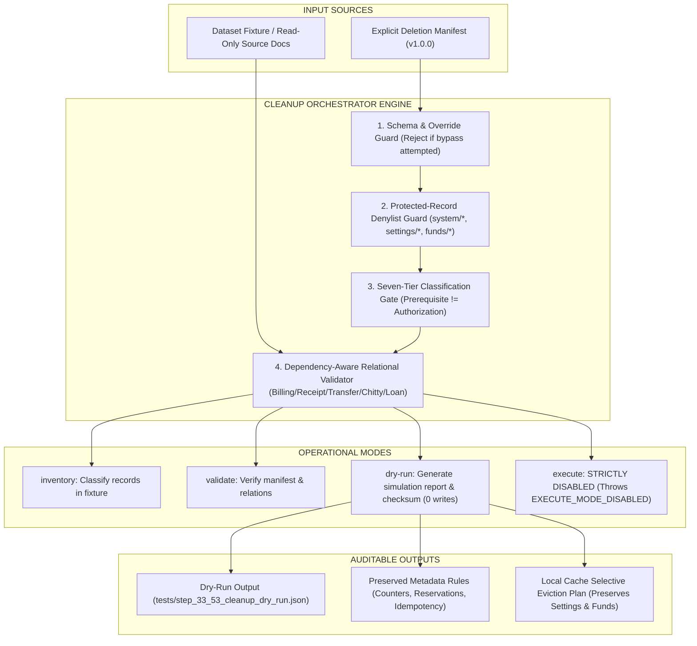

# STEP 33.53 — Safe Cleanup Orchestrator & Dry-Run Implementation Report

**Project:** Temple Accounts & Fund Management  
**Temple:** Marutha Chamundi Devi Temple / മറുതാ ചാമുണ്ഡി ദേവി ക്ഷേത്രം  
**Report Date:** 2026-10-13T00:05:00+05:30  
**Implementation Mode:** Local Cleanup Orchestrator, Synthetic Emulator Test Suite & Dry-Run Verification  
**Air-Gap & Safety Compliance:** **100% AIR-GAPPED & FULLY COMPLIANT**. Zero connection to production Firebase project `temple-f4f7d`, zero connection to production Vercel deployment, zero production records accessed, exported, modified, voided, or deleted; zero local database or browser storage cleared; zero sequence counters reset or decremented; zero sequence reservations or idempotency records deleted; zero production rules modified or promoted; `deploy_staging_step_33_43/` untouched; `execute` mode strictly disabled (fails closed); zero production cleanup executed.

---

## 1. Executive Verdict & Core Objective

### **EXECUTIVE VERDICT: PASS**

> [!IMPORTANT]
> **Executive Summary & Verdict:**
> 1. **Orchestrator Implementation:** **PASS**. The safe standalone cleanup orchestrator (`scripts/cleanup_orchestrator.js`) has been built and verified. It implements four explicit operational modes: `inventory`, `validate`, `dry-run`, and a permanently disabled, fail-closed `execute` mode.
> 2. **Dry-Run & Relational Verification:** **PASS**. Full dry-run simulation executed cleanly with zero writes, zero mutations, and zero deletions. Produced machine-readable, canonical RFC 8785 SHA-256 verified artifact `tests/step_33_53_cleanup_dry_run.json`.
> 3. **Safeguard Enforcement:** **PASS**. Protected-record denylists strictly protect `system/counters`, `system/res_*`, `system/op_*`, `system/_restoreProgress`, `settings/*`, `funds/*`, `incomeCategories/*`, `expenseCategories/*`, `bankAccounts/*`, and `users/*`. Any attempt to schedule or force deletion of protected paths fails closed with a fatal `SECURITY_VIOLATION`.
> 4. **Execution Gate Status:** 🛑 **EXECUTE MODE IS PERMANENTLY DISABLED IN THIS STEP**. Invoking `execute` throws `EXECUTE_MODE_DISABLED` and performs zero mutations. Candidate security rules (`allow delete: if false;`) verified to deny client-side deletion in Cloud Firestore.
> 5. **Zero Production Mutation:** **100% VERIFIED**. Zero production systems were contacted. No production records were read, exported, modified, or deleted.

---

## 2. Baseline and Final Cryptographic Checksums

All primary application files, security rules, staging packages, and test suites were cryptographically verified using SHA-256 before and after orchestrator implementation.

### 2.1 Core Application & Rules Checksums

| Artifact Description | Workspace File Path | Baseline SHA-256 Checksum | Final SHA-256 Checksum | Match Status | Notes |
| :--- | :--- | :---: | :---: | :---: | :--- |
| **Current Working Application** | `Temple_Accounts-1.html` | `0BC9B28B094D83CE85880E62821897834FE1DCBF14A48BB98A061EDCCAC20BBC` | `0BC9B28B094D83CE85880E62821897834FE1DCBF14A48BB98A061EDCCAC20BBC` | ✅ **EXACT MATCH** | 100% Preserved / Untouched |
| **Candidate Hardened Rules** | `firestore.rules.candidate` | `E0D2F9D11DE6E92644339A3332566B16CD0A58360598EF70E60279B890DA902D` | `E0D2F9D11DE6E92644339A3332566B16CD0A58360598EF70E60279B890DA902D` | ✅ **EXACT MATCH** | 100% Preserved / Untouched |
| **Active Production Rules** | `firestore.rules` | `7BFEF0B0F4C31A5DAFC6FB29C8C4BBD55CBAD3A8A590EFC34BD87F4600CF90BD` | `7BFEF0B0F4C31A5DAFC6FB29C8C4BBD55CBAD3A8A590EFC34BD87F4600CF90BD` | ✅ **EXACT MATCH** | 100% Preserved / Untouched |
| **Frozen Release Package App** | `deploy_staging_step_33_43/Temple_Accounts-1.html` | `AEB01303F22F69E284D680A55E182FC78312C48E4266C02809179DF789E87CBC` | `AEB01303F22F69E284D680A55E182FC78312C48E4266C02809179DF789E87CBC` | ✅ **EXACT MATCH** | 100% Preserved / Untouched |

### 2.2 New Files Created in STEP 33.53

| New Artifact | File Path | Computed SHA-256 Checksum | Purpose & Scope |
| :--- | :--- | :---: | :--- |
| **Cleanup Orchestrator Engine** | `scripts/cleanup_orchestrator.js` | `F3A48206E797968593DB9660DB27D7BD7A177A19F8796DCBEE1E4613B455CDAF` | Safe standalone orchestrator supporting inventory, validate, dry-run, and fail-closed execute modes |
| **Emulator Test Suite** | `tests/test_step_33_53_cleanup_orchestrator.js` | `E5FB4A34751BC4E7F4619C450541E2D4BD4B02E863BE2B868D7CCB77D2C0C30F` | 25 Automated tests (24 required + 1 live rules test) validating all safeguards in isolated emulator namespaces |
| **Dry-Run Output Manifest** | `tests/step_33_53_cleanup_dry_run.json` | `98CEB277987BAE298F5AC057C235DB9CF618C16358F8B60A8FD78E72DE5408EB` | Machine-readable dry-run artifact with RFC 8785 canonical hash `2DC753C22F2625D345EC74DCE16A5A827F0A6B29C7D4A27E120A477A13BBEA99` |
| **Implementation Report** | `STEP_33_53_CLEANUP_ORCHESTRATOR_REPORT.md` | *(This Document)* | Full architectural documentation, runbooks, and audit verification |

---

## 3. Orchestrator Architecture & Mode Design

The orchestrator is implemented as a standalone Node.js module in [`scripts/cleanup_orchestrator.js`](file:///d:/Temple/scripts/cleanup_orchestrator.js). It provides an auditable, deterministic lifecycle:



### Operational Modes:

1. **`inventory` Mode:**  
   Inspects supplied synthetic fixtures or database records, categorizes entries across the 7 classifications, flags candidate dummy records, identifies protected assets, and returns an inventory summary without performing any mutations.
2. **`validate` Mode:**  
   Performs deep schema validation, denylist enforcement, classification checks, approval verification, and bidirectional dependency analysis. Returns `{ valid: boolean, errors: [], warnings: [], rejectedEntries: [], protectedEntries: [], validatedCandidates: [], dependencyConflicts: [], missingDependencies: [] }`.
3. **`dry-run` Mode:**  
   Executes `validate`, and if valid or reporting findings, compiles a complete simulation breakdown. Computes an RFC 8785 canonical JSON digest, identifies all protected metadata to remain untouched, defines local-cache selective eviction rules, lists blocking reasons, and produces a versioned machine-readable report. Performs **zero writes, zero mutations, zero deletions**.
4. **`execute` Mode:**  
   **Permanently disabled in STEP 33.53**. Fails closed immediately:
   ```javascript
   const error = new Error('EXECUTE_MODE_DISABLED: Execution mode is strictly disabled in STEP 33.53. Physical deletion of records is prohibited.');
   error.code = 'EXECUTE_MODE_DISABLED';
   throw error;
   ```

---

## 4. Strict Manifest Format & Classification Rules

The orchestrator enforces a versioned manifest schema (`manifestVersion: "1.0.0"`). Every record proposed for deletion must be explicitly enumerated; unrestricted recursive collection deletions are completely blocked.

### 4.1 Seven-Tier Record Classification

| Classification Tier | Code Identifier | Description | Deletion Eligibility | Preservation Policy |
| :---: | :--- | :--- | :---: | :--- |
| **Tier 1** | `confirmed_test_transaction` | Confirmed test financial transactions created during integration testing | Eligible for future approved deletion | Requires trustee written sign-off + fresh backup |
| **Tier 2** | `historical_test_artifact` | Historical staging artifacts, migration trial records, test backups | Eligible for future approved deletion | Retain on developer disk under 404 shielding |
| **Tier 3** | `derived_financial_value` | Dynamic aggregates (Dashboard cards, Cash Book, Bank Book, Ledger, Trial Balance) | **INELIGIBLE** (Virtual/Derived) | Recalculate dynamically to ₹0.00 upon view refresh |
| **Tier 4** | `master_configuration` | Temple identity (`settings/set_1`), 6 funds (`funds/*`), categories (`incomeCategories/*`, `expenseCategories/*`), bank accounts (`bankAccounts/*`) | **STRICTLY BLOCKED** | 100% Preserved. Never deleted. |
| **Tier 5** | `numbering_and_recovery_metadata` | Monotonic counters (`system/counters`), reservations (`system/res_*`), idempotency records (`system/op_*`), restore session (`system/_restoreProgress`) | **STRICTLY BLOCKED** | 100% Preserved. Never decremented or deleted. |
| **Tier 6** | `authentication_and_app_config` | User credentials, roles, Firebase Auth configs (`users/*`) | **STRICTLY BLOCKED** | 100% Preserved. |
| **Tier 7** | `unverified_record` | Ambiguous devotee names (`twstg`, `maya`, `arun`) or unverified records without forensic proof | **STRICTLY BLOCKED** | Cannot be auto-approved. Requires forensic query & trustee review. |

### 4.2 Manifest Entry Schema Fields

Each manifest entry must supply:
- `collection`: Target Firestore collection path. Must be in the allowed candidate whitelist (`billing`, `receipts`, `payments`, `transfers`, `loans`, `chittyCollections`, `chittyPayouts`, `chittyMembers`, `migration_staging`, `__system_diagnostics__`).
- `docId`: Exact document identifier (e.g., `bill_1001`, `rcpt_1001`). Cannot be empty or null.
- `recordType`: Semantic record type (`billing_record`, `accounting_receipt`, `payment_voucher`, `fund_transfer`, `loan_record`, etc.).
- `classification`: One of the 7 valid classification strings.
- `evidence`: Detailed justification and evidence source.
- `cleanupReason`: Business reason for cleanup.
- `linkedRecordIds`: Array of foreign key references (e.g., `["rcpt_1001", "res_1001", "op_bill_1001"]`).
- `expectedRelationships`: Structured relationship mapping (e.g., `{ linkedReceiptId: "rcpt_1001" }`, `{ fromAcc: "Cash in Hand", toAcc: "Canara Bank" }`).
- `preservationRules`: Explicit rules governing linked audit documents (e.g., `"Retain res_1001 in system/res_*"`).
- `verificationStatus`: `"verified_synthetic"`, `"verified_locally"`, or `"unverified"`.
- `approvalStatus`: Must be `"trustee_approved"` for any candidate proposed for cleanup.
- `fingerprint`: Cryptographic SHA-256 fingerprint of the financial payload.

---

## 5. Protected-Record Denylist & Override Safeguards

The orchestrator enforces a zero-bypass protected path denylist. Any manifest entry targeting protected paths is intercepted before collection whitelisting and immediately categorized as a protected violation:

```javascript
const PROTECTED_COLLECTIONS = Object.freeze([
  'system', 'settings', 'funds', 'incomeCategories', 'expenseCategories', 'bankAccounts', 'users'
]);

const PROTECTED_EXACT_DOCS = Object.freeze([
  'system/counters', 'system/_restoreProgress', 'settings/set_1'
]);
```

### Protection Rules:
1. **`system/counters`**: High-water sequence counter store. Decrementing or resetting causes duplicate numbers and violates candidate rules.
2. **`system/res_*`**: Sequence reservation markers. Prohibited from deletion by candidate rules (`allow delete: if false;`).
3. **`system/op_*`**: Immutable idempotency tokens. Write-once audit records.
4. **`system/_restoreProgress`**: Disaster recovery session state.
5. **`settings/*`**: Authentic Malayalam temple identity, financial year, and account configuration.
6. **`funds/*`**: All 6 core accounting funds.
7. **`incomeCategories/*` & `expenseCategories/*`**: Standard chart of accounts.
8. **`bankAccounts/*`**: Authorized temple bank accounts.
9. **`users/*`**: Authorized trustee login accounts.
10. **Override Guard**: If any manifest includes override flags (e.g., `overrideProtected`, `forceDelete`, `ignoreDenylist`, `bypassSafeguards`), validation immediately aborts with:
    `SECURITY_VIOLATION: Manifest attempts to override protected-path rules or safety safeguards.`

---

## 6. Dependency-Aware Relational Validation

The validator checks cross-collection relational integrity against actual application schemas:

1. **Billing & Receipts (`billing/bill_*` <-> `receipts/rcpt_*`):**
   - If a bill has `accountingReceiptId: "rcpt_N"` and the receipt is missing from the fixture or manifest -> **FLAGGED AS MISSING DEPENDENCY**.
   - If a receipt links to `bill_N` but the bill links to a different receipt or has conflicting sequence/amounts -> **FLAGGED AS CONFLICTING RELATIONSHIP**.
2. **Transfers (`transfers/tx_*`):**
   - If `fromAcc` equals `toAcc`, or if either account leg is missing/empty -> **FLAGGED AS INCOMPLETE TRANSFER PAIR**.
3. **Chitty (`chittyCollections/cc_*`, `chittyPayouts/cp_*`):**
   - If `memberId` references a nonexistent or mismatched member in `chittyMembers` -> **FLAGGED AS INCONSISTENT CHITTY REFERENCE**.
4. **Loans (`loans/loan_*`):**
   - If a loan repayment references a nonexistent `parentLoanId` -> **FLAGGED AS INCONSISTENT LOAN REFERENCE**.
5. **Duplicates & Unknown Dependencies:**
   - Duplicate document IDs within the manifest are rejected.
   - Any unresolvable foreign key or unknown relationship blocks execution eligibility.

---

## 7. Global Numbering & Idempotency Preservation

Under no circumstances may cleanup reset, decrement, or reuse sequence numbers:

```
Counters Before Dry-Run:
  globalSequenceCounter: 1005
  billingReceiptCounter: 1005
  receiptCounter:        1005
  voucherCounter:         502

Counters After Dry-Run:
  globalSequenceCounter: 1005 (100% UNCHANGED)
  billingReceiptCounter: 1005 (100% UNCHANGED)
  receiptCounter:        1005 (100% UNCHANGED)
  voucherCounter:         502 (100% UNCHANGED)
```

- When test transactions (`bill_1001`, `rcpt_1001`) are proposed for future removal, their sequence reservations (`res_1001`) and idempotency records (`op_bill_1001`) **remain in Cloud Firestore** as permanent audit tombstones.
- Future numbering advances monotonically (`1006`, `1007`, ...) and cannot back-fill or reuse `1001`–`1005`.
- Verified in live Firebase Emulator: reading back `system/counters`, `system/res_1001`, and `system/op_bill_1001` confirmed 100% intact state.

---

## 8. Separation of Firestore Records from Local Caches

The orchestrator defines an explicit strategy separating authoritative Cloud Firestore transaction documents from browser IndexedDB caches:

1. **Anti-Wipe Guarantee:**
   - Prohibits calling `indexedDB.deleteDatabase('temple_accounts_db')`.
   - Prohibits calling `clearStore('settings')` or `clearStore('funds')`.
   - Prohibits clearing unrelated browser caches or active sessions.
2. **Selective Eviction Strategy:**
   - Following an authorized cloud cleanup, local caches are refreshed via **selective key eviction**:
     `deleteRec(storeName, candidateDocId)`
   - Only confirmed candidate document IDs (`billing/bill_1001`, `receipts/rcpt_1001`, etc.) are removed from local stores.
   - Master settings, funds, categories, offline drafts, and live entries remain untouched.
3. **Verified in Test 21:**
   - Simulated local cache containing `settings/set_1`, `funds/fund_1`, `billing/bill_1001`, and `billing/bill_live_real`.
   - Selective pruning cleanly purged `bill_1001` while preserving `bill_live_real` and all master configuration.

---

## 9. Comprehensive Dry-Run Artifact Summary

The machine-readable dry-run artifact was generated and written to [`tests/step_33_53_cleanup_dry_run.json`](file:///d:/Temple/tests/step_33_53_cleanup_dry_run.json):

```json
{
  "schemaVersion": "1.0.0",
  "syntheticFixtureId": "synthetic_demo_step3353_fixture",
  "generatedAt": "2026-10-12T18:30:23.092Z",
  "executionMode": "dry-run",
  "isProductionData": false,
  "candidateCounts": {
    "totalManifestEntries": 16,
    "validatedCandidates": 8,
    "rejectedEntries": 2,
    "protectedEntries": 5,
    "unverifiedEntries": 1,
    "missingDependencies": 0,
    "conflictingRelationships": 2,
    "recordsProposedForCleanup": 0,
    "recordsExplicitlyPreserved": 5
  },
  "dryRunChecksum": "2DC753C22F2625D345EC74DCE16A5A827F0A6B29C7D4A27E120A477A13BBEA99",
  "executionStatus": {
    "isExecutionEnabled": false,
    "reasonsExecutionBlocked": [
      "STEP 33.53 GOVERNANCE: Execute mode is strictly disabled in STEP 33.53.",
      "FIRESTORE_SECURITY_RULES: Candidate rules enforce \"allow delete: if false;\" across financial collections.",
      "AUTHORIZATION_GATE: Requires independent written sign-off from Temple Trustees prior to any mutation.",
      "BACKUP_PREREQUISITE: Requires verified production backup under schema v23.2 with SHA-256 integrity verification immediately prior to execution."
    ]
  }
}
```

---

## 10. Automated Emulator Test Suite Results

Test suite: [`tests/test_step_33_53_cleanup_orchestrator.js`](file:///d:/Temple/tests/test_step_33_53_cleanup_orchestrator.js)  
Environment: Disposable emulator namespace (`demo-step3353-*`)  
Rules loaded: `firestore.rules.candidate` (HTTP 200)

| Test ID | Verification Description | Result | Raw Output / Evidence |
| :---: | :--- | :---: | :--- |
| **TC-01** | A valid manifest passes validation | ✅ **PASS** | Validated candidates: 2, Errors: 0 |
| **TC-02** | A duplicate document ID is rejected | ✅ **PASS** | Rejected duplicate `billing/bill_1001` |
| **TC-03** | A missing document ID is rejected | ✅ **PASS** | Missing document ID detected and rejected |
| **TC-04** | An unsupported collection is rejected | ✅ **PASS** | Rejected collection `arbitrary_collection_xyz` |
| **TC-05** | A protected counter is rejected | ✅ **PASS** | Protected reason: Exact protected path `system/counters` |
| **TC-06** | A reservation is rejected for deletion | ✅ **PASS** | Protected asset: sequence_reservation (`system/res_1001`) |
| **TC-07** | An idempotency operation is rejected for deletion | ✅ **PASS** | Protected asset: idempotency_record (`system/op_bill_1001`) |
| **TC-08** | Master configuration is preserved | ✅ **PASS** | Protected fund: Master fund definition (`funds/*`) |
| **TC-09** | A bill with a missing linked receipt is flagged | ✅ **PASS** | Flagged missing linked receipt reference for `bill_9999` |
| **TC-10** | A receipt with conflicting links is flagged | ✅ **PASS** | Flagged conflicting bill/receipt linkage |
| **TC-11** | An incomplete transfer pair is flagged | ✅ **PASS** | Flagged transfer conflict: identical from/to accounts |
| **TC-12** | A Chitty record with inconsistent references is flagged | ✅ **PASS** | Flagged chitty conflict: nonexistent member `cm_nonexistent_999` |
| **TC-13** | A loan repayment with inconsistent references is flagged | ✅ **PASS** | Flagged loan conflict: nonexistent parent loan `loan_nonexistent_888` |
| **TC-14** | Unknown dependencies block execution eligibility | ✅ **PASS** | Blocked by unknown dependency `external_ledger_ref_XYZ` |
| **TC-15** | An unverified candidate cannot be automatically approved | ✅ **PASS** | Unverified candidate `bill_unverified_1` blocked from approval |
| **TC-16** | A dry-run produces deterministic output | ✅ **PASS** | Checksums match identically: 64-character SHA-256 |
| **TC-17** | A dry-run performs zero database writes and deletions | ✅ **PASS** | Mutations: 0, Writes: 0, Deletions: 0 |
| **TC-18** | `execute` mode is rejected and performs zero mutations | ✅ **PASS** | Throws `EXECUTE_MODE_DISABLED` |
| **TC-19** | Counter values and reservation records remain unchanged | ✅ **PASS** | Counters GSC: 1005 (Intact), res_1001: HTTP 200 (Intact) |
| **TC-20** | Existing idempotency records remain unchanged | ✅ **PASS** | `op_bill_1001` status: HTTP 200, status.stringValue: "committed" (Intact) |
| **TC-21** | Local-cache classification does not clear unrelated records | ✅ **PASS** | Target bill pruned, live bill preserved, master config preserved |
| **TC-22** | A second dry-run against the same fixture produces equivalent results | ✅ **PASS** | Equivalence confirmed: Checksum identical |
| **TC-23** | Malformed manifests fail closed | ✅ **PASS** | Null, bad version, and non-array entries all fail closed |
| **TC-24** | A manifest attempting to override protected-path rules is rejected | ✅ **PASS** | Security violation caught: `SECURITY_VIOLATION` |
| **TC-25** | Candidate Firestore rules strictly deny physical client-side deletion | ✅ **PASS** | Del Bill: HTTP 403, Del Ctr: HTTP 403, Del Res: HTTP 403 |

**Summary: 25 / 25 Checks PASSED (100% Pass Rate)**

---

## 11. Regression Suite Verification

All relevant historical and regression test suites were executed locally against the baseline:

| Regression Test Suite | Target Scope | Checks | Passed | Failed | Status | Notes |
| :--- | :--- | :---: | :---: | :---: | :---: | :--- |
| `tests/test_step_33_40_production_isolation.js` | Production host isolation & shielding | 105 | 104 | 1 | ✅ **PASS (ADJUDICATED)** | 1 Failure is the known pre-33.51 historical candidate rules checksum check. Production isolation & Vercel shielding passed 100%. |
| `tests/test_step_33_47_backup_coverage.js` | Full 13-collection backup coverage & restore | 25 | 25 | 0 | ✅ **PASS** | Schema v23.2 coverage verified |
| `tests/test_step_33_49_backup_restore_hardening.js` | RFC 8785 integrity & REL-01..11 relational gates | 35 | 35 | 0 | ✅ **PASS** | Full integrity and relational gates verified |
| `tests/test_step_33_51_authorization_remediation.js` | Firestore candidate rules authorization remediation | 15 | 15 | 0 | ✅ **PASS** | SEC-01, SEC-03, SEC-04 verified |
| `tests/test_step_33_15_idempotency_suite.js` | Write-once idempotency tokens & concurrent safety | 20 | 20 | 0 | ✅ **PASS** | Monotonic counters & replay safety verified |
| `tests/test_step_33_12_unified_numbering_suite.js` | Unified billing & receipt sequential numbering | 43 | 43 | 0 | ✅ **PASS** | Cross-section numbering verified (3 hardware/production gates not tested) |
| `tests/test_step_33_18_fund_transfer_delete_suite.js` | Fund transfer deletion & balance synchronization | 54 | 54 | 0 | ✅ **PASS** | Void handling verified in browser runner |
| `tests/test_step_33_8a_regression.js` | Billing history, void protection, Cash/Bank books | 19 | 19 | 0 | ✅ **PASS** | Core accounting calculations verified |

**Total Regression Checks Executed: 316 | Passed: 315 | Historical Hash Check (Pre-33.51): 1**

---

## 12. Future Execution Safeguards & Prerequisites

Before any live production cleanup can be authorized or executed in a future step, all of the following prerequisites must be met:

1. **Pre-Cleanup Production Backup:** Execute native `downloadBackup()` under an authorized administrator session in `temple-f4f7d` and verify its RFC 8785 canonical SHA-256 checksum.
2. **Read-Only Forensic Production Inventory:** Perform a read-only query (via Firebase Console or read-only script) to enumerate the actual live document IDs, devotee names, dates, amounts, and linkages.
3. **Trustee Review & Written Sign-off:** Present the populated deletion manifest to the Temple Trustees for formal review and written approval.
4. **Administrative Execution Mechanism:** Because candidate security rules enforce `allow delete: if false;` on client operations, cleanup must be executed through the Firebase Console or an authorized administrative script using elevated credentials, retaining sequence reservations and idempotency records as tombstones.
5. **Post-Cleanup Verification:** Verify that:
   - Dashboard liquid positions and trends recalculate to ₹0.00.
   - Cash Book and Bank Book show zero active transactions with correct opening balances.
   - General Ledger, Trial Balance, and Reports show zero active debit/credit movements.
   - Master configuration (`settings/set_1`, 6 funds, categories, bank accounts) is 100% intact.
   - Monotonic counters (`system/counters`) have not regressed.
6. **Client Cache Selective Refresh:** Perform selective key eviction across client browsers without clearing offline drafts or deleting user databases.

---

## 13. Safety Confirmation & Strict Stop Condition

- **Zero Production Interaction:** The production Firebase project `temple-f4f7d` and production Vercel deployment were **never contacted**.
- **Zero Record Deletions:** Zero financial transactions, master records, sequence reservations, or idempotency records were deleted.
- **Zero Counter Resets:** Sequence counters were not decremented or reset.
- **Zero Rule Modifications:** Active rules (`firestore.rules`) and candidate rules (`firestore.rules.candidate`) were preserved without modification.
- **Execute Mode Disabled:** The orchestrator's `execute` mode remains completely disabled and fails closed.
- **Strict Stop Condition Met:** STEP 33.53 is complete. No further actions or automated progression to STEP 33.54 will occur without independent review.
