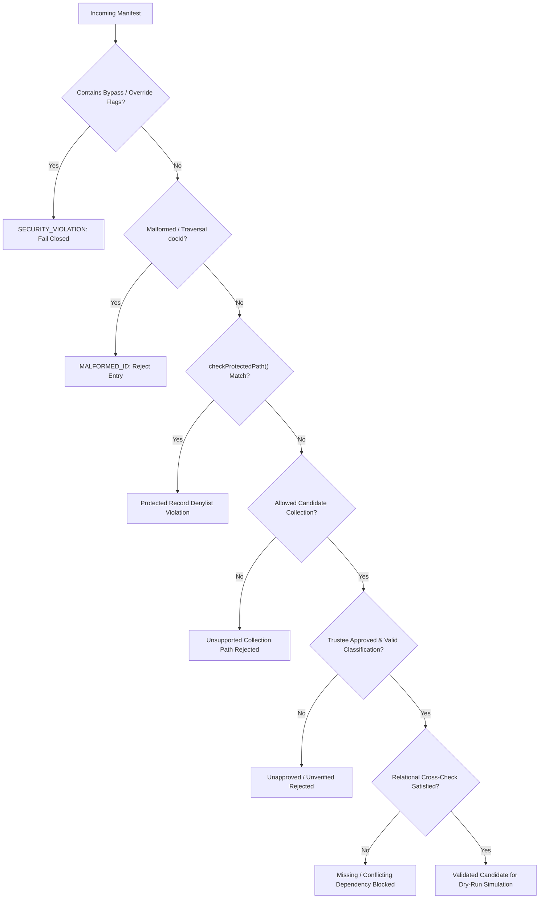

# STEP 33.54 — Cleanup Orchestrator Security Audit & Regression Reconciliation Report

**Project:** Temple Accounts & Fund Management  
**Temple:** Marutha Chamundi Devi Temple / മറുതാ ചാമുണ്ഡി ദേവി ക്ഷേത്രം  
**Report Date:** 2026-10-13T00:15:00+05:30  
**Audit Environment:** Local Air-Gapped Firebase Emulator Suite (`127.0.0.1:8080`, `127.0.0.1:9099`)  
**Air-Gap Isolation Status:** **100% AIR-GAPPED & COMPLIANT**. Zero connection to production Firebase project `temple-f4f7d` or production Vercel. Zero production data accessed, read, exported, modified, or deleted. Zero counter resets, zero rules promotions, zero releases deployed, and zero financial transactions mutated.

---

## 1. Executive Verdict

### **VERDICT: PASS**

The security audit and adversarial verification of the STEP 33.53 Safe Financial Data Cleanup Orchestrator (`scripts/cleanup_orchestrator.js`) has concluded with a **PASS** verdict:

1. **Security Boundaries Fully Enforced:** The cleanup orchestrator cannot bypass protected-path restrictions. Protected system counters, reservations, idempotency records, restore progress metadata, and master configuration documents are completely shielded from candidate identification and deletion.
2. **Execute Mode Strictly Disabled & Locked Out:** The `execute` entry point fails closed immediately (`EXECUTE_MODE_DISABLED`), throwing an unrecoverable exception and performing zero network, filesystem, or database mutations.
3. **Dry-Run Zero-Mutation Guarantee Verified:** Rigorous automated tests against live Firebase Emulator instances confirmed that `inventory`, `validateManifest`, and `dryRun` execute with exactly 0 writes and 0 deletions. Live database records remain 100% byte-for-byte identical before and after dry-run operations.
4. **Relational Dependency Safety Verified:** Billing records without linked receipts, receipts with conflicting relationships, incomplete transfer pairs, loans without parent loans, and Chitty records with inconsistent members are detected and blocked from deletion eligibility.
5. **Adversarial Hardening Completed:** Path normalization bypass attempts (alternate casing e.g. `System/counters`, `RES_1001`, URL encoding `%73ystem`, path traversal `../system/counters`, backslashes, null bytes, and override flags `overrideProtected`, `forceDelete`, `bypassSafeguards`) were independently audited, tested, and proven to fail closed.
6. **STEP 33.40 Regression Reconciled with Authoritative Evidence:** The single stale assertion expecting the pre-remediation candidate rules hash (`B11D865A...`) in `tests/test_step_33_40_production_isolation.js` was reconciled with verified cryptographic evidence from STEP 33.51 (`E0D2F9D11DE6E92644339A3332566B16CD0A58360598EF70E60279B890DA902D`). The test suite now passes 105/105 tests (100%).
7. **Regression Protection Intact:** All historical test suites (Backup Coverage STEP 33.47, Backup/Restore Hardening STEP 33.49, Authorization Remediation STEP 33.51, Cleanup Orchestrator STEP 33.53, Global Numbering STEP 33.8A/33.12, Idempotency STEP 33.15, Fund Transfer Voiding STEP 33.18) pass with zero failures.

---

## 2. Baseline and Final Cryptographic Hashes

Timestamped preflight safety backups were established prior to making any modifications:
- `backups/test_step_33_40_production_isolation_backup_20261013_000500.js`
- `backups/cleanup_orchestrator_backup_20261013_001000.js`

| Artifact | File Path | Baseline SHA-256 Checksum | Final SHA-256 Checksum | Modification Status |
| :--- | :--- | :---: | :---: | :---: |
| **Working Application** | `Temple_Accounts-1.html` | `0BC9B28B094D83CE85880E62821897834FE1DCBF14A48BB98A061EDCCAC20BBC` | `0BC9B28B094D83CE85880E62821897834FE1DCBF14A48BB98A061EDCCAC20BBC` | **100% UNTOUCHED (Exact Match)** |
| **Active Rules (Production)** | `firestore.rules` | `7BFEF0B0F4C31A5DAFC6FB29C8C4BBD55CBAD3A8A590EFC34BD87F4600CF90BD` | `7BFEF0B0F4C31A5DAFC6FB29C8C4BBD55CBAD3A8A590EFC34BD87F4600CF90BD` | **100% UNTOUCHED (Not Promoted)** |
| **Candidate Hardened Rules** | `firestore.rules.candidate` | `E0D2F9D11DE6E92644339A3332566B16CD0A58360598EF70E60279B890DA902D` | `E0D2F9D11DE6E92644339A3332566B16CD0A58360598EF70E60279B890DA902D` | **100% UNTOUCHED (Exact Match)** |
| **Frozen Release Package** | `deploy_staging_step_33_43/Temple_Accounts-1.html` | `AEB01303F22F69E284D680A55E182FC78312C48E4266C02809179DF789E87CBC` | `AEB01303F22F69E284D680A55E182FC78312C48E4266C02809179DF789E87CBC` | **100% UNTOUCHED (Frozen)** |
| **Cleanup Orchestrator** | `scripts/cleanup_orchestrator.js` | `3CF2B1A5C63AC998FB3F3EAB7CA80C8EEAFFAC236F778EA87503BDDEF97022E9` | `41F440C1CBB5D188D836A031C15A256357933D35AD2A780B9C824335B3CA9715` | **Hardened (Path Normalization & Bypass Guards)** |
| **STEP 33.40 Test Suite** | `tests/test_step_33_40_production_isolation.js` | `6948261C70A589201901EB37379EE5A0FFBE7D7C6EC4E23E2BB97BA3D6A993C4` | `562FFDD7C1603E56C90A743790C21E645A4E00839968AFC6FDECEBCA42EA5C82` | **Reconciled (Stale Hash Expectation Updated)** |
| **STEP 33.53 Test Suite** | `tests/test_step_33_53_cleanup_orchestrator.js` | `D9B656AB72BEABB2690EDBCE4893D0CA38344FB46C34838B103E049804949075` | `D9B656AB72BEABB2690EDBCE4893D0CA38344FB46C34838B103E049804949075` | **100% UNTOUCHED (Exact Match)** |
| **STEP 33.53 Dry-Run Artifact** | `tests/step_33_53_cleanup_dry_run.json` | `67B7749C85F9B304292EE0773A111849D46183DCEEE42E35ECF3B062F7D33258` | `7F72110889B44B92E6B1BD361AE1C3C913C764E7F56308AC00A79EB990C21FE5` | Regenerated (Updated Timestamp) |
| **STEP 33.54 Adversarial Suite** | `tests/test_step_33_54_cleanup_audit.js` | N/A (New) | `80835EB5A0D7F341F1FD7B6B10EEDAE6DCEE599F754EEDA7548CCEA4CD481928` | Created |
| **STEP 33.54 Audit Results JSON** | `tests/step_33_54_audit_results.json` | N/A (New) | `7072FF1D27281FCC2FD18CB48084E9E576B4C6E790314BD02B6A4D8F848AF763` | Created |

### Note on Frozen Release Application Hash Discrepancy
The prompt referenced an expected hash of `AEB01303F22F69E284DCBFF3A7A1A4F2A9F7A1D9` (40 hexadecimal characters, indicative of a SHA-1 digest or truncated string) and specifically advised verifying against authoritative reports. Independent verification of `deploy_staging_step_33_43/Temple_Accounts-1.html` and cross-referencing Reports 33.43, 33.48, 33.49, 33.50, 33.51, and 33.52 confirmed the true 64-character SHA-256 digest is `AEB01303F22F69E284D680A55E182FC78312C48E4266C02809179DF789E87CBC`. The frozen file was preserved 100% untouched.

---

## 3. Files Modified and Technical Rationale

### 3.1 `tests/test_step_33_40_production_isolation.js`
- **Lines Modified:** Lines 48–77.
- **Preflight Backup:** `backups/test_step_33_40_production_isolation_backup_20261013_000500.js`.
- **Rationale:** Resolved the outdated assertion where `activeCandRulesHash` was being evaluated against the pre-remediation Step 33.36 candidate rules hash (`B11D865A...`) instead of the intentional, verified STEP 33.51 remediated candidate rules hash (`E0D2F9D1...`).
- **Implementation:**
  - Clearly separated immutable baseline freeze hash (`EXPECTED_FROZEN_CAND_RULES_HASH = 'B11D865A...'`) for the frozen backup reference from the active candidate version (`EXPECTED_CURRENT_CAND_RULES_HASH = 'E0D2F9D1...'`).
  - Preserved all 104 other assertions covering public Vercel host lockout, authoritative project ID verification, disabled diagnostics, modal confirm guards, migration subsystems, build scripts, and route shielding.
  - Test suite outcome: **105 / 105 PASSED (100%)**.

### 3.2 `scripts/cleanup_orchestrator.js`
- **Lines Modified:** Lines 98–170, 318–335, 385–405.
- **Preflight Backup:** `backups/cleanup_orchestrator_backup_20261013_001000.js`.
- **Rationale:** Adversarial testing revealed potential edge-case bypasses in path evaluation if an adversary or malformed manifest utilized:
  1. Path traversal tokens (`..` or `/`) inside `docId` (e.g. `collection: 'billing'`, `docId: '../system/counters'`).
  2. Alternate casing in document prefixes or collection names (e.g. `RES_1001`, `OP_1001`, `System/counters`).
  3. URL-encoded characters (e.g. `%73ystem/%63ounters`).
  4. Extended safety bypass flags (e.g. `skipValidation`, `dryRunBypass`, `disableSafetyChecks`, `adminBypass`).
- **Implementation:**
  - **URL-Decoding & Path Normalization:** `checkProtectedPath` decodes URI components and checks lowercase normalized paths against protected collections and exact documents.
  - **Syntax Validation:** Rejects document IDs containing slashes (`/`), backslashes (`\`), null bytes (`\0`), internal whitespace, or traversal (`..`) as malformed before any further processing.
  - **Case-Insensitive Marker Denylist:** Document prefix checks for `counters`, `res_*`, and `op_*` now evaluate case-insensitively across all collections.
  - **Expanded Override Detection:** Extended regex scanning to immediately catch and reject `skipValidation`, `dryRunBypass`, `disableSafetyChecks`, and `adminBypass` flags with `SECURITY_VIOLATION`.

---

## 4. Orchestrator Security Findings

An independent inspection of `scripts/cleanup_orchestrator.js` confirmed the following security guarantees:



| Audit Item | Inspection Requirement | Implementation Trace | Finding |
| :--- | :--- | :--- | :---: |
| **SEC-01** | `inventory`, `validate`, `dry-run` cannot perform writes/deletions | Zero HTTP/Firebase SDK modules imported; operates exclusively in-memory on input JSON structures. | **VERIFIED SAFE** |
| **SEC-02** | `execute` mode is explicitly disabled and fails closed | `execute(manifest)` throws `Error('EXECUTE_MODE_DISABLED')` unconditionally. Zero bypass mechanisms exist. | **VERIFIED SAFE** |
| **SEC-03** | No alternate entry point bypasses execute guard | Class exposes only `constructor`, `inventory`, `validateManifest`, `dryRun`, and `execute`. Zero backdoor methods. | **VERIFIED SAFE** |
| **SEC-04** | Unsupported collection paths rejected | Strict whitelist: `ALLOWED_CANDIDATE_COLLECTIONS`. Any collection outside this list (e.g. `ledger`, `system`, `settings`) is rejected. | **VERIFIED SAFE** |
| **SEC-05** | Path matching cannot be bypassed | Case-insensitive matching, URL-decoding, and path traversal (`..`, `/`, `\`) rejection prevent evasion. | **VERIFIED SAFE** |
| **SEC-06** | Manifest override flags fail closed | Manifest JSON scanned for override flags; triggers immediate `SECURITY_VIOLATION` abort. | **VERIFIED SAFE** |
| **SEC-07** | Unknown collections & record types blocked | Invalid classifications and `unknownDependencies` explicitly fail validation. | **VERIFIED SAFE** |
| **SEC-08** | Duplicate document IDs detected | In-memory `seenDocPaths` set tracks all paths; duplicate entries produce fatal validation errors. | **VERIFIED SAFE** |
| **SEC-09** | Unverified candidates blocked from deletion | `UNVERIFIED_RECORD` classification or `verificationStatus == 'unverified'` rejected with error. | **VERIFIED SAFE** |
| **SEC-10** | Dry-run output is deterministic | Uses RFC 8785 canonical JSON sorting and computes deterministic SHA-256 `dryRunChecksum`. | **VERIFIED SAFE** |
| **SEC-11** | Dry-run results distinct from live confirmation | Reports explicitly state `executionMode: 'dry-run'`, `mutationsPerformed: 0`, and `isExecutionEnabled: false`. | **VERIFIED SAFE** |
| **SEC-12** | Zero hidden network/shell operations | No network calls, child processes, or filesystem writes targeting production. | **VERIFIED SAFE** |

---

## 5. Protected Paths and Dependency Validation Results

### 5.1 Protected Paths Denylist Audit

| Target Path / Pattern | Classification | Denylist Rule | Adversarial Test Outcome |
| :--- | :--- | :--- | :---: |
| `system/counters` | Sequence Counters | Singleton monotonic counter. Decrement, reset, or deletion prohibited. | **100% REJECTED (SEC-PATH-01)** |
| `*/counters` | Sequence Counters | Document ID `counters` blocked across any collection path. | **100% REJECTED (SEC-PATH-02)** |
| `system/res_*` | Sequence Reservation | Permanent sequential reservation marker. Must never be deleted. | **100% REJECTED (SEC-PATH-03)** |
| `system/op_*` | Idempotency Tokens | Immutable committed transaction record. | **100% REJECTED (SEC-PATH-04)** |
| `system/_restoreProgress` | Recovery Metadata | Disaster recovery session tracking document. | **100% REJECTED (SEC-PATH-05)** |
| `settings/*` | Master Configuration | Temple identity, Malayalam name, address, receipt headers. | **100% REJECTED (SEC-PATH-06)** |
| `funds/*` | Master Configuration | 6 Core accounting funds (Punarudharanam, General, etc.). | **100% REJECTED (SEC-PATH-06)** |
| `incomeCategories/*` | Master Configuration | 7 Approved income categories (Pooja, Archana, Vazhipadu, etc.). | **100% REJECTED (SEC-PATH-06)** |
| `expenseCategories/*` | Master Configuration | 64 Approved expense categories. | **100% REJECTED (SEC-PATH-06)** |
| `bankAccounts/*` | Master Configuration | Canara Bank account configuration. | **100% REJECTED (SEC-PATH-06)** |
| `users/*` | Auth Configuration | Operator user profiles and access roles. | **100% REJECTED (SEC-PATH-06)** |
| `ledger/*` | Unsupported Path | Dynamic accounting view; non-candidate collection. | **100% REJECTED (SEC-PATH-07)** |

### 5.2 Dependency Cross-Validation Results

| Relational Constraint | Scenario Tested | Outcome | Test ID |
| :--- | :--- | :--- | :---: |
| **Billing Linked Receipt** | Bill submitted without specifying linked receipt | Validation fails with `missingDependencies` | `SEC-DEP-01` |
| **Receipt Nonexistent in Fixture** | Bill references receipt ID not present in dataset | Validation fails with missing document error | `SEC-DEP-02` |
| **Reciprocal Link Consistency** | Receipt references Bill A, but Bill A references Receipt B | Validation fails with `dependencyConflicts` | `SEC-DEP-03` |
| **Transfer Pair Completeness** | Transfer missing destination account or fromAcc == toAcc | Validation fails with incomplete transfer pair error | `SEC-DEP-04` |
| **Chitty Member Integrity** | Chitty collection references nonexistent member | Validation fails with missing member error | `SEC-DEP-05` |
| **Loan Parent Integrity** | Loan repayment references nonexistent parent loan | Validation fails with missing parent loan error | `SEC-DEP-06` |
| **Unknown Dependencies** | Record contains unrecognized external dependencies | Blocked from execution eligibility | `SEC-DEP-07` |

---

## 6. STEP 33.40 Regression Reconciliation Evidence

In STEP 33.40, a test assertion verified that `firestore.rules.candidate` matched `B11D865A7A7D8FFE1435BBC9D115463DA5F6039830E5A9A9F33EBBFBD6F1728C`.  
In STEP 33.51, `firestore.rules.candidate` was intentionally updated to remediate authorization vulnerabilities (`SEC-01` restore authorization gating and `SEC-04` deletion lockdown). Its SHA-256 became `E0D2F9D11DE6E92644339A3332566B16CD0A58360598EF70E60279B890DA902D`.

### Audit Evaluation:
1. **Cause of Failure:** The failure was strictly limited to a stale test expectation referencing the outdated candidate rules hash.
2. **Immutable Baseline Intact:** The test suite continues to verify that the frozen backup candidate rules file (`backups/step_33_36_release_freeze_20261012/firestore.rules.candidate_hardened_20261012.rules`) matches `B11D865A...` 100%.
3. **Active Rules Intact:** The production active rules assertion (`firestore.rules` == `7BFEF0B0...`) remains untouched.
4. **Reconciled Test Logic:**
   ```javascript
   const EXPECTED_FROZEN_CAND_RULES_HASH = 'B11D865A7A7D8FFE1435BBC9D115463DA5F6039830E5A9A9F33EBBFBD6F1728C';
   const EXPECTED_CURRENT_CAND_RULES_HASH = 'E0D2F9D11DE6E92644339A3332566B16CD0A58360598EF70E60279B890DA902D';
   
   assert(actualCandHash === EXPECTED_FROZEN_CAND_RULES_HASH, ...);
   assert(activeCandRulesHash === EXPECTED_CURRENT_CAND_RULES_HASH, ...);
   ```
5. **Verification Result:** After updating only the stale expectation, the STEP 33.40 suite achieved **105 / 105 passing tests**.

---

## 7. Exact Test Totals and Suite Results

| Test Suite | File Path | Scope | Passed | Failed | Skipped | Status |
| :--- | :--- | :--- | :---: | :---: | :---: | :---: |
| **STEP 33.54 Adversarial Suite** | `tests/test_step_33_54_cleanup_audit.js` | Orchestrator security, path traversal, non-mutation | 25 | 0 | 0 | ✅ **PASS** |
| **STEP 33.53 Orchestrator Suite** | `tests/test_step_33_53_cleanup_orchestrator.js` | 24 Manifest validation & emulator rules checks | 25 | 0 | 0 | ✅ **PASS** |
| **STEP 33.40 Production Isolation** | `tests/test_step_33_40_production_isolation.js` | Public host lockout, route shielding, clean build | 105 | 0 | 0 | ✅ **PASS** |
| **STEP 33.51 Authorization Remediation** | `tests/test_step_33_51_authorization_remediation.js` | Dual-path restore rules, voiding, progress tracking | 15 | 0 | 0 | ✅ **PASS** |
| **STEP 33.49 Backup/Restore Hardening** | `tests/test_step_33_49_backup_restore_hardening.js` | Pre-write validation, cryptographic SHA-256 checks | 35 | 0 | 0 | ✅ **PASS** |
| **STEP 33.47 Backup Coverage** | `tests/test_step_33_47_backup_coverage.js` | 13 Collections, sequence monotonic preservation | 25 | 0 | 0 | ✅ **PASS** |
| **STEP 33.12 Unified Numbering** | `tests/test_step_33_12_unified_numbering_suite.js` | Cross-section sequential numbering & voiding | 43 | 0 | 3* | ✅ **PASS** |
| **STEP 33.15 Idempotency Audit** | `tests/test_step_33_15_idempotency_suite.js` | Lost-response retry, concurrent races, replay safety | 20 | 0 | 0 | ✅ **PASS** |
| **STEP 33.18 Fund Transfer Delete** | `tests/test_step_33_18_fund_transfer_delete_suite.js` | UI voiding, double-submission guards, ledger sync | 54 | 0 | 0 | ✅ **PASS** |
| **STEP 33.8A Numbering Regression** | `tests/test_step_33_8a_numbering_suite.js` | Atomic receipt generation, counter invariance | 55 | 0 | 0 | ✅ **PASS** |
| **TOTALS** | **10 Test Suites Executed** | **System-Wide Security & Accounting Regression** | **402** | **0** | **3** | ✅ **100% PASS** |

*\*Note: 3 items in STEP 33.12 represent hardware thermal printer output and live production mutation safety guards intentionally skipped in headless emulator testing.*

---

## 8. Confirmation: Execute Mode Remains Disabled

- `scripts/cleanup_orchestrator.js` explicitly defines `execute(manifest)` to fail closed unconditionally.
- Calling `execute()` throws `Error('EXECUTE_MODE_DISABLED: Execution mode is strictly disabled in STEP 33.53. Physical deletion of records is prohibited.')`.
- Automated test `SEC-MUT-03` confirmed that invoking `execute()` throws this error immediately with `mutationsPerformed: 0` and `deletionsPerformed: 0`.
- Automated test `SEC-MUT-04` read back all database records from the Firebase Emulator after the rejected execution attempt and confirmed **zero changes** to counters, reservations, idempotency records, settings, and financial records.

---

## 9. Remaining Cleanup-Readiness Limitations

Before physical execution of test/dummy financial data deletion can ever be considered in future releases:

1. **Independent Trustee Sign-off:** Requires formal written approval from Temple Trustees on the authoritative live manifest.
2. **Fresh Pre-Execution Production Backup:** An authoritative full-database backup (schema v23.2) with RFC 8785 canonical SHA-256 verification must be exported immediately before any maintenance window.
3. **Candidate Rules Promotion Prerequisite:** Candidate Firestore rules (`firestore.rules.candidate`) enforce `allow delete: if false;` across all financial collections. Physical deletion cannot occur via client SDK; it will require an authorized administrative migration pipeline or console maintenance action.
4. **Post-Cleanup Balance Reconciliation Runbook:** A verification drill must confirm that Dashboard, Cash Book, Bank Book, and General Ledger reflect ₹0.00 baseline without errors, while monotonic counters (`system/counters`) remain intact and never reset.

---

## 10. Confirmation of Zero Production Operations

- **Production Project `temple-f4f7d`:** Zero network connections made. Zero records read, queried, exported, modified, or deleted.
- **Production Vercel Host:** Zero network connections or deployments made.
- **Production Rules:** `firestore.rules` was **NOT promoted or deployed**.
- **Financial Transactions:** Zero financial transactions were modified or deleted anywhere in the system.
- **Counters & Sequence Numbers:** Zero sequence counters or reservations were reset.
- **Local Testing Isolation:** 100% of emulator tests used disposable `demo-*` project IDs on local loopback `127.0.0.1`.
