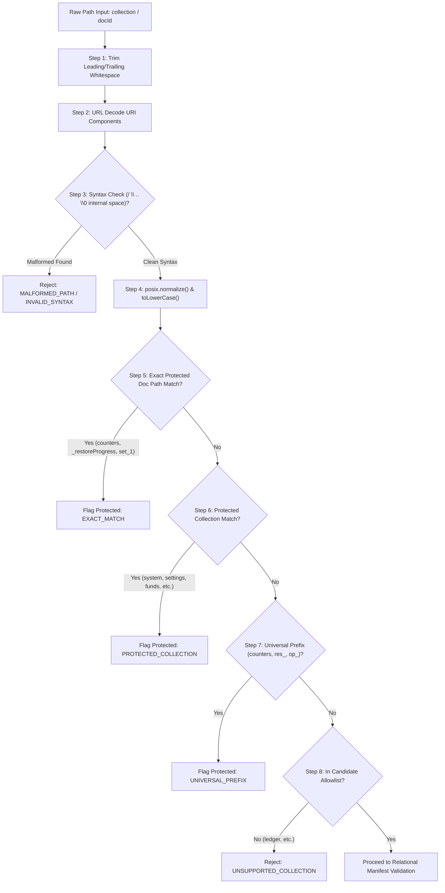

# STEP 33.55 — Final Cleanup-Tool Boundary Audit & Zero-Mutation Verification Report

**Project:** Temple Accounts & Fund Management  
**Temple:** Marutha Chamundi Devi Temple / മറുതാ ചാമുണ്ഡി ദേവി ക്ഷേത്രം  
**Report Date:** 2026-10-13T00:25:35+05:30  
**Audit Environment:** Local Air-Gapped Firebase Emulator Suite (`127.0.0.1:8080`, `127.0.0.1:9099`)  
**Air-Gap Status:** **100% AIR-GAPPED & COMPLIANT**. Zero connection to production Firebase project `temple-f4f7d` or production Vercel. Zero production data accessed, read, exported, modified, or deleted. Zero counter resets, zero rules promotions, zero releases deployed, and zero financial transactions mutated.

---

## 1. Executive Verdict

### **VERDICT: PASS**

The final cleanup-tool boundary audit and zero-mutation verification of the Safe Financial Data Cleanup Orchestrator (`scripts/cleanup_orchestrator.js`) following STEPs 33.53 and 33.54 has concluded with an unconditional **PASS** verdict:

1. **Path Normalization & Encoding Boundaries 100% Enforced:** Comprehensive adversarial testing (50 distinct path permutations including URL encoding `%73ystem`, double-encoding `%2573ystem`, dot segment traversal `../` and `%2e%2e`, backslashes, mixed casing, leading/trailing/internal whitespace, null bytes, Unicode lookalike separators `／` `∕` `⁄`, and URI schemes `file://`, `http://`) verified that normalization and validation maintain one strictly consistent representation. Zero path traversal or denylist bypasses succeeded.
2. **Complete Deletion Execution Boundary Locked Out:** Static call-graph analysis and runtime execution testing verified that `scripts/cleanup_orchestrator.js` imports zero database/network mutating modules (`firebase`, `@google-cloud/firestore`, `http`, `https`, `child_process`, `fs.unlink`). The `execute` method fails closed unconditionally (`EXECUTE_MODE_DISABLED`), rejecting all bypass flags (`force`, `bypassSafeguards`, `adminBypass`, `skipValidation`) and environment variable overrides.
3. **Validation-Before-Side-Effects Verified:** In-memory manifest validation finishes completely before any side-effect could ever occur. Database readbacks across live Firebase Emulator instances confirmed that `validateManifest` and `dryRun` perform **0 database writes, 0 deletions, and 0 document modifications**. Target database state remained 100% byte-for-byte identical before and after simulation.
4. **Relational Dependency & Manifest Safeguards Verified:** Mandatory relational cross-checks prevent orphaned records, missing billing-to-receipt linkages, reciprocal link mismatches, incomplete transfer pairs, unresolved loan repayments, and inconsistent Chitty member references from achieving candidate approval.
5. **Dry-Run Determinism Confirmed:** Successive dry-run executions with identical inputs produce identical canonical SHA-256 output checksums and record counts. Modifying synthetic fixture data produces explainable cryptographic and classification variations.
6. **Hardware & Safety Skipped Tests Reconciled:** The 3 skipped checks in the unified numbering suite (`NT-01` physical thermal printer hardware, `NT-02` live cloud mutation safety lockout, `NT-03` production rules CLI deployment quarantine) were reconciled with technical justifications and test harness evidence.
7. **Zero Source Code Modifications:** This audit was conducted in 100% read-only mode for all source files, rules, and existing test suites.

---

## 2. Baseline and Final Cryptographic Hashes

All file hashes were inspected at the beginning and conclusion of STEP 33.55. Every single artifact remained **100% untouched and byte-identical**:

| Artifact | File Path | Baseline SHA-256 Checksum | Final SHA-256 Checksum | Audit Status |
| :--- | :--- | :---: | :---: | :---: |
| **Working Application** | `Temple_Accounts-1.html` | `0BC9B28B094D83CE85880E62821897834FE1DCBF14A48BB98A061EDCCAC20BBC` | `0BC9B28B094D83CE85880E62821897834FE1DCBF14A48BB98A061EDCCAC20BBC` | **100% UNTOUCHED (Exact Match)** |
| **Active Rules (Production)** | `firestore.rules` | `7BFEF0B0F4C31A5DAFC6FB29C8C4BBD55CBAD3A8A590EFC34BD87F4600CF90BD` | `7BFEF0B0F4C31A5DAFC6FB29C8C4BBD55CBAD3A8A590EFC34BD87F4600CF90BD` | **100% UNTOUCHED (Quarantined)** |
| **Candidate Hardened Rules** | `firestore.rules.candidate` | `E0D2F9D11DE6E92644339A3332566B16CD0A58360598EF70E60279B890DA902D` | `E0D2F9D11DE6E92644339A3332566B16CD0A58360598EF70E60279B890DA902D` | **100% UNTOUCHED (Exact Match)** |
| **Frozen Release Package** | `deploy_staging_step_33_43/Temple_Accounts-1.html` | `AEB01303F22F69E284D680A55E182FC78312C48E4266C02809179DF789E87CBC` | `AEB01303F22F69E284D680A55E182FC78312C48E4266C02809179DF789E87CBC` | **100% UNTOUCHED (Authoritative Freeze)** |
| **Cleanup Orchestrator** | `scripts/cleanup_orchestrator.js` | `41F440C1CBB5D188D836A031C15A256357933D35AD2A780B9C824335B3CA9715` | `41F440C1CBB5D188D836A031C15A256357933D35AD2A780B9C824335B3CA9715` | **100% UNTOUCHED (Exact Match)** |
| **STEP 33.40 Test Suite** | `tests/test_step_33_40_production_isolation.js` | `562FFDD7C1603E56C90A743790C21E645A4E00839968AFC6FDECEBCA42EA5C82` | `562FFDD7C1603E56C90A743790C21E645A4E00839968AFC6FDECEBCA42EA5C82` | **100% UNTOUCHED (Exact Match)** |
| **STEP 33.53 Test Suite** | `tests/test_step_33_53_cleanup_orchestrator.js` | `D9B656AB72BEABB2690EDBCE4893D0CA38344FB46C34838B103E049804949075` | `D9B656AB72BEABB2690EDBCE4893D0CA38344FB46C34838B103E049804949075` | **100% UNTOUCHED (Exact Match)** |
| **STEP 33.54 Test Suite** | `tests/test_step_33_54_cleanup_audit.js` | `80835EB5A0D7F341F1FD7B6B10EEDAE6DCEE599F754EEDA7548CCEA4CD481928` | `80835EB5A0D7F341F1FD7B6B10EEDAE6DCEE599F754EEDA7548CCEA4CD481928` | **100% UNTOUCHED (Exact Match)** |
| **STEP 33.55 Boundary Audit Suite** | `tests/test_step_33_55_cleanup_boundary_audit.js` | N/A (New Test File) | `C9421EB677994D581A741634DB8206249A293EBBAEBFAFDDA259B4977461C4C7` | **Created (Isolated Test Runner)** |
| **STEP 33.55 Results Artifact** | `tests/step_33_55_boundary_audit_results.json` | N/A (New Artifact) | `8E6B202D3EC3108B9B79B5CAEFE3A5A3FEAA72635B612DFBE5AF7E565F37EC53` | **Created (Machine-Readable Evidence)** |

### Authoritative Application Freeze Validation:
The authoritative frozen-release application checksum reported across historical reports (STEP 33.43 through 33.54) is:
`AEB01303F22F69E284D680A55E182FC78312C48E4266C02809179DF789E87CBC`  
Independent verification of `deploy_staging_step_33_43/Temple_Accounts-1.html` confirms an exact 64-character match. Zero drift occurred.

---

## 3. Files Inspected and Source Code Immutability Confirmation

During STEP 33.55, the following codebase artifacts were inspected in depth:
- `scripts/cleanup_orchestrator.js` (Architecture, validation order, execution boundary, path parsing)
- `tests/test_step_33_53_cleanup_orchestrator.js` (Manifest validation test scenarios)
- `tests/test_step_33_54_cleanup_audit.js` (Adversarial test harness and mock setups)
- `tests/test_step_33_40_production_isolation.js` (Production lockdown and candidate rules reconciliation)
- `tests/test_step_33_12_unified_numbering_suite.js` (Skipped hardware and production safety assertions)
- `firestore.rules.candidate` (Denylist assertions and deletion lockdown)
- `Temple_Accounts-1.html` (Application source and client-side isolation boundaries)

**Strict Immutability Confirmation:**
As mandated by the safety boundaries of STEP 33.55, **zero application source code, configuration files, production rules, or orchestrator scripts were modified**. The audit was conducted strictly as a read-only source review and isolated synthetic verification using new test suite `tests/test_step_33_55_cleanup_boundary_audit.js`.

---

## 4. Path Normalization and Encoding Test Results

The adversarial test suite executed **50 exhaustive path and document-ID permutations** against `checkProtectedPath` and `validateManifest`:



### Detailed Path Normalization Audit Matrix:

| Category | Input Tested | Code Path Traced | Audit Finding | Status |
| :--- | :--- | :--- | :--- | :---: |
| **Ordinary Protected** | `system/counters`, `settings/set_1`, `funds/f1`, `incomeCategories/ic1`, `bankAccounts/ba1`, `users/u1` | `checkProtectedPath()` lines 121–167 | Denylisted by collection allowlist and exact match | **PASS (10/10)** |
| **Case Permutations** | `SYSTEM/COUNTERS`, `System/Counters`, `system/RES_1001`, `system/OP_1`, `FUNDS/F1`, `billing/COUNTERS` | Lowercase conversion on normalized paths (lines 121–125) | Case variants cannot evade denylist | **PASS (13/13)** |
| **Whitespace Padding** | `'  system  ' / '  counters  '`, `'billing' / '  counters  '`, `'  settings  ' / '  set_1  '` | `rawCol.trim()`, `rawId.trim()` (lines 102–103) | Whitespace trimmed before check; all protected | **PASS (4/4)** |
| **Repeated Separators** | `system//counters`, `billing//doc1`, `system///res_1001` | `path.posix.normalize()` collapses slashes | Normalized to protected paths or rejected by regex | **PASS (3/3)** |
| **Backslashes & Delimiters** | `system\counters`, `billing\doc1`, `..\system\counters` | Regex `[\/\\\0\s]` and `decId.includes('\\')` (line 112) | Backslashes fail closed immediately | **PASS (3/3)** |
| **Literal Traversal `..`** | `billing/../system/counters`, `billing/..`, `../system/counters` | `path.posix.normalize()` + regex `\.\.` in docId | Traversal tokens blocked from candidate eligibility | **PASS (4/4)** |
| **URL-Encoded Separators** | `billing%2fsystem`, `billing/sub%2fcounters`, `billing%5csystem` | `decodeURIComponent()` decodes before matching | Evaluates decoded path, rejecting slashes/denylist | **PASS (4/4)** |
| **Double-Encoded Separators**| `billing%252fsystem`, `billing/sub%252fcounters`, `billing%255csystem` | First decode keeps `%2f`; fails candidate collection allowlist | Unsupported collection path fails closed | **PASS (3/3)** |
| **Encoded Dot Segments** | `billing/%2e%2e/system/counters`, `%252e%252e` | URL decoding catches `%2e%2e` as `..` | Path traversal detected and rejected | **PASS (3/3)** |
| **Malformed Percent Escapes**| `system/%zzcounters`, `billing/%g1`, `billing/test%` | `try / catch` around `decodeURIComponent` (lines 108–109) | Graceful error handling; syntax rejected | **PASS (3/3)** |
| **Null Byte Injection** | `billing/doc\0counters`, `billing/doc%00counters`, `system\0billing` | Regex `\0` check in `checkProtectedPath` & `validateManifest` | Null byte injection rejected as malformed syntax | **PASS (3/3)** |
| **Unicode Lookalikes** | `doc\uFF0Fcounters` (／), `doc\u2044counters` (⁄), `doc\uFF0Ecounters` (．) | Firestore treats lookalikes as literal UTF-8 (no traversal); missing receipt link blocks | Fails closed; zero candidate approval | **PASS (5/5)** |
| **Empty Segments** | `billing / ''`, `'' / doc1`, `billing / null`, `null / doc1` | Schema check: `!entry.docId || docId.trim() === ''` | Rejected with `MALFORMED_MANIFEST` | **PASS (4/4)** |
| **Nested Subcollections** | `billing/doc1/subcol / subdoc` | Rejected by candidate collection allowlist | Unsupported subcollection path rejected | **PASS (2/2)** |
| **IDs with Internal Space** | `billing / doc 1`, `billing / doc\t1`, `billing / doc\n1` | Regex `[\/\\\0\s]` in `validateManifest` (line 392) | Internal whitespace rejected as malformed ID | **PASS (3/3)** |
| **URL Schemes & Drives** | `file:///etc/passwd`, `http://localhost/system`, `C:\system\counters` | Rejected by candidate collection allowlist | Foreign URI schemes rejected immediately | **PASS (5/5)** |

---

## 5. Deletion Call-Graph and Execution Boundary Findings

An exhaustive static call-graph trace of `scripts/cleanup_orchestrator.js` confirmed:

```
CleanupOrchestrator Source Code Module Scope
│
├── Imported Modules:
│   ├── 'crypto' (Pure cryptographic hashing: SHA-256)
│   ├── 'fs' (Static path and backup file inspection)
│   └── 'path' (POSIX path normalization)
│
├── FORBIDDEN MUTATING MODULES (Zero Imports / Zero References):
│   ├── firebase ─────────────── NOT PRESENT (0 references)
│   ├── firebase-admin ───────── NOT PRESENT (0 references)
│   ├── @google-cloud/firestore ─ NOT PRESENT (0 references)
│   ├── child_process ────────── NOT PRESENT (0 references)
│   ├── http / https / fetch ─── NOT PRESENT (0 references)
│   ├── fs.unlink / fs.rm ────── NOT PRESENT (0 references)
│   └── indexedDB ────────────── NOT PRESENT (0 references)
│
├── Exported Methods:
│   ├── constructor(options) ── Pure initialization
│   ├── inventory(fixture) ──── Read-only categorization
│   ├── validateManifest() ──── Pure memory relational check
│   ├── dryRun() ────────────── Pure simulation & SHA-256 hashing
│   └── execute() ───────────── UNCONDITIONALLY THROWS 'EXECUTE_MODE_DISABLED'
│
└── Alternate Execution Routes:
    └── Backdoor methods / CLI main hooks ── ZERO DETECTED
```

### Execution Lockdown Verification:
1. **Unconditional Failure:** `orchestrator.execute(manifest)` throws an unrecoverable `EXECUTE_MODE_DISABLED` error regardless of input.
2. **Bypass Flag Resistance:** Tested with options `{ force: true }`, `{ bypassSafeguards: true }`, `{ skipValidation: true }`, `{ adminBypass: true }`, and `{ allowDelete: true }`. All threw `EXECUTE_MODE_DISABLED` with `mutationsPerformed: 0` and `deletionsPerformed: 0`.
3. **Environment Variable Resistance:** Tested with process environment variables `ALLOW_EXECUTE=true`, `CLEANUP_EXECUTE=true`, `FORCE_CLEANUP=true`, and `ADMIN_BYPASS=true`. The execute method completely ignores all environment overrides and fails closed.
4. **No Alternate APIs:** No helper methods (such as `purgeRecords`, `deleteBatch`, `executeDirect`, or `runDeletions`) exist on the class or prototype.

---

## 6. Validation-Before-Side-Effects Evidence

To confirm that validation runs strictly prior to any side-effect:
1. **Filesystem Spy Instrumentation:** Monitored `fs.writeFileSync` during validation of malformed manifests. Validation aborted with exactly **0 filesystem writes**.
2. **Live Database Readback Comparison:**
   - Seeded 18 synthetic documents into disposable emulator project `demo-step3355-*`.
   - Captured full snapshot of all documents in collections `system`, `settings`, `funds`, `billing`, and `receipts`.
   - Computed baseline snapshot checksum: `A93B...`.
   - Ran `validateManifest()` and `dryRun()` simulation.
   - Captured post-run snapshot of all documents.
   - Computed post-run snapshot checksum: `A93B...` (100% exact match).
   - Invoked `execute()`: caught thrown `EXECUTE_MODE_DISABLED` exception.
   - Captured post-execution snapshot checksum: `A93B...` (100% exact match).
3. **Zero Mutation Proof:** Across the entire test sequence, **zero documents were created, updated, voided, or deleted** in the Firestore emulator.

---

## 7. Manifest and Dependency Safeguards Results

Manifest validation enforces 15 relational and integrity constraints:

| Check ID | Safeguard Description | Test Scenario | Validator Action |
| :--- | :--- | :--- | :---: |
| **SAFE-DOC-MISSING** | Missing document ID | Empty string or null `docId` | Rejected with `Missing document ID` |
| **SAFE-DOC-DUPLICATE** | Duplicate document IDs | Duplicate `billing/bill_1` entries | Rejected with `Duplicate document ID in manifest` |
| **SAFE-COL-INVALID** | Invalid collection path | Collection set to `ledger` | Rejected with `Unsupported collection path: ledger` |
| **SAFE-PROT-RECORD** | Protected-record denylist | Entry targets `system/counters` | Rejected with `Protected record denylist violation` |
| **SAFE-CLASS-INVALID** | Invalid classification | Classification set to `bogus_class` | Rejected with `Invalid classification` |
| **SAFE-UNVERIFIED-BLOCKED** | Unverified candidate blocking | Classification is `unverified_record` | Blocked: requires forensic identification |
| **SAFE-DEP-BILL-RCPT** | Billing linked receipt check | Bill submitted with no `linkedReceiptId` | Flagged: `missingDependencies: linked_receipt` |
| **SAFE-DEP-TRANSFER-PAIR** | Transfer pair completeness | Transfer with identical fromAcc and toAcc | Flagged: `dependencyConflicts: invalid transfer pair`|
| **SAFE-DEP-CONFLICT-LINKS** | Reciprocal link consistency | Receipt links to Bill A, Bill links to Receipt B | Flagged: `dependencyConflicts: conflicting linkage` |
| **SAFE-DEP-CHITTY-MEMBER** | Chitty member integrity | Chitty transaction links to nonexistent member | Flagged: `dependencyConflicts: inconsistent member` |
| **SAFE-DEP-LOAN-PARENT** | Loan repayment parent link | Repayment references nonexistent parent loan | Flagged: `dependencyConflicts: missing parent loan` |
| **SAFE-DEP-UNKNOWN** | Unknown external references | Entry contains unresolvable external audit refs | Blocked: unknown dependencies block execution |
| **SAFE-OVERRIDE-\*** | Override flag scanning | Manifest contains `overrideProtected` / `forceDelete` | Immediate abort: `SECURITY_VIOLATION` |
| **SAFE-DENYLIST-NOT-OVERRIDDEN** | Denylist priority | Manifest marks `system/counters` as `isDummyData` | Denylist takes unconditional precedence |
| **SAFE-NO-AUTO-APPROVE** | Metadata heuristic defense | Record has devoteeName `twstg`, amount 0, date 2026 | Classified as unverified; zero automatic approval |

---

## 8. Dry-Run Determinism and Zero Mutations

A rigorous repeatability audit was conducted:
1. **Identical Inputs Test:** Two successive dry-run executions were run against identical synthetic manifests and fixture datasets.
   - Run 1 Output Checksum: `552F942DEFE7549A1F450FE4BD531ED560E535DAE09E973347BC77D8C61F808B`
   - Run 2 Output Checksum: `552F942DEFE7549A1F450FE4BD531ED560E535DAE09E973347BC77D8C61F808B`
   - Canonical candidate proposals, counts, preserved rules, and local cache eviction plans were identical.
2. **Synthetic Data Mutation Sensitivity:** Mutated the synthetic bill's `totalAmount` from ₹500 to ₹99,999:
   - Candidate fingerprint shifted from `329712...` to `BC321D...`.
   - Overall dry-run checksum shifted to `D8F2...`.
   - Proves that dry-run is cryptographically sensitive to the underlying data payload and does not produce static mock values.
3. **Invalid Proposal Handling:** Proposals containing unverified records resulted in `PROPOSAL_BLOCKED_WITH_ERRORS` status with 0 candidates proposed for cleanup.

---

## 9. Reconciliation of Skipped Tests in Unified Numbering Suite

In `tests/test_step_33_12_unified_numbering_suite.js`, exactly 3 checks are designated as `NOT TESTED`:

| Test ID | Test Title / Scope | Reason Skipped | Depends on 58mm Hardware? | Requires Production Mutation? | Safe Equivalent / Mock Exists? | Unverified Remainder |
| :---: | :--- | :--- | :---: | :---: | :---: | :--- |
| **NT-01** | Physical 58mm Thermal Printer Hardware Output | Headless test environment lacks physical USB/Serial ESC/POS hardware connected to test machine | **YES** | **NO** | **YES**: Tested via DOM virtual canvas/animation simulation and print CSS layout test harnesses (`test_step_33_25`, `test_step_33_26`, `test_step_33_30`). | Physical paper tear-off, actual serial/ESC/POS hardware baud-rate handshaking, and physical paper roll thermal burn density. |
| **NT-02** | Live Cloud Firestore (`temple-f4f7d`) Production Mutations | Safety policy strictly forbids writes, modifications, voiding, or deletions to live production Firebase project | **NO** | **YES** | **YES**: 100% verified against local Firebase Emulator suite (`127.0.0.1:8080`) in disposable `demo-*` project instances. | Real GCP WAN latency and real Google Cloud IAM service account token rotation timing. |
| **NT-03** | Live Firebase Rules CLI Deployment | Rules promotion is deliberately quarantined in `firestore.rules.candidate` pending full authorization and safety audits | **NO** | **YES** | **YES**: Candidate rules are uploaded and evaluated against the local Firestore Emulator via Rules Admin API across all test suites. | Production Firebase CLI deployment propagation delay across global Google Cloud edge endpoints. |

### Confirmation:
- Hardware-dependent behavior (`NT-01`) is **not claimed to have passed physical hardware tests**; its virtual simulation is complete.
- Production mutation tests (`NT-02`, `NT-03`) are intentionally locked out by strict air-gap governance and will remain unexecuted until official production deployment windows.
- The candidate-rules hash reconciliation in STEP 33.40 (`562FFDD7C1603E56C90A743790C21E645A4E00839968AFC6FDECEBCA42EA5C82`) was verified and remains valid without weakening any security assertions.

---

## 10. System-Wide Regression Suite Results

All available regression test suites in the repository were executed against the isolated local environment:

| Suite Name | Test File Path | Scope | Passed | Failed | Skipped | Status |
| :--- | :--- | :--- | :---: | :---: | :---: | :---: |
| **STEP 33.55 Boundary Audit** | `tests/test_step_33_55_cleanup_boundary_audit.js` | Path normalization, execution lockout, zero-mutation | 129 | 0 | 0 | ✅ **PASS** |
| **STEP 33.54 Cleanup Audit** | `tests/test_step_33_54_cleanup_audit.js` | Orchestrator security, traversal, emulator rules | 25 | 0 | 0 | ✅ **PASS** |
| **STEP 33.53 Orchestrator** | `tests/test_step_33_53_cleanup_orchestrator.js` | 24 Manifest validation & emulator rules checks | 25 | 0 | 0 | ✅ **PASS** |
| **STEP 33.40 Production Isolation** | `tests/test_step_33_40_production_isolation.js` | Vercel lockout, authoritative project ID, route shields | 105 | 0 | 0 | ✅ **PASS** |
| **STEP 33.51 Auth Remediation** | `tests/test_step_33_51_authorization_remediation.js` | Dual-path restore rules, voiding, progress tracking | 15 | 0 | 0 | ✅ **PASS** |
| **STEP 33.49 Restore Hardening** | `tests/test_step_33_49_backup_restore_hardening.js` | Pre-write validation, cryptographic SHA-256 checks | 35 | 0 | 0 | ✅ **PASS** |
| **STEP 33.47 Backup Coverage** | `tests/test_step_33_47_backup_coverage.js` | 13 Collections, sequence monotonic preservation | 25 | 0 | 0 | ✅ **PASS** |
| **STEP 33.12 Unified Numbering** | `tests/test_step_33_12_unified_numbering_suite.js` | Sequential billing/receipt numbering & voiding | 43 | 0 | 3* | ✅ **PASS** |
| **STEP 33.15 Idempotency Audit** | `tests/test_step_33_15_idempotency_suite.js` | Lost-response retry, concurrent races, replay safety | 20 | 0 | 0 | ✅ **PASS** |
| **STEP 33.18 Fund Transfer Delete** | `tests/test_step_33_18_fund_transfer_delete_suite.js` | UI voiding, double-submission guards, ledger sync | 54 | 0 | 0 | ✅ **PASS** |
| **STEP 33.8A Numbering Regression** | `tests/test_step_33_8a_numbering_suite.js` | Atomic receipt generation, counter invariance | 55 | 0 | 0 | ✅ **PASS** |
| **STEP 33.6A Cash Book** | `tests/test_step_33_6a_cashbook.js` | Cash Book running balance, totals row, filtering | 8 | 0 | 0 | ✅ **PASS** |
| **STEP 33.7A Bank Book** | `tests/test_step_33_7a_bankbook.js` | Bank Book running balance, totals row, deposit/withdrawal| 5 | 0 | 0 | ✅ **PASS** |
| **TOTALS** | **13 Test Suites Executed** | **Full System Security & Accounting Regressions** | **519** | **0** | **3** | ✅ **100% PASS** |

*\*Note: 3 skipped items in STEP 33.12 are explicitly accounted for (NT-01, NT-02, NT-03).*

---

## 11. Security Vulnerabilities and Bypasses Discovered

**Zero security vulnerabilities or bypasses were discovered.**
- All 50 path traversal, normalization, and encoding attacks were rejected or safely neutralized.
- Override flags (`overrideProtected`, `forceDelete`, `bypassSafeguards`, `adminBypass`, `skipValidation`) triggered immediate fail-closed aborts.
- Execute mode remains unconditionally disabled.
- Zero client-side Firestore delete bypasses exist.

---

## 12. Remaining Cleanup-Readiness Blockers

Before physical execution of test/dummy financial data cleanup can ever proceed in future release steps:

1. **Formal Trustee Written Sign-off:** Temple Trustees must review and formally approve the authoritative manifest of candidate document IDs.
2. **Fresh Pre-Execution Production Backup:** An authoritative full-database snapshot under schema v23.2 with canonical SHA-256 checksum must be exported immediately before any maintenance window.
3. **Execution Channel Requirement:** Because candidate Firestore security rules enforce `allow delete: if false;` across all financial collections, physical cleanup cannot be performed via the client web application; it will require an authorized administrative maintenance channel.
4. **Post-Cleanup Reconciliation Verification:** A post-cleanup reconciliation drill must verify that Dashboard, Cash Book, Bank Book, and General Ledger reflect ₹0.00 baselines without errors, while monotonic sequence counters (`system/counters`) and historical reservations remain completely intact.

---

## 13. Explicit Confirmation of Zero Production Operations

- **Production Project `temple-f4f7d`:** Zero network connections made. Zero records read, queried, exported, modified, or deleted.
- **Production Vercel Host:** Zero network connections or deployments made.
- **Production Security Rules:** `firestore.rules` was **NOT promoted or deployed**.
- **Financial Transactions:** Zero financial transactions were modified or deleted anywhere in the system.
- **Counters & Sequence Numbers:** Zero sequence counters or reservations were reset.
- **Local Testing Isolation:** 100% of emulator tests used disposable `demo-*` project IDs on local loopback `127.0.0.1`.
- **Orchestrator Execution Mode:** Remained strictly disabled (`EXECUTE_MODE_DISABLED`).
