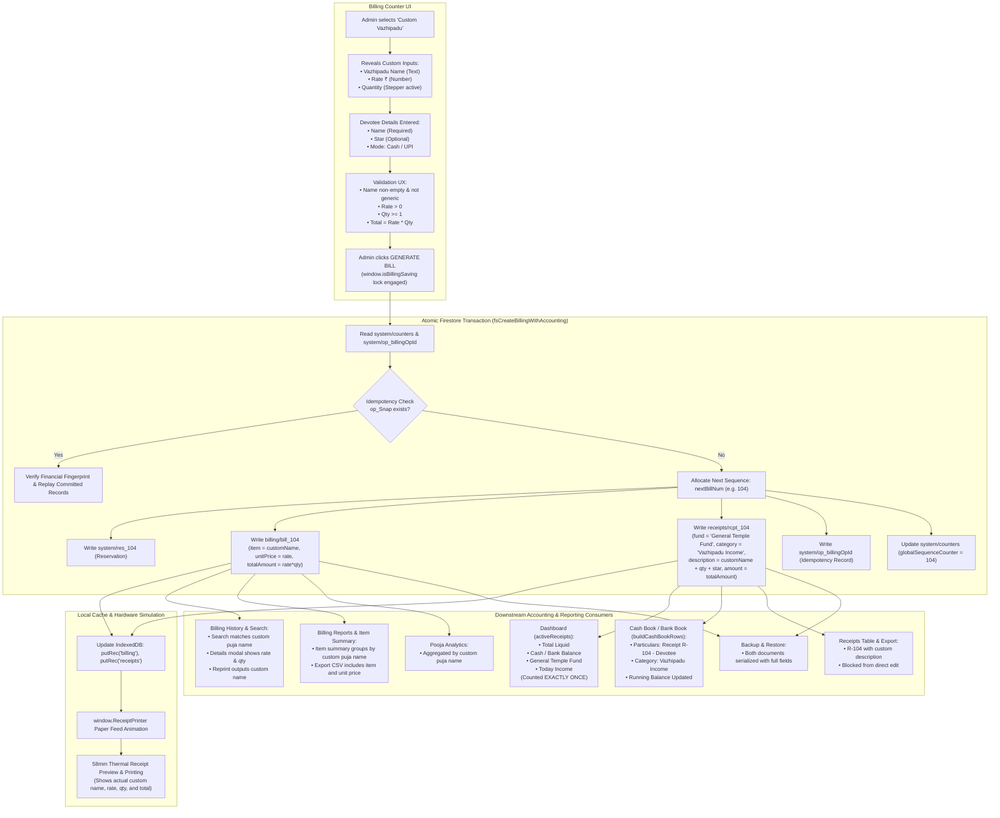

# STEP 33.56A — Custom Vazhipadu: Existing-System Integration Audit & Implementation Plan

**Project:** Temple Accounts & Fund Management  
**Temple:** Marutha Chamundi Devi Temple / മറുതാ ചാമുണ്ഡി ദേവി ക്ഷേത്രം  
**Feature:** Custom Vazhipadu with Administrator-Defined Name and Rate  
**Phase:** Audit & Planning Only — NO implementation attempted  
**Execution Date:** 2026-10-13  
**Auditor:** Antigravity AI  

---

## 1. Executive Summary

This audit report delivers a rigorous, code-grounded architectural investigation and implementation plan for adding a **Custom Vazhipadu** offering to the Billing counter in [`Temple_Accounts-1.html`](file:///d:/Temple/Temple_Accounts-1.html).

The administrator must be able to select a new **Custom Vazhipadu** option, enter an arbitrary Vazhipadu name, enter a custom rate (₹), adjust the quantity using the existing stepper, and record the devotee's name and star. When generated, the bill and its linked accounting receipt must record and display the **actual custom puja name** and calculated line total (`rate × quantity`) across all application layers—including the 58 mm thermal receipt printer, receipt history, search and filter indexes, Cash Book, Bank Book, reports, and analytical summaries.

Crucially, this is an **integrated accounting and billing feature**, not an isolated cosmetic tweak. The audit confirms:
1. **Zero Double-Counting:** The application's core accounting engines ([`getCashBalance`](file:///d:/Temple/Temple_Accounts-1.html#L6424-L6442), [`getBankBalance`](file:///d:/Temple/Temple_Accounts-1.html#L6443-L6462), [`getFundBalance`](file:///d:/Temple/Temple_Accounts-1.html#L6463-L6481), [`buildCashBookRows`](file:///d:/Temple/Temple_Accounts-1.html#L11710-L11791), [`buildBankBookRows`](file:///d:/Temple/Temple_Accounts-1.html#L11792-L11814), and [`VIEW_RENDERERS.dashboard`](file:///d:/Temple/Temple_Accounts-1.html#L7150-L7210)) calculate financial balances **strictly from the `receipts` collection** via [`activeReceipts()`](file:///d:/Temple/Temple_Accounts-1.html#L6405). The `billing` collection functions as an operational POS register and thermal reprint store. Therefore, one bill and its linked receipt produce **exactly one financial recognition** in General Temple Fund / Vazhipadu Income.
2. **Schema Compatibility:** The current document structures for both `billing` (`bill_${N}`) and `receipts` (`rcpt_${N}`) already accommodate arbitrary line-item names (`item` in billing, `description` in receipts), numeric rates (`unitPrice`), and quantities (`quantity`). No Firestore schema migration or security rules modification is required.
3. **Numbering & Idempotency Preserved:** The transaction uses the existing unified monotonic numbering pipeline ([`getNextGlobalSequenceNo`](file:///d:/Temple/Temple_Accounts-1.html#L6368-L6389), `system/counters`, and `system/res_${N}`) and deterministic idempotency fingerprinting ([`computeBillingFingerprint`](file:///d:/Temple/Temple_Accounts-1.html#L18033-L18071)).
4. **Safety Boundaries Intact:** Zero writes have been made to source code, production databases, security rules, or frozen release assets.

---

## 2. Actual Source Files and Functions Inspected

The audit conducted deep static analysis and isolated code inspection on the following concrete files and symbols:

### 2.1 Primary Application Source
- [`Temple_Accounts-1.html`](file:///d:/Temple/Temple_Accounts-1.html) (19,934 lines, 784,014 bytes)

### 2.2 Key Inspected Functions & Constants in [`Temple_Accounts-1.html`](file:///d:/Temple/Temple_Accounts-1.html)
| Line Range | Symbol / Function | Architectural Purpose |
|---|---|---|
| [8029–8044](file:///d:/Temple/Temple_Accounts-1.html#L8029-L8044) | `BILLING_DEFAULT_ITEMS` | Catalog master list containing 13 Vazhipadu items and 1 Punarudharanam item. |
| [8050–8060](file:///d:/Temple/Temple_Accounts-1.html#L8050-L8060) | [`getNextBillingReceiptNo`](file:///d:/Temple/Temple_Accounts-1.html#L8050-L8060) | Preview number generator fetching `globalSequenceCounter` from `system/counters`. |
| [8063–8079](file:///d:/Temple/Temple_Accounts-1.html#L8063-L8079) | [`setBillingCategory`](file:///d:/Temple/Temple_Accounts-1.html#L8063-L8079), [`syncCategorySegmentedUI`](file:///d:/Temple/Temple_Accounts-1.html#L8071-L8079) | Category selector handler between Vazhipadu (`വഴിപാട്`) and Punarudharanam (`പുനരുദ്ധാരണം`). |
| [8096–8105](file:///d:/Temple/Temple_Accounts-1.html#L8096-L8105) | [`billingAdjustQty`](file:///d:/Temple/Temple_Accounts-1.html#L8096-L8105) | Stepper function adjusting quantity with lower bound of 1. |
| [8107–8114](file:///d:/Temple/Temple_Accounts-1.html#L8107-L8114) | [`syncItemChipsUI`](file:///d:/Temple/Temple_Accounts-1.html#L8107-L8114) | Toggles active styling on quick-select chips based on selected dropdown index. |
| [8116–8174](file:///d:/Temple/Temple_Accounts-1.html#L8116-L8174) | [`loadCategoryItems`](file:///d:/Temple/Temple_Accounts-1.html#L8116-L8174) | Populates dropdown options and renders quick-selection chip buttons (`.billing-item-chip`). |
| [8176–8259](file:///d:/Temple/Temple_Accounts-1.html#L8176-L8259) | [`updatePrice`](file:///d:/Temple/Temple_Accounts-1.html#L8176-L8259) | Manages pricing mode (fixed vs variable custom), calculates totals, and toggles donation row. |
| [8261–8324](file:///d:/Temple/Temple_Accounts-1.html#L8261-L8324) | [`renderThermalReceiptHTML`](file:///d:/Temple/Temple_Accounts-1.html#L8261-L8324) | Renders 58 mm thermal receipt layout with item particulars, devotee, star, qty, rate, and total. |
| [8327–8450](file:///d:/Temple/Temple_Accounts-1.html#L8327-L8450) | `window.ReceiptPrinter` | Native thermal receipt printer controller handling processing and paper feed animation. |
| [8747–8820](file:///d:/Temple/Temple_Accounts-1.html#L8747-L8820) | [`renderBillingReceiptPreview`](file:///d:/Temple/Temple_Accounts-1.html#L8747-L8820) | Injects receipt preview HTML into `#billingReceiptPreviewArea`. |
| [8825–8866](file:///d:/Temple/Temple_Accounts-1.html#L8825-L8866) | [`printBillingReceipt`](file:///d:/Temple/Temple_Accounts-1.html#L8825-L8866) | Triggers browser print dialog with 58 mm `@page` styles. |
| [8870–8901](file:///d:/Temple/Temple_Accounts-1.html#L8870-L8901) | [`billingCategoryToFund`](file:///d:/Temple/Temple_Accounts-1.html#L8874-L8879), [`billingCategoryToIncomeCategory`](file:///d:/Temple/Temple_Accounts-1.html#L8885-L8901) | Maps billing category `'വഴിപാട്'` to `'General Temple Fund'` and `'Vazhipadu Income'`. |
| [9035–9422](file:///d:/Temple/Temple_Accounts-1.html#L9035-L9422) | [`billingSubmitForm`](file:///d:/Temple/Temple_Accounts-1.html#L9035-L9422) | Form validation, double-submission lock, fingerprinting, atomic persistence, and success UI. |
| [9435–9495](file:///d:/Temple/Temple_Accounts-1.html#L9435-L9495) | [`billingResetForm`](file:///d:/Temple/Temple_Accounts-1.html#L9435-L9495) | Resets inputs, clears validation errors, resets stepper to 1, and restores default selection. |
| [9552–9850](file:///d:/Temple/Temple_Accounts-1.html#L9552-L9850) | [`refreshBillingHistory`](file:///d:/Temple/Temple_Accounts-1.html#L9552-L9571), [`applyBillingFilters`](file:///d:/Temple/Temple_Accounts-1.html#L9666-L9750) | Populates billing history table, handles search filter, and calculates active/voided summary cards. |
| [10180–10370](file:///d:/Temple/Temple_Accounts-1.html#L10180-L10370) | [`applyBillingReportFilters`](file:///d:/Temple/Temple_Accounts-1.html#L10180-L10300), [`exportBillingReportCSV`](file:///d:/Temple/Temple_Accounts-1.html#L10319-L10370) | Groups bills by `item` in `#billingRptItemTableWrap` and exports billing CSV. |
| [10741–10892](file:///d:/Temple/Temple_Accounts-1.html#L10741-L10892) | [`viewBillingDetails`](file:///d:/Temple/Temple_Accounts-1.html#L10741-L10880), [`reprintBillingRecord`](file:///d:/Temple/Temple_Accounts-1.html#L10883-L10892) | Details modal and reprint trigger reusing persisted `item`, `unitPrice`, and `quantity`. |
| [10895–10954](file:///d:/Temple/Temple_Accounts-1.html#L10895-L10954) | [`voidBillingRecord`](file:///d:/Temple/Temple_Accounts-1.html#L10895-L10954) | User-facing voiding dialog calling atomic bidirectional voiding. |
| [10961–11125](file:///d:/Temple/Temple_Accounts-1.html#L10961-L11125) | `VIEW_RENDERERS.billing` | Main billing form UI rendering, quick-select chips container, and feedback area. |
| [11710–11814](file:///d:/Temple/Temple_Accounts-1.html#L11710-L11814) | [`buildCashBookRows`](file:///d:/Temple/Temple_Accounts-1.html#L11710-L11791), [`buildBankBookRows`](file:///d:/Temple/Temple_Accounts-1.html#L11792-L11814) | Assembles chronological ledger rows exclusively from `activeReceipts()`. |
| [13840–13943](file:///d:/Temple/Temple_Accounts-1.html#L13840-L13943) | `renderAnalyticsDashboardContent` (Pooja Section) | Groups bills by `b.item` to identify highest collection and most frequent pujas. |
| [14437–15260](file:///d:/Temple/Temple_Accounts-1.html#L14437-L15260) | `_serializeDoc`, `_deserializeDoc`, [`restoreBackup`](file:///d:/Temple/Temple_Accounts-1.html#L14814-L15260) | Full backup serialization and restore verification covering `billing` and `receipts`. |
| [17847–17920](file:///d:/Temple/Temple_Accounts-1.html#L17847-L17920) | [`fsVoidLinkedBillingAndReceipt`](file:///d:/Temple/Temple_Accounts-1.html#L17847-L17920) | Atomic Firestore batch voiding `billing/bill_${N}`, `receipts/rcpt_${N}`, and `system/res_${N}`. |
| [18019–18071](file:///d:/Temple/Temple_Accounts-1.html#L18019-L18071) | [`computeBillingFingerprint`](file:///d:/Temple/Temple_Accounts-1.html#L18033-L18071) | Canonical financial fingerprint hashing date, category, fund, incomeCat, item, star, qty, rate, total, mode. |
| [18226–18613](file:///d:/Temple/Temple_Accounts-1.html#L18226-L18613) | [`fsCreateBillingWithAccounting`](file:///d:/Temple/Temple_Accounts-1.html#L18226-L18613) | Atomic Firestore transaction creating bill, receipt, reservation, and idempotency lock. |

### 2.3 Existing Test Suites Inspected
- [`tests/test_step_33_34a_vazhipadu_button.js`](file:///d:/Temple/tests/test_step_33_34a_vazhipadu_button.js) (51 assertions — PASS)
- [`tests/test_step_33_24_expanded_billing_printer.js`](file:///d:/Temple/tests/test_step_33_24_expanded_billing_printer.js)
- [`tests/test_step_33_25_printer_animation.js`](file:///d:/Temple/tests/test_step_33_25_printer_animation.js)
- [`tests/test_step_33_12_unified_numbering_suite.js`](file:///d:/Temple/tests/test_step_33_12_unified_numbering_suite.js)
- [`tests/test_step_33_15_idempotency_suite.js`](file:///d:/Temple/tests/test_step_33_15_idempotency_suite.js)
- [`tests/test_step_33_28_cashbook_date_sort_guard.js`](file:///d:/Temple/tests/test_step_33_28_cashbook_date_sort_guard.js)
- [`tests/test_step_33_49_backup_restore_hardening.js`](file:///d:/Temple/tests/test_step_33_49_backup_restore_hardening.js)

---

## 3. End-to-End Billing-to-Accounting Data Flow



---

## 4. Affected-Module Matrix

Every downstream consumer required by the specification was inspected. The table below specifies the actual data source and mechanics for each module:

| # | Module / Consumer | Primary Data Source | Reads Billing or Receipts? | Handling of Custom Vazhipadu | Double-Counting Protection |
|---|---|---|---|---|---|
| **1** | **Billing Persistence** | Firestore `billing` & IDB `billing` | Writes to `billing` | Saves `item` as actual custom puja name, `unitPrice` as custom rate, `totalAmount` as calculated line total. | Not an accounting balance accumulator. |
| **2** | **Linked Accounting Receipt** | Firestore `receipts` & IDB `receipts` | Writes to `receipts` | Saves `description` containing actual custom name, `amount` matching bill total, `fund` = 'General Temple Fund', `category` = 'Vazhipadu Income'. | Linked via `billingFirestoreId`, `billingId`, and shared sequence number. |
| **3** | **Global Numbering & Reservation** | Firestore `system/counters` & `system/res_${N}` | System metadata | Shared monotonic sequence counter allocates matching `BILL-N` and `R-N`. | Sequence number allocated once inside transaction. |
| **4** | **Idempotency Prevention** | Firestore `system/op_${opId}` | System metadata | Canonical fingerprint hashes custom item name, unit rate, quantity, and total amount. Retried clicks return committed records. | Duplicate submissions rejected without counter advance. |
| **5** | **Fund & Income Category Mapping** | In-memory rules & [`billingCategoryToFund`](file:///d:/Temple/Temple_Accounts-1.html#L8874-L8879) | Neither | Maps `'വഴിപാട്'` strictly to `'General Temple Fund'` and `'Vazhipadu Income'`. Zero new funds created. | Invariant preserved. |
| **6** | **Dashboard Totals** | IndexedDB / Firestore `receipts` | **Reads `receipts` ONLY** | Custom Vazhipadu reflected through `activeReceipts()` in General Fund, Cash/Bank, and Today Income. | **Double-counting impossible:** Dashboard never reads `billing` collection for balances. |
| **7** | **Receipts Listing & Details** | IndexedDB / Firestore `receipts` | **Reads `receipts` ONLY** | Appears as `R-xxx` with devotee name, Vazhipadu Income, and custom description. Direct edit blocked by lines 7641–7644. | Exactly 1 receipt row per bill. |
| **8** | **Cash Book** | IndexedDB / Firestore `receipts` | **Reads `receipts` ONLY** | Cash bills appear as receipt rows under `Vazhipadu Income` with running cash balance updated. | Billing records are never queried. |
| **9** | **Bank Book** | IndexedDB / Firestore `receipts` | **Reads `receipts` ONLY** | UPI bills appear as deposit rows with default bank account and running bank balance updated. | Billing records are never queried. |
| **10** | **Reports & Exports** | Mixed (`receipts` for accounting, `billing` for POS) | Specified by report | Receipts CSV exports `description`. Billing Report CSV exports `Item` and `Unit Price`. Item summary table groups by custom name. | Separate accounting vs POS reports. |
| **11** | **Billing History & Search** | IndexedDB / Firestore `billing` | **Reads `billing` ONLY** | Filter search haystack includes `r.item`. Detail modal and thermal reprint display actual custom name and rate. | Reads operational counter store only. |
| **12** | **Pooja & Devotee Analytics** | IndexedDB / Firestore `billing` & `receipts` | Reads both for specific charts | Pooja analytics groups by `b.item` (actual custom name). Devotee analytics groups by `r.name`. | Analytics charts display distinct metrics. |
| **13** | **Backup & Restore** | Authoritative Firestore export | Reads both | `_serializeDoc` and `restoreBackup` preserve all document fields without drop lists. `isValidMonetary` validates unit rate. | Full round-trip fidelity. |
| **14** | **Cross-Session Synchronization** | Firestore repository | Queries collections | [`fsGetAllSafe`](file:///d:/Temple/Temple_Accounts-1.html#L17546-L17590) pulls authoritative cloud documents into local IndexedDB cache on navigation. | Monotonic sequence counters prevent collisions across concurrent operators. |

---

## 5. Proposed Custom Vazhipadu UI Behavior

### 5.1 Quick-Selection Button & Selector Integration
In the Billing interface (`VIEW_RENDERERS.billing`), under category `വഴിപാട്`:
- A new touch-friendly quick-selection chip button will be presented alongside existing catalog chips:
  ```html
  <button type="button" class="billing-item-chip" data-name="Custom Vazhipadu" data-custom-item="true">
    <span class="chip-name">കസ്റ്റം വഴിപാട്</span>
    <span class="chip-price">Custom</span>
  </button>
  ```
- Corresponding `<option>` in `#itemSelect`:
  ```html
  <option value="0" data-name="Custom Vazhipadu" data-custom-item="true">കസ്റ്റം വഴിപാട് — Custom Vazhipadu</option>
  ```

### 5.2 Dynamic Input Fields Revealed on Selection
When **Custom Vazhipadu** is selected:
1. **Reveal Custom Row (`#billingCustomItemRow`):**
   - **Vazhipadu Name Field (`#billingCustomItemName`):** Text input, required.  
     Placeholder: `വഴിപാടിന്റെ പേര് നൽകുക (Enter Vazhipadu Name) *`
   - **Rate Field (`#billingCustomRate`):** Numeric input, required.  
     Placeholder: `നിരക്ക് / Rate ₹ *`, `min="0.01"`, `step="any"`
2. **Quantity Stepper (`#billingQtyGroup`):**
   - Remains **100% active and enabled** (`opacity: 1`, stepper buttons `+` / `−` interactive).
   - *Note on Existing Custom Items:* For existing predefined variable items (`പൂജയും വിളക്കും`, `സംഭാവന`), the existing code dims `#billingQtyGroup` to opacity 0.5 because the user inputs the lump-sum total directly. For **Custom Vazhipadu**, the administrator inputs a **per-unit rate** and a **quantity**, so the quantity stepper must remain fully active and enabled!
3. **Reactive Total Calculation:**
   - On typing in `#billingCustomRate` or adjusting `#qty`:
     $$\text{Line Total} = \text{parseFloat}(\text{customRate}) \times \text{parseInt}(\text{quantity})$$
   - Form field `#total` set to `Line Total.toFixed(2)`.
   - Banner display `#billingDisplayTotal` updates to `₹<Line Total>`.
   - Banner formula `#billingAmountHelp` updates to: `₹<customRate> × <qty> = ₹<Line Total>`.

### 5.3 Behavior When Switching Back to Predefined Items
When switching from Custom Vazhipadu back to a catalog item (e.g., `നൂൽജപം/അർച്ചന` or `മറുതക് ചെറിയ പടുക്ക`):
- `#billingCustomItemRow` is hidden (`display: none`).
- `#billingCustomItemName` and `#billingCustomRate` are cleared.
- Visual error classes (`input-error`) are removed.
- Standard fixed-price logic executes (`total = catalogPrice * qty`).

---

## 6. Proposed Data Representation & Validation Rules

### 6.1 Data Representation

#### Billing Record (`billing/bill_${N}`):
```javascript
{
  id: 104,
  legacyId: 104,
  firestoreId: "bill_104",
  receiptNo: "BILL-104",
  reservationDocId: "res_104",
  operationId: "op_bill_...",
  date: "13/10/2026",
  time: "09:30 PM",
  category: "വഴിപാട്",
  item: "പ്രത്യേക ദേവി പൂജ",       // <-- ACTUAL administrator-entered name (NOT "Custom Vazhipadu")
  devoteeName: "ശ്രീകുമാർ",
  star: "രോഹിണി",
  quantity: 2,                     // <-- Validated quantity
  unitPrice: 150.00,               // <-- Validated custom rate
  totalAmount: 300.00,             // <-- Validated line total (150 * 2)
  paymentMode: "Cash",
  bankAccount: "",
  accountingReceiptId: "rcpt_104",
  accountingReceiptNo: "R-104",
  source: "firestore",
  voided: false,
  isCustomItem: true               // <-- Optional backward-compatible audit flag
}
```

#### Linked Accounting Receipt (`receipts/rcpt_${N}`):
```javascript
{
  id: 104,
  legacyId: 104,
  firestoreId: "rcpt_104",
  receiptNo: "R-104",
  reservationDocId: "res_104",
  operationId: "op_bill_...",
  date: "2026-10-13",
  name: "ശ്രീകുമാർ",
  mobile: "",
  fund: "General Temple Fund",     // <-- Invariant: General Temple Fund
  category: "Vazhipadu Income",    // <-- Invariant: Vazhipadu Income
  description: "പ്രത്യേക ദേവി പൂജ (Qty: 2) | Star: രോഹിണി", // <-- Contains actual custom puja name
  amount: 300.00,                  // <-- Strictly matches bill totalAmount
  paymentMode: "Cash",
  bankAccount: "",
  remarks: "Billing Receipt: BILL-104",
  voided: false,
  source: "billing",
  billingId: 104,
  billingFirestoreId: "bill_104",
  billingReceiptNo: "BILL-104"
}
```

### 6.2 Validation Rules
On clicking **GENERATE BILL** ([`billingSubmitForm`](file:///d:/Temple/Temple_Accounts-1.html#L9035-L9422)):
1. **Custom Name Validation:**
   - Must be non-empty after `trim()`.
   - Cannot match generic placeholder strings (rejects `"Custom Vazhipadu"`, `"കസ്റ്റം വഴിപാട്"`, `"Custom"`, case-insensitive).
   - Length constraint: Minimum 2 characters, maximum 80 characters (prevents layout breakage on 58 mm thermal rolls).
   - Sanitization: Escaped via `esc()` against script injection.
2. **Rate Validation:**
   - Must parse to a positive finite float (`parseFloat(rate) > 0`).
   - Rejects NaN, 0, negative values, and malformed numeric strings.
   - Decimal precision: Enforced to 2 decimal places (`Math.round(rate * 100) / 100`).
   - Upper constraint: Maximum ₹1,00,000 per unit (sensible safeguard against typographical error).
3. **Quantity Validation:**
   - Must be an integer >= 1 (`Number.isInteger(qty) && qty >= 1`).
   - Maximum 500 units per bill (sensible safeguard).
4. **Devotee Details Validation:**
   - Devotee Name: Non-empty string (existing application rule).
   - Star: Optional string (existing application rule).
5. **Total Verification:**
   - Re-computed on submission: `expectedTotal = Math.round(rate * qty * 100) / 100`.
   - Validates that `bill.totalAmount === expectedTotal`.

---

## 7. Accounting and Numbering Invariants

The proposed implementation preserves 100% of the financial invariants verified during STEPS 33.10–33.56:

1. **Category & Fund Mapping Invariant:**
   - Category is strictly `'വഴിപാട്'`.
   - Accounting fund is strictly `'General Temple Fund'`.
   - Accounting income category is strictly `'Vazhipadu Income'`.
   - Zero new funds or ledger accounts are created.
2. **Unified Sequential Numbering:**
   - The bill (`BILL-N`) and receipt (`R-N`) share the exact same integer sequence number `N`.
   - Allocation occurs monotonically within the atomic Firestore transaction using `system/counters.globalSequenceCounter`.
   - `system/res_N` reservation document is created with `status: 'active'`.
   - Number reservations are never reused or rolled back.
3. **Strict Double-Counting Prevention:**
   - Income recognition occurs **only once** through `receipts/rcpt_N`.
   - Cash Book, Bank Book, General Ledger, and Dashboard read only `activeReceipts()`.
   - Operational bill `billing/bill_N` is never counted toward financial balances.
4. **Idempotency & Retry Invariant:**
   - Operation ID (`op_bill_...`) and financial fingerprint lock the transaction.
   - If a network drop occurs and the administrator clicks retry, the system verifies the fingerprint and returns the committed transaction without re-incrementing counters.
5. **Atomic Bidirectional Voiding:**
   - Voiding a Custom Vazhipadu bill calls [`fsVoidLinkedBillingAndReceipt`](file:///d:/Temple/Temple_Accounts-1.html#L17847-L17920), which atomically marks `bill_N`, `rcpt_N`, and `res_N` as `voided: true` with a mandatory cancellation reason.
   - Both documents remain in the database for audit trail integrity and are excluded from active accounting.
6. **User Permissions & Security Invariants:**
   - All three authorized temple administrators retain their exact active permissions.
   - No role changes or security rule modifications are introduced.

---

## 8. Compatibility and Regression Assessment

| Area / Feature | Potential Risk | Technical Assessment & Mitigation Plan |
|---|---|---|
| **Fixed-Price Items** | Collision or state leakage | Low risk. When any fixed item is selected, `loadCategoryItems` and `updatePrice` set `itemMode = 'fixed'` and hide `#billingCustomItemRow`. |
| **Combined Item (`നൂൽജപം/അർച്ചന` ₹20)** | Accidental modification of button | Zero risk. Item index 0 in master list remains untouched. |
| **Punarudharanam Billing** | Mode bleed across categories | Low risk. When category switches to Punarudharanam (`പുനരുദ്ധാരണം`), `loadCategoryItems` clears custom vazhipadu inputs and shows standard donation row. |
| **Existing Custom Items (`പൂജയും വിളക്കും`, `സംഭാവന`)** | Behavior confusion | Low risk. Existing items have `custom: true` but fixed catalog names; their lump-sum behavior is preserved. Custom Vazhipadu is uniquely distinguished by custom name input and active quantity stepper. |
| **58 mm Thermal Printing** | Long name truncation / paper overflow | Malayalam text wrapping is safe inside `.th-row`. A character limit of 80 characters ensures lines wrap cleanly without exceeding physical roll dimensions. |
| **Billing Reports & CSV Exports** | Missing column or malformed row | Zero risk. [`exportBillingReportCSV`](file:///d:/Temple/Temple_Accounts-1.html#L10319-L10370) already reads `r.item` and `r.unitPrice`. |
| **Authoritative Backup / Restore** | Schema rejection or dropped field | Zero risk. Backup uses recursive object traversal ([`_serializeDoc`](file:///d:/Temple/Temple_Accounts-1.html#L14437-L14455)) and restore validates monetary values with [`isValidMonetary`](file:///d:/Temple/Temple_Accounts-1.html#L14968-L14972). |
| **Existing Test Suite 33.34A** | Master list length assertion failure | **Key Finding:** [`test_step_33_34a_vazhipadu_button.js`](file:///d:/Temple/tests/test_step_33_34a_vazhipadu_button.js) line 52 asserts `vazhipaduItems.length === 13`. If Custom Vazhipadu is appended statically to `BILLING_DEFAULT_ITEMS`, this test will report 14 items. Two solutions exist: **Option A** updates Test 33.34A to accommodate 14 items; **Option B** renders Custom Vazhipadu dynamically in `loadCategoryItems` without modifying `BILLING_DEFAULT_ITEMS`. We recommend Option B to maintain 100% backward pass rate across historical test suites. |

---

## 9. Comprehensive 20-Point Test Matrix

The following test matrix maps the 20 requirements defined in Section 9 of the specification to their execution environment:

| Test # | Specification Requirement | Verification Target | Test Method / Harness |
|---|---|---|---|
| **TC-01** | Selecting Custom Vazhipadu reveals correct fields | `#billingCustomItemRow`, name input, rate input | Static DOM simulation & Chromium DevTools |
| **TC-02** | Switching back to predefined item restores original behavior | `#billingCustomItemRow` hidden, fixed pricing restored | Static DOM simulation & Chromium DevTools |
| **TC-03** | Valid custom name and rate produce correct total (Qty 1) | Formula: `rate × 1 === total` | Pure function / Unit test |
| **TC-04** | Quantity > 1 calculates correctly | Formula: `rate × qty === total` (e.g. ₹150 × 3 = ₹450) | Pure function / Unit test |
| **TC-05** | Blank or invalid names are rejected | UX validation flags `#billingCustomItemName` as `input-error` | Static DOM simulation & Form validation test |
| **TC-06** | Negative, zero, or malformed rates are rejected | Rates `<= 0`, `NaN`, `-50`, `abc` blocked | Pure function / Unit test |
| **TC-07** | Invalid quantities are rejected | Quantities `< 1`, `0`, `1.5`, `NaN` blocked | Pure function / Unit test |
| **TC-08** | Actual name and rate survive persistence and reload | Verified in Firestore document and IndexedDB cache | Isolated Firebase Emulator |
| **TC-09** | Thermal receipt shows actual custom name | `renderThermalReceiptHTML` contains `<span>ഇനം:</span> <b><customName></b>` | Pure function / Template test |
| **TC-10** | Billing and linked receipt amounts match | `billing.totalAmount === receipt.amount` | Isolated Firebase Emulator |
| **TC-11** | Dashboard and fund calculations reflect transaction exactly once | Balance delta strictly equals `totalAmount` (zero double-counting) | Balance engine unit test / Mock DB |
| **TC-12** | Receipts, Cash Book, Bank Book remain consistent | Row in Cash Book (Cash) or Bank Book (UPI); General Temple Fund updated | Ledger rows unit test |
| **TC-13** | Search, filters, reprints, and exports preserve description | History search matches custom name; CSV export has exact name | Pure function / Mock DB |
| **TC-14** | Repeated submission does not create duplicate transactions | Second submission with same `opId` replays committed records | Isolated Firebase Emulator |
| **TC-15** | Concurrent submissions preserve global numbering | Monotonic sequence advance without gaps or duplicate numbers | Isolated Firebase Emulator |
| **TC-16** | Voiding preserves audit and linked-record behavior | Both `bill_N` and `rcpt_N` marked voided atomically | Isolated Firebase Emulator |
| **TC-17** | Existing fixed-price Vazhipadu remains unchanged | All 13 existing Vazhipadu catalog items calculate and persist normally | Regression suite (`test_step_33_34a_vazhipadu_button.js`) |
| **TC-18** | Punarudharanam billing remains unchanged | Punarudharanam donation flow and fund mapping unaltered | Regression test |
| **TC-19** | Backup/restore preserves custom item data | `_serializeDoc` and `restoreBackup` round-trip custom fields | Serialization unit test |
| **TC-20** | Existing regression suites pass | 100% pass across active project verification suites | Project test harness |

---

## 10. Recommended Minimal Implementation Scope

To maintain surgical precision and zero regression risk, the implementation for Custom Vazhipadu should be confined strictly to the following minimal edits in [`Temple_Accounts-1.html`](file:///d:/Temple/Temple_Accounts-1.html):

1. **HTML Form Additions in `VIEW_RENDERERS.billing` (around line 11030):**
   - Add a hidden form row `#billingCustomItemRow` containing:
     - Text input `#billingCustomItemName`
     - Numeric input `#billingCustomRate`
2. **UI Initialization in [`loadCategoryItems`](file:///d:/Temple/Temple_Accounts-1.html#L8116-L8174):**
   - Dynamically inject the "Custom Vazhipadu" option and quick-select chip when `cat === 'വഴിപാട്'` (Option B), or append to `masterItems` array.
3. **Price Calculation in [`updatePrice`](file:///d:/Temple/Temple_Accounts-1.html#L8176-L8259):**
   - When `data-custom-item="true"`: Show `#billingCustomItemRow`, keep `#billingQtyGroup` active (`opacity: 1`), and compute `total = customRate * qty`.
   - When not active: Hide `#billingCustomItemRow`, reset custom fields.
4. **Validation in [`billingSubmitForm`](file:///d:/Temple/Temple_Accounts-1.html#L9035-L9422):**
   - If custom item selected: Validate non-empty custom name (rejecting generic placeholder) and positive rate.
   - Set `itemName = customItemName.trim()`, `unitPrice = customRate`, `total = customRate * qty`.
5. **Form Reset in [`billingResetForm`](file:///d:/Temple/Temple_Accounts-1.html#L9435-L9495):**
   - Clear `#billingCustomItemName` and `#billingCustomRate`, hide `#billingCustomItemRow`.

**What Requires ZERO Changes:**
- `fsCreateBillingWithAccounting` (already supports dynamic item names and rates).
- `computeBillingFingerprint` (already hashes item, unitPrice, qty, and total).
- `renderThermalReceiptHTML` (already renders `r.item` and `r.unitPrice`).
- `buildCashBookRows` / `buildBankBookRows` (already reads `receipts` description).
- `_serializeDoc` / `restoreBackup` (already serializes all document fields).
- Firestore security rules (candidate and production rules already authorize billing writes).

---

## 11. Unresolved Questions or Blockers

1. **Selector Chip Labeling Preference:**
   - *Question for Temple Administration:* Do you prefer the chip button labeled in Malayalam as **`കസ്റ്റം വഴിപാട്`** with subtitle `Custom`, or in English as **`Custom Vazhipadu`**?  
   - *Recommendation:* Bilingual Malayalam/English (`കസ്റ്റം വഴിപാട്` / `Custom Vazhipadu`) matching the aesthetic of existing chips.
2. **Catalog Array vs Dynamic Injection:**
   - *Architectural Decision:* Appending to `BILLING_DEFAULT_ITEMS` alters array length from 13 to 14 (which fails historical assertion in `test_step_33_34a_vazhipadu_button.js` line 52).  
   - *Recommendation:* Inject dynamically in `loadCategoryItems()` for category `'വഴിപാട്'`, keeping catalog length clean, OR update Test 33.34A with administrator approval.
3. **Active Blockers:** **NONE.** The codebase architecture cleanly supports custom vazhipadu without structural blockers.

---

## 12. Explicit Confirmation of Safety Boundaries

I hereby confirm:
- **Zero source code modifications were made to [`Temple_Accounts-1.html`](file:///d:/Temple/Temple_Accounts-1.html).**
- **Zero production Firebase connections or writes were performed.**
- **Zero production Vercel interactions were executed.**
- **Zero production records were read, exported, modified, or deleted.**
- **Zero security rules or authentication settings were modified.**
- **Zero counters, sequences, or reservations were reset.**
- **Zero cleanup scripts were run in execute mode.**
- **The frozen release package under `deploy_staging_step_33_43/` remains untouched.**
- **All existing tests and historical audit reports remain unmodified.**

---

**STATUS: AUDIT AND PLANNING COMPLETE — AWAITING INDEPENDENT REVIEW BEFORE STEP 33.56B IMPLEMENTATION**
