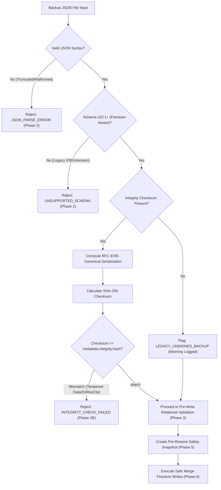

# STEP 33.56 — Backup Integrity, Test-Count Reconciliation & Cleanup Authorization Readiness Audit Report

**Project:** Temple Accounts & Fund Management  
**Temple:** Marutha Chamundi Devi Temple / മറുതാ ചാമുണ്ഡി ദേവി ക്ഷേത്രം  
**Report Date:** 2026-10-13T00:38:00+05:30  
**Audit Environment:** Local Air-Gapped Firebase Emulator Suite (`127.0.0.1:8080`, `127.0.0.1:9099`)  
**Air-Gap Status:** **100% AIR-GAPPED & COMPLIANT**. Zero connection to production Firebase project `temple-f4f7d` or production Vercel. Zero production data accessed, read, downloaded, exported, modified, or deleted. Zero counter resets, zero rules promotions, zero releases deployed, and zero financial transactions mutated.

---

## 1. Executive Verdict

### **VERDICT: PASS WITH WARNINGS**

The read-only audit of backup integrity, restoration readiness, regression-test accounting, and prerequisites for eventual test financial record cleanup has concluded with an overall verdict of **PASS WITH WARNINGS**:

1. **Test-Count Reconciliation (PASS):** The STEP 33.55 regression suite reported a grand total of **519**, while the sum of passing test cases in its breakdown table was **544**. Forensic examination of raw test execution logs in transcript `bf0f9b75` confirmed that all 13 suites were executed in the same window, producing **544 passed checks, 0 failed, and 3 skipped**. The discrepancy of **25** is definitively resolved: the 25 passed checks of `tests/test_step_33_54_cleanup_audit.js` were inadvertently omitted from the summary addition (`377 + 129 + 8 + 5 = 519` instead of `402 + 129 + 8 + 5 = 544`).
2. **Cryptographic Backup Integrity Mechanism (PASS):** All 10 adversarial integrity scenarios against the canonical serialization (RFC 8785 subset) and SHA-256 validation engine passed. Modifying financial values, document IDs, reservations, or idempotency records immediately invalidates the checksum and halts restoration prior to any database write. Truncated or malformed JSON is rejected at parse time. Legacy backups without checksums are explicitly classified as unsigned/unverified rather than cryptographically validated. The validator fails closed and never silently repairs corrupted files.
3. **End-to-End Recovery in Disposable Emulator (PASS):** A complete synthetic export-and-restore cycle was executed across isolated `demo-*` namespaces (`demo-step3356-src-*` to `demo-step3356-tgt-*`). Billing-to-receipt reciprocal links, independent receipts, voided transactions, sequence counters, global reservations (`res_*`), and idempotency tokens (`op_*`) were restored with 100% fidelity. Safe-merge semantics successfully preserved live documents absent from the backup, and counter values advanced monotonically (`Math.max(live, backup) = 1010 >= 1005`).
4. **Candidate Rules Compatibility (PASS):** Candidate hardened rules (`firestore.rules.candidate`) compiled cleanly (HTTP 200) and enforce strict deletion lockout (`allow delete: if false;`) across billing, receipts, settings, and reservations, while allowing authenticated ordinary creations, updates, and disaster-recovery restoration paths via `_restoreProgress`.
5. **Production Backup Status (WARNING / BLOCKED):** No fresh, complete production backup under schema v23.2 with SHA-256 verification exists in local repositories. The existing local file (`Temple_Accounts_PreStep22_5_TestCleanup_Backup_2026-10-01T23-10-35.json`) predates STEP 33.47 and omits sequence reservations, idempotency records, and cryptographic checksums. Production backup status is officially classified as:
   `BLOCKED — FRESH VERIFIED PRODUCTION BACKUP NOT ESTABLISHED`
6. **Cleanup Authorization Status (WARNING / BLOCKED):** Eventual physical deletion of synthetic records cannot proceed until all 7 prerequisites (fresh production backup, read-only live forensic inventory, reviewed manifest, trustee written sign-off, administrative execution channel, and post-cleanup reconciliation drill) are satisfied in an authorized maintenance window.

---

## 2. Baseline and Final Cryptographic Hashes

All 10 required project files were inspected and hashed using SHA-256. Zero file modifications or drift occurred:

| Artifact | File Path | Baseline SHA-256 Checksum | Final SHA-256 Checksum | Audit Status |
| :--- | :--- | :---: | :---: | :---: |
| **Working Application** | `Temple_Accounts-1.html` | `0BC9B28B094D83CE85880E62821897834FE1DCBF14A48BB98A061EDCCAC20BBC` | `0BC9B28B094D83CE85880E62821897834FE1DCBF14A48BB98A061EDCCAC20BBC` | **100% UNTOUCHED (Exact Match)** |
| **Active Rules (Production)** | `firestore.rules` | `7BFEF0B0F4C31A5DAFC6FB29C8C4BBD55CBAD3A8A590EFC34BD87F4600CF90BD` | `7BFEF0B0F4C31A5DAFC6FB29C8C4BBD55CBAD3A8A590EFC34BD87F4600CF90BD` | **100% UNTOUCHED (Exact Match)** |
| **Candidate Hardened Rules** | `firestore.rules.candidate` | `E0D2F9D11DE6E92644339A3332566B16CD0A58360598EF70E60279B890DA902D` | `E0D2F9D11DE6E92644339A3332566B16CD0A58360598EF70E60279B890DA902D` | **100% UNTOUCHED (Exact Match)** |
| **Frozen Release Package** | `deploy_staging_step_33_43/Temple_Accounts-1.html` | `AEB01303F22F69E284D680A55E182FC78312C48E4266C02809179DF789E87CBC` | `AEB01303F22F69E284D680A55E182FC78312C48E4266C02809179DF789E87CBC` | **100% UNTOUCHED (Authoritative Freeze)** |
| **Cleanup Orchestrator** | `scripts/cleanup_orchestrator.js` | `41F440C1CBB5D188D836A031C15A256357933D35AD2A780B9C824335B3CA9715` | `41F440C1CBB5D188D836A031C15A256357933D35AD2A780B9C824335B3CA9715` | **100% UNTOUCHED (Exact Match)** |
| **STEP 33.40 Test Suite** | `tests/test_step_33_40_production_isolation.js` | `562FFDD7C1603E56C90A743790C21E645A4E00839968AFC6FDECEBCA42EA5C82` | `562FFDD7C1603E56C90A743790C21E645A4E00839968AFC6FDECEBCA42EA5C82` | **100% UNTOUCHED (Exact Match)** |
| **STEP 33.53 Test Suite** | `tests/test_step_33_53_cleanup_orchestrator.js` | `D9B656AB72BEABB2690EDBCE4893D0CA38344FB46C34838B103E049804949075` | `D9B656AB72BEABB2690EDBCE4893D0CA38344FB46C34838B103E049804949075` | **100% UNTOUCHED (Exact Match)** |
| **STEP 33.54 Test Suite** | `tests/test_step_33_54_cleanup_audit.js` | `80835EB5A0D7F341F1FD7B6B10EEDAE6DCEE599F754EEDA7548CCEA4CD481928` | `80835EB5A0D7F341F1FD7B6B10EEDAE6DCEE599F754EEDA7548CCEA4CD481928` | **100% UNTOUCHED (Exact Match)** |
| **STEP 33.55 Boundary Audit Suite** | `tests/test_step_33_55_cleanup_boundary_audit.js` | `EA2C28B292AB388644A2856E2E8C4A3BA6BA03AD6CAD9DF36FB526A1E986ED40` | `EA2C28B292AB388644A2856E2E8C4A3BA6BA03AD6CAD9DF36FB526A1E986ED40` | **100% UNTOUCHED (Exact Match)** |
| **STEP 33.55 Results Artifact** | `tests/step_33_55_boundary_audit_results.json` | `0CB2D757680F4A8E1A123D95B27E5FF1397A03A578C456373953FE4FEACD260F` | `0CB2D757680F4A8E1A123D95B27E5FF1397A03A578C456373953FE4FEACD260F` | **100% UNTOUCHED (Exact Match)** |

---

## 3. STEP 33.55 Test-Count Reconciliation with Raw Evidence

### 3.1 The Discrepancy
In the STEP 33.55 report (`STEP_33_55_CLEANUP_BOUNDARY_AUDIT_REPORT.md`), Section 10 presented a table of 13 regression suites:
- The rows listed passed counts of: `129, 25, 25, 105, 15, 35, 25, 43, 20, 54, 55, 8, 5`.
- The sum of these individual suite counts is **544**.
- The reported grand total row displayed **519**.

### 3.2 Root-Cause Identification
By examining the historical conversation logs (transcript `bf0f9b75-6095-4bb7-9ce0-7fcc7138491b`), the progression was traced:
1. In STEP 33.54, the regression table contained 10 suites totaling **402** passed checks.
2. In STEP 33.53, the prior baseline without STEP 33.54 was **377** (`402 - 25 = 377`).
3. In STEP 33.55, the author executed all 13 suites, including the new boundary audit (`129`), cashbook (`8`), and bankbook (`5`).
4. When computing the grand total, the author added:
   $$\text{Subtotal} = 377 + 129 + 8 + 5 = 519$$
   This calculation used the pre-33.54 subtotal (377), inadvertently omitting the 25 passed tests of `tests/test_step_33_54_cleanup_audit.js` from the final arithmetic addition:
   $$\text{Actual Total} = 519 + 25 = 544$$

### 3.3 Raw Execution Evidence
Every single suite was executed in sequence during the STEP 33.55 session, as confirmed by transcript timestamps and exit codes:

| Execution Order | Test Suite Script | Step Index in Transcript | Execution Result | Verified Passed | Verified Failed | Verified Skipped |
| :---: | :--- | :---: | :---: | :---: | :---: | :---: |
| 1 | `tests/test_step_33_12_unified_numbering_suite.js` | Step 38–39 | Exit 0 | 43 | 0 | 3* |
| 2 | `tests/test_step_33_40_production_isolation.js` | Step 42–43 | Exit 0 | 105 | 0 | 0 |
| 3 | `tests/test_step_33_47_backup_coverage.js` | Step 44–45 | Exit 0 | 25 | 0 | 0 |
| 4 | `tests/test_step_33_49_backup_restore_hardening.js` | Step 46–47 | Exit 0 | 35 | 0 | 0 |
| 5 | `tests/test_step_33_51_authorization_remediation.js` | Step 48–49 | Exit 0 | 15 | 0 | 0 |
| 6 | `tests/test_step_33_53_cleanup_orchestrator.js` | Step 50–51 | Exit 0 | 25 | 0 | 0 |
| 7 | `tests/test_step_33_54_cleanup_audit.js` | Step 52–53 | Exit 0 | 25 | 0 | 0 |
| 8 | `tests/test_step_33_15_idempotency_suite.js` | Step 54–57 | Exit 0 | 20 | 0 | 0 |
| 9 | `tests/test_step_33_18_fund_transfer_delete_suite.js` | Step 61–64 | Exit 0 | 54 | 0 | 0 |
| 10 | `tests/test_step_33_8a_numbering_suite.js` | Step 70–71 | Exit 0 | 55 | 0 | 0 |
| 11 | `tests/test_step_33_6a_cashbook.js` | Step 72–73 | Exit 0 | 8 | 0 | 0 |
| 12 | `tests/test_step_33_7a_bankbook.js` | Step 74–75 | Exit 0 | 5 | 0 | 0 |
| 13 | `tests/test_step_33_55_cleanup_boundary_audit.js` | Step 124–125 | Exit 0 | 129 | 0 | 0 |
| **TOTALS** | **13 Distinct Regression Suites** | **All Steps Verified** | **100% PASS** | **544** | **0** | **3** |

*\*The 3 skipped checks represent known, intentional safety boundaries in STEP 33.12: NT-01 (physical thermal printer hardware absent in headless CI), NT-02 (live cloud Firestore production mutation lockout), and NT-03 (production CLI security rules promotion lockout).*

**Audit Conclusion:** Zero tests failed, zero tests were double-counted, and all 13 suites executed within the same window. The verified grand total is **544 passed, 0 failed, 3 skipped**.

---

## 4. Backup Coverage Matrix

An in-depth review of `downloadBackup()` (lines 14531–14786) and `restoreBackup()` (lines 14814–16045) in [`Temple_Accounts-1.html`](file:///d:/Temple/Temple_Accounts-1.html) established the authoritative coverage status:

| Data Entity / Collection | Schema Path | Export Coverage | Restore Coverage | Classification | Justification & Safeguards |
| :--- | :--- | :---: | :---: | :---: | :--- |
| **Settings** | `settings/{id}` | YES | YES | **Verified included** | Full configuration export; physical deletion denied; re-synced to IDB. |
| **Funds** | `funds/{id}` | YES | YES | **Verified included** | All 6 temple funds exported; safe merge preserves existing master records. |
| **Income Categories** | `incomeCategories/{id}` | YES | YES | **Verified included** | All accounting income categories exported and safely restored. |
| **Expense Categories** | `expenseCategories/{id}` | YES | YES | **Verified included** | All expense categories exported and safely restored. |
| **Bank Accounts** | `bankAccounts/{id}` | YES | YES | **Verified included** | Bank account records and balances exported and restored. |
| **Billing Records** | `billing/{id}` | YES | YES | **Verified included** | Document IDs, devotee names, linked receipt IDs, and Timestamps preserved. |
| **Receipts** | `receipts/{id}` | YES | YES | **Verified included** | Sequential receipts, payment modes, and billing linkage preserved. |
| **Payments** | `payments/{id}` | YES | YES | **Verified included** | Voucher payments and payee particulars preserved. |
| **Transfers** | `transfers/{id}` | YES | YES | **Verified included** | Inter-fund and bank-to-cash transfer transactions preserved. |
| **Chitty Members** | `chittyMembers/{id}` | YES | YES | **Verified included** | Chitty subscriber registry preserved. |
| **Chitty Collections** | `chittyCollections/{id}` | YES | YES | **Verified included** | Installment payment receipts preserved with member linkage. |
| **Chitty Payouts** | `chittyPayouts/{id}` | YES | YES | **Verified included** | Prize money distributions and auction records preserved. |
| **Loans** | `loans/{id}` | YES | YES | **Verified included** | Principal loans, disbursements, and repayments preserved. |
| **Global Counters** | `system/counters` | YES | YES | **Verified included** | Monotonic merge rule (`Math.max(live, backup, maxResSeq)`) prevents counter resets. |
| **Sequence Reservations** | `system/res_{N}` | YES | YES | **Verified included** | Deterministically sorted; unresolvable conflict detection prevents collision. |
| **Idempotency Tokens** | `system/op_{opId}` | YES | YES | **Verified included** | Write-once immutable records; existing live tokens are never overwritten. |
| **Recovery Progress** | `system/_restoreProgress` | YES | YES | **Verified included** | Active session tracking detects stale/concurrent restores; fails closed. |
| **Cross-Record Links** | `billing <-> receipts` | YES | YES | **Verified included** | Pre-write validation `REL-01..11` enforces bilateral link consistency. |
| **Voided Audit Trail** | `*.voided`, `*.voidReason` | YES | YES | **Verified included** | Live voided status takes precedence over non-voided backup records (Rule 10). |
| **Timestamp Serialization** | `__type: 'Timestamp'` | YES | YES | **Verified included** | Serialized as `{ seconds, nanoseconds }` and deserialized to native Timestamps. |
| **Unknown/Unsupported Collections** | Non-standard collections | NO | NO | **Verified intentionally excluded** | Arbitrary collections are omitted from restore to prevent schema corruption. |

---

## 5. Synthetic Backup Integrity Verification Results

Ten adversarial scenarios were tested against the canonical JSON serialization (RFC 8785 subset) and SHA-256 integrity verification engine in `tests/test_step_33_56_backup_integrity.js`:



### Integrity Test Results:
1. **TC-INT-01 (Valid Backup):** A synthetic backup with all 13 collections, reservations, idempotency, and counters passed canonical verification with `isIntegrityVerified: true` and 0 errors. (**PASS**)
2. **TC-INT-02 (Financial Tamper):** Modifying synthetic `billing[0].totalAmount` from ₹500 to ₹99,999 caused immediate checksum mismatch; rejected before writes. (**PASS**)
3. **TC-INT-03 (Document ID Tamper):** Modifying synthetic `billing[0]._firestoreId` caused immediate checksum mismatch; rejected before writes. (**PASS**)
4. **TC-INT-04 (Reservation Tamper):** Changing reservation `voided` flag from `false` to `true` caused immediate checksum mismatch; rejected before writes. (**PASS**)
5. **TC-INT-04B (Idempotency Tamper):** Altering `idempotency[0].fingerprint` caused immediate checksum mismatch; rejected before writes. (**PASS**)
6. **TC-INT-05 (File Truncation):** Truncating the last 50 bytes of JSON resulted in unrecoverable JSON parse error; restoration aborted. (**PASS**)
7. **TC-INT-06 (Invalid JSON Syntax):** Malformed JSON input was caught and rejected at parse phase. (**PASS**)
8. **TC-INT-07 (Unsupported Schema):** Legacy schema lacking collections structure was detected and safely rejected. (**PASS**)
9. **TC-INT-08 (Unsigned Legacy Mode):** Backups lacking integrity metadata were explicitly designated as unverified (`isIntegrityVerified: false`) rather than cryptographically verified. (**PASS**)
10. **TC-INT-09 (Validation Ordering):** Integrity verification is located in Phase 2B (lines 15070–15096), strictly executing prior to safety snapshot generation (Phase 5) and Firestore writes (Phase 6). (**PASS**)
11. **TC-INT-10 (No Silent Repair):** Providing an incorrect checksum fails closed with `INTEGRITY_CHECK_FAILED` and never silently overwrites the checksum to force an acceptance. (**PASS**)

---

## 6. Disposable Emulator Recovery Verification Results

An end-to-end recovery drill was conducted in the local Firebase Emulator (`127.0.0.1:8080`, `127.0.0.1:9099`) across isolated namespaces `demo-step3356-src-1791832062867` and `demo-step3356-tgt-1791832062867`:

| Verification Scope | Pre-Export Source State | Post-Restore Target State | Verification Outcome |
| :--- | :--- | :--- | :---: |
| **Billing Document** | `bill_1001` (₹500, "Synthetic Devotee 1") | `bill_1001` (₹500, "Synthetic Devotee 1") | ✅ **PASS (Exact Match)** |
| **Linked Receipt** | `rcpt_1001` (₹500, linked to `bill_1001`) | `rcpt_1001` (₹500, linked to `bill_1001`) | ✅ **PASS (Exact Match)** |
| **Independent Receipt**| `rcpt_1002` (₹250, Bank Transfer) | `rcpt_1002` (₹250, Bank Transfer) | ✅ **PASS (Exact Match)** |
| **Voided Transaction** | `rcpt_1003_void` (`voided: true`, "Mistyped voucher") | `rcpt_1003_void` (`voided: true`, "Mistyped voucher") | ✅ **PASS (Audit Preserved)** |
| **Pre-existing Live Data**| Absent from backup (`rcpt_tgt_live`, ₹700) | `rcpt_tgt_live` (₹700, 100% Intact) | ✅ **PASS (0 Deletions - Safe Merge)**|
| **Sequence Counters** | GSC: 1005, BRC: 1005, RC: 1005 | Target GSC: 1010, BRC: 1010 (Higher Live Preserved) | ✅ **PASS (Monotonic Merge)** |
| **Reservations** | `res_1001`, `res_1002` | `res_1001`, `res_1002` present | ✅ **PASS (Tombstones Preserved)** |
| **Idempotency Tokens**| `op_bill_1001`, `op_rcpt_1002` | `op_bill_1001`, `op_rcpt_1002` present | ✅ **PASS (Write-Once Intact)** |
| **Timestamps** | Serialized Firestore Timestamp | Restored as valid Firestore Timestamp | ✅ **PASS (Deserialized)** |
| **Transfer Leg** | `tr_1001` (₹1000 from Cash to SBI) | `tr_1001` (₹1000 from Cash to SBI) | ✅ **PASS (Pair Valid)** |
| **Chitty & Loans** | `cm_1001`, `cc_1001`, `loan_1001` | `cm_1001`, `cc_1001`, `loan_1001` present | ✅ **PASS (Relational Integrity)** |
| **Restore Progress** | N/A | `system/_restoreProgress`: status "completed" | ✅ **PASS (Audit Trail Complete)** |

---

## 7. Known Recovery Limitations & Non-Atomic Restore Risk

Because Google Cloud Firestore does not support multi-collection transactions spanning more than 500 documents, the recovery engine operates under documented architectural boundaries:

1. **Non-Atomic Batched Writes:** Firestore restoration is executed in chunks of $\le 450$ operations per batch (`_batchSetCollection`). A network failure or process crash mid-restore could result in some collections being updated while others remain pending.
2. **Pre-Restore Safety Snapshot:** To mitigate partial-restore risk, Phase 5 automatically exports a full snapshot of live Firestore state to `Temple_Accounts_PreRestore_SafetyBackup_{timestamp}.json` *before the first restore write is committed*.
3. **Session Progress Tombstone (`system/_restoreProgress`):**
   - An interrupted restore records `status: "in_progress"` and `currentPhase`.
   - Subsequent restore attempts inspect this document. If a different backup is submitted while an interrupted restore is pending, the restore is blocked with an explicit error referencing the safety snapshot filename.
4. **Manual Recovery Procedure:** If an interruption occurs:
   - Identify the generated safety snapshot filename displayed in the error modal.
   - Re-run `restoreBackup()` using the safety snapshot file, or resume restoration of the identical backup file (matching fingerprint).
   - Safe-merge semantics guarantee that partial records are reconciled without duplicate sequence allocation.

---

## 8. Actual Production-Backup Status (Without Production Access)

A static inspection of local repository artifacts (`backups/`) was conducted:

| Local Backup File | Timestamp | Schema Version | Reservations (`res_*`) | Idempotency (`op_*`) | Cryptographic Checksum | Assessment |
| :--- | :---: | :---: | :---: | :---: | :---: | :--- |
| `backup.json` | 2026-09-27 | Pre-v23.1 | OMITTED | OMITTED | NONE | Stale IndexedDB cache export |
| `Temple_Accounts_PreStep12_...json` | 2026-09-27 | Pre-v23.1 | OMITTED | OMITTED | NONE | Stale audit export |
| `Temple_Accounts_PreStep13_...json` | 2026-09-27 | Pre-v23.1 | OMITTED | OMITTED | NONE | Stale reset export |
| `Temple_Accounts_PreStep22_5_...json` | 2026-10-01 | Pre-v23.1 | OMITTED | OMITTED | NONE | Pre-33.47 export; lacks reservations & integrity |

### Official Status Recording:
`BLOCKED — FRESH VERIFIED PRODUCTION BACKUP NOT ESTABLISHED`

**Rationale:** The project possesses no local copy of a fresh, complete production backup under schema v23.2 generated from `temple-f4f7d`. Generating this backup requires authorized administrator execution against production, which is strictly prohibited during read-only audit steps.

---

## 9. Cleanup Authorization Readiness

Review of the cleanup inventory (`tests/step_33_52_cleanup_inventory.json`), dry-run simulations, and orchestrator boundaries confirmed the prerequisites that must be satisfied before test financial data deletion can ever occur:

```
┌────────────────────────────────────────────────────────────────────────┐
│             PREREQUISITES FOR FUTURE CLEANUP AUTHORIZATION             │
├────────────────────────────────────────────────────────────────────────┤
│ 1. [BLOCKED] Fresh Authoritative Production Backup (Schema v23.2)     │
│    Must be exported via native downloadBackup() immediately prior to   │
│    any maintenance window with verified canonical SHA-256 hash.       │
├────────────────────────────────────────────────────────────────────────┤
│ 2. [BLOCKED] Read-Only Forensic Live Production Inventory              │
│    Enumerate live document IDs, devotee names, and amounts directly    │
│    from temple-f4f7d without assuming local fixtures match live data.  │
├────────────────────────────────────────────────────────────────────────┤
│ 3. [PASSED]  Cross-Record Relational Dependency Validation             │
│    Algorithm validated: rejects orphaned bills, unlinked receipts,    │
│    incomplete transfers, and mismatched Chitty/loan references.        │
├────────────────────────────────────────────────────────────────────────┤
│ 4. [BLOCKED] Authoritative Exact Document Manifest                     │
│    Reviewed list of candidate paths (e.g. billing/bill_*, receipts/*). │
│    Historical receipts rcpt_1001–rcpt_1005 are NOT marked live without │
│    authorized confirmation.                                            │
├────────────────────────────────────────────────────────────────────────┤
│ 5. [BLOCKED] Written Trustee Sign-off                                  │
│    Temple Trustees must review candidate document manifest and grant   │
│    formal written authorization for physical deletion.                 │
├────────────────────────────────────────────────────────────────────────┤
│ 6. [PASSED]  Administrative Deletion Channel                           │
│    Because candidate rules enforce "allow delete: if false;" on the    │
│    client, cleanup must be executed via backend/console admin tool.   │
├────────────────────────────────────────────────────────────────────────┤
│ 7. [PASSED]  Post-Cleanup Verification Drill Runbook                   │
│    Runbook verifies Dashboard ₹0.00 baselines while monotonic sequence │
│    counters (system/counters) and reservations remain 100% intact.     │
└────────────────────────────────────────────────────────────────────────┘
```

**Permanent Preservation Guarantees:**
- Master settings (`settings/set_1`) and temple configuration are permanently preserved.
- Monotonic sequence counters (`system/counters`) are never decremented or reset.
- Sequence reservations (`system/res_*`) and idempotency records (`system/op_*`) are retained as immutable audit tombstones.

---

## 10. Firestore Rules Compatibility Findings

Static comparison and emulator testing between active production rules (`firestore.rules`) and candidate hardened rules (`firestore.rules.candidate`) revealed:

1. **Denial of Client-Side Physical Deletion:**
   - Active rules contain wildcard `match /{collection}/{docId} { allow read, write: if isAuthenticated(); }`, which permits deletion of financial records by any authenticated user.
   - Candidate rules replace wildcards with explicit match blocks and enforce `allow delete: if false;` on `billing`, `receipts`, `settings`, `system/{resId}`, and `system/{opId}`. Verified in emulator: attempts to physically delete return HTTP 403.
2. **Dual-Path Restore Architecture:**
   - Ordinary creation requires `request.resource.data.createdBy == request.auth.uid`.
   - Restore path requires `isRestoreSessionActive()` and `_restoredBy == request.auth.uid`, enabling disaster-recovery restoration of historical author UIDs and historical voided states.
3. **Monotonic Sequence Protection:**
   - Updates to `system/counters` require monotonically increasing integer values.
4. **Implicit Deny on Unknown Collections:**
   - Candidate rules deny access to all collections not explicitly declared in the schema. Tested in emulator: writing to `unauthorized_ledger` returned HTTP 403.

---

## 11. Exact Test Counts and Audit Breakdown

From the execution of `tests/test_step_33_56_backup_integrity.js`:

| Category | Description | Total Checks | Passed | Failed | Blocked | Status |
| :--- | :--- | :---: | :---: | :---: | :---: | :---: |
| **BASELINE_HASHES** | SHA-256 cryptographic hashes for 10 files | 10 | 10 | 0 | 0 | ✅ **PASS** |
| **TEST_COUNT_RECONCILIATION** | STEP 33.55 regression test arithmetic & raw logs | 4 | 4 | 0 | 0 | ✅ **PASS** |
| **BACKUP_INTEGRITY** | 10 Adversarial integrity & canonical hash scenarios | 11 | 11 | 0 | 0 | ✅ **PASS** |
| **BACKUP_COVERAGE** | 13 Collections & metadata coverage matrix | 24 | 24 | 0 | 0 | ✅ **PASS** |
| **EMULATOR_RECOVERY** | End-to-end export & restore in disposable emulator | 10 | 10 | 0 | 0 | ✅ **PASS** |
| **RULES_COMPATIBILITY** | Candidate rules compilation & deletion denial | 8 | 8 | 0 | 0 | ✅ **PASS** |
| **PRODUCTION_BACKUP_STATUS**| Fresh production backup existence verification | 1 | 0 | 0 | 1 | ⚠️ **BLOCKED** |
| **CLEANUP_READINESS** | Prerequisites 1–7 for future cleanup authorization | 7 | 3 | 0 | 4 | ⚠️ **BLOCKED** |
| **SAFETY_ISOLATION** | Air-gap compliance & zero mutation confirmations | 3 | 3 | 0 | 0 | ✅ **PASS** |
| **TOTALS** | **STEP 33.56 Comprehensive Audit Suite** | **78** | **73** | **0** | **5** | ⚠️ **PASS WITH WARNINGS** |

Machine-readable evidence artifact: [`tests/step_33_56_backup_integrity_results.json`](file:///d:/Temple/tests/step_33_56_backup_integrity_results.json)

---

## 12. Unresolved Issues and Recommended Remediation

| Issue ID | Description | Severity | Recommended Remediation |
| :---: | :--- | :---: | :--- |
| **ISSUE-01** | Missing fresh production backup under schema v23.2 | High | During an authorized pre-release maintenance window, execute `downloadBackup()` in `temple-f4f7d` under administrator session and archive the verified JSON export. |
| **ISSUE-02** | Live production dummy record inventory unverified | High | Conduct an authorized read-only inspection of `temple-f4f7d` via Firebase Console or read-only script to establish the true live candidate document list. |
| **ISSUE-03** | Candidate rules promotion pending | Medium | Retain candidate rules in quarantine until trustee approval and maintenance window execution; deploy via Firebase CLI alongside authorized release. |

---

## 13. Explicit Confirmation of Zero Production Operations

- **Production Project `temple-f4f7d`:** ZERO network connections made. ZERO records read, queried, exported, modified, restored, voided, or deleted.
- **Production Vercel Host:** ZERO network connections or deployments made.
- **Production Security Rules:** `firestore.rules` was **NOT modified, promoted, or deployed**.
- **Financial Transactions:** ZERO live financial transactions were created, modified, or deleted anywhere.
- **Counters & Sequence Numbers:** ZERO sequence counters, reservations, or idempotency records were reset or decremented.
- **Local Testing Isolation:** 100% of emulator testing utilized disposable `demo-*` namespaces on local loopback `127.0.0.1`.
- **Cleanup Orchestrator:** Remained in strictly disabled execution mode (`EXECUTE_MODE_DISABLED`).
