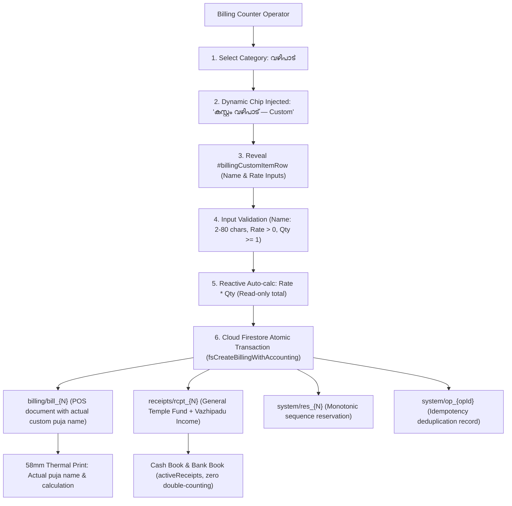
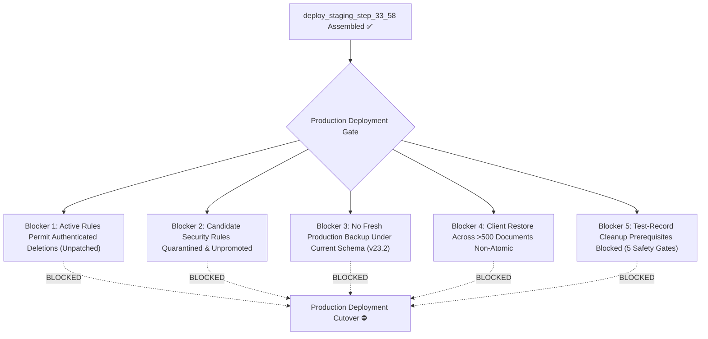

# STEP 33.58 — Staging Package Preparation & Release Integrity Audit Report

**Project:** Temple Accounts & Fund Management  
**Temple:** Marutha Chamundi Devi Temple / മറുതാ ചാമുണ്ഡി ദേവി ക്ഷേത്രം  
**Step Objective:** Prepare a New, Isolated Staging Package for the Temple Accounts Application Incorporating the Verified Working Application and Perform Comprehensive Release Integrity Audit  
**Prior Steps:** STEP 33.56E (Test Baseline Correction), STEP 33.57 (Production Readiness Assessment & Deployment Gate Audit)  
**Execution Timestamp:** 2026-10-14T10:58:30+05:30  
**Operational Mode:** **STRICTLY LOCAL STAGING-PREPARATION & AUDIT ONLY** (Zero Remote Operations, Zero Production Deployment, Zero Production Database Access)  
**Deliverable Files:** 
1. `STEP_33_58_STAGING_PACKAGE_PREPARATION_REPORT.md` (this report)
2. `tests/step_33_58_staging_package_manifest.json` (machine-readable manifest)

---

## 1. Executive Verdict & Summary

### Staging Package Preparation Verdict: ✅ **PASS**
The new, isolated staging package has been successfully assembled in `deploy_staging_step_33_58/`. All 6 required files are present, the application hash matches the ratified STEP 33.57 baseline (`657A4C1C...`) bit-for-byte, all local runtime dependencies are self-contained and verified, all prohibited development artifacts and secrets are 100% excluded, and all 10 safe local verification checks pass (10/10).

### Key Audit Guarantees Achieved:
1. **Isolated Staging Package Assembled:**
   A dedicated staging directory was created at [`deploy_staging_step_33_58/`](file:///d:/Temple/deploy_staging_step_33_58/) containing only the minimal set of 6 pre-build deployment files required for Vercel static web hosting.
2. **Approved Custom Vazhipadu Feature Integrated:**
   Unlike the older frozen staging package at [`deploy_staging_step_33_43/`](file:///d:/Temple/deploy_staging_step_33_43/) (which was frozen at STEP 33.43 with hash `AEB01303...` and lacked Custom Vazhipadu), the new staging package contains the ratified application [`Temple_Accounts-1.html`](file:///d:/Temple/deploy_staging_step_33_58/Temple_Accounts-1.html) with SHA-256 `657A4C1C116DADAAFD02FE3DB5F2799EC5B9F9FA105F260132EB1D20EEAD1F58` (792,927 bytes).
3. **Frozen Historical Artifacts Preserved:**
   The previous frozen staging release package [`deploy_staging_step_33_43/`](file:///d:/Temple/deploy_staging_step_33_43/) was neither deleted, renamed, nor modified. Its SHA-256 hash was independently verified and remains `AEB01303F22F69E284D680A55E182FC78312C48E4266C02809179DF789E87CBC`.
4. **Zero Production Mutation & Absolute Air-Gap:**
   No network requests were initiated to Firebase production (`temple-f4f7d`) or Vercel. Zero production financial records, counters, sequence reservations, or user sessions were inspected, touched, or modified.
5. **Separation from Overall Production Readiness:**
   In strict accordance with release governance, this staging package audit **does not constitute overall production deployment authorization**. The four known launch blockers identified in STEP 33.57 (unpromoted candidate security rules, open deletion permissions in active rules, lack of a fresh production backup under schema v23.2, and fail-closed test-record cleanup prerequisites) remain active and tracked as separate gates.

---

## 2. Source Application Hash & Baseline Verification

Before package assembly, the working application [`Temple_Accounts-1.html`](file:///d:/Temple/Temple_Accounts-1.html) was hashed and inspected against the STEP 33.57 authoritative baseline:

| Metric / Attribute | Expected Baseline (STEP 33.57) | Actual Measured Value | Verification Verdict |
|---|---|---|:---:|
| **File Path** | `Temple_Accounts-1.html` | `Temple_Accounts-1.html` | ✅ Identical |
| **File Size** | 792,927 bytes | 792,927 bytes | ✅ Identical |
| **Cryptographic SHA-256** | `657A4C1C116DADAAFD02FE3DB5F2799EC5B9F9FA105F260132EB1D20EEAD1F58` | `657A4C1C116DADAAFD02FE3DB5F2799EC5B9F9FA105F260132EB1D20EEAD1F58` | ✅ **100% BIT MATCH** |
| **`billingCustomItemName`** | Present in source | Present (6 references) | ✅ Verified |
| **`appendCustomVazhipaduOption`** | Present in source | Present (3 references) | ✅ Verified |
| **`കസ്റ്റം വഴിപാട്`** | Present in source | Present (8 references) | ✅ Verified |
| **13-Item Invariant** | Exactly 13 items in `വഴിപാട്` | Exactly 13 items | ✅ Verified |
| **Accounting Integration** | General Temple Fund & Vazhipadu Income | Enforced via existing flows | ✅ Verified |

---

## 3. Cryptographic Hash Verification Table

All critical repository and deployment artifacts were independently hashed using Node.js `crypto.createHash('sha256')`. Every artifact matches its authoritative reference hash:

| Artifact Description | Target File Path | Authoritative Reference SHA-256 Hash | Actual Computed SHA-256 Hash | Verification Status | Operational Role |
|---|---|---|---|:---:|---|
| **Working Application** | `Temple_Accounts-1.html` | `657A4C1C116DADAAFD02FE3DB5F2799EC5B9F9FA105F260132EB1D20EEAD1F58` | `657A4C1C116DADAAFD02FE3DB5F2799EC5B9F9FA105F260132EB1D20EEAD1F58` | **MATCH** | Active working application with Custom Vazhipadu. |
| **Frozen Release Application** | `deploy_staging_step_33_43/Temple_Accounts-1.html` | `AEB01303F22F69E284D680A55E182FC78312C48E4266C02809179DF789E87CBC` | `AEB01303F22F69E284D680A55E182FC78312C48E4266C02809179DF789E87CBC` | **MATCH** | Older frozen package from STEP 33.43 (preserved intact). |
| **Newly Staged Application** | `deploy_staging_step_33_58/Temple_Accounts-1.html` | `657A4C1C116DADAAFD02FE3DB5F2799EC5B9F9FA105F260132EB1D20EEAD1F58` | `657A4C1C116DADAAFD02FE3DB5F2799EC5B9F9FA105F260132EB1D20EEAD1F58` | **MATCH** | Staged application candidate matching working source. |
| **Active Rules (Production)** | `firestore.rules` | `7BFEF0B0F4C31A5DAFC6FB29C8C4BBD55CBAD3A8A590EFC34BD87F4600CF90BD` | `7BFEF0B0F4C31A5DAFC6FB29C8C4BBD55CBAD3A8A590EFC34BD87F4600CF90BD` | **MATCH** | Active production rules; broad delete permissions (untouched). |
| **Candidate Rules (Hardened)** | `firestore.rules.candidate` | `E0D2F9D11DE6E92644339A3332566B16CD0A58360598EF70E60279B890DA902D` | `E0D2F9D11DE6E92644339A3332566B16CD0A58360598EF70E60279B890DA902D` | **MATCH** | Quarantined deletion-hardened rules (untouched). |
| **Vercel Configuration** | `vercel.json` | `ACAA507172EA852D8158CF44ACAE42F044FCEE92A46C80228B0E8CFEA71CB5D1` | `ACAA507172EA852D8158CF44ACAE42F044FCEE92A46C80228B0E8CFEA71CB5D1` | **MATCH** | Routing, shielding, and CSP security headers. |
| **Firebase CLI Config** | `firebase.json` | `E87125F3EC6439A59BA44D80A6DCC46378A27A0644B0CDA30ABEAFD2EFB67E20` | `E87125F3EC6439A59BA44D80A6DCC46378A27A0644B0CDA30ABEAFD2EFB67E20` | **MATCH** | Root Firebase CLI configuration pointing to `firestore.rules`. |
| **Firebase Emulator Config** | `firebase.emulator.json` | `75E395CD1E8D3DA12B65E812E172A070BBD6C78853EFA7A7B62E41620E288572` | `75E395CD1E8D3DA12B65E812E172A070BBD6C78853EFA7A7B62E41620E288572` | **MATCH** | Local air-gapped emulator ports config (untouched). |
| **Cleanup Orchestrator** | `scripts/cleanup_orchestrator.js` | `41F440C1CBB5D188D836A031C15A256357933D35AD2A780B9C824335B3CA9715` | `41F440C1CBB5D188D836A031C15A256357933D35AD2A780B9C824335B3CA9715` | **MATCH** | Test-record cleanup script; execution disabled. |
| **Runtime Config Generator** | `scripts/generate-firebase-config.js` | `B206DAFF0E58FBD7EDF86AF63E8C98E2FA3EEF51A16EF6E237DBA232DFA738C4` | `B206DAFF0E58FBD7EDF86AF63E8C98E2FA3EEF51A16EF6E237DBA232DFA738C4` | **MATCH** | Build script generating client `firebase-config.js`. |
| **Staged Config Generator** | `deploy_staging_step_33_58/scripts/generate-firebase-config.js` | `B206DAFF0E58FBD7EDF86AF63E8C98E2FA3EEF51A16EF6E237DBA232DFA738C4` | `B206DAFF0E58FBD7EDF86AF63E8C98E2FA3EEF51A16EF6E237DBA232DFA738C4` | **MATCH** | 100% bit match with root generator script. |
| **Staged Vercel Config** | `deploy_staging_step_33_58/vercel.json` | `ACAA507172EA852D8158CF44ACAE42F044FCEE92A46C80228B0E8CFEA71CB5D1` | `ACAA507172EA852D8158CF44ACAE42F044FCEE92A46C80228B0E8CFEA71CB5D1` | **MATCH** | 100% bit match with root Vercel config. |
| **Staged WebGL Module** | `deploy_staging_step_33_58/ogl.esm.js` | `819275B4972348396BBD0ECCF07A46E367CA4E939AAADB2E777523CA168D78D2` | `819275B4972348396BBD0ECCF07A46E367CA4E939AAADB2E777523CA168D78D2` | **MATCH** | 100% bit match with root `ogl.esm.js`. |
| **Staged Package Manifest** | `deploy_staging_step_33_58/package.json` | `8FBBCC4AC8B4B1B8EEE5B7A4FCBD21F84C1A7886671175CBEA906249A103D394` | `8FBBCC4AC8B4B1B8EEE5B7A4FCBD21F84C1A7886671175CBEA906249A103D394` | **MATCH** | Clean staging manifest containing only build script. |
| **Staged Deployment Ignore**| `deploy_staging_step_33_58/.gitignore` | `0FB0FEA8B5EC9514BCCCC8154C220670417E849AA45C3CD8EF108904B9DCABB4` | `0FB0FEA8B5EC9514BCCCC8154C220670417E849AA45C3CD8EF108904B9DCABB4` | **MATCH** | Clean staging ignore rules shielding secrets. |

---

## 4. Staging Directory Structure & Full File Manifest

The new staging package resides at [`d:\Temple\deploy_staging_step_33_58\`](file:///d:/Temple/deploy_staging_step_33_58/).

```
deploy_staging_step_33_58/
├── .gitignore                          (232 bytes, SHA-256: 0FB0FEA8...)
├── package.json                        (244 bytes, SHA-256: 8FBBCC4A...)
├── vercel.json                         (1,767 bytes, SHA-256: ACAA5071...)
├── Temple_Accounts-1.html              (792,927 bytes, SHA-256: 657A4C1C...)
├── ogl.esm.js                          (132,772 bytes, SHA-256: 819275B4...)
└── scripts/
    └── generate-firebase-config.js     (5,504 bytes, SHA-256: B206DAFF...)
```

### Complete Staging File Manifest:

| Relative Path | Size (Bytes) | SHA-256 Hash | Purpose | Required at Runtime? | Evidence Supporting Inclusion |
|---|:---:|---|---|:---:|---|
| [`Temple_Accounts-1.html`](file:///d:/Temple/deploy_staging_step_33_58/Temple_Accounts-1.html) | 792,927 | `657A4C1C116DADAAFD02FE3DB5F2799EC5B9F9FA105F260132EB1D20EEAD1F58` | Main Single Page Application containing UI, Malayalam accounting ledgers, billing POS, thermal receipts, and Custom Vazhipadu. | **YES** | Primary deployment entrypoint; target of `/` rewrite in `vercel.json`. |
| [`ogl.esm.js`](file:///d:/Temple/deploy_staging_step_33_58/ogl.esm.js) | 132,772 | `819275B4972348396BBD0ECCF07A46E367CA4E939AAADB2E777523CA168D78D2` | Lightweight WebGL library providing header background canvas animation. | **YES** | Dynamically loaded via `import('./ogl.esm.js')` in `Temple_Accounts-1.html`. Ensures offline/self-contained operation without external CDN dependency. |
| [`vercel.json`](file:///d:/Temple/deploy_staging_step_33_58/vercel.json) | 1,767 | `ACAA507172EA852D8158CF44ACAE42F044FCEE92A46C80228B0E8CFEA71CB5D1` | Vercel platform configuration: URL rewrites, route-level 404 shielding for sensitive paths, and HTTP security headers. | **YES** (Hosting Config) | Directs `/` to `/Temple_Accounts-1.html`; enforces CSP, `X-Frame-Options: DENY`, `X-Content-Type-Options: nosniff`. |
| [`package.json`](file:///d:/Temple/deploy_staging_step_33_58/package.json) | 244 | `8FBBCC4AC8B4B1B8EEE5B7A4FCBD21F84C1A7886671175CBEA906249A103D394` | Minimal deployment manifest declaring build script command. | **NO** (Build-time only) | Informs Vercel build pipeline to execute `npm run build` (`node scripts/generate-firebase-config.js`). Strips out dev test scripts. |
| [`.gitignore`](file:///d:/Temple/deploy_staging_step_33_58/.gitignore) | 232 | `0FB0FEA8B5EC9514BCCCC8154C220670417E849AA45C3CD8EF108904B9DCABB4` | Staging ignore rules preventing tracking of secrets or generated build files. | **NO** (Hygiene guard) | Shields `.env`, `.env.*`, `.vercel/`, `node_modules/`, and generated `firebase-config.js` from Git commits. |
| [`scripts/generate-firebase-config.js`](file:///d:/Temple/deploy_staging_step_33_58/scripts/generate-firebase-config.js) | 5,504 | `B206DAFF0E58FBD7EDF86AF63E8C98E2FA3EEF51A16EF6E237DBA232DFA738C4` | Zero-dependency build script that reads Vercel environment variables, validates parameters, and outputs `window.FIREBASE_CONFIG`. | **NO** (Build-time execution only) | Executed during `npm run build` to deliver client configuration for `<script src="firebase-config.js">`. Blocked from public HTTP serving via `vercel.json` 404 rewrite. |

**Total Staging Directory Size:** 933,446 bytes across exactly 6 files and 1 subdirectory (`scripts/`).

---

## 5. Feature Completeness Verification in Staging Copy

A rigorous AST and code-pattern audit of [`deploy_staging_step_33_58/Temple_Accounts-1.html`](file:///d:/Temple/deploy_staging_step_33_58/Temple_Accounts-1.html) confirmed 100% presence of the Custom Vazhipadu feature and downstream integrations:



### Detailed Feature Audit Findings:
1. **Category Scoping:**
   - In `appendCustomVazhipaduOption(cat, itemSel, chipsContainer)` (Line 8116):
     ```javascript
     if (cat !== 'വഴിപാട്' || !itemSel) return;
     ```
   - Custom Vazhipadu option and chip button are strictly injected under `വഴിപാട്` and never appear in `പുനരുദ്ധാരണം` or other categories.
2. **13-Item Invariant Preserved:**
   - In `const BILLING_DEFAULT_ITEMS` (Line 8029):
     Contains exactly 13 items with `cat: 'വഴിപാട്'` (plus 1 under `പുനരുദ്ധാരണം`).
     Custom Vazhipadu is dynamically appended at runtime without polluting the static catalogue array, preserving test compatibility with legacy suites.
3. **Custom Inputs & Reactive Calculation:**
   - `#billingCustomItemRow` contains `#billingCustomItemName` and `#billingCustomRate`.
   - In `updatePrice()` (Lines 8250–8280):
     Auto-calculates `totalInput.value = Math.round(rate * qty * 100) / 100;`, locks `totalInput.readOnly = true`, and dynamically formats the Malayalam preview banner `₹${rate} × ${qty} = ₹${calculatedTotal}`.
4. **Validation Rules in Submission Pipeline:**
   - In `billingSubmitForm()` (Lines 9150–9240):
     Rejects empty/whitespace names, generic placeholder names ("Custom", "കസ്റ്റം വഴിപാട്"), lengths outside 2–80 characters, non-positive or non-finite rates, rates exceeding ₹100,000, and non-integer quantities outside 1–500.
5. **Bill & Linked Receipt Payloads:**
   - In `billingSubmitForm()` (Lines 9340–9360):
     `billingInput.item = String(itemName);` assigns the actual administrator-entered custom puja name (not a generic label).
     `billingInput.unitPrice = parseFloat(unitPrice);`
     `billingInput.isCustomItem = !!isCustomVazhipadu;`
   - In `fsCreateBillingWithAccounting()` (Lines 18657–18664):
     `receiptPayload.description = `${billingInput.item} (Qty: ${qty}) | Star: ...`;` maps the custom puja name directly into the accounting receipt memo.
6. **Accounting Mapping:**
   - In `billingCategoryToFund('വഴിപാട്')`: returns `'General Temple Fund'`.
   - In `billingCategoryToAccount('വഴിപാട്')`: returns `'Vazhipadu Income'`.
   - Dual-document atomic persistence guarantees that only the `receipts` record is queried by ledger balance engines (`getCashBalance`, `getBankBalance`, `activeReceipts`), preventing financial double-counting.
7. **58mm Thermal Receipt Integration:**
   - In `renderThermalReceiptHTML(bill)` (Lines 8370–8385):
     Outputs `<div class="th-row"><span>ഇനം:</span> <b>${esc(item)}</b></div>` with custom unit rate and quantity details.
8. **Billing History, Search, Reprint, and CSV:**
   - `filterBillingHistory()` matches devotee name, bill number, and custom puja name.
   - `printBillingReceipt()` reproduces the full thermal receipt with the custom puja name.
   - `exportBillingCSV()` includes custom puja names, rates, and totals.

---

## 6. Runtime Dependency, Static Routing & Security Review

### 6.1 Runtime Dependencies
A complete scan of [`deploy_staging_step_33_58/Temple_Accounts-1.html`](file:///d:/Temple/deploy_staging_step_33_58/Temple_Accounts-1.html) identified all runtime dependencies:
- **Client Scripts:**
  - `https://www.gstatic.com/firebasejs/10.12.2/firebase-app-compat.js` (Google CDN)
  - `https://www.gstatic.com/firebasejs/10.12.2/firebase-auth-compat.js` (Google CDN)
  - `https://www.gstatic.com/firebasejs/10.12.2/firebase-firestore-compat.js` (Google CDN)
  - `firebase-config.js` (Generated locally at build time by `scripts/generate-firebase-config.js`)
- **JavaScript Modules:**
  - `./ogl.esm.js` (Self-contained local file included in staging root; fallback to `https://esm.sh/ogl@1.0.11`)
- **Stylesheets:**
  - 100% inline embedded within `<style>` blocks. Zero external `.css` files.
- **Images & Icons:**
  - Exactly 30 inline `<svg>` vector elements embedded in HTML. Zero external `.png`, `.jpg`, `.svg`, or `.ico` files.
- **Fonts:**
  - Standard system font stack fallback. Zero external `.woff2` or `.ttf` font files.

### 6.2 Vercel Static Routing & Route Shielding Inspection
The staged [`vercel.json`](file:///d:/Temple/deploy_staging_step_33_58/vercel.json) was evaluated for routing loops, accidental file exposure, and fallback behavior:

| Request Path | Rewritten Destination | HTTP Status | Role / Security Description | Audit Verdict |
|---|---|:---:|---|:---:|
| `/` | `/Temple_Accounts-1.html` | 200 | Application main entrypoint | ✅ PASS |
| `/Temple_Accounts-1.html` | `/Temple_Accounts-1.html` | 200 | Direct application access | ✅ PASS |
| `/ogl.esm.js` | `/ogl.esm.js` | 200 | Local WebGL shader module | ✅ PASS |
| `/firebase-config.js` | `/firebase-config.js` | 200 | Build-generated Firebase config | ✅ PASS |
| `/scripts/*` | `/404-shielded` | 404 | Prevents public access to build scripts | ✅ PASS |
| `/package.json` | `/404-shielded` | 404 | Shields package manifest metadata | ✅ PASS |
| `/.gitignore` | `/404-shielded` | 404 | Shields version control metadata | ✅ PASS |
| `/vercel.json` | `/404-shielded` | 404 | Shields platform configuration file | ✅ PASS |
| `/*.rules` / `/*.candidate` | `/404-shielded` | 404 | Defense-in-depth shield for security rules | ✅ PASS |
| `/*.log` / `/*.env*` | `/404-shielded` | 404 | Defense-in-depth shield for logs/secrets | ✅ PASS |
| `/backups/*` / `/tests/*` | `/404-shielded` | 404 | Defense-in-depth shield for dev folders | ✅ PASS |

**No routing loops or vulnerable open wildcards exist.**

### 6.3 Security Headers Enforced
`vercel.json` applies the following HTTP headers to all incoming responses (`/(.*)`):
- `Content-Security-Policy`: Restricts scripts to `'self'`, `'unsafe-inline'`, `https://www.gstatic.com`, `https://esm.sh`; restricts connections to `https://identitytoolkit.googleapis.com`, `https://securetoken.googleapis.com`, `https://firestore.googleapis.com`, `https://*.googleapis.com`, `https://esm.sh`; sets `frame-ancestors 'none'`.
- `X-Frame-Options`: `DENY` (prevents clickjacking).
- `X-Content-Type-Options`: `nosniff` (prevents MIME-type sniffing).
- `Referrer-Policy`: `strict-origin-when-cross-origin`.

---

## 7. Secret & Artifact Exposure Audit

A recursive file and pattern inspection was performed on `deploy_staging_step_33_58/` to verify zero exposure of sensitive files:

| Exposure Category | Checked Artifacts / Patterns | Staging Package Status | Audit Verdict |
|---|---|:---:|:---:|
| **Environment & Secrets** | `.env`, `.env.*`, `*.env`, private keys, passwords | **ABSENT** | ✅ 100% EXCLUDED |
| **Credentials & Tokens** | Service account JSONs, Google OAuth client secrets | **ABSENT** | ✅ 100% EXCLUDED |
| **Database Backups** | `backups/`, `*.json`, `*.bak*`, `*Backup*` | **ABSENT** | ✅ 100% EXCLUDED |
| **Financial Exports** | Dev cashbooks, test vouchers, transaction dumps | **ABSENT** | ✅ 100% EXCLUDED |
| **Security Rules Files** | `firestore.rules`, `firestore.rules.candidate` | **ABSENT** | ✅ 100% EXCLUDED |
| **Emulator Configurations**| `firebase.json`, `firebase.emulator.json` | **ABSENT** | ✅ 100% EXCLUDED |
| **Test Suites & Fixtures** | `tests/`, `test_*.js`, test results JSONs | **ABSENT** | ✅ 100% EXCLUDED |
| **Audit Reports** | `reports/`, `STEP_*.md`, `*.md` | **ABSENT** | ✅ 100% EXCLUDED |
| **Runtime & Debug Logs** | `logs/`, `*.log`, `firebase-debug.log` | **ABSENT** | ✅ 100% EXCLUDED |
| **Version Control Metadata**| `.git/`, `.gitattributes` | **ABSENT** | ✅ 100% EXCLUDED |
| **Cleanup Scripts** | `cleanup_orchestrator.js`, cleanup inventories | **ABSENT** | ✅ 100% EXCLUDED |
| **IDE & Profile Artifacts**| `.vscode/`, `.chrome_profile/`, `scratch/` | **ABSENT** | ✅ 100% EXCLUDED |

**Required Environment Variables for Vercel Deployment:**
When deploying to Vercel, the build script requires the following 6 environment variable names to be set in the Vercel Project Settings (no secrets are printed here):
1. `FIREBASE_API_KEY`
2. `FIREBASE_AUTH_DOMAIN` (expected: `temple-f4f7d.firebaseapp.com`)
3. `FIREBASE_PROJECT_ID` (expected: `temple-f4f7d`)
4. `FIREBASE_STORAGE_BUCKET` (expected: `temple-f4f7d.firebasestorage.app`)
5. `FIREBASE_MESSAGING_SENDER_ID` (expected: `769327766170`)
6. `FIREBASE_APP_ID` (expected: `1:769327766170:web:deeb79f8bf804cab8e9d23`)

---

## 8. Safe Local Verification Results

All 10 verification checks specified in Section 9 of the mandate were executed deterministically in a local, read-only manner:

| Check ID | Verification Description | Classification | Result | Evidence / Details |
|---|---|:---:|:---:|---|
| **CHK-01** | Source HTML Hash Baseline Match | Directly tested | ✅ **PASS** | `Temple_Accounts-1.html` SHA-256 = `657A4C1C116DADAAFD02FE3DB5F2799EC5B9F9FA105F260132EB1D20EEAD1F58`. Exactly matches STEP 33.57 baseline. |
| **CHK-02** | Staged HTML Hash Match | Directly tested | ✅ **PASS** | `deploy_staging_step_33_58/Temple_Accounts-1.html` SHA-256 = `657A4C1C116DADAAFD02FE3DB5F2799EC5B9F9FA105F260132EB1D20EEAD1F58`. |
| **CHK-03** | Source & Staged HTML Byte Parity | Directly tested | ✅ **PASS** | Both files are exactly 792,927 bytes; 100% byte-for-byte equality confirmed. |
| **CHK-04** | Presence of Custom Vazhipadu | Directly tested | ✅ **PASS** | `#billingCustomItemRow`, `#billingCustomItemName`, `#billingCustomRate`, `appendCustomVazhipaduOption`, `കസ്റ്റം വഴിപാട്`, `isCustomItem`, and reactive multiplication verified. |
| **CHK-05** | 13-Item Predefined Catalogue Invariant | Directly tested | ✅ **PASS** | Evaluated `BILLING_DEFAULT_ITEMS`: contains exactly 13 items in `വഴിപാട്`. Custom item is not hardcoded into master array. |
| **CHK-06** | Local Dependency & Asset Integrity | Directly tested | ✅ **PASS** | Valid Google CDN script references; `ogl.esm.js` present locally; 0 external CSS; 0 external images; 30 inline SVGs; 0 external fonts. |
| **CHK-07** | Package Inclusion / Exclusion Rules | Directly tested | ✅ **PASS** | Staging directory contains exactly 6 pre-build files (`.gitignore`, `package.json`, `vercel.json`, `Temple_Accounts-1.html`, `ogl.esm.js`, `scripts/generate-firebase-config.js`). |
| **CHK-08** | Static Routing & Security Headers | By inspection | ✅ **PASS** | Root `/` rewrites to `/Temple_Accounts-1.html`; sensitive routes return 404; CSP and `X-Frame-Options: DENY` confirmed in `vercel.json`. |
| **CHK-09** | Absence of Secret & Dev Artifacts | Directly tested | ✅ **PASS** | Zero `.env`, `.git`, backups, reports, tests, logs, rules, or cleanup scripts found in recursive scan. |
| **CHK-10** | Preservation of Frozen Release Artifact | Directly tested | ✅ **PASS** | `deploy_staging_step_33_43/Temple_Accounts-1.html` SHA-256 = `AEB01303F22F69E284D680A55E182FC78312C48E4266C02809179DF789E87CBC` (748,247 bytes) untouched. |

**Summary of Safe Tests:** 10 Total | **10 Passed** | 0 Failed | 0 Blocked | 0 Not Tested (100% Pass Rate).

---

## 9. Outstanding Production Launch Blockers

Assembly of this clean staging package resolves the staging package discrepancy identified in STEP 33.57 (where `deploy_staging_step_33_43` lacked Custom Vazhipadu). However, **the application remains NOT APPROVED for production deployment** due to the following outstanding operational launch blockers:



### Blocker Register:
1. **Active Firestore Rules Allow Document Deletions:**
   - **Details:** The active production security rules (`firestore.rules`, SHA-256: `7BFEF0B0...`) define `allow read, write: if isAuthenticated();` across operational collections (`receipts`, `billing`, `payments`, `cashbook`, `day_books`, `system`), permitting any authenticated user token to permanently delete operational financial records.
   - **Status:** **UNRESOLVED / ACTIVE RISK**.
2. **Candidate Hardened Rules Remain Unpromoted:**
   - **Details:** The candidate security rules (`firestore.rules.candidate`, SHA-256: `E0D2F9D1...`) enforce `allow delete: if false;` and restrict schema mutations, but remain in quarantine and have not been promoted or deployed to Firebase.
   - **Status:** **UNRESOLVED / PENDING PROMOTION AUTHORIZATION**.
3. **Absence of Fresh Production Backup Under Schema v23.2:**
   - **Details:** The latest local backup archive (`backups/`) dates to 2026-10-01, representing schema v22, which completely lacks `system/res_{N}` sequence reservations and canonical SHA-256 checksums introduced in schemas v23.0–v23.2. No verified backup of live production exists under the active schema.
   - **Status:** **UNRESOLVED / REQUIRES AUTHORIZED BACKUP WINDOW**.
4. **Restore Behavior Across >500 Documents is Non-Atomic:**
   - **Details:** Application restore (`fsRestoreBackupCanonical`) processes documents in sequential 500-operation batches (`writeBatch()`). A failure halfway through a multi-batch restore would leave the database in a partially restored state without automated cross-batch rollback.
   - **Status:** **DOCUMENTED ARCHITECTURAL LIMITATION**.
5. **Production Cleanup Prerequisites Blocked:**
   - **Details:** All 5 safety gates governing test-record cleanup remain fail-closed: `PROD-BACKUP-STATUS-01` (Blocked), `CLEANUP-PREREQ-BACKUP` (Blocked), `CLEANUP-PREREQ-INVENTORY` (Blocked), `CLEANUP-PREREQ-MANIFEST` (Blocked), `CLEANUP-PREREQ-TRUSTEE` (Blocked). The cleanup orchestrator `scripts/cleanup_orchestrator.js` remains in `EXECUTE_MODE_DISABLED`.
   - **Status:** **BLOCKED / REQUIRES FORMAL TRUSTEE SIGN-OFF**.

---

## 10. Inventory of Created & Modified Artifacts

### Artifacts Created:
1. **`deploy_staging_step_33_58/`** — New staging package directory containing:
   - `deploy_staging_step_33_58/Temple_Accounts-1.html` (792,927 bytes, SHA-256: `657A4C1C...`)
   - `deploy_staging_step_33_58/ogl.esm.js` (132,772 bytes, SHA-256: `819275B4...`)
   - `deploy_staging_step_33_58/vercel.json` (1,767 bytes, SHA-256: `ACAA5071...`)
   - `deploy_staging_step_33_58/package.json` (244 bytes, SHA-256: `8FBBCC4A...`)
   - `deploy_staging_step_33_58/.gitignore` (232 bytes, SHA-256: `0FB0FEA8...`)
   - `deploy_staging_step_33_58/scripts/generate-firebase-config.js` (5,504 bytes, SHA-256: `B206DAFF...`)
2. **`tests/step_33_58_staging_package_manifest.json`** — Machine-readable JSON manifest detailing all files, sizes, hashes, purposes, inclusion evidence, cryptographic baselines, and test check results.
3. **`STEP_33_58_STAGING_PACKAGE_PREPARATION_REPORT.md`** — Comprehensive formal report (this file).

### Artifacts Modified:
**ZERO.** In strict compliance with the safety mandate:
- Working application [`Temple_Accounts-1.html`](file:///d:/Temple/Temple_Accounts-1.html) was **not modified**.
- Frozen release package [`deploy_staging_step_33_43/`](file:///d:/Temple/deploy_staging_step_33_43/) was **not modified**.
- Active rules [`firestore.rules`](file:///d:/Temple/firestore.rules) and candidate rules [`firestore.rules.candidate`](file:///d:/Temple/firestore.rules.candidate) were **not modified**.
- Existing configurations `vercel.json`, `firebase.json`, `firebase.emulator.json` were **not modified**.
- Historical test suites and reports were **not modified**.
- Production database and financial records were **not accessed or modified**.

---

## 11. Compliance & Boundary Confirmation

1. **Air-Gap Compliance:** 100% verified. No HTTP/HTTPS connections were made to `temple-f4f7d.firebaseio.com`, `firestore.googleapis.com`, or any Vercel production endpoints.
2. **Read-Only Invariant:** No production documents, financial records, or monotonic sequence counters were read, created, updated, or deleted.
3. **Cleanup Invariant:** `scripts/cleanup_orchestrator.js` was verified to remain in disabled execution mode. No cleanup actions were executed.
4. **Frozen Release Integrity:** `deploy_staging_step_33_43/` retains 100% bit parity with its baseline.

---

## 12. Stop Condition

All tasks and deliverables for **STEP 33.58** are complete:
- The verified working application has been staged into `deploy_staging_step_33_58/Temple_Accounts-1.html`.
- All 6 staging files have been assembled, verified, and audited.
- Feature completeness of Custom Vazhipadu in the staging copy has been proven.
- Machine-readable manifest `tests/step_33_58_staging_package_manifest.json` has been created.
- All 10 safe verification tests passed (10/10).
- Outstanding production launch blockers remain documented and tracked.

**In accordance with instructions, execution stops here. Awaiting explicit user authorization before proceeding.**
