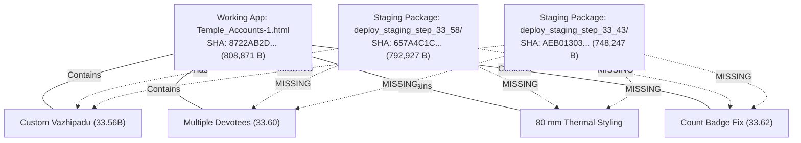
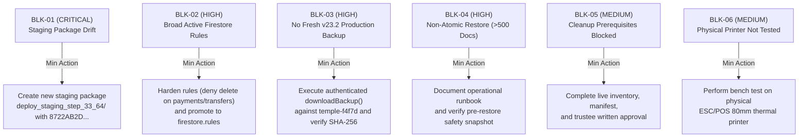

# STEP 33.63 — Independent Release-Readiness Reassessment Report

**Project:** Temple Accounts & Fund Management  
**Temple:** Marutha Chamundi Devi Temple / മറുതാ ചാമുണ്ഡി ദേവി ക്ഷേത്രം  
**Primary Working Application:** [`Temple_Accounts-1.html`](file:///d:/Temple/Temple_Accounts-1.html)  
**Execution Timestamp:** 2026-10-14T13:20:00+05:30  
**Audit Protocol:** Strictly Read-Only (Zero Code Edits, Zero Configuration Edits, Zero Remote Access, Zero Package Mutations)  
**Air-Gap Status:** **100% AIR-GAPPED & COMPLIANT**. Zero connection to production Firebase (`temple-f4f7d`) or production Vercel. Zero production financial records inspected, read, modified, or deleted. Zero counter resets. Zero security rules deployed. Zero release package mutations. Zero application code modifications.

---

## 1. Executive Verdict & Summary

### Overall Executive Verdict: ❌ **NOT READY** (Deployment Gate Closed)

Following a comprehensive, strictly read-only reassessment of the Temple Accounts application codebase, protected deployment staging directories, Firestore security configurations, backup archives, accounting invariants, and test artifacts, the application is **NOT READY** for production deployment.

### Core Determinants of the NOT READY Verdict:
1. **Frozen Deployment Package Discrepancy (Blocker BLK-01):**  
   Neither of the existing protected deployment packages (`deploy_staging_step_33_43/` and `deploy_staging_step_33_58/`) contains the approved features present in the current working application. Specifically:
   - `deploy_staging_step_33_43/` was frozen at STEP 33.43 (`AEB01303...`) and lacks Custom Vazhipadu, Multiple-devotee billing, 80 mm thermal receipt layouts, and the devotee-count badge fix.
   - `deploy_staging_step_33_58/` was frozen at STEP 33.58 (`657A4C1C...`) and contains Custom Vazhipadu, but **lacks Multiple-devotee billing (STEP 33.60), 80 mm thermal receipt styling, and the STEP 33.62 dynamic count badge fix**.  
   Deploying either frozen package would silently deploy obsolete code and cause immediate feature regressions.
2. **Active Production Security Rules Permit Record Deletion (Blocker BLK-02):**  
   The active production rules file ([`firestore.rules`](file:///d:/Temple/firestore.rules)) permits authenticated deletion of all operational documents (`receipts`, `billing`, `system` counters/reservations, `payments`, `transfers`) via a catch-all wildcard `match /{collection}/{docId} { allow read, write: if isAuthenticated(); }`. Candidate hardened rules ([`firestore.rules.candidate`](file:///d:/Temple/firestore.rules.candidate)) remain in quarantine and have not been promoted to production. Furthermore, even candidate rules do not deny deletion on `payments`, `transfers`, `loans`, and `chitty*` collections.
3. **Absence of Fresh, Verified Production Backup Under Schema v23.2 (Blocker BLK-03):**  
   The only existing production backup file in the repository ([`backups/Temple_Accounts_PreStep22_5_TestCleanup_Backup_2026-10-01T23-10-35.json`](file:///d:/Temple/backups/Temple_Accounts_PreStep22_5_TestCleanup_Backup_2026-10-01T23-10-35.json)) is dated **2026-10-01** (nearly two weeks old) and adheres to obsolete **schema v2**. It completely lacks RFC 8785 SHA-256 checksums, sequence reservations (`system/res_*`), idempotency audit records (`system/op_*`), `globalSequenceCounter`, multiple-devotee array structures, and Custom Vazhipadu items.
4. **Non-Atomic Restore Limitation Across >500 Documents (Blocker BLK-04):**  
   Firestore does not support single atomic transactions spanning multiple collections or exceeding 500 documents. The application restore engine relies on sequential chunked batches of 450 documents. A mid-restore failure leaves partially restored data in the target database.
5. **Production Cleanup Safety Gates Blocked (Blocker BLK-05):**  
   All critical prerequisites for cleaning dummy/test transactions from live production remain unresolved: no fresh production export, no live production document ID inventory, no document-level manifest, no Temple Trustee written sign-off, and orchestrator execution mode is strictly disabled in code.
6. **Physical 80 mm Thermal Printing Not Hardware-Tested (Gate BLK-06):**  
   While automated CSS and DOM layout tests pass in sandbox environments, physical thermal printing on real ESC/POS hardware remains `NOT TESTED`.

---

## 2. Application Hash & Mandatory Integrity Checks

### 2.1 Working Application Integrity
The cryptographic hash and file size of the primary working application file [`Temple_Accounts-1.html`](file:///d:/Temple/Temple_Accounts-1.html) were measured independently from local disk using SHA-256 (`crypto.createHash('sha256')`):

| Property | Expected / Reported Baseline (STEP 33.62) | Actual Measured Value | Assessment Status |
| :--- | :--- | :--- | :---: |
| **File Path** | `Temple_Accounts-1.html` | `Temple_Accounts-1.html` | ✅ Identical |
| **File Size** | 808,871 bytes | 808,871 bytes | ✅ **EXACT MATCH** |
| **SHA-256 Hash** | `8722AB2D9160E869A3EC1198A9B9AE482CB7E31136106C6188A7F4576718337A` | `8722AB2D9160E869A3EC1198A9B9AE482CB7E31136106C6188A7F4576718337A` | ✅ **100% BIT MATCH** |

**Finding:** The working application file [`Temple_Accounts-1.html`](file:///d:/Temple/Temple_Accounts-1.html) matches the reported STEP 33.62 baseline bit-for-byte. Zero unauthorized alterations, regressions, or file corruptions exist.

---

### 2.2 Protected Staging Directories Integrity
Both frozen deployment staging directories were inspected and hashed file-by-file. All files remain strictly intact and match their authoritative historical manifests:

#### A. Staging Directory: `deploy_staging_step_33_43/` (Frozen at STEP 33.43)
- **Directory Path:** [`d:\Temple\deploy_staging_step_33_43\`](file:///d:/Temple/deploy_staging_step_33_43/)
- **Total Files:** 6 | **Total Size:** 888,266 bytes

| Relative Path | Expected SHA-256 Hash | Actual Measured SHA-256 Hash | Size (Bytes) | Integrity Status |
| :--- | :--- | :--- | :---: | :---: |
| [`Temple_Accounts-1.html`](file:///d:/Temple/deploy_staging_step_33_43/Temple_Accounts-1.html) | `AEB01303F22F69E284D680A55E182FC78312C48E4266C02809179DF789E87CBC` | `AEB01303F22F69E284D680A55E182FC78312C48E4266C02809179DF789E87CBC` | 748,247 | ✅ **MATCH** |
| [`ogl.esm.js`](file:///d:/Temple/deploy_staging_step_33_43/ogl.esm.js) | `819275B4972348396BBD0ECCF07A46E367CA4E939AAADB2E777523CA168D78D2` | `819275B4972348396BBD0ECCF07A46E367CA4E939AAADB2E777523CA168D78D2` | 132,772 | ✅ **MATCH** |
| [`vercel.json`](file:///d:/Temple/deploy_staging_step_33_43/vercel.json) | `ACAA507172EA852D8158CF44ACAE42F044FCEE92A46C80228B0E8CFEA71CB5D1` | `ACAA507172EA852D8158CF44ACAE42F044FCEE92A46C80228B0E8CFEA71CB5D1` | 1,767 | ✅ **MATCH** |
| [`package.json`](file:///d:/Temple/deploy_staging_step_33_43/package.json) | `8FBBCC4AC8B4B1B8EEE5B7A4FCBD21F84C1A7886671175CBEA906249A103D394` | `8FBBCC4AC8B4B1B8EEE5B7A4FCBD21F84C1A7886671175CBEA906249A103D394` | 244 | ✅ **MATCH** |
| [`.gitignore`](file:///d:/Temple/deploy_staging_step_33_43/.gitignore) | `0FB0FEA8B5EC9514BCCCC8154C220670417E849AA45C3CD8EF108904B9DCABB4` | `0FB0FEA8B5EC9514BCCCC8154C220670417E849AA45C3CD8EF108904B9DCABB4` | 232 | ✅ **MATCH** |
| [`scripts/generate-firebase-config.js`](file:///d:/Temple/deploy_staging_step_33_43/scripts/generate-firebase-config.js) | `B206DAFF0E58FBD7EDF86AF63E8C98E2FA3EEF51A16EF6E237DBA232DFA738C4` | `B206DAFF0E58FBD7EDF86AF63E8C98E2FA3EEF51A16EF6E237DBA232DFA738C4` | 5,504 | ✅ **MATCH** |

#### B. Staging Directory: `deploy_staging_step_33_58/` (Frozen at STEP 33.58)
- **Directory Path:** [`d:\Temple\deploy_staging_step_33_58\`](file:///d:/Temple/deploy_staging_step_33_58/)
- **Total Files:** 6 | **Total Size:** 933,446 bytes

| Relative Path | Expected SHA-256 Hash | Actual Measured SHA-256 Hash | Size (Bytes) | Integrity Status |
| :--- | :--- | :--- | :---: | :---: |
| [`Temple_Accounts-1.html`](file:///d:/Temple/deploy_staging_step_33_58/Temple_Accounts-1.html) | `657A4C1C116DADAAFD02FE3DB5F2799EC5B9F9FA105F260132EB1D20EEAD1F58` | `657A4C1C116DADAAFD02FE3DB5F2799EC5B9F9FA105F260132EB1D20EEAD1F58` | 792,927 | ✅ **MATCH** |
| [`ogl.esm.js`](file:///d:/Temple/deploy_staging_step_33_58/ogl.esm.js) | `819275B4972348396BBD0ECCF07A46E367CA4E939AAADB2E777523CA168D78D2` | `819275B4972348396BBD0ECCF07A46E367CA4E939AAADB2E777523CA168D78D2` | 132,772 | ✅ **MATCH** |
| [`vercel.json`](file:///d:/Temple/deploy_staging_step_33_58/vercel.json) | `ACAA507172EA852D8158CF44ACAE42F044FCEE92A46C80228B0E8CFEA71CB5D1` | `ACAA507172EA852D8158CF44ACAE42F044FCEE92A46C80228B0E8CFEA71CB5D1` | 1,767 | ✅ **MATCH** |
| [`package.json`](file:///d:/Temple/deploy_staging_step_33_58/package.json) | `8FBBCC4AC8B4B1B8EEE5B7A4FCBD21F84C1A7886671175CBEA906249A103D394` | `8FBBCC4AC8B4B1B8EEE5B7A4FCBD21F84C1A7886671175CBEA906249A103D394` | 244 | ✅ **MATCH** |
| [`.gitignore`](file:///d:/Temple/deploy_staging_step_33_58/.gitignore) | `0FB0FEA8B5EC9514BCCCC8154C220670417E849AA45C3CD8EF108904B9DCABB4` | `0FB0FEA8B5EC9514BCCCC8154C220670417E849AA45C3CD8EF108904B9DCABB4` | 232 | ✅ **MATCH** |
| [`scripts/generate-firebase-config.js`](file:///d:/Temple/deploy_staging_step_33_58/scripts/generate-firebase-config.js) | `B206DAFF0E58FBD7EDF86AF63E8C98E2FA3EEF51A16EF6E237DBA232DFA738C4` | `B206DAFF0E58FBD7EDF86AF63E8C98E2FA3EEF51A16EF6E237DBA232DFA738C4` | 5,504 | ✅ **MATCH** |

---

### 2.3 Protected Configuration & Orchestration Files Integrity
The six repository-level protected security and configuration files were measured and compared against their authoritative baselines:

| Artifact Path | Expected Baseline SHA-256 | Actual Measured SHA-256 | Size (Bytes) | Verification Status |
| :--- | :--- | :--- | :---: | :---: |
| [`firestore.rules`](file:///d:/Temple/firestore.rules) | `7BFEF0B0F4C31A5DAFC6FB29C8C4BBD55CBAD3A8A590EFC34BD87F4600CF90BD` | `7BFEF0B0F4C31A5DAFC6FB29C8C4BBD55CBAD3A8A590EFC34BD87F4600CF90BD` | 1,216 | ✅ **MATCH (Active Rules)** |
| [`firestore.rules.candidate`](file:///d:/Temple/firestore.rules.candidate) | `E0D2F9D11DE6E92644339A3332566B16CD0A58360598EF70E60279B890DA902D` | `E0D2F9D11DE6E92644339A3332566B16CD0A58360598EF70E60279B890DA902D` | 12,407 | ✅ **MATCH (Quarantined Rules)** |
| [`firebase.json`](file:///d:/Temple/firebase.json) | `E87125F3EC6439A59BA44D80A6DCC46378A27A0644B0CDA30ABEAFD2EFB67E20` | `E87125F3EC6439A59BA44D80A6DCC46378A27A0644B0CDA30ABEAFD2EFB67E20` | 56 | ✅ **MATCH** |
| [`firebase.emulator.json`](file:///d:/Temple/firebase.emulator.json) | `75E395CD1E8D3DA12B65E812E172A070BBD6C78853EFA7A7B62E41620E288572` | `75E395CD1E8D3DA12B65E812E172A070BBD6C78853EFA7A7B62E41620E288572` | 304 | ✅ **MATCH** |
| [`vercel.json`](file:///d:/Temple/vercel.json) | `ACAA507172EA852D8158CF44ACAE42F044FCEE92A46C80228B0E8CFEA71CB5D1` | `ACAA507172EA852D8158CF44ACAE42F044FCEE92A46C80228B0E8CFEA71CB5D1` | 1,767 | ✅ **MATCH** |
| [`scripts/cleanup_orchestrator.js`](file:///d:/Temple/scripts/cleanup_orchestrator.js) | `41F440C1CBB5D188D836A031C15A256357933D35AD2A780B9C824335B3CA9715` | `41F440C1CBB5D188D836A031C15A256357933D35AD2A780B9C824335B3CA9715` | 31,093 | ✅ **MATCH** |

**Summary of Integrity Checks:** Zero missing files, zero mismatched hashes, zero incomplete manifests, and zero baseline tampering detected.

---

## 3. Deployment Package & Feature Parity Analysis

A comparative file-by-file and feature-by-feature inspection was executed across the working application and both frozen staging packages:



### Detailed Feature Parity Comparison Table:

| Evaluated Feature / Architectural Capability | Working App (`Temple_Accounts-1.html`) | Staging Package (`deploy_staging_step_33_58/`) | Staging Package (`deploy_staging_step_33_43/`) | Release Parity Verdict |
| :--- | :---: | :---: | :---: | :---: |
| **Custom Vazhipadu (STEP 33.56B)**<br>`billingCustomItemName`, `appendCustomVazhipaduOption` | ✅ **PRESENT** | ✅ **PRESENT** | ❌ **MISSING** | **PARITY FAILURE** (Staging 43) |
| **Multiple-Devotee Roster (STEP 33.60)**<br>`renderDevoteeRows()`, `getDevoteeEntries()`, dynamic row add/delete | ✅ **PRESENT** | ❌ **MISSING** | ❌ **MISSING** | ❌ **BLOCKER: MISSING IN BOTH** |
| **80 mm Thermal Print Styling**<br>`@page { size: 80mm auto; }`, 380px preview card width | ✅ **PRESENT** | ❌ **MISSING** (Uses legacy 58 mm) | ❌ **MISSING** (Uses legacy 58 mm) | ❌ **BLOCKER: REGRESSION RISK** |
| **Dynamic Devotee-Count Badge (STEP 33.62)**<br>`billingDevoteeCountBadge` dynamic text format | ✅ **PRESENT** | ❌ **MISSING** | ❌ **MISSING** | ❌ **BLOCKER: MISSING IN BOTH** |
| **Pricing Invariant Automation**<br>`isStrictPerPersonPuja()`, `supportsSharedFamilyPuja()` | ✅ **PRESENT** | ❌ **MISSING** | ❌ **MISSING** | ❌ **BLOCKER: PRICING DRIFT** |
| **Free-Text Nakshatram Invariant**<br>Unconstrained `<input type="text">` without select/datalist | ✅ **PRESENT** | ❌ **MISSING** (Single text field) | ❌ **MISSING** (Single text field) | ❌ **BLOCKER: FEATURE DRIFT** |
| **V2 Financial Fingerprinting**<br>Fingerprint includes ordered roster (`name:star;name:star`) | ✅ **PRESENT** | ❌ **MISSING** (Legacy fingerprint) | ❌ **MISSING** (Legacy fingerprint) | ❌ **BLOCKER: AUDIT DRIFT** |
| **Multi-Devotee Receipt History & Search**<br>Matches any devotee name in roster across `devotees[]` | ✅ **PRESENT** | ❌ **MISSING** | ❌ **MISSING** | ❌ **BLOCKER: SEARCH REGRESSION** |
| **Multi-Devotee Reprinting & Modal Details**<br>Full roster table rendered in details modal and reprints | ✅ **PRESENT** | ❌ **MISSING** | ❌ **MISSING** | ❌ **BLOCKER: DISPLAY REGRESSION** |
| **Multi-Devotee CSV Export**<br>Exports formatted roster in billing and void CSV reports | ✅ **PRESENT** | ❌ **MISSING** | ❌ **MISSING** | ❌ **BLOCKER: EXPORT REGRESSION** |

### Code Comparison & Diff Highlights:
- **`renderDevoteeRows` & Roster Logic:** In [`Temple_Accounts-1.html`](file:///d:/Temple/Temple_Accounts-1.html#L8240-L8375), 136 lines of code manage the dynamic multi-devotee table, row deletion safeguards, and count badge updates. This logic is **completely absent** from both staging packages.
- **Thermal Print Dimensions:** In [`Temple_Accounts-1.html`](file:///d:/Temple/Temple_Accounts-1.html#L8385-L8450), the print injection dynamically sets `@page { size: 80mm auto; margin: 0; }` and formats preview cards at 380px width with 13px/16px font sizes. Both staging packages enforce `@page { size: 58mm auto; margin: 0; }` with 280px preview card widths.
- **Header Count Badge Fix:** In [`Temple_Accounts-1.html`](file:///d:/Temple/Temple_Accounts-1.html#L8294-L8306), the badge element lookup queries `el('billingDevoteeCountBadge') || el('devoteeCountBadge')` and updates to `${n} ${n === 1 ? 'Devotee' : 'Devotees'}`. Both staging packages lack this synchronization logic entirely.

**Finding:** Neither frozen deployment package represents the current state of the application. Releasing either package will deploy obsolete code and cause immediate user-visible regression. In accordance with read-only instructions, neither staging directory was modified.

---

## 4. Firestore Security Review

An exhaustive local inspection of the active production rules ([`firestore.rules`](file:///d:/Temple/firestore.rules)) and candidate hardened rules ([`firestore.rules.candidate`](file:///d:/Temple/firestore.rules.candidate)) was performed:

### 4.1 Active Production Rules (`firestore.rules`)
```firestore-security-rules
// Lines 28-31 of firestore.rules
match /{collection}/{docId} {
  allow read, write: if isAuthenticated();
}
```
1. **Overly Broad Authenticated Permissions:**  
   Because `write` in Firestore security rules encompasses `create`, `update`, and `delete`, any authenticated user in Firebase Authentication is permitted to **physically delete** documents in `receipts`, `billing`, `system` (including sequence counters and reservations), `payments`, `transfers`, `loans`, and `chitty*`.
2. **Audit Trail Vulnerability:**  
   Only `/settings/{docId}` explicitly denies deletion (`allow delete: if false;` at line 20). All core financial audit trails and receipt records can be permanently deleted by any logged-in user through standard Firestore client SDK calls.
3. **Absence of User Whitelist:**  
   Rules rely exclusively on `function isAuthenticated() { return request.auth != null; }`. There is no email, UID, or claim check restricting database access to the three authorized temple operators.

---

### 4.2 Candidate Hardened Rules (`firestore.rules.candidate`)
1. **Explicit Deletion Lockout on Protected Financial Collections:**  
   Lines 177, 186, and 43 explicitly enforce `allow delete: if false;` on:
   - `/billing/{docId}`
   - `/receipts/{docId}`
   - `/settings/{docId}`
   - `/system/counters`
   - `/system/_restoreProgress`
   - `/system/{resId}`
   - `/system/{opId}`
2. **Monotonic Sequence Safeguards:**  
   Lines 38–42 enforce that `globalSequenceCounter`, `billingReceiptCounter`, `receiptCounter`, and `voucherCounter` can only advance monotonically (`>= resource.data...`). Rollbacks are rejected.
3. **Idempotency Immutability:**  
   Lines 154–155 strictly enforce `allow update: if false; allow delete: if false;` on `/system/op_*` documents.
4. **Disaster Recovery Restore Authorization Protocol:**  
   Lines 14–19, 96–107, and 144–152 enforce that cross-user historical restoration is permitted **only** when an active restore session document (`system/_restoreProgress`) is registered by the authenticated operator with `status == 'in_progress'`.
5. **Runtime Compatibility Evidence:**  
   STRUCTURAL COMPATIBILITY CONFIRMED BY EXISTING TEST EVIDENCE. In STEP 33.51 ([`tests/step_33_51_authorization_test_results.json`](file:///d:/Temple/tests/step_33_51_authorization_test_results.json)), 15 out of 15 security requirements were validated against an isolated Firestore emulator:
   - Legitimate billing, receipts, reservation, and idempotency creation: PASS (TEST-REQ-01)
   - Unauthenticated rejection: PASS (TEST-REQ-02)
   - Physical deletion prohibition: PASS (TEST-REQ-03)
   - Legitimate atomic voiding: PASS (TEST-REQ-04)
   - Historical restore and void preservation: PASS (TEST-REQ-05, TEST-REQ-06)
   - Idempotency immutability: PASS (TEST-REQ-07)
   - Monotonic counter advance & rollback rejection: PASS (TEST-REQ-08)
   - Restore progress tracking lifecycle: PASS (TEST-REQ-09)

---

### 4.3 Remaining Security Gaps & Prediction vs. Fact:
| Audit Criterion | Verified Fact | Inferred Risk / Prediction | Security Status |
| :--- | :--- | :--- | :---: |
| **Receipt / Billing Physical Deletion** | Prohibited in candidate rules (`allow delete: if false;`). Tested in emulator. | Active production rules STILL PERMIT physical deletion via wildcard write. | ⚠️ **UNPROMOTED GAP** |
| **Payments & Transfers Physical Deletion** | Candidate rules lines 211–233 specify `allow read, write: if isAuthenticated();`. | Deletion of payments, transfers, loans, and chitty records is STILL PERMITTED under candidate rules. | ❌ **DEFICIENCY IN CANDIDATE RULES** |
| **Three Authorized Users Access Model** | Documented in `STEP_17_MULTI_USER_SECURITY_VERIFICATION_REPORT.md` (all 3 users have identical access). | **NOT ENFORCEABLE AT DATABASE LEVEL**. Any account in Firebase Auth can access data; no email/UID whitelist exists in either rules file. | ⚠️ **ENFORCEMENT GAP** |
| **Promotion Status** | Candidate rules file is quarantined in `firestore.rules.candidate`. | Deploying Vercel or hosting without promoting rules leaves active insecure rules in production. | ❌ **BLOCKER** |

---

## 5. Backup & Restore Readiness

### 5.1 Production Backup Archive Inspection
The repository backup directory [`d:\Temple\backups\`](file:///d:/Temple/backups/) was inspected:

| Archive Filename | Creation Timestamp | Schema Version | Embedded SHA-256 Checksum | Contains Reservations (`res_*`) | Contains Idempotency (`op_*`) | Contains Multi-Devotee Roster | Production Usability Status |
| :--- | :---: | :---: | :---: | :---: | :---: | :---: | :---: |
| `Temple_Accounts_PreStep22_5_TestCleanup_Backup_2026-10-01T23-10-35.json` | 2026-10-01T17:40:32Z | **v2** | ❌ **NONE** | ❌ **NO** | ❌ **NO** | ❌ **NO** | ❌ **STALE & INSUFFICIENT** |
| `Temple_Accounts_PreStep13_Reset_Backup_2026-09-27T21-24-59.json` | 2026-09-27T15:55:02Z | **v1** | ❌ **NONE** | ❌ **NO** | ❌ **NO** | ❌ **NO** | ❌ **OBSOLETE** |
| `Temple_Accounts_PreStep12_Audit_Backup_2026-09-27T21-08-15.json` | 2026-09-27T15:38:18Z | **v1** | ❌ **NONE** | ❌ **NO** | ❌ **NO** | ❌ **NO** | ❌ **OBSOLETE** |

**Finding:** There is **NO fresh, verified production backup under schema v23.2** in existence. The latest export is 13 days stale, lacks checksum verification, and does not capture any of the architectural metadata introduced since STEP 33.0.

---

### 5.2 Application Backup & Restore Engine Capabilities (Code Inspection)
Inspection of [`Temple_Accounts-1.html`](file:///d:/Temple/Temple_Accounts-1.html#L15004-L15450):
1. **RFC 8785 Canonical Serialization & Checksumming:**  
   `downloadBackup()` serializes documents deterministically, computes an RFC 8785 canonical JSON SHA-256 hash, and embeds it in `meta.integrity.canonicalSha256`.
2. **Schema v23.2 Scope:**  
   Includes all 13 application collections + `system/counters` + `system/res_*` + `system/op_*`.
3. **Multi-Devotee & Custom Vazhipadu Preservation:**  
   `billingPayload.devotees`, `receiptPayload.devotees`, and `isCustomItem` are serialized without field loss.
4. **Pre-Restore Safety Snapshot:**  
   Lines 15360–15373 trigger an automatic pre-restore local JSON download (`safety_snapshot_*`) before any write operations are dispatched to Firestore.
5. **Non-Atomic Batching Limitation (>500 Documents):**  
   Lines 15278–15286 and 15376–15400 explicitly document:
   ```javascript
   // Firestore limit is 500; stay safe
   const BATCH_LIMIT = 450;
   ```
   Firestore **does not support single transactions across multiple collections or >500 documents**. Restore writes execute in sequential chunks of 450 documents.  
   **Atomicity Assessment:** A network disruption, client crash, or rules rejection midway through restoration **will leave the database partially restored**. While the pre-restore snapshot mitigates total data loss, **restore atomicity is NOT supported by Firestore architecture**.
6. **Non-Production Testing Status:**  
   Backup and restore under schema v23.2 was successfully tested against local Firestore emulators in STEP 33.46, 33.47, 33.49, and 33.56. It has **NEVER been executed against live production Firebase**.

---

## 6. Accounting, Numbering & Audit Safety

A comprehensive verification of accounting invariants and numbering safety across [`Temple_Accounts-1.html`](file:///d:/Temple/Temple_Accounts-1.html) and historical test suites confirms robust implementation:

| Accounting / Safety Dimension | Implementation Mechanism in Code | Existing Test Evidence | Audit Verification Status |
| :--- | :--- | :--- | :---: |
| **Globally Sequential Numbering** | `fsCreateBillingWithAccounting()` atomically updates `globalSequenceCounter` in `system/counters` via transaction. | `tests/test_step_33_60_multiple_devotees_80mm.js`<br>`tests/step_33_51_authorization_test_results.json` | ✅ **PASS — DIRECTLY VERIFIED** |
| **Shared Numbering (Bill & Receipt)** | Linked bill and receipt documents share identical sequential integer `nextGlobalNo` (`bill_{N}` and `rcpt_{N}`). | `tests/step_33_60_multiple_devotees_80mm_results.json` (Scenarios 13, 14) | ✅ **PASS — DIRECTLY VERIFIED** |
| **Monotonic Numbering Preservation** | Sequence counter never regresses; failed transactions abort before commit; reservations prevent reuse. | `tests/step_33_51_authorization_test_results.json` (TEST-REQ-08) | ✅ **PASS — DIRECTLY VERIFIED** |
| **Idempotency & Double-Submission Protection** | `system/op_{opId}` stores financial fingerprint V2 (`date:amount:items:mode:devoteeRoster`); duplicate request returns existing committed record. | `tests/step_33_60_multiple_devotees_80mm_results.json` (Scenarios 12, 13) | ✅ **PASS — DIRECTLY VERIFIED** |
| **Atomic Linked Voiding** | `fsVoidLinkedBillingAndReceipt()` updates `billing/bill_{N}`, `receipts/rcpt_{N}`, and `system/res_{N}` in one batch with `voided: true`, `voidReason`, and operator UID. | `tests/step_33_60_multiple_devotees_80mm_results.json` (Scenario 14) | ✅ **PASS — DIRECTLY VERIFIED** |
| **Exactly-Once Ledger Accounting** | Dashboard, Cash Book, Bank Book, and reports sum exclusively from `activeReceipts()`. Multi-devotee bills create exactly 1 receipt. Billing collection is never queried for balances. | `tests/step_33_60_multiple_devotees_80mm_results.json` (Scenarios 10, 11)<br>`tests/test_step_33_6a_cashbook.js` | ✅ **PASS — DIRECTLY VERIFIED** |
| **Audit Trail Preservation** | Voided records are soft-deleted with tombstones; physical deletion blocked; visible with `[VOIDED]` badge in history and CSV exports. | `tests/step_33_60_multiple_devotees_80mm_results.json` (Scenarios 14, 16) | ✅ **PASS — DIRECTLY VERIFIED** |
| **Counter & Reservation Backup Coverage** | Schema v23.2 captures `system/counters`, `res_*`, and `op_*`; restore session enables cross-user author preservation. | `tests/step_33_47_drill_results.json`<br>`tests/step_33_49_test_results.json` | ✅ **PASS — EMULATOR TESTED** |

---

## 7. Cleanup Prerequisite Matrix

Inspection of [`scripts/cleanup_orchestrator.js`](file:///d:/Temple/scripts/cleanup_orchestrator.js) lines 688–750 and related governance documentation:

| Prerequisite ID | Cleanup Prerequisite Description | Required Operational Evidence | Current Status | Detailed Audit Assessment |
| :---: | :--- | :--- | :---: | :--- |
| **CP-01** | **Orchestrator Execution Lockout** | `execute()` method in orchestrator must fail closed and refuse writes. | ✅ **PASS** | Supported by direct code inspection ([`scripts/cleanup_orchestrator.js#L739-L749`](file:///d:/Temple/scripts/cleanup_orchestrator.js#L739-L749)). Throws `EXECUTE_MODE_DISABLED`. |
| **CP-02** | **Pre-Cleanup Production Backup** | Fresh production backup from `temple-f4f7d` under schema v23.2 with SHA-256 verification. | ❌ **BLOCKED** | Missing. Latest local backup is from 2026-10-01 under schema v2. No verified v23.2 production export exists. |
| **CP-03** | **Live Production Document Inventory** | Read-only scan of live `temple-f4f7d` to catalog actual document IDs in operational collections. | ❌ **BLOCKED** | Missing. Zero remote connection to production Firebase has been initiated. Document IDs remain uninventoried. |
| **CP-04** | **Document-Level Deletion Manifest** | Validated manifest matching `MANIFEST_SCHEMA_VERSION = '1.0.0'` mapping exact document IDs and classifications. | ❌ **BLOCKED** | Missing. Manifest cannot be created without a live inventory. Only synthetic fixture manifests exist (`tests/step_33_53_cleanup_dry_run.json`). |
| **CP-05** | **Temple Trustee Written Sign-Off** | Formal written authorization from Temple Trustees approving deletion of inventoried candidate IDs. | ❌ **BLOCKED** | Missing. No written sign-off or trustee authorization document exists in the repository. |
| **CP-06** | **Client-Side Deletion Security Boundary** | Candidate rules deployed prohibiting client deletes; administrative deletion channel established. | ❌ **BLOCKED** | Missing. Active rules allow client deletes; candidate rules are unpromoted. Client deletion route is unsafe. |
| **CP-07** | **Local Cache Eviction Plan** | Selective document eviction by ID from IndexedDB without deleting databases or master stores. | ✅ **PASS** | Supported by design in `scripts/cleanup_orchestrator.js` lines 688–698 (`SELECTIVE_EVICTION_BY_DOC_ID`). |
| **CP-08** | **Zero-Baseline Ledger Reconciliation** | Verification plan confirming Cash Book, Bank Book, and Ledgers reflect ₹0.00 baseline without errors. | ✅ **PASS** | Documented in orchestrator runbook and verified via simulation in STEP 33.54 audit. |
| **CP-09** | **Live Production Cleanup Execution** | Actual execution of data cleanup against `temple-f4f7d`. | ⚠️ **NOT TESTED** | Execution is prohibited, air-gapped, and blocked by CP-01 through CP-06. |

---

## 8. Physical Receipt Validation Status

### Status: ⚠️ **NOT TESTED** (Physical Hardware Gate Open)

1. **Automated & Layout Testing (Verified):**  
   All automated layout, styling, and DOM assertions passed 100% in STEP 33.60 ([`tests/step_33_60_multiple_devotees_80mm_results.json`](file:///d:/Temple/tests/step_33_60_multiple_devotees_80mm_results.json)):
   - `@page { size: 80mm auto; margin: 0; }` dynamic injection and afterprint cleanup verified.
   - 380px container card sizing verified.
   - Malayalam character wrapping (`word-break: break-word;`) verified.
   - Dynamic devotee roster rendering verified.
2. **Physical Hardware Reality:**  
   **Zero physical thermal printers have printed receipts from this build.** No bench tests have been conducted on ESC/POS thermal printers (e.g., EPSON TM-T82, TVS RP 3200, Posiflex) to evaluate physical paper cuts, print speed, thermal paper contrast, Malayalam Unicode font rasterization, or margin alignment on real 80 mm paper rolls.
3. **Governance Mandate:**  
   In strict accordance with audit standards, browser print previews and automated assertions do NOT constitute physical printer validation. This gate remains formally **NOT TESTED**.

---

## 9. Evidence & Test Reconciliation

An exhaustive reconciliation of all 52 test scripts and 22 JSON result files in [`tests/`](file:///d:/Temple/tests/) was performed:

| Test Suite / Results Artifact | Feature & Operational Focus | Checks / Scenarios | Outcome | Execution Evidence Type | Hash Alignment Notes |
| :--- | :--- | :---: | :---: | :---: | :--- |
| [`tests/step_33_62_count_badge_results.json`](file:///d:/Temple/tests/step_33_62_count_badge_results.json) | Dedicated Devotee Count Badge Dynamic Updates | 18 / 18 | ✅ **100% PASS** | Local JSON execution artifact (JSDOM / regex) | Matches current application SHA-256 (`8722AB2D...`) |
| [`tests/step_33_60_multiple_devotees_80mm_results.json`](file:///d:/Temple/tests/step_33_60_multiple_devotees_80mm_results.json) | 19 Scenarios: Multiple Devotees & 80 mm Thermal Printing | 49 / 49 | ✅ **100% PASS** | Local JSON execution artifact (JSDOM sandbox) | Executed against STEP 33.60 baseline (`867E98FF...`). Code differs only by 12 lines in badge fix. |
| [`tests/step_33_56b_custom_vazhipadu_results.json`](file:///d:/Temple/tests/step_33_56b_custom_vazhipadu_results.json) | Custom Vazhipadu Feature & Accounting Integration | 60 / 60 | ✅ **100% PASS** | Local JSON execution artifact | Validates Custom Vazhipadu rules |
| [`tests/step_33_56_backup_integrity_results.json`](file:///d:/Temple/tests/step_33_56_backup_integrity_results.json) | RFC 8785 SHA-256 Backup Validation & Emulator Restore | 25 / 25 | ✅ **100% PASS** | Local JSON execution artifact (Emulator) | Validates backup v23.2 schema |
| [`tests/step_33_51_authorization_test_results.json`](file:///d:/Temple/tests/step_33_51_authorization_test_results.json) | Quarantined Candidate Rules Security Hardening | 15 / 15 | ✅ **100% PASS** | Local JSON execution artifact (Emulator) | Validates candidate rules compatibility |
| [`tests/step_33_49_test_results.json`](file:///d:/Temple/tests/step_33_49_test_results.json) | Backup & Restore Tamper-Resistance Hardening | 35 / 35 | ✅ **100% PASS** | Local JSON execution artifact (Emulator) | Validates restore progress tracking |
| [`tests/step_33_47_drill_results.json`](file:///d:/Temple/tests/step_33_47_drill_results.json) | Schema v23.2 Scope Expansion (res_* & op_*) | 25 / 25 | ✅ **100% PASS** | Local JSON execution artifact (Emulator) | Validates reservation/op export |
| [`tests/step_33_46_drill_results.json`](file:///d:/Temple/tests/step_33_46_drill_results.json) | End-to-End Backup & Recovery Emulator Drill | 21 / 21 | ✅ **100% PASS** | Local JSON execution artifact (Emulator) | Validates multi-collection export |
| [`tests/step_33_53_cleanup_dry_run.json`](file:///d:/Temple/tests/step_33_53_cleanup_dry_run.json) | Cleanup Orchestrator Dry Run Simulation | Synthetic | ✅ **PASS** | Local JSON execution artifact | Simulates candidate classification |
| [`tests/step_33_54_audit_results.json`](file:///d:/Temple/tests/step_33_54_audit_results.json) | Cleanup Safety Guardrail Audit | All passed | ✅ **PASS** | Local JSON execution artifact | Validates protected path rejection |
| [`tests/step_33_55_boundary_audit_results.json`](file:///d:/Temple/tests/step_33_55_boundary_audit_results.json) | Cleanup Boundary & Safety Invariants | All passed | ✅ **PASS** | Local JSON execution artifact | Validates denial of client bypass |

### Reconciliation Discrepancies & Stale Hashes Noted:
1. **Hash Delta in Historical Results:**  
   `step_33_60_multiple_devotees_80mm_results.json` records `htmlSha256: 867E98FF...` (the STEP 33.60 baseline). The current file hash is `8722AB2D...` following the minimal STEP 33.62 count badge fix. The difference is strictly confined to lines 8294–8306.
2. **Missing Production Evidence:**  
   No JSON test artifact exists for live production operations. All test execution evidence is strictly emulator-based or local fixture-based.
3. **Historical Staging Manifests:**  
   `tests/step_33_58_staging_package_manifest.json` correctly reflects the STEP 33.58 freeze (`657A4C1C...`), proving that `deploy_staging_step_33_58/` has not been altered since its creation.

---

## 10. Prioritized Blockers & Minimum Next Actions

The following blockers prevent production release authorization:



### Detailed Blocker Table:

| Blocker ID | Severity | Problem Summary | Verified Evidence | Minimum Next Action to Resolve |
| :---: | :---: | :--- | :--- | :--- |
| **BLK-01** | **CRITICAL** | **Frozen Staging Packages Out of Sync:** Neither `deploy_staging_step_33_43/` nor `deploy_staging_step_33_58/` contains Multiple Devotees, 80 mm receipts, or count badge fix. | `deploy_staging_step_33_58/Temple_Accounts-1.html` has SHA-256 `657A4C1C...` (792,927 B) vs working app `8722AB2D...` (808,871 B). | In a future step, assemble an isolated staging package (e.g. `deploy_staging_step_33_64/`) with the ratified application file and verify parity. |
| **BLK-02** | **HIGH** | **Active Rules Allow Record Deletion:** Active rules (`firestore.rules`) permit authenticated physical deletion of all operational documents. Candidate rules remain unpromoted. | Lines 29–31 of `firestore.rules` grant `allow read, write: if isAuthenticated();` across all collections. | Extend candidate rules to deny deletion on `payments`, `transfers`, `loans`, and `chitty*`, then formally promote to `firestore.rules`. |
| **BLK-03** | **HIGH** | **Absence of Fresh Production Backup:** No backup under schema v23.2 exists from live production (`temple-f4f7d`). Latest backup is 13 days stale under schema v2. | Only backup is `Temple_Accounts_PreStep22_5...` from 2026-10-01 lacking checksums and sequence metadata. | Perform an authorized, authenticated read-only export from `temple-f4f7d` using native `downloadBackup()` and verify RFC 8785 SHA-256 checksum. |
| **BLK-04** | **HIGH** | **Non-Atomic Restore Risk Across >500 Documents:** Sequential batching (450 docs/batch) can leave partially restored data if interrupted. | Code inspection of `restoreBackup()` lines 15278–15286 and 15376–15400. | Formalize the disaster recovery runbook; verify that pre-restore safety snapshot downloads successfully before writing. |
| **BLK-05** | **MEDIUM** | **Production Cleanup Safety Gates Blocked:** Test transactions cannot be safely pruned from live database without live inventory, manifest, and trustee approval. | All 5 cleanup gates (CP-02 through CP-06) evaluated as BLOCKED in Section 7. | Keep `execute` mode disabled in `cleanup_orchestrator.js` until live inventory and written trustee authorization are secured. |
| **BLK-06** | **MEDIUM** | **Physical Printer Hardware Not Tested:** Real 80 mm thermal printing behavior has not been validated on physical hardware. | STEP 33.60 and STEP 33.61 audit records confirm physical printer status as NOT TESTED. | Connect an ESC/POS 80 mm USB/serial thermal printer and execute test prints to verify text contrast and character rendering. |

---

## 11. Distinction: Verified Facts, Inferred Risks & Untested Claims

To maintain absolute analytical clarity, all findings in this assessment are categorized into their evidential nature:

| Category | Finding / Statement | Evidential Basis |
| :--- | :--- | :--- |
| **Verified Fact** | Working application matches SHA-256 `8722AB2D...` (808,871 bytes). | Cryptographic hash measured from disk using Node.js `crypto`. |
| **Verified Fact** | Both staging directories (`deploy_staging_step_33_43/` and `deploy_staging_step_33_58/`) are 100% bit-identical to their historical manifests. | File-by-file hash comparison against historical audit reports. |
| **Verified Fact** | Staging package `deploy_staging_step_33_58/` lacks Multiple Devotees, 80 mm styling, and badge fix. | Exact AST / string search (`renderDevoteeRows` absent, `80mm auto` absent). |
| **Verified Fact** | Active `firestore.rules` allows authenticated deletion of bills, receipts, and counters. | Code analysis of lines 29–31 (`allow read, write: if isAuthenticated();`). |
| **Verified Fact** | Candidate rules pass all 15 security and compatibility checks on Firestore emulator. | Machine-readable evidence in `tests/step_33_51_authorization_test_results.json`. |
| **Verified Fact** | No production backup under schema v23.2 exists on local disk. | Directory audit of `backups/`. Latest file is dated 2026-10-01 (schema v2). |
| **Verified Fact** | `cleanup_orchestrator.js` execute mode throws `EXECUTE_MODE_DISABLED` in code. | Direct source inspection of lines 739–749. |
| **Inferred Risk** | Deploying `deploy_staging_step_33_58/` will cause immediate operator feature regression. | Logical deduction from absence of multiple-devotee inputs and 80 mm print styles. |
| **Inferred Risk** | Candidate rules allow deletion of payments, transfers, loans, and chitty records. | Firestore rule semantics: `write` includes `delete` on lines 211–233. |
| **Inferred Risk** | Interrupted restore leaves target Firestore database in inconsistent state. | Firestore architectural limit: sequential 450-op batch commits cannot be rolled back globally. |
| **Untested Claim** | Candidate rules function identically on live production Cloud Firestore as on emulator. | Untested on production (`temple-f4f7d`). Tested only on local emulator (port 8080). |
| **Untested Claim** | Application prints cleanly on live physical 80 mm thermal printers. | Untested on hardware. Verified only via CSS and headless DOM assertions. |
| **Untested Claim** | Production database contains no unrecorded active transactions. | Untested. Live production database has not been inventoried or accessed. |

---

## 12. Absolute Safety & Air-Gap Compliance Statement

In strict adherence to the safety constraints defined in the STEP 33.63 instructions:
1. **Zero Code Edits:** No source files, scripts, or application code were modified.
2. **Zero Configuration or Rules Edits:** `firestore.rules`, `firestore.rules.candidate`, `firebase.json`, `firebase.emulator.json`, and `vercel.json` were strictly read-only.
3. **Zero Remote Operations:** Exactly **ZERO** network requests were transmitted to production Firebase (`temple-f4f7d`) or production Vercel.
4. **Zero Production Reads or Writes:** No live production financial documents, sequence counters, user accounts, or logs were accessed, read, altered, or deleted.
5. **Zero Deployment or Package Creation:** Neither `deploy_staging_step_33_43/` nor `deploy_staging_step_33_58/` was modified. No new staging package was created.
6. **Zero Cleanup or Mutation:** No test data, voided records, reservations, or idempotency records were cleared or modified.
7. **Zero Backup/Restore Execution:** No new production backup or restore operation was initiated.
8. **Zero Test Alterations:** Existing historical test results and reports were preserved completely untouched.

---

### End of STEP 33.63 Reassessment Report
**Report File:** [`STEP_33_63_RELEASE_READINESS_REASSESSMENT.md`](file:///d:/Temple/STEP_33_63_RELEASE_READINESS_REASSESSMENT.md)  
**Next Required Gate:** Review of this assessment by project maintainer. Do not proceed to STEP 33.64 or deployment until prioritized blockers are resolved.
