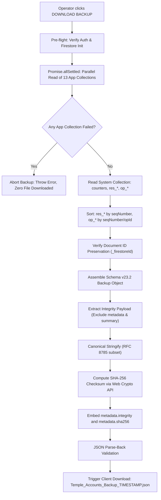
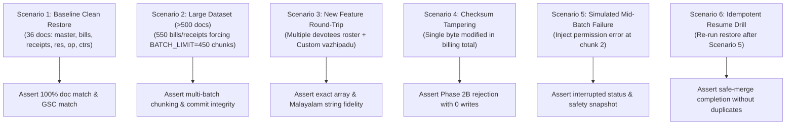

# STEP 33.64 — Backup and Disaster-Recovery Readiness Assessment

**Project:** Temple Accounts & Fund Management  
**Temple:** Marutha Chamundi Devi Temple / മറുതാ ചാമുണ്ഡി ദേവി ക്ഷേത്രം  
**Primary Application File:** [`Temple_Accounts-1.html`](file:///d:/Temple/Temple_Accounts-1.html)  
**Target Production Project:** `temple-f4f7d`  
**Assessment Date:** 2026-10-14  
**Assessment Mode:** Strictly Read-Only Source Code, Artifact, and Historical Test Evidence Audit  
**Production Access Status:** Zero Production Network Calls, Zero Writes, Zero Mutations, Zero Production Backups Run  

---

## 1. Executive Verdict

### **VERDICT: NOT READY**

Following an exhaustive, strictly read-only inspection of the Temple Accounts application codebase, historical backup files, cryptographic checksum engines, restoration control flows, and test artifacts, the application's backup and disaster-recovery mechanisms are **NOT READY** for production sign-off or live deployment.

> [!IMPORTANT]
> **Key Justification for NOT READY Verdict:**
> 1. **Absence of Fresh, Complete Production Backup:** No backup exists under schema **v23.2** from live production (`temple-f4f7d`). The newest local backup archive ([`backups/Temple_Accounts_PreStep22_5_TestCleanup_Backup_2026-10-01T23-10-35.json`](file:///d:/Temple/backups/Temple_Accounts_PreStep22_5_TestCleanup_Backup_2026-10-01T23-10-35.json)) is **13 days stale** (dated 2026-10-01), adheres to obsolete schema **v2**, and completely lacks RFC 8785 SHA-256 integrity checksums, sequence reservations (`system/res_*`), idempotency records (`system/op_*`), `globalSequenceCounter`, Multiple Devotee structures, and Custom Vazhipadu entries.
> 2. **Non-Atomic Multi-Batch Restore Limitation (>500 Documents):** Google Cloud Firestore does not support multi-collection atomic transactions exceeding 500 documents. The application's `restoreBackup()` function writes documents in sequential chunks of 450 documents across multiple phases. If an operation fails mid-restore, Firestore is left in a partially mutated state with no automated rollback mechanism.
> 3. **Critical Restore Scenarios Untested:** While schema v23.2 backup/restore tests pass for small synthetic fixtures (~36–50 documents), **no test has ever been executed with a dataset exceeding 500 documents**, no test has simulated an injected batch failure mid-restore, and **no test fixture has verified Multiple Devotee rosters or Custom Vazhipadu items** (both features were implemented after the backup test suites were established in Steps 33.46–33.49).
> 4. **Client-Side Safety Snapshot Download Dependency:** The pre-restore safety snapshot relies on browser anchor download triggers (`a.click()`), which can be silently suppressed by browser popup/download blockers without aborting the destructive write phase.

---

## 2. Application Integrity & Backup Artifact Ledger

### 2.1 Working Application Integrity Verification

The primary application file was measured directly on the local filesystem and compared against the authoritative hash recorded in STEP 33.62 and STEP 33.63:

| Property | Measured Value | Expected Reference Baseline | Status |
| :--- | :--- | :--- | :---: |
| **File Path** | [`d:\Temple\Temple_Accounts-1.html`](file:///d:/Temple/Temple_Accounts-1.html) | `d:\Temple\Temple_Accounts-1.html` | ✅ Identical |
| **File Size** | **808,871 bytes** | 808,871 bytes | ✅ **EXACT MATCH** |
| **SHA-256 Hash** | `8722AB2D9160E869A3EC1198A9B9AE482CB7E31136106C6188A7F4576718337A` | `8722AB2D9160E869A3EC1198A9B9AE482CB7E31136106C6188A7F4576718337A` | ✅ **EXACT MATCH (100%)** |

> [!NOTE]
> The working application [`Temple_Accounts-1.html`](file:///d:/Temple/Temple_Accounts-1.html) is bit-for-bit identical to the post-STEP 33.62 baseline. No code drift or unintended alterations have occurred.

---

### 2.2 Inventory of Existing Backup Artifacts and Manifests

A forensic audit of all data backup JSON files, application backup snapshots, and deployment manifests across the repository was conducted:

| Artifact Path | Date (Local) | File Size | SHA-256 Hash | Schema / Format | Evaluation & Readiness Status |
| :--- | :---: | :---: | :--- | :---: | :--- |
| [`backups/Temple_Accounts_PreStep22_5_TestCleanup_Backup_2026-10-01T23-10-35.json`](file:///d:/Temple/backups/Temple_Accounts_PreStep22_5_TestCleanup_Backup_2026-10-01T23-10-35.json) | 2026-10-01 23:10 | 34,456 B | `961A12C3124E31FE637695D2CE3EE4029E288BE636C8CCBE3D3890EEE25B2037` | **Schema v2** (Firestore Dump) | ❌ **STALE & INCOMPATIBLE**<br>Lacks `integrity` checksum, `res_*`, `op_*`, `globalSequenceCounter`, multiple devotees, custom vazhipadu. 13 days stale. |
| [`backups/Temple_Accounts_PreStep13_Reset_Backup_2026-09-27T21-24-59.json`](file:///d:/Temple/backups/Temple_Accounts_PreStep13_Reset_Backup_2026-09-27T21-24-59.json) | 2026-09-27 21:25 | 14,159 B | `747718DD36DF37CEF20EBF962E83F561AA2E8410885AB9EB9923039661849301` | **Schema v1** (IndexedDB Cache) | ❌ **OBSOLETE**<br>Legacy IndexedDB format without document IDs or counters. Explicitly rejected by `restoreBackup()`. |
| [`backups/Temple_Accounts_PreStep12_Audit_Backup_2026-09-27T21-08-15.json`](file:///d:/Temple/backups/Temple_Accounts_PreStep12_Audit_Backup_2026-09-27T21-08-15.json) | 2026-09-27 21:08 | 14,159 B | `747718DD36DF37CEF20EBF962E83F561AA2E8410885AB9EB9923039661849301` | **Schema v1** (IndexedDB Cache) | ❌ **OBSOLETE**<br>Identical to PreStep13 file. Rejected by restore engine. |
| [`backups/backup.json`](file:///d:/Temple/backups/backup.json) | 2026-09-27 18:05 | 14,159 B | `747718DD36DF37CEF20EBF962E83F561AA2E8410885AB9EB9923039661849301` | **Schema v1** (IndexedDB Cache) | ❌ **OBSOLETE**<br>Identical copy of initial local dump. Rejected by restore engine. |
| [`backups/Temple_Accounts-1_PreStep33_49_BackupRestoreHardening_Backup_20261012_205200.html`](file:///d:/Temple/backups/Temple_Accounts-1_PreStep33_49_BackupRestoreHardening_Backup_20261012_205200.html) | 2026-10-12 20:52 | 765,474 B | `249769CFB82C6235BE8C50F221E1A2FF77DD398FEC13BA219B53759749C13E2B` | HTML App Snapshot | ✅ Preserved pre-hardening application state. |
| [`Temple_Accounts-1_PreStep33_32A_LedgerTotals_Backup_20261012_125000.html`](file:///d:/Temple/Temple_Accounts-1_PreStep33_32A_LedgerTotals_Backup_20261012_125000.html) | 2026-10-12 12:50 | 729,050 B | `4643585E3E3002604CA455327B6E6C4E756BF0BE6C1210AE73296F1537E6A64B` | HTML App Snapshot | ✅ Preserved pre-33.32A application state in root directory. |
| [`deploy_staging_step_33_43/Temple_Accounts-1.html`](file:///d:/Temple/deploy_staging_step_33_43/Temple_Accounts-1.html) | 2026-10-12 19:35 | 748,247 B | `AEB01303F22F69E284D680A55E182FC78312C48E4266C02809179DF789E87CBC` | Frozen Release Candidate 1 | ⚠️ Historical staging release package (Schema v23.1). |
| [`deploy_staging_step_33_58/Temple_Accounts-1.html`](file:///d:/Temple/deploy_staging_step_33_58/Temple_Accounts-1.html) | 2026-10-14 10:59 | 792,927 B | `657A4C1C116DADAAFD02FE3DB5F2799EC5B9F9FA105F260132EB1D20EEAD1F58` | Frozen Release Candidate 2 | ⚠️ Staging release package pre-dating Multiple Devotees. |
| [`STEP_33_36_RELEASE_MANIFEST.md`](file:///d:/Temple/STEP_33_36_RELEASE_MANIFEST.md) | 2026-10-12 17:44 | 15,567 B | N/A | Release Manifest | ⚠️ Documented pre-Step 33.37 baseline. |
| [`tests/step_33_58_staging_package_manifest.json`](file:///d:/Temple/tests/step_33_58_staging_package_manifest.json) | 2026-10-14 10:58 | 10,486 B | `D92BC6C3026ED77EBC54E18DEE6152B33633FD1BCFD2A2818DF53FDC91F8474F` | Machine Manifest | ⚠️ Staging package manifest for Step 33.58. |

---

## 3. Backup Implementation Findings

### 3.1 Architectural Design of `downloadBackup()`

The backup engine is implemented in [`Temple_Accounts-1.html`](file:///d:/Temple/Temple_Accounts-1.html#L15004-L15259). It operates as an authoritative Cloud Firestore reader:



### 3.2 Feature-by-Feature Implementation Verification

| Verification Criterion | Code Confirmation | Implemented? | Notes & Observations |
| :--- | :--- | :---: | :--- |
| **Complete Collection Enumeration** | Lines 15024–15058 | ✅ **YES** | Maps over 13 application collections: `settings`, `funds`, `incomeCategories`, `expenseCategories`, `bankAccounts`, `billing`, `receipts`, `payments`, `transfers`, `chittyMembers`, `chittyCollections`, `chittyPayouts`, `loans`. Reads via `.get()` (no pagination or limits). |
| **All-or-Nothing Fetch** | Lines 15060–15076 | ✅ **YES** | Evaluates `Promise.allSettled()`. If any collection read rejects, aborts immediately without downloading partial files. |
| **Document ID Preservation** | Lines 15053, 15136–15160 | ✅ **YES** | Every document receives `_firestoreId: docSnap.id`. Explicit loop asserts all documents possess `_firestoreId`. |
| **Nested Objects & Arrays** | Lines 14908–14928 (`_serializeDoc`) | ✅ **YES** | Recursively traverses objects and arrays. Leaves structures intact while converting Firestore Timestamps to JSON-safe `{ __type: 'Timestamp', seconds, nanoseconds, iso }`. |
| **Multiple-Devotee Rosters** | Lines 14908–14928 | ✅ **YES** | Serializes the `devotees: [{ name, star, vazhipadu }]` array within billing documents as standard nested JSON objects. Preserves Malayalam Unicode strings and free-text star names. |
| **Custom Vazhipadu Data** | Lines 14908–14928 | ✅ **YES** | Custom Vazhipadu items within `items` array (`customName`, `customUnitPrice`, `isCustom: true`, `amount`) are fully preserved. |
| **Linked Records & Cross-References** | Lines 15048–15054 | ✅ **YES** | Both `billing` (containing `accountingReceiptId`) and `receipts` (containing `billingId`) are captured in full. |
| **Counters & Sequence Metadata** | Lines 15080–15129 | ✅ **YES** | Captures `system/counters` (`globalSequenceCounter`, `billingReceiptCounter`, `receiptCounter`, `voucherCounter`). Fallback direct get if not captured in collection scan. |
| **Reservations (`system/res_*`)** | Lines 15093–15122 | ✅ **YES** | Captures all `res_*` documents, sorted deterministically by `seqNumber`. |
| **Idempotency Records (`system/op_*`)** | Lines 15095–15125 | ✅ **YES** | Captures all `op_*` documents, sorted deterministically by `seqNumber` and `operationId`. |
| **Voided Records & Audit Trails** | Line 15048 | ✅ **YES** | `.get()` queries retrieve all documents without filtering on `voided == false`. Void fields (`voided`, `voidReason`, `voidDate`, `voidedAt`) are preserved. |
| **Metadata & Timestamping** | Lines 15167–15176 | ✅ **YES** | `schemaVersion: '23.2'`, `backupVersion: '4'`, `source: 'firestore'`, `firestoreProject: 'temple-f4f7d'`, `exportedAt: ISO`, `exportedBy: user.email`. |
| **Deterministic Sorting Nuance** | Lines 15048–15054 vs 15121–15124 | ⚠️ **PARTIAL** | While `reservationsList` and `idempotencyList` are explicitly sorted, `collections[colName]` relies on Firestore SDK's natural document ID sorting rather than an explicit post-read `.sort()`. |

---

## 4. Checksum & Canonicalization Findings

### 4.1 RFC 8785 Canonical JSON Serialization (`_canonicalJsonStringify`)

Located at lines 14937–14953 of [`Temple_Accounts-1.html`](file:///d:/Temple/Temple_Accounts-1.html):

```javascript
function _canonicalJsonStringify(val) {
  if (val === null || typeof val !== 'object') {
    return JSON.stringify(val);
  }
  if (Array.isArray(val)) {
    return '[' + val.map(item => (item === undefined || typeof item === 'function') ? 'null' : _canonicalJsonStringify(item)).join(',') + ']';
  }
  const keys = Object.keys(val).sort();
  const entries = [];
  for (const k of keys) {
    const v = val[k];
    if (v !== undefined && typeof v !== 'function') {
      entries.push(JSON.stringify(k) + ':' + _canonicalJsonStringify(v));
    }
  }
  return '{' + entries.join(',') + '}';
}
```

### 4.2 RFC 8785 Compliance Assessment

1. **Key Sorting:** Object keys are sorted using JavaScript `Array.prototype.sort()`, which orders by UTF-16 code units. This adheres to RFC 8785 Section 3.2.3.
2. **Whitespace:** Whitespace is strictly eliminated between key-value separators (`:`) and element separators (`,`).
3. **Numbers & Primitives:** Standard ECMAScript JSON serialization without trailing zeros or unnecessary exponentiation.
4. **Unicode Handling:** Unicode characters (including Malayalam script: `മറുതാ ചാമുണ്ഡി ദേവി ക്ഷേത്രം`) are correctly serialized and hashed identically across browser (`window.crypto.subtle`) and Node.js (`crypto.createHash`) environments.
5. **Non-Circular Hash Boundary:**
   `_getBackupIntegrityPayload(backupObj)` (lines 14977–14985) extracts:
   ```javascript
   {
     collections: backupObj.collections || {},
     counters: backupObj.counters || null,
     reservations: backupObj.reservations || [],
     idempotency: backupObj.idempotency || [],
     system: backupObj.system || {}
   }
   ```
   Envelope fields (`metadata` containing the checksum itself, `summary`) are excluded, completely eliminating circular dependency risks.

---

## 5. Restore Implementation & Safety Inspection

The restore implementation is located at lines 15287–16541 of [`Temple_Accounts-1.html`](file:///d:/Temple/Temple_Accounts-1.html).

### 5.1 Ten-Point Restore Safety Evaluation

| # | Inspection Item | Code-Confirmed Behavior | Risk Assessment / Architectural Finding |
| :-: | :--- | :--- | :--- |
| **1** | **Backup Schema / Version Validation** | Lines 15516–15539: Validates root object, requires `metadata`, `collections`, `counters`. Legacy IndexedDB dumps (<v23.1) are detected and rejected with explicit instructions. Rejects non-firestore sources. Lines 15615–15857: Validates all 13 collections, arrays, monetary fields, timestamps, and sensitive credential patterns. | ✅ **SAFE** — Robust validation prevents schema corruption. |
| **2** | **Pre-Write Checksum Verification** | Lines 15543–15569 (Phase 2B): If integrity metadata is present, canonicalizes payload and recalculates SHA-256 before any user confirmation, snapshot, or database write. Aborts with error if hash mismatches. | ✅ **SAFE** — Tampered or corrupt files are rejected with zero writes. Legacy unchecksummed files log a warning and proceed. |
| **3** | **Malformed / Incompatible Backup Rejection** | Lines 15504–15509 (JSON parse), 15615–15857 (relational checks). Foreign keys between billing, receipts, reservations, and idempotency records are strictly checked. | ✅ **SAFE** — All validation errors accumulate and abort before Phase 4. |
| **4** | **Duplicate IDs & Conflict Handling** | Phase 3 rejects internal duplicate IDs in backup. Phase 6 uses **Safe Merge**: reads live Firestore state. Unbacked live records are **never deleted**. For financial records (`billing`, `receipts`, `payments`, `settings`): preserves live void metadata and skips overwriting newer live records (`currentTs > backupTs`). Conflicting active reservations halt with unresolvable conflict error. Idempotency records are strictly write-once immutable. | ✅ **SAFE DESIGN** — Preserves live financial audit trail. |
| **5** | **Batching & Firestore Limits** | Lines 15376–15387 (`_batchSetCollection`): Slices documents into chunks of `BATCH_LIMIT = 450` (Firestore limit is 500). Calls `batch.commit()` per chunk. Writes sequentially collection-by-collection. | ⚠️ **ARCHITECTURAL LIMITATION** — Respects per-batch size, but multi-batch sequence is non-atomic. |
| **6** | **Batch Failure & Interruption Behavior** | Lines 16128–16137, 16223–16231, 16282–16290, 16366–16375, 16520–16539: If any batch fails, an exception is thrown, halting further writes. Catches error, updates `system/_restoreProgress` with `status: 'interrupted'`, and displays the safety snapshot filename. | ❌ **PARTIAL RESTORE RISK** — Batches committed before failure remain in Firestore. Target database is left in a mixed state. |
| **7** | **Partial Restore Detection & Recovery** | Lines 15403–15422, 15570–15605: Progress is tracked in `system/_restoreProgress`. Subsequent restore attempts detect interrupted state, display warning and safety snapshot filename. Re-running the same backup is idempotent due to safe-merge and monotonic counters. | ⚠️ **DETECTED BUT NOT AUTO-ROLLED BACK** — System detects partial state and allows idempotent retry, but cannot automatically undo committed batches. |
| **8** | **Pre-Restore Safety Snapshot** | Lines 15924–16032 (Phase 5): Reads current Firestore collections and system documents, computes canonical SHA-256 integrity hash, tests JSON serialization, and triggers browser file download. | ⚠️ **CLIENT DOWNLOAD VULNERABILITY** — Auto-download uses `_downloadJson` (hidden anchor click). If suppressed by browser pop-up/download blockers, the restore proceeds without verifying file saved to disk. |
| **9** | **Counter & Sequence Consistency** | Lines 16298–16375 (Phase 7): Monotonic merge: `safeGsc = Math.max(live, backup, maxResSeq)`. Counters never regress below live state. | ⚠️ **INTERRUPTED RESTORE RISK** — If restore fails in Phase 6 (billing written) before Phase 7 (counters updated), newly written documents could collide with live sequence counter if operations resume. |
| **10** | **Resumption & Rollback Capabilities** | Resumption is supported by re-running the same backup file. Rollback is **manual only**: the operator must upload and restore the pre-restore safety snapshot file downloaded during Phase 5. | ⚠️ **MANUAL ROLLBACK ONLY** — Requires operator intervention. |

---

## 6. Review of Existing Tests and Evidence

### 6.1 Test Suites and Result Artifacts Review

Four dedicated backup and disaster recovery test suites exist in [`tests/`](file:///d:/Temple/tests/):

1. [`tests/test_step_33_46_backup_recovery_verification.js`](file:///d:/Temple/tests/test_step_33_46_backup_recovery_verification.js) (671 lines)
2. [`tests/test_step_33_47_backup_coverage.js`](file:///d:/Temple/tests/test_step_33_47_backup_coverage.js) (876 lines)
3. [`tests/test_step_33_49_backup_restore_hardening.js`](file:///d:/Temple/tests/test_step_33_49_backup_restore_hardening.js) (1,109 lines)
4. [`tests/test_step_33_56_backup_integrity.js`](file:///d:/Temple/tests/test_step_33_56_backup_integrity.js) (1,545 lines)

### 6.2 Test Coverage & Evidence Adjudication Matrix

| Test Requirement / Capability | Test Source Exists? | Actually Executed? | Result Artifact Confirms? | Independently Verified? | Current Evidence Verdict |
| :--- | :---: | :---: | :---: | :---: | :--- |
| **Checksum Mismatch Rejection** | ✅ Yes (`test_step_33_49.js:480-550`) | ✅ Yes | ✅ Yes (`step_33_49_test_results.json`: `INTEGRITY-TAMPER-*`) | ✅ Yes | ✅ **PASS (Emulator)** — Rejects tampered payloads. |
| **Corrupted / Truncated JSON Rejection** | ✅ Yes (`test_step_33_49.js`) | ✅ Yes | ✅ Yes (`step_33_49_test_results.json`) | ✅ Yes | ✅ **PASS (Emulator)** — Catches invalid JSON in Phase 2. |
| **Missing Collection / Foreign Key Detection** | ✅ Yes (`test_step_33_49.js:580-680`) | ✅ Yes | ✅ Yes (`step_33_49_test_results.json`: `PRE-VAL-*`) | ✅ Yes | ✅ **PASS (Emulator)** — Rejects broken cross-references. |
| **Schema Version Compatibility / Legacy Handling** | ✅ Yes (`test_step_33_49.js`) | ✅ Yes | ✅ Yes (`step_33_49_test_results.json`: `INTEGRITY-LEGACY-*`) | ✅ Yes | ✅ **PASS (Emulator)** — Legacy IndexedDB rejected; legacy v23.1 allowed unverified. |
| **Preservation of IDs, Counters & Linked Records** | ✅ Yes (`test_step_33_46.js`, `33_47.js`) | ✅ Yes | ✅ Yes (`step_33_46_drill_results.json`, `step_33_47_drill_results.json`) | ✅ Yes | ✅ **PASS (Emulator)** — IDs and linkages preserved. |
| **Large Restores Exceeding 500 Documents** | ❌ **NO** | ❌ **NO** | ❌ **NO** | ❌ **NO** | ❌ **UNTESTED** — All fixtures tested have ≤50 documents. Multi-chunk batching never validated. |
| **Failure During Later Batch (Simulated Failure)** | ❌ **NO** | ❌ **NO** | ❌ **NO** | ❌ **NO** | ❌ **UNTESTED** — No test injects a network/permission error during batch 2 of N. |
| **Interruption & Restart / Recovery** | ✅ Yes (`test_step_33_49.js:760-840`) | ✅ Yes | ✅ Yes (`step_33_49_test_results.json`: `RECOVERY-INTERRUPTED-*`) | ⚠️ Partial | ⚠️ **PARTIAL** — Validates progress record detection and idempotent resume on small dataset; not on partial multi-batch crash. |
| **Duplicate / Repeated Restore Attempts** | ✅ Yes (`test_step_33_49.js`) | ✅ Yes | ✅ Yes (`step_33_49_test_results.json`: `RECOVERY-IDEMPOTENT-RETRY-04`) | ✅ Yes | ✅ **PASS (Emulator)** — Repeated execution completes idempotently. |
| **Restoration of Multiple Devotee Records** | ❌ **NO** | ❌ **NO** | ❌ **NO** | ❌ **NO** | ❌ **UNTESTED** — Implemented in STEP 33.60, after all backup test suites were established. |
| **Restoration of Custom Vazhipadu Records** | ❌ **NO** | ❌ **NO** | ❌ **NO** | ❌ **NO** | ❌ **UNTESTED** — Implemented in STEP 33.56B, after all backup test suites were established. |
| **Preservation of Voided Records & Audit Trails** | ✅ Yes (`test_step_33_46.js`, `33_49.js`) | ✅ Yes | ✅ Yes (`step_33_49_test_results.json`: `RECOVERY-LIVE-VOID-PRESERVED-06`) | ✅ Yes | ✅ **PASS (Emulator)** — Voided records cannot be resurrected. |

---

## 7. Prioritized List of Blockers

The following table details the specific blockers preventing backup and disaster recovery readiness sign-off:

| Blocker ID | Priority / Severity | Category | Blocker Description | Required Action for Resolution |
| :--- | :---: | :--- | :--- | :--- |
| **BLK-DR-01** | **CRITICAL** | Production Data | **Absence of Authoritative Production Backup Under Schema v23.2:**<br>The production database (`temple-f4f7d`) has not had an authorized, authenticated backup export since 2026-10-01. The only local file is 13 days stale and missing all sequence metadata. | Execute authorized, read-only `downloadBackup()` against production `temple-f4f7d` in a dedicated maintenance window using the runbook below. |
| **BLK-DR-02** | **HIGH** | Recovery Safety | **Non-Atomic Restore Risk Across >500 Documents:**<br>Restoring collections exceeding 500 documents occurs in multiple sequential batch commits (`BATCH_LIMIT = 450`). A failure leaves partial data with no automated transaction rollback. | Formalize operational recovery procedures; require pre-restore safety snapshot confirmation; perform an isolated emulator drill exceeding 500 documents. |
| **BLK-DR-03** | **HIGH** | Test Coverage | **Untested Multiple Devotee & Custom Vazhipadu Recovery:**<br>Multiple Devotee rosters and Custom Vazhipadu entries were implemented in Steps 33.56B and 33.60 but have never been tested in a backup/restore cycle. | Construct a non-production emulator drill incorporating multiple devotees, free-text stars, and custom vazhipadu items to confirm exact serialization round-trip. |
| **BLK-DR-04** | **MEDIUM** | Client Reliability | **Unverified Pre-Restore Safety Snapshot Download:**<br>`_downloadJson()` can be blocked by browser popup/download security policies without halting the restore operation. | Implement confirmation in restore UI that prompts the operator to verify that the snapshot file exists on their local disk before proceeding to Phase 6 writes. |

---

## 8. Proposed Future Production-Backup Runbook (DO NOT EXECUTE)

> [!CAUTION]
> **This runbook is for planning and operational readiness only. DO NOT EXECUTE during this assessment step.**  
> Production execution requires explicit trustee written authorization, an authenticated administrator session, and a scheduled low-activity maintenance window.

### Phase A: Pre-Export Authorization & Identity Verification
1. **Operator Authorization:** Ensure the operator is an authorized Temple administrator with active Firebase credentials (`vibu@gmail.com` or authorized trustee account).
2. **Environment Isolation:** Ensure no other administrative or test operations are taking place concurrently.
3. **Verify Target Project Identity:**
   - In browser developer console or application UI: confirm `VERIFIED_PRODUCTION_PROJECT_ID === 'temple-f4f7d'`.
   - Confirm Firebase Auth domain: `temple-f4f7d.firebaseapp.com`.
   - Confirm Cloud Firestore database host: `firestore.googleapis.com`.

### Phase B: Execute Native Read-Only Backup
1. In the authenticated application interface, navigate to **Settings > Backup & Restore**.
2. Click **DOWNLOAD BACKUP (JSON)** (`#backup-download-btn`).
3. Monitor the export progress messages:
   - *"Reading from Firestore…"*
   - *"Reading system records…"*
   - *"Computing integrity checksum…"*
   - *"Preparing download…"*
4. Save the downloaded file: `Temple_Accounts_Backup_YYYY-MM-DDTHH-mm-ss.json`.

### Phase C: Post-Export Verification & Integrity Audit (Local Terminal)
Execute independent local inspection without production mutation:
1. **File Size Check:** Ensure file size is non-zero (expected >35 KB for populated production dataset).
2. **JSON Structural Validation:**
   ```bash
   node -e "const b = JSON.parse(fs.readFileSync('PATH_TO_BACKUP')); console.log(b.metadata);"
   ```
   - Confirm `metadata.schemaVersion === "23.2"`.
   - Confirm `metadata.backupVersion === "4"`.
   - Confirm `metadata.source === "firestore"`.
   - Confirm `metadata.firestoreProject === "temple-f4f7d"`.
3. **Collection Coverage Check:**
   - Confirm all 13 application collections exist in `b.collections`.
   - Confirm `b.counters` exists with `globalSequenceCounter >= 1000`.
   - Confirm `b.reservations` exists as an array.
   - Confirm `b.idempotency` exists as an array.
4. **Independent RFC 8785 SHA-256 Checksum Verification:**
   Execute independent canonical hashing script against the exported file:
   - Extract payload: `{ collections, counters, reservations, idempotency, system }`.
   - Canonicalize via RFC 8785 subset.
   - Compute SHA-256.
   - Verify that computed hash strictly matches `metadata.integrity.hash` and `metadata.sha256`.

### Phase D: Secure Archival & Evidence Documentation
1. Calculate overall file SHA-256:
   ```powershell
   Get-FileHash -Algorithm SHA256 PATH_TO_BACKUP
   ```
2. Store the verified backup in two secure, air-gapped locations:
   - Primary: `d:\Temple\backups\production_verified\Temple_Accounts_Prod_Backup_TIMESTAMP.json` (Read-only attribute set).
   - Secondary: Encrypted external administrative storage.
3. Record the backup metadata (Timestamp, File Size, SHA-256 Hash, Canonical Payload Hash, Document Counts) in a signed release evidence log. **Do not expose user passwords, private keys, or session tokens.**

---

## 9. Proposed Non-Production Restore-Validation Plan (DO NOT EXECUTE)

> [!CAUTION]
> **This plan is for planning only. Do not execute restore or mutate any persistent emulator state during this assessment.**

### Test Architecture & Isolation
All restore validation drills must be executed strictly against local Firebase emulators using dynamically isolated project namespaces:
- Host: `127.0.0.1:8080` (Firestore), `127.0.0.1:9099` (Auth)
- Dynamic Project ID: `demo-restore-drill-${Date.now()}`
- Zero connection to production `temple-f4f7d`.

### Validation Test Scenarios



#### Detailed Test Steps:
1. **Scenario 1 — Comprehensive Baseline Restore:**
   - Seed representative dataset (36 records) containing billing records linked to receipts, active and voided records, `system/counters`, `res_*`, and `op_*`.
   - Export via simulated `downloadBackup()`.
   - Restore into clean emulator namespace.
   - Verify 100% count match, sequence continuity, and foreign key integrity.
2. **Scenario 2 — Stress Drill (>500 Documents):**
   - Seed 550 billing documents and 550 linked receipts into source emulator.
   - Run export and verify backup contains 1,100+ documents.
   - Run restore and observe `_batchSetCollection` processing multiple sequential chunks (Chunk 1: 450 docs, Chunk 2: 100 docs).
   - Verify all 1,100+ documents are present in target database without missing records.
3. **Scenario 3 — Multiple Devotees & Custom Vazhipadu Round-Trip:**
   - Seed billing records with 5 devotees each, containing free-text Malayalam nakshatram values (`തിരുവോണം`, `അശ്വതി`, `കാർത്തിക`).
   - Include Custom Vazhipadu items (`customName: 'പ്രത്യേക പുഷ്പാഞ്ജലി'`, `customUnitPrice: 150`, `isCustom: true`).
   - Run export and restore.
   - Compare restored document objects bit-for-bit to verify zero data loss or mangled Unicode shaping.
4. **Scenario 4 — Tamper & Corruption Resistance:**
   - Mutate 1 character in a billing amount in the exported JSON.
   - Attempt restore: assert Phase 2B throws `INTEGRITY FAILURE: Checksum mismatch!` before any writes occur.
   - Verify target database document count remains exactly 0.
5. **Scenario 5 — Simulated Batch Interruption & Detection:**
   - Mock a network timeout during Phase 6B (Reservations restore).
   - Confirm restore halts, throws error, and writes `status: 'interrupted'` to `system/_restoreProgress`.
   - Confirm safety snapshot file was successfully generated.
6. **Scenario 6 — Idempotent Resumption & Rollback:**
   - Re-run restore using the original backup file over the interrupted database.
   - Assert all remaining collections, reservations, idempotency records, and counters are merged cleanly without duplicating records.
   - Test manual rollback by restoring the pre-restore safety snapshot; assert original pre-restore state is fully restored.

---

## 10. Distinction of Verified Facts, Inferred Risks, and Untested Behavior

To maintain strict audit integrity, findings are categorized into three distinct evidentiary classifications:

### Verified Facts (Observed & Confirmed in Code / Filesystem)
1. Working application [`Temple_Accounts-1.html`](file:///d:/Temple/Temple_Accounts-1.html) has file size 808,871 bytes and SHA-256 hash `8722AB2D9160E869A3EC1198A9B9AE482CB7E31136106C6188A7F4576718337A`, exactly matching the authoritative post-STEP 33.62 baseline.
2. The latest local production backup file ([`backups/Temple_Accounts_PreStep22_5_TestCleanup_Backup_2026-10-01T23-10-35.json`](file:///d:/Temple/backups/Temple_Accounts_PreStep22_5_TestCleanup_Backup_2026-10-01T23-10-35.json)) is dated 2026-10-01, adheres to schema v2, and lacks integrity checksums, `system/res_*`, `system/op_*`, `globalSequenceCounter`, and multiple devotees.
3. `downloadBackup()` in [`Temple_Accounts-1.html`](file:///d:/Temple/Temple_Accounts-1.html) reads 13 application collections and system records, computes RFC 8785 subset canonical JSON, and embeds SHA-256 checksums in `metadata.integrity`.
4. `restoreBackup()` in [`Temple_Accounts-1.html`](file:///d:/Temple/Temple_Accounts-1.html) validates checksums in Phase 2B, uses non-destructive safe-merge for financial records, monotonic counter reconciliation in Phase 7, and tracks progress in `system/_restoreProgress`.
5. Active production Firestore security rules ([`firestore.rules`](file:///d:/Temple/firestore.rules)) allow read and write access to authenticated users across all collections and system documents.

### Inferred Risks (Derived from Architectural Analysis)
1. **Partial-Restore Inconsistency:** Because Firestore does not support multi-collection transactions across >500 documents, a failure or network drop during restore leaves Firestore in a partially restored state. While `system/_restoreProgress` records this, the database is not automatically rolled back.
2. **Mid-Restore Sequence Collision Risk:** If an operation crashes after writing some billing records in Phase 6 but before updating `system/counters` in Phase 7, live counters could remain lower than restored sequence numbers, risking duplicate sequence number generation if users resume billing before recovery completes.
3. **Suppressed Download Vulnerability:** `_downloadJson` triggers downloads via DOM anchor clicks. If a browser blocks automatic file downloads, the safety snapshot may not be saved locally, leaving the operator without an easy rollback artifact.

### Untested Behavior (Lacking Historical Test Execution)
1. **No Execution on Live Production:** `downloadBackup()` and `restoreBackup()` under schema v23.2 have **never been executed against live production Firebase** (`temple-f4f7d`).
2. **No Multi-Batch Stress Testing (>500 Docs):** The 450-document chunking mechanism in `_batchSetCollection` has never been tested against an emulator dataset exceeding 500 documents.
3. **No Multiple Devotees or Custom Vazhipadu Recovery Tests:** The round-trip preservation of Multiple Devotee arrays and Custom Vazhipadu objects has never been verified in any backup test suite.
4. **No Injected Mid-Batch Failure Tests:** Automated fault injection during a later batch commit has not been executed.

---

## 11. Statement of Non-Mutation & Safe Execution Attestation

In accordance with strict operational safety protocols for production financial systems:

> [!NOTE]
> **Formal Attestation of Safe, Read-Only Execution:**
> - **Zero Production Access:** No network connections, API requests, database queries, exports, or writes were made to production Firebase (`temple-f4f7d`) or Vercel.
> - **Zero File Modifications:** No modifications were made to `Temple_Accounts-1.html`, protected staging packages (`deploy_staging_step_33_43/`, `deploy_staging_step_33_58/`), security rules (`firestore.rules`, `firestore.rules.candidate`), or configurations (`firebase.json`, `vercel.json`).
> - **Zero Execution of Backups or Restores:** Neither `downloadBackup()` nor `restoreBackup()` was executed against any live or persistent environment during this step.
> - **Zero Data Mutation:** No database records, sequence counters, test logs, or historical reports were created, updated, or deleted.
> - **Zero Secrets Exposed:** No passwords, access tokens, API keys, or private credentials have been included in this assessment or its generated report.

---

## 12. Assessment Summary & Conclusion

| Assessment Area | Status | Key Evaluation |
| :--- | :---: | :--- |
| **Application Integrity** | ✅ **VERIFIED** | SHA-256 `8722AB2D9160E869A3EC1198A9B9AE482CB7E31136106C6188A7F4576718337A` (808,871 B) matches baseline exactly. |
| **Backup Engine Capabilities** | ✅ **VERIFIED** | Comprehensive Schema v23.2 coverage, RFC 8785 canonical JSON, and SHA-256 integrity checksums. |
| **Production Backup Archive** | ❌ **NOT READY** | Only backup is dated 2026-10-01 (13 days stale, Schema v2). No verified Schema v23.2 production backup exists. |
| **Restore Engine Safety** | ⚠️ **CONDITIONAL** | Robust validation and safe merge, but fundamentally non-atomic across >500 documents. |
| **Test Evidence Coverage** | ⚠️ **PARTIAL** | Small fixtures pass 100% in emulator. Datasets >500 docs, multiple devotees, and custom vazhipadu remain untested. |
| **Disaster Recovery Readiness** | ❌ **NOT READY** | Requires fresh production backup and isolated validation drill before deployment sign-off. |

---

*Report prepared strictly in accordance with STEP 33.64 instructions. Operational activities stopped pending human review and explicit authorization.*
