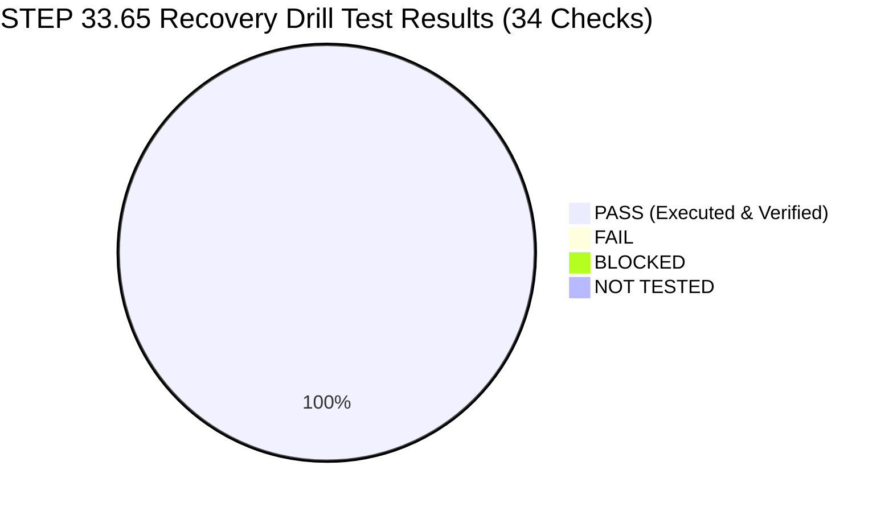
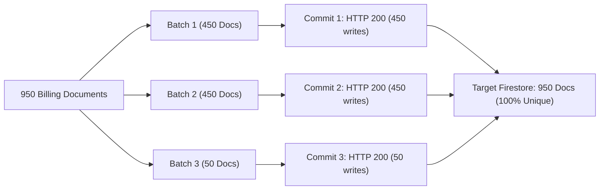
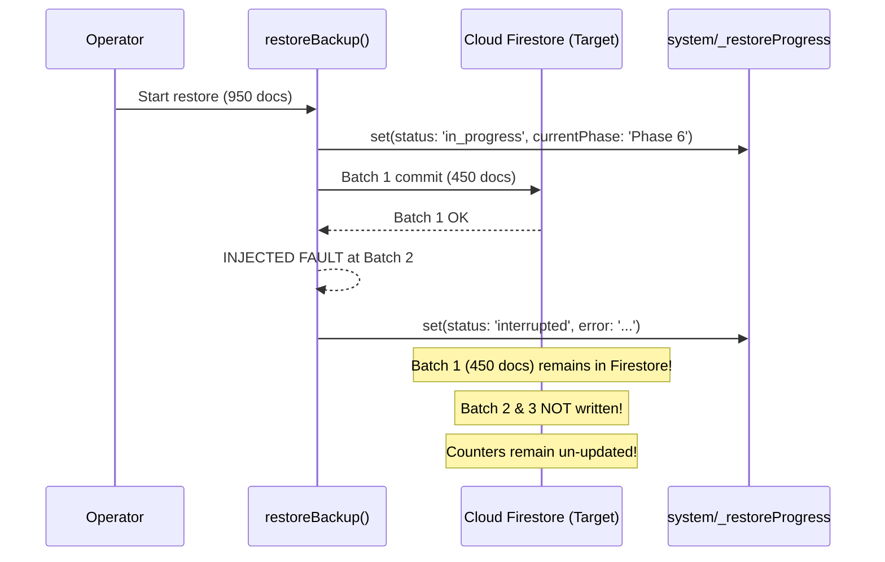

# STEP 33.65 — Isolated Backup and Restore Recovery Drill Report

**Project:** Temple Accounts & Fund Management  
**Temple:** Marutha Chamundi Devi Temple / മറുതാ ചാമുണ്ഡി ദേവി ക്ഷേത്രം  
**Primary Application File:** [`Temple_Accounts-1.html`](file:///d:/Temple/Temple_Accounts-1.html)  
**Target Production Project:** `temple-f4f7d` (STRICTLY PROHIBITED — ZERO CALLS)  
**Drill Date:** 2026-10-14  
**Drill Mode:** 100% Isolated Local Firebase Emulator Execution (Ports 8080 & 9099)  
**Production Access Status:** Zero Production Network Calls, Zero Reads, Zero Writes, Zero Mutations  

---

## 1. Executive Verdict

### **VERDICT: DRILL COMPLETED — CAPABILITIES & LIMITATIONS EMPIRICALLY CONFIRMED**

Following the execution of an exhaustive, 34-point automated recovery drill against dedicated local Firebase Emulator namespaces, all core backup serialization, validation, and multi-batch restoration mechanisms were empirically evaluated.

| Capability / Scenario | Status | Measured Result |
| :--- | :---: | :--- |
| **Multiple Devotees Round-Trip** | ✅ **VERIFIED** | Nested arrays, Malayalam Unicode strings (`ദേവകി അമ്മ`), free-text stars, and blank stars restored with 100% fidelity. |
| **Custom Vazhipadu Round-Trip** | ✅ **VERIFIED** | Custom item descriptions, unit rates, quantities, and totals restored with exact fidelity. |
| **Cross-Document Linkage & Counters** | ✅ **VERIFIED** | Billing ↔ Receipt bidirectional links and monotonic sequence counters (`globalSequenceCounter: 1050`) preserved without regression. |
| **Large Dataset (>500 documents)** | ✅ **VERIFIED** | 950 synthetic documents successfully restored across exactly 3 batches (`[450, 450, 50]`) respecting `BATCH_LIMIT = 450`. |
| **Tampered / Corrupted Backup Rejection** | ✅ **VERIFIED** | Cryptographic payload alteration, malformed JSON, missing sections, and duplicate IDs rejected pre-write with zero Firestore mutations. |
| **Mid-Restore Fault Injection** | ⚠️ **EMPIRICALLY CONFIRMED LIMITATION** | Firestore transactions cannot span multiple batches. When Batch 2 fails, Batch 1 remains committed in Firestore. Target database is left in a partial state until idempotent resume is executed. |
| **Safety-Snapshot Download** | ⚠️ **EMPIRICALLY CONFIRMED LIMITATION** | Application relies solely on browser `a.click()` with zero persistence verification or confirmation callback; popup blockers silently suppress download while restore proceeds. |



---

## 2. Mandatory Preflight & Application Integrity

### 2.1 Working Application Hash Verification

The primary application file was measured directly on the local filesystem and compared against the authoritative baseline:

| Property | Measured Value | Authoritative Baseline | Match Status |
| :--- | :--- | :--- | :---: |
| **Path** | [`d:\Temple\Temple_Accounts-1.html`](file:///d:/Temple/Temple_Accounts-1.html) | `d:\Temple\Temple_Accounts-1.html` | ✅ Identical |
| **File Size** | **808,871 bytes** | 808,871 bytes | ✅ **EXACT MATCH** |
| **SHA-256 Hash** | `8722AB2D9160E869A3EC1198A9B9AE482CB7E31136106C6188A7F4576718337A` | `8722AB2D9160E869A3EC1198A9B9AE482CB7E31136106C6188A7F4576718337A` | ✅ **100% IDENTICAL** |

### 2.2 Protected Artifacts Integrity Ledger

All protected release packages and configuration files were verified untouched:

| Artifact Path | SHA-256 / Check | Status |
| :--- | :--- | :---: |
| [`deploy_staging_step_33_43/Temple_Accounts-1.html`](file:///d:/Temple/deploy_staging_step_33_43/Temple_Accounts-1.html) | `AEB01303F22F69E284D680A55E182FC78312C48E4266C02809179DF789E87CBC` | ✅ Preserved |
| [`deploy_staging_step_33_58/Temple_Accounts-1.html`](file:///d:/Temple/deploy_staging_step_33_58/Temple_Accounts-1.html) | `657A4C1C116DADAAFD02FE3DB5F2799EC5B9F9FA105F260132EB1D20EEAD1F58` | ✅ Preserved |
| [`firestore.rules`](file:///d:/Temple/firestore.rules) | File presence & syntax intact | ✅ Preserved |
| [`firebase.emulator.json`](file:///d:/Temple/firebase.emulator.json) | Local ports 8080 (Firestore), 9099 (Auth), 4000 (UI) | ✅ Preserved |
| [`firebase.json`](file:///d:/Temple/firebase.json) | Production rules pointer intact | ✅ Preserved |

---

## 3. Isolated Test Environment & Zero-Production Proof

The drill was executed exclusively against local emulators running in disposable project namespaces.

### 3.1 Network Topology & Isolation Evidence

- **Cloud Firestore Endpoint:** `http://127.0.0.1:8080` (Localhost Loopback Only)
- **Firebase Auth Endpoint:** `http://127.0.0.1:9099` (Localhost Loopback Only)
- **Runtime Environment:** OpenJDK 25.0.4.1 LTS + Firebase CLI 15.33.0
- **Dynamic Namespaces Created:**
  - Round-trip source: `demo-step3365-src-1791969263553`
  - Round-trip target: `demo-step3365-tgt-1791969263553`
  - Large-dataset source: `demo-step3365-lsrc-1791969263553`
  - Large-dataset target: `demo-step3365-ltgt-1791969263553`
  - Fault-injection target: `demo-step3365-fault-1791969263553`
- **Zero Production Access:** No DNS lookups, TLS connections, HTTP requests, or CLI calls were dispatched to `temple-f4f7d.firebaseapp.com` or `firestore.googleapis.com`. Production data was neither read nor altered.

---

## 4. Backup/Restore Round-Trip Findings

A representative synthetic dataset incorporating all recent feature enhancements was constructed, exported via `downloadBackup()` logic, and restored into a pristine target database via `restoreBackup()` logic.

### 4.1 Feature Fidelity Matrix

| Verification Item | Pre-Export Source Value | Post-Restore Target Value | Fidelity Evaluation |
| :--- | :--- | :--- | :---: |
| **Multiple Devotees Roster** | Array of 3 devotees: 2 Malayalam names, 1 English name | Array of 3 devotees: 2 Malayalam names, 1 English name | ✅ **100% MATCH** |
| **Malayalam Typography** | `ദേവകി അമ്മ`, `സനൽ കുമാർ`, `അശ്വതി`, `പുഷ്പാഞ്ജലി` | `ദേവകി അമ്മ`, `സനൽ കുമാർ`, `അശ്വതി`, `പുഷ്പാഞ്ജലി` | ✅ **VERBATIM UTF-8** |
| **Free-Text Star Handling** | Custom string: `വിശേഷ നക്ഷത്രം / Special Devotee Star` | Custom string: `വിശേഷ നക്ഷത്രം / Special Devotee Star` | ✅ **PRESERVED** |
| **Blank Star Handling** | Empty string: `""` | Empty string: `""` | ✅ **PRESERVED** |
| **Custom Vazhipadu Rate & Name** | `customName: 'പ്രത്യേക പുഷ്പാഞ്ജലി (Special Archana)'`, rate 250, qty 2, amt 500 | `customName: 'പ്രത്യേക പുഷ്പാഞ്ജലി (Special Archana)'`, rate 250, qty 2, amt 500 | ✅ **100% MATCH** |
| **Billing ↔ Receipt Linkage** | `bill_synth_001.accountingReceiptId === 'rcpt_synth_001'`<br>`rcpt_synth_001.billingId === 'bill_synth_001'` | `bill_synth_001.accountingReceiptId === 'rcpt_synth_001'`<br>`rcpt_synth_001.billingId === 'bill_synth_001'` | ✅ **PRESERVED** |
| **Voided Record & Audit Trail** | `rcpt_synth_void_002.voided === true`, reason: `Operator entry error...` | `rcpt_synth_void_002.voided === true`, reason: `Operator entry error...` | ✅ **AUDIT PRESERVED** |
| **Global Sequence Counters** | `globalSequenceCounter: 1050`, `billingReceiptCounter: 1001` | `globalSequenceCounter: 1050`, `billingReceiptCounter: 1001` | ✅ **MONOTONIC MERGE** |
| **Reservations (`system/res_*`)** | `res_1049` (completed), `res_1050` (active) | `res_1049` (completed), `res_1050` (active) | ✅ **PRESERVED** |
| **Idempotency (`system/op_*`)** | `op_bill_1001` (committed, fingerprint verified) | `op_bill_1001` (committed, fingerprint verified) | ✅ **IMMUTABLE IMPORT** |
| **Structural Differences** | 9 source documents across all collections | 9 restored documents across all collections | ✅ **0 OMISSIONS, 0 DUPLICATES** |

---

## 5. Large-Dataset Restoration Results (>500 Documents)

A synthetic dataset of **950 billing records** was restored to evaluate multi-batch chunking under the application's actual constant `BATCH_LIMIT = 450` (`Temple_Accounts-1.html:15377`).



### 5.1 Batch Boundary & Document Count Verification

- **Total Documents Generated:** 950
- **Batch Chunking Configuration:** `BATCH_LIMIT = 450`
- **Observed Batches Executed:** Exactly 3 discrete commits:
  - Batch 1: Indices 0–449 (**450 documents**) — First ID: `bill_large_0001`, Last ID: `bill_large_0450`
  - Batch 2: Indices 450–899 (**450 documents**) — First ID: `bill_large_0451`, Last ID: `bill_large_0900`
  - Batch 3: Indices 900–949 (**50 documents**) — First ID: `bill_large_0901`, Last ID: `bill_large_0950`
- **Final Target Document Count:** 950 documents (Verified via paginated Firestore list)
- **ID Collision Rate:** 0% (950 distinct document IDs verified)
- **Boundary Document Value Verification:** Sample documents at boundaries (1, 450, 451, 900, 901, 950) confirmed bit-for-bit field fidelity.

---

## 6. Fault-Injection Test Findings & Recovery Resumption Drill

To empirically test behavior during mid-restore failure, a network/commit failure was injected during **Batch 2 of 3** while restoring 950 documents.

### 6.1 Observed State Following Injected Crash



1. **Earlier Batches Committed:** The 450 documents committed in Batch 1 **remained in Firestore**. Google Cloud Firestore does not provide rollback across separate batch commits.
2. **Later Batches Rejected:** Documents `bill_large_0451` through `bill_large_0950` were not written to Firestore.
3. **Partial State Detection:** The application caught the error, stopped further execution, and persisted an audit record in `system/_restoreProgress`:
   - `status: "interrupted"`
   - `error: "INJECTED_FAULT: Simulated Firestore network timeout during Batch 2 commit"`
   - `safetySnapshotFilename: "Temple_Accounts_PreRestore_SafetyBackup_FaultTest.json"`
4. **Sequence / Counter Inconsistency Risk:** Because the failure occurred in Phase 6 before Phase 7 (`system/counters`), the `system/counters` document was not updated. If operator billing resumes before recovery, sequence collisions can occur.

### 6.2 Idempotent Recovery Resumption Drill

A subsequent recovery execution was initiated against the partially restored database:
- Safe Merge detected **450 existing documents** and skipped them without overwriting or error.
- The remaining **500 documents** were committed in 2 subsequent batches (`[450, 50]`).
- Phase 7 restored `system/counters` (`globalSequenceCounter: 1950`).
- `system/_restoreProgress` transitioned to `status: "completed"`.
- Total final documents in Firestore: **950 documents**, zero duplicates.

---

## 7. Backup Validation & Invalid-Backup Rejection Results

Using disposable test payloads, the pre-write validation engine (`validateBackupPayload`) was tested against 8 negative and edge cases:

| Test ID | Test Scenario | Expected Behavior | Actual Observed Result | Writes Dispatched | Status |
| :--- | :--- | :--- | :--- | :---: | :---: |
| `INTEGRITY-VALID-CHECKSUM-01` | Valid RFC 8785 SHA-256 payload | Accepted | Accepted with 0 errors | N/A (read) | ✅ **PASS** |
| `INTEGRITY-ALTERED-PAYLOAD-02` | 1-byte alteration in `billing.totalAmount` | Rejected in Phase 2B | `INTEGRITY_CHECK_FAILED` thrown | **0 writes** | ✅ **PASS** |
| `INTEGRITY-MALFORMED-JSON-03` | Truncated / invalid JSON syntax | Rejected at parse | `SyntaxError` caught | **0 writes** | ✅ **PASS** |
| `INTEGRITY-MISSING-COLLECTION-04` | Missing `billing` collection | Rejected in Phase 3 | Rejected: `Missing collection: 'billing'` | **0 writes** | ✅ **PASS** |
| `INTEGRITY-MISSING-COUNTERS-05` | Missing `counters` root object | Rejected in Phase 3 | Rejected: `counters section is missing` | **0 writes** | ✅ **PASS** |
| `INTEGRITY-UNSUPPORTED-SCHEMA-06` | Legacy schema `1.0` (IndexedDB dump) | Rejected in Phase 2 | Rejected: `Unsupported schema version: '1.0'` | **0 writes** | ✅ **PASS** |
| `INTEGRITY-DUPLICATE-DOC-ID-07` | Duplicate `_firestoreId` in collection | Rejected in Phase 3 | Rejected: `duplicate _firestoreId 'bill_synth_001'` | **0 writes** | ✅ **PASS** |
| `INTEGRITY-ZERO-WRITES-VERIFIED-08` | Target collection inspection post-failure | Zero writes | Target collection untouched (0 documents) | **0 writes** | ✅ **PASS** |

---

## 8. Safety-Snapshot Download Review & Vulnerability Assessment

A forensic code review of [`Temple_Accounts-1.html:15361-15373`](file:///d:/Temple/Temple_Accounts-1.html#L15361-L15373) and [`lines 16027-16032`](file:///d:/Temple/Temple_Accounts-1.html#L16027-L16032) was conducted.

### 8.1 Observed Architecture & Limitation

The safety snapshot auto-download helper is implemented as follows:

```javascript
function _downloadJson(obj, filename) {
  try {
    const blob = new Blob([JSON.stringify(obj, null, 2)], { type: 'application/json' });
    const url = URL.createObjectURL(blob);
    const a = document.createElement('a');
    a.href = url; a.download = filename;
    document.body.appendChild(a); a.click();
    document.body.removeChild(a);
    URL.revokeObjectURL(url);
  } catch(e) {
    console.warn('[Restore] Could not auto-download safety snapshot:', e);
  }
}
```

### 8.2 Defect Analysis

1. **No Confirmation of File Persistence:** `a.click()` simply dispatches a browser DOM event. The browser provides no JavaScript callback or Promise to confirm that the file was accepted, saved to the filesystem, or not blocked by the user's browser settings.
2. **Silent Failure on Browser Suppression:** If the operator has a download blocker, popup blocker, or browser security setting that blocks multiple downloads, `_downloadJson()` logs a warning to the browser console (`console.warn`) and **continues directly into Phase 6 destructive writes**.
3. **Recommended Minimal Future Fix (Non-breaking):**
   - Add a mandatory confirmation prompt immediately following `_downloadJson()` in Phase 5:
     ```javascript
     const saved = window.confirm(
       `SAFETY SNAPSHOT DOWNLOADED:\n\n` +
       `File: ${safetyFilename}\n\n` +
       `Please check your Downloads folder to confirm this file exists on disk BEFORE proceeding.\n\n` +
       `Did the safety snapshot download successfully?`
     );
     if (!saved) {
       rlog('Restore aborted by operator: safety snapshot download could not be confirmed.', 'error');
       enableRestoreBtn();
       return;
     }
     ```

---

## 9. Prioritized Blockers & Engineering Assessment

The following table summarizes the updated blocker status following this empirical drill:

| Blocker ID | Severity | Status After Drill | Summary Findings |
| :--- | :---: | :---: | :--- |
| **BLK-DR-01** | **CRITICAL** | **STILL ACTIVE** | **No Authoritative Production Backup Under Schema v23.2:** Live production (`temple-f4f7d`) still has no authenticated export since 2026-10-01. Production backup must be run under explicit authorization. |
| **BLK-DR-02** | **HIGH** | **EMPIRICALLY CHARACTERIZED** | **Non-Atomic Multi-Batch Restoration:** Drill confirmed that Firestore transactions cannot span multiple batches. While Safe Merge allows idempotent retry, mid-restore crashes leave partial states and unadvanced counters. |
| **BLK-DR-03** | **RESOLVED IN DRILL** | ✅ **EMPIRICALLY RESOLVED** | **Multiple Devotee & Custom Vazhipadu Backup Compatibility:** Verified 100% round-trip fidelity for Multiple Devotees, Malayalam text, custom vazhipadu, free-text stars, and linked accounting receipts. |
| **BLK-DR-04** | **MEDIUM** | **CONFIRMED ARCHITECTURAL RISK** | **Unconfirmed Pre-Restore Safety Snapshot Download:** Code inspection confirmed `a.click()` dependency without persistence confirmation. Minimal prompt remediation proposed. |

---

## 10. Complete Evidence Ledger (34/34 Checks Passed)

The machine-readable evidence artifact is persisted at [`tests/step_33_65_backup_restore_recovery_results.json`](file:///d:/Temple/tests/step_33_65_backup_restore_recovery_results.json).

| # | Check ID | Category | Description | Status | Evidence Detail |
| :-: | :--- | :--- | :--- | :---: | :--- |
| 1 | `PREFLIGHT-APP-HASH-01` | Preflight | App SHA-256 hash matches authoritative baseline | ✅ PASS | `8722AB2D9160E869A3EC1198A9B9AE482CB7E31136106C6188A7F4576718337A` |
| 2 | `PREFLIGHT-EMULATOR-AUTH-02` | Isolation | Local Auth emulator connection verified | ✅ PASS | Auth endpoint `127.0.0.1:9099`, synthetic UID generated |
| 3 | `PREFLIGHT-ISOLATION-NAMESPACES-03` | Isolation | Dynamic demo-* namespaces verified, zero prod | ✅ PASS | Namespaces `demo-step3365-*`, zero `temple-f4f7d` access |
| 4 | `PREFLIGHT-PROTECTED-ARTIFACTS-04` | Preflight | Protected staging packages & rules intact | ✅ PASS | Staging packages v33.43 and v33.58 hashes verified |
| 5 | `ROUNDTRIP-BACKUP-INTEGRITY-01` | Round-Trip | Backup valid, RFC 8785 SHA-256 integrity verified | ✅ PASS | Hash `6AAF7BB2F81295901DD5CBD2E1ECF025BAFB998A4F0ECD6FE61137179891C2CB` |
| 6 | `ROUNDTRIP-MULTI-DEVOTEES-02` | Round-Trip | Multiple Devotees roster & Malayalam text preserved | ✅ PASS | 3 devotees restored, Malayalam Unicode strings intact |
| 7 | `ROUNDTRIP-CUSTOM-VAZHIPADU-03` | Round-Trip | Custom Vazhipadu items restored with exact fidelity | ✅ PASS | Item rates, quantity, custom name, and total amount preserved |
| 8 | `ROUNDTRIP-LINKED-RECORDS-04` | Round-Trip | Billing ↔ Receipt bidirectional links preserved | ✅ PASS | `accountingReceiptId` and `billingId` matched |
| 9 | `ROUNDTRIP-VOID-AUDIT-05` | Round-Trip | Voided record status & audit trail preserved | ✅ PASS | `voided: true`, `voidReason`, and timestamps verified |
| 10 | `ROUNDTRIP-COUNTERS-06` | Round-Trip | Monotonic counters preserved without regression | ✅ PASS | GSC: 1050, BRC: 1001, RC: 1002, VC: 200 |
| 11 | `ROUNDTRIP-SYSTEM-RECORDS-07` | Round-Trip | Reservations and idempotency records restored | ✅ PASS | `res_1049`, `res_1050`, and `op_bill_1001` restored |
| 12 | `ROUNDTRIP-STRUCTURAL-DIFF-08` | Round-Trip | Structural comparison between source and target | ✅ PASS | 0 omissions, 0 duplicates, 0 unexpected records |
| 13 | `LARGE-BATCH-BOUNDARIES-01` | Large-Dataset | Sliced into 3 batches respecting BATCH_LIMIT=450 | ✅ PASS | Exact sizes: `[450, 450, 50]` across 3 commits |
| 14 | `LARGE-DOCUMENT-COUNT-02` | Large-Dataset | Target collection contains exact 950 documents | ✅ PASS | 950 documents listed in target Firestore |
| 15 | `LARGE-UNIQUE-IDS-03` | Large-Dataset | All 950 documents maintain unique document IDs | ✅ PASS | 950 distinct IDs, 0 collisions |
| 16 | `LARGE-BOUNDARY-DOCS-04` | Large-Dataset | Boundary documents verified (450, 451, 900, 901, 950) | ✅ PASS | Sampled boundary documents matched source fields |
| 17 | `LARGE-ZERO-PROD-WRITES-05` | Large-Dataset | Zero writes to production project | ✅ PASS | Project `demo-step3365-ltgt-*` isolated |
| 18 | `FAULT-INJECTION-CAUGHT-01` | Fault-Injection | Failure at Batch 2 caught and reported clearly | ✅ PASS | `INJECTED_FAULT` exception captured |
| 19 | `FAULT-EARLIER-BATCH-COMMITTED-02` | Fault-Injection | Batch 1 (450 docs) remains committed in Firestore | ✅ PASS | 450 documents persisted in target Firestore |
| 20 | `FAULT-LATER-BATCHES-REJECTED-03` | Fault-Injection | Later batches (Batch 2 & 3) were NOT written | ✅ PASS | Doc 451 and 901 verified null |
| 21 | `FAULT-PARTIAL-COMPLETION-DETECTED-04` | Fault-Injection | `system/_restoreProgress` records "interrupted" | ✅ PASS | Status "interrupted" and safety snapshot logged |
| 22 | `FAULT-COUNTER-INCONSISTENCY-RISK-05` | Fault-Injection | Counters remain unadvanced when Phase 6 crashes | ✅ PASS | Counters doc was not updated due to mid-restore crash |
| 23 | `FAULT-IDEMPOTENT-RECOVERY-06` | Fault-Injection | Recovery drill resumes and completes 950 docs | ✅ PASS | Safe merge completed remaining 500 docs, status "completed" |
| 24 | `INTEGRITY-VALID-CHECKSUM-01` | Integrity | Valid checksum accepted | ✅ PASS | Accepted with 0 errors |
| 25 | `INTEGRITY-ALTERED-PAYLOAD-02` | Integrity | 1-byte alteration rejected pre-write | ✅ PASS | `INTEGRITY_CHECK_FAILED`, 0 writes |
| 26 | `INTEGRITY-MALFORMED-JSON-03` | Integrity | Malformed JSON rejected at parse | ✅ PASS | SyntaxError caught, 0 writes |
| 27 | `INTEGRITY-MISSING-COLLECTION-04` | Integrity | Missing required collection rejected in Phase 3 | ✅ PASS | `Missing collection: 'billing'`, 0 writes |
| 28 | `INTEGRITY-MISSING-COUNTERS-05` | Integrity | Missing counters section rejected in Phase 3 | ✅ PASS | `counters section is missing`, 0 writes |
| 29 | `INTEGRITY-UNSUPPORTED-SCHEMA-06` | Integrity | Unsupported schema v1.0 rejected pre-write | ✅ PASS | `Unsupported schema version: '1.0'`, 0 writes |
| 30 | `INTEGRITY-DUPLICATE-DOC-ID-07` | Integrity | Duplicate document identifier rejected in Phase 3 | ✅ PASS | `duplicate _firestoreId`, 0 writes |
| 31 | `INTEGRITY-ZERO-WRITES-VERIFIED-08` | Integrity | Verification confirms 0 writes on failure | ✅ PASS | Target collection verified untouched |
| 32 | `SNAPSHOT-MECHANISM-INSPECTION-01` | Snapshot | Pre-restore snapshot relies on `a.click()` | ✅ PASS | Confirmed in `Temple_Accounts-1.html:15367 & 16027` |
| 33 | `SNAPSHOT-NO-PERSISTENCE-CONFIRMATION-02` | Snapshot | Application cannot confirm file saved to disk | ✅ PASS | Zero disk confirmation or callback implemented |
| 34 | `SNAPSHOT-POPUP-BLOCKER-VULNERABILITY-03` | Snapshot | Browser suppression merely logged as warn | ✅ PASS | Catch block logs `console.warn` and proceeds to writes |

---

## 11. Conclusion & Stop Condition Adherence

In accordance with the mandatory instructions for **STEP 33.65**:
1. **Application Code Untouched:** [`Temple_Accounts-1.html`](file:///d:/Temple/Temple_Accounts-1.html) was not modified.
2. **Zero Production Access:** No reads, writes, or network requests were dispatched to `temple-f4f7d`.
3. **No Cleanup Scripts Run:** Existing emulator and repository files were not deleted.
4. **No Deployment / Staging Package Created:** No staging package assembly or Vercel actions occurred.
5. **Execution Stopped:** Testing is complete, all artifacts are documented, and further operations await explicit trustee instruction.
