# STEP 33.81 — Receipt Description Propagation Audit Report (READ-ONLY)

**Target File:** `d:\Temple\Temple_Accounts-1.html`  
**Audit Date:** October 17, 2026  
**Auditor:** Antigravity AI  
**Audit Mode:** READ-ONLY (No code modified, no tests run or altered, no database mutations, no live network calls)  
**Final Verdict:** **SAFE WITH CONDITIONS**

---

## Executive Summary

An exhaustive read-only audit of `Temple_Accounts-1.html` was conducted to investigate how the **Description** field from the Receipts form is saved, stored, and displayed across the **Receipts table**, **Cash Book**, and **General Ledger**.

### Key Findings
1. **Receipt Storage & Edit Workflow**: The receipt form already contains a `<input type="text" name="description">` control (Line 7860). When submitted, `saveReceipt` records this value into the Firestore document under the exact field name **`description`** for both independent receipts (Line 19964) and physical receipts (Line 19644). In edit mode (Lines 8026–8051), `fsUpdateRecordSafe` correctly preserves or updates `description`.
2. **Billing Synchronization**: In `runBillingAtomicTransaction` (Lines 19384–19486), billing records automatically synchronize into the `receipts` collection with a comprehensive, pre-formatted `description` combining offering name, quantity, devotee star, and roster details.
3. **Display Omission in Receipts Table**: Despite being captured in the form, saved in Firestore, printed on vouchers (`printReceipt`, Line 8231), and exported in Receipts CSV (Line 16910), the **Receipts table renderer (`VIEW_RENDERERS.receipts`) completely omits the description** (Lines 7894, 7912–7927).
4. **Display Omission in Cash Book**: `buildCashBookRows()` (Lines 12530–12611) queries `activeReceipts()` which contains `r.description`, but the row mapping hardcodes `particulars: 'Receipt ' + r.receiptNo + ' - ' + r.name`, omitting `r.description`.
5. **Display Omission in General Ledger**: `VIEW_RENDERERS.ledger` (Lines 12790–12826) queries `activeReceipts()`, but the row mapping hardcodes `particulars: r.name + ' - ' + r.category`, omitting `r.description`. Both billing-linked and ordinary receipts share the identical Firestore `receipts` collection and query path.
6. **Architectural Guardrails**: Both the Cash Book and General Ledger have strict column-count dependencies enforced by existing CSS alignment rules, DOM-parsing recalculation functions (`updateLedgerTotals`, `getFilteredLedgerRecords`), PDF exports (`renderLedgerPDFReportHTML`), and regression test suites (`test_step_33_6a_cashbook.js`, `test_step_33_32a_ledger_totals.js`, `test_step_33_34b_ledger_pdf_export.js`). 
   - **Cash Book** must remain exactly **7 columns**; the description must be displayed inside the `Particulars` column.
   - **General Ledger** must remain exactly **6 columns**; the description must be displayed inside the `Particulars` column.
   - **Receipts Table** can either adopt a dedicated 10th column (requiring CSS right-alignment selector update at Line 2226 from `nth-child(7)` to `nth-child(8)`) or display the description as a secondary subtitle under the Name or Category cell (preserving 9 columns and zero CSS changes).

---

## 1. Baseline File Verification

| Attribute | Verified Value |
| :--- | :--- |
| **Target File** | `d:\Temple\Temple_Accounts-1.html` |
| **File Size** | `832,866 bytes` |
| **Total Lines** | `21,030 lines` |
| **SHA-256 Hash** | `17BB408830459B3FB1CEC6F40D04221D3C06BF3BFDAEDAFEBFFD2D7DAD562A4E` |
| **Environment** | Windows 11, Node.js v20.18.0, PowerShell |
| **Database State** | Production Firebase untouched; no reads, writes, rules, or counter changes |

*Verification Command:* `Get-FileHash -Algorithm SHA256 'D:\Temple\Temple_Accounts-1.html'`  
*Result:* Hash matches baseline exactly.

---

## 2. Investigation Task Findings

### Task 1: Receipt Form Description Input & Stored Field Name

- **Form Input Element (Line 7860):**
  ```html
  <div class="form-group">
    <label>Description</label>
    <input type="text" name="description" value="${esc(editRec ? editRec.description : '')}">
  </div>
  ```
  The input has `name="description"`. If editing an existing record, it initializes with `editRec.description` or empty string if undefined.
- **Form Submission Parsing (`saveReceipt`, Lines 8014–8022):**
  ```javascript
  const rec = {
    date: fd.get('date'), name: fd.get('name'), mobile: fd.get('mobile') || '',
    star: (fd.get('star') || '').trim(),
    fund: targetFund,
    category: targetCategory,
    description: fd.get('description') || '',
    paymentMode: fd.get('paymentMode'), bankAccount: fd.get('bankAccount') || '', amount,
    remarks: fd.get('remarks') || ''
  };
  ```
- **Independent Receipt Firestore Document (`fsCreateIndependentReceipt`, Line 19964):**
  ```javascript
  description: receiptInput.description || '',
  ```
- **Physical Receipt Firestore Document (`fsCreatePhysicalReceipt`, Line 19644):**
  ```javascript
  description: receiptInput.description || '',
  ```
- **Billing-Linked Receipt Firestore Document (`runBillingAtomicTransaction`, Line 19472):**
  ```javascript
  description: description,
  ```
- **Financial Fingerprint (`computeReceiptFingerprint`, Lines 19000, 19014):**
  ```javascript
  const description = String(input.description || '').trim();
  // Part of the v2 fingerprint array at index 9:
  return ['v2', date, fund, category, amount, paymentMode, bankAccount, name, mobile, description, remarks, manNo].join('|');
  ```
- **Verified Fact:** The exact field name in the saved receipt document in the Firestore `receipts` collection is **`description`** (type: `string`).

---

### Task 2: Description in Save and Edit Workflows

- **Save Workflow (New Receipts):**
  - For independent receipts, `saveReceipt` passes `rec` to `fsCreateIndependentReceipt`. The field `rec.description` is written atomically into `receipts/rcpt_${N}` inside a Firestore transaction.
  - For physical receipts (`P600–P900`, `PU1+`), `saveReceipt` passes `rec` to `fsCreatePhysicalReceipt`. The field `rec.description` is written atomically into `receipts/rcpt_phys_${physId}`.
- **Edit Workflow (Existing Receipts):**
  - When an admin clicks "Edit" in the Receipts table (Line 7924):
    `navigate('receipts', null, '${esc(r.id)}')`
  - In `VIEW_RENDERERS.receipts` (Lines 7820–7828):
    1. Loads `editRec = await fsGetOneSafe('receipts', editId)`.
    2. Guard against editing voided receipts (Lines 7821–7824).
    3. Guard against editing billing-linked receipts:
       ```javascript
       if (editRec && (editRec.source === 'billing' || editRec.billingFirestoreId || editRec.billingId || editRec.billingReceiptNo)) {
         alert(`Receipt ${editRec.receiptNo || editId} was generated from Pooja Bill ... Direct editing of billing-linked receipts is not permitted ...`);
         editRec = null;
       }
       ```
    4. Renders the form with `value="${esc(editRec ? editRec.description : '')}"`.
  - When the admin submits the update (`saveReceipt`, Lines 8026–8051):
    ```javascript
    if (editId) {
      const prior = await fsGetOneSafe('receipts', editId);
      ...
      rec.id = editId;
      rec.receiptNo = receiptNoInput || (prior ? prior.receiptNo : '');
      rec.voided = prior ? prior.voided : false;
      // Preserves prior metadata...
      await fsUpdateRecordSafe('receipts', rec.firestoreId || editId, rec);
      savedRec = rec;
    }
    ```
    - `rec.description` receives `fd.get('description') || ''`.
    - If the admin edited the text, the new text is saved.
    - If the admin did not modify the text, the pre-populated existing text is preserved.
    - `fsUpdateRecordSafe` uses `{ merge: true }` to update the Firestore document and syncs the local IndexedDB cache.
- **Verified Fact:** The existing save and edit workflows already preserve and update the description field completely and correctly. No changes are required in the receipt form, `saveReceipt`, `fsCreateIndependentReceipt`, `fsCreatePhysicalReceipt`, or `fsUpdateRecordSafe`.

---

### Task 3: Receipts Table Renderer Inspection

- **Table Header (Line 7894):**
  ```html
  <thead><tr><th>Receipt No</th><th>Date</th><th>Name</th><th>Fund</th><th>Category</th><th>Mode</th><th>Amount</th><th>Status</th><th>Actions</th></tr></thead>
  ```
  Current columns (9 total):
  `[1: Receipt No, 2: Date, 3: Name, 4: Fund, 5: Category, 6: Mode, 7: Amount, 8: Status, 9: Actions]`
- **Table Body (Lines 7912–7927):**
  ```html
  <tr data-record-id="${esc(r.id)}" data-edit-scope="receipts" data-receipt-type="${typeAttr}" class="${rowClass.trim()}">
    <td><b>${esc(r.receiptNo)}</b>${badgeHtml}</td>
    <td>${fmtDate(r.date)}</td>
    <td>${esc(r.name)}${r.star ? ` <span style="font-size:11px;color:var(--text-muted);font-weight:normal;">(${esc(r.star)})</span>` : ''}</td>
    <td>${esc(r.fund)}</td>
    <td>${esc(r.category)}</td>
    <td><span class="pill ${(r.paymentMode||'').toLowerCase()}">${esc(r.paymentMode||'')}</span></td>
    <td>${fmtMoney(r.amount)}</td>
    <td>${r.voided?'Voided':'Active'}</td>
    <td>...actions...</td>
  </tr>
  ```
- **Table Search Filter (`filterReceiptTable`, Lines 7937–7946):**
  ```javascript
  const textMatch = !q || tr.textContent.toLowerCase().includes(q);
  ```
  Any text rendered in any table cell within the row is automatically searchable by the search toolbar.
- **CSS Column-Index Dependency (Line 2226):**
  ```css
  #receiptTable th:nth-child(7), #receiptTable td:nth-child(7),
  #paymentTable th:nth-child(7), #paymentTable td:nth-child(7),
  ... {
    text-align: right;
    font-variant-numeric: tabular-nums;
  }
  ```
  Column 7 is currently styled with right alignment for numeric amounts.
- **Options for Displaying Description:**
  - **Option A (Dedicated Column — Recommended if column layout is desired):**
    - Add `<th>Description</th>` in `<thead>` after `<th>Category</th>`.
    - Add `<td>${esc(r.description || '—')}</td>` in `<tbody>` after the category cell.
    - **CRITICAL CONDITION:** Update line 2226 from `#receiptTable th:nth-child(7), #receiptTable td:nth-child(7)` to `nth-child(8)`, because Amount shifts from column 7 to column 8.
  - **Option B (Contextual Subtitle — Smallest UI change, 0 CSS edits):**
    - Render the description as a secondary line inside the Name cell (identical to how Devotee Star is displayed):
      ```html
      <td>${esc(r.name)}${r.star ? ` <span style="font-size:11px;color:var(--text-muted);font-weight:normal;">(${esc(r.star)})</span>` : ''}${r.description ? `<div style="font-size:11px;color:var(--text-muted);margin-top:2px;">${esc(r.description)}</div>` : ''}</td>
      ```
    - Retains 9 columns, requires zero CSS changes, avoids horizontal table expansion, and is automatically searchable by `receiptSearch`.

---

### Task 4: Cash Book Data Source and Renderer Inspection

- **Data Source (`buildCashBookRows`, Lines 12530–12546):**
  ```javascript
  const [receipts, payments, transfers, loans, collections, payouts] = await Promise.all([
    activeReceipts(), activePayments(), txFetcher, allLoans(), colFetcher, payFetcher
  ]);
  const rows = [];
  receipts.filter(r=>r.paymentMode==='Cash' && !r.voided).forEach(r => rows.push({
    date: r.date,
    particulars: `Receipt ${r.receiptNo} - ${r.name}`,
    category: r.category || 'Uncategorized',
    paymentType: resolvePaymentType(r, 'Cash'),
    receipt: r.amount,
    payment: 0
  }));
  ```
- **Table Renderer (`VIEW_RENDERERS.cashbook`, Lines 12653–12658):**
  - Header:
    ```html
    <thead><tr><th>Date</th><th>Particulars</th><th>Category</th><th>Payment Type</th><th>Receipt</th><th>Payment</th><th>Balance</th></tr></thead>
    ```
  - Body:
    ```html
    <tr data-category="${esc(r.category)}">
      <td>${fmtDate(r.date)}</td>
      <td>${esc(r.particulars)}</td>
      <td>${esc(r.category)}</td>
      <td>${esc(r.paymentType||'—')}</td>
      <td>${r.receipt?fmtMoney(r.receipt):'-'}</td>
      <td>${r.payment?fmtMoney(r.payment):'-'}</td>
      <td>${fmtMoney(r.balance)}</td>
    </tr>
    ```
- **Finding:**
  - `r.description` is available on the receipt record `r` returned by `activeReceipts()`.
  - In `buildCashBookRows`, `r.description` is currently **omitted**. It is not replaced by another field; `particulars` simply concatenates receipt number and name.
- **Constraints & Hardening:**
  - `test_step_33_6a_cashbook.js` (Lines 220–232) explicitly asserts that `#cashBookTable` has exactly **7 columns** in the exact order: `['Date', 'Particulars', 'Category', 'Payment Type', 'Receipt', 'Payment', 'Balance']`.
  - CSS lines 2220–2223 align columns 5, 6, and 7 to the right.
  - `exportCashBookCSV()` (Line 12703) exports the exact 7-column schema.
- **Recommended Implementation for Cash Book:**
  - Include the description inside the **`Particulars`** field:
    ```javascript
    particulars: `Receipt ${r.receiptNo} - ${r.name}${r.description ? ` (${r.description})` : ''}`,
    ```
  - If `r.description` is empty/undefined, it renders `Receipt ${r.receiptNo} - ${r.name}` (100% identical to current behavior).
  - This preserves all 7 columns, maintains all test assertions, keeps CSS alignment intact, and propagates description to both the UI table and `exportCashBookCSV()`.

---

### Task 5: General Ledger Data Source and Renderer Inspection

- **Data Source (`VIEW_RENDERERS.ledger`, Lines 12790–12795):**
  ```javascript
  VIEW_RENDERERS.ledger = async function() {
    const [funds, receipts, payments] = await Promise.all([allFunds(), activeReceipts(), activePayments()]);
    const combined = [
      ...receipts.map(r => ({ date:r.date, voucher:r.receiptNo, particulars:r.name+' - '+r.category, fund:r.fund, debit:0, credit:r.amount })),
      ...payments.map(p => ({ date:p.date, voucher:p.voucherNo, particulars:p.paidTo+' - '+p.category, fund:p.fund, debit:p.amount, credit:0 }))
    ].sort((a,b) => a.date.localeCompare(b.date));
    window._ledgerRows = combined;
  ```
- **Table Renderer (Lines 12810–12814):**
  ```html
  <table id="ledgerTable">
    <thead><tr><th>Date</th><th>Voucher/Receipt No.</th><th>Particulars</th><th>Fund</th><th>Debit</th><th>Credit</th></tr></thead>
    <tbody>
      ${combined.map(x=>`<tr data-date="${x.date}" data-fund="${esc(x.fund)}" data-debit="${x.debit || 0}" data-credit="${x.credit || 0}"><td>${fmtDate(x.date)}</td><td>${esc(x.voucher)}</td><td>${esc(x.particulars)}</td><td>${esc(x.fund)}</td><td>${x.debit?fmtMoney(x.debit):'-'}</td><td>${x.credit?fmtMoney(x.credit):'-'}</td></tr>`).join('')}
    </tbody>
  ```
- **Data Path Comparison (Billing-Linked vs. Ordinary Receipts):**
  - Both ordinary receipts and billing-linked receipts are queried together via `activeReceipts()`.
  - Both are stored as documents in the single `receipts` collection.
  - Both are mapped via `receipts.map(r => ...)`.
  - **Verified Finding:** Billing-linked receipts and ordinary receipts follow the **EXACT SAME data path**. There is no special branching or divergence in the General Ledger.
- **Constraints & Hardening:**
  - The Ledger table is strictly **6 columns**: `Date`, `Voucher/Receipt No.`, `Particulars`, `Fund`, `Debit`, `Credit`.
  - `updateLedgerTotals()` (Lines 12858–12873) and `getFilteredLedgerRecords()` (Lines 12909–12920) parse DOM cells directly by column index: `tds[4]` is Debit and `tds[5]` is Credit.
  - `renderLedgerPDFReportHTML()` (Lines 12989–13028) defines an A4 landscape 6-column layout with 37% dedicated width for `Particulars`.
  - Adding a new column to the Ledger would break `tds[4]` / `tds[5]` DOM parsing, cause totals recalculations to fail, break PDF generation, and violate `test_step_33_32a_ledger_totals.js` and `test_step_33_34b_ledger_pdf_export.js`.
- **Recommended Implementation for General Ledger:**
  - Include the description inside the **`Particulars`** field:
    ```javascript
    ...receipts.map(r => ({ date:r.date, voucher:r.receiptNo, particulars:r.name+' - '+r.category+(r.description ? ' ('+r.description+')' : ''), fund:r.fund, debit:0, credit:r.amount })),
    ```
  - If `r.description` is empty/undefined, it renders `r.name + ' - ' + r.category` (100% identical to current behavior).
  - This preserves all 6 columns, debit/credit column index references, totals calculation, dynamic filtering, and PDF/CSV export.

---

### Task 6: Billing-to-Receipt Accounting Synchronization

- **Billing Synchronization (`runBillingAtomicTransaction`, Lines 19384–19486):**
  ```javascript
  let description = String(billingInput.item || '');
  if (billingInput.quantity && billingInput.quantity > 1) {
    description += ` (Qty: ${billingInput.quantity})`;
  }
  const devoteeRoster = (Array.isArray(billingInput.devotees) && billingInput.devotees.length > 0)
    ? billingInput.devotees
    : [{ name: billingInput.devoteeName || '', star: billingInput.star || '' }];
  if (devoteeRoster.length > 1) {
    description += ` | Devotees (${devoteeRoster.length}): ${devoteeRoster.map(d => d.name + (d.star ? ` (${d.star})` : '')).join(', ')}`;
  } else if (billingInput.star) {
    description += ` | Star: ${billingInput.star}`;
  }
  ```
  Then written directly into the linked accounting receipt payload (Line 19472):
  ```javascript
  description: description,
  ```
- **Verified Fact:** Billing transactions ALREADY format and persist a comprehensive description to the linked receipt document in Firestore.
- Because `activeReceipts()` returns these linked receipt documents with their populated `description` field, displaying `r.description` in the Receipts table, Cash Book, and Ledger will automatically propagate billing offering details without modifying any billing code.
- **Rule:** As specified by safety requirements, `runBillingAtomicTransaction` and its description logic must NOT be altered.

---

### Task 7: CSV/Excel Exports and Accounting Reports Compatibility

| Export / Report | Function / Line | Relies on Description? | Compatibility Assessment |
| :--- | :--- | :--- | :--- |
| **Receipts CSV** | `exportCSV('receipts')` (Line 16905) | **Yes** (Column 7: `Description`) | **100% Compatible**. Already exports `r.description`. |
| **Cash Book CSV** | `exportCashBookCSV()` (Line 12703) | Via `r.particulars` | **100% Compatible**. Inherits description via `particulars` without column shifts. |
| **Ledger CSV** | `exportLedgerCSV()` (Line 12882) | Via DOM `tds[2]` (`Particulars`) | **100% Compatible**. Inherits description via `particulars`. |
| **Ledger PDF** | `renderLedgerPDFReportHTML()` (Line 12989) | Via `r.particulars` | **100% Compatible**. Inherits description via `particulars` in 37% width column. |
| **Daily/Range Report** | `runRangeReport()` (Line 13996) | No (summarizes amounts) | **100% Compatible**. Calculations use `sumField(..., 'amount')`. |
| **Fund Balances** | `getAllFundBalances()` (Line 13969) | No (financial math only) | **100% Compatible**. Calculations unaffected. |
| **Global Search** | `runGlobalSearch()` (Line 16942) | **Yes** (Searches `r.description`) | **100% Compatible**. Already indexes `r.description`. |
| **Reprint Voucher** | `printReceipt()` (Line 8231) | **Yes** (`<div>${esc(r.description\|\|'')}</div>`) | **100% Compatible**. Already prints `description`. |

- **Compatibility Risk Assessment:** **Zero risk** across all reports and exports, provided Cash Book and Ledger incorporate the description within `Particulars` rather than introducing new table columns.

---

### Task 8: Smallest Safe Implementation Scope

To achieve full description propagation with zero regression risks, zero database mutations, and zero calculation alterations:

```mermaid
flowchart TD
    A[Receipt Form: Description Input] -->|name='description'| B[saveReceipt]
    C[Billing: Pooja Booking] -->|Item + Qty + Roster| D[runBillingAtomicTransaction]
    B -->|Persists description| E[(Firestore: receipts collection)]
    D -->|Persists description| E
    E -->|activeReceipts| F[VIEW_RENDERERS.receipts]
    E -->|activeReceipts| G[buildCashBookRows]
    E -->|activeReceipts| H[VIEW_RENDERERS.ledger]
    F -->|Displays r.description| I[Receipts Table]
    G -->|particulars + r.description| J[Cash Book Table]
    H -->|particulars + r.description| K[General Ledger Table]
```



#### Exact Minimal Modifications Required:

1. **Receipts Table Renderer (`VIEW_RENDERERS.receipts`):**
   - **Approach 1 (Dedicated Column):**
     - Line 7894: Add `<th>Description</th>` in `<thead>` (after `<th>Category</th>`).
     - Line 7918: Add `<td>${esc(r.description || '—')}</td>` in `<tbody>`.
     - Line 2226: Update `#receiptTable th:nth-child(7), #receiptTable td:nth-child(7)` to `nth-child(8)`.
   - **Approach 2 (Contextual Subtitle under Name):**
     - Line 7916: Add `${r.description ? `<div style="font-size:11px;color:var(--text-muted);margin-top:2px;">${esc(r.description)}</div>` : ''}` into Name cell.
     - *Advantage of Approach 2:* Zero CSS edits, 100% preserved 9-column schema, no horizontal table cramping.

2. **Cash Book Row Builder (`buildCashBookRows`):**
   - Line 12541: Update receipt particulars to include description if present:
     ```javascript
     particulars: `Receipt ${r.receiptNo} - ${r.name}${r.description ? ` (${r.description})` : ''}`,
     ```
   - If `r.description` is empty, falsy, or absent, renders `Receipt ${r.receiptNo} - ${r.name}`.
   - Preserves 7-column schema, balance calculations, totals recalculation, category filtering, and CSV export.

3. **General Ledger Renderer (`VIEW_RENDERERS.ledger`):**
   - Line 12793: Update receipt particulars to include description if present:
     ```javascript
     ...receipts.map(r => ({ date:r.date, voucher:r.receiptNo, particulars:r.name+' - '+r.category+(r.description ? ' ('+r.description+')' : ''), fund:r.fund, debit:0, credit:r.amount })),
     ```
   - If `r.description` is empty, falsy, or absent, renders `r.name + ' - ' + r.category`.
   - Preserves 6-column schema, `tds[4]` and `tds[5]` DOM cell indexing, totals footer, filtering, CSV export, and PDF export.

4. **Accounting Calculations Invariance:**
   - Amount summation formulas (`sumField`, `reduce`), debit/credit totals, cash/bank running balances, and opening balances are completely independent of particulars/description strings.
   - No financial calculation changes will occur.

---

### Task 9: Relevant Existing Tests & Recommended Regression Tests

#### Relevant Existing Test Suites:
1. `tests/test_step_33_6a_cashbook.js`: Validates Cash Book row building, column headers, running balance, category filter, and CSV export.
2. `tests/test_step_33_32a_ledger_totals.js`: Validates Ledger totals recalculation, cell indices `tds[4]` and `tds[5]`, filtering, and null safety.
3. `tests/test_step_33_34b_ledger_pdf_export.js`: Validates Ledger PDF export, DOM table structure, 6-column schema, and styling.
4. `tests/test_billing_sync_suite.js`: Validates billing-to-receipt synchronization and field population.
5. `tests/test_step_33_69_physical_receipts.js`: Validates physical receipt fields, saving, and isolation.

#### Recommended Focused Regression Suite (`tests/test_step_33_81_receipt_description_propagation.js`):
1. **Form Save Test:** Verify that `saveReceipt` records `description` in payload and local cache.
2. **Edit Preservation Test:** Verify that editing a receipt with a description preserves the value when untouched and updates it when modified.
3. **Receipts Table Rendering Test:**
   - Verify receipts with descriptions render the text properly.
   - Verify receipts without descriptions render safely (`—` or clean fallback) without `undefined` or `null`.
4. **Cash Book Propagation Test:**
   - Verify receipt with description produces `Receipt R-001 - Devotee (Description)`.
   - Verify receipt without description produces `Receipt R-001 - Devotee`.
   - Verify payments, transfers, loans, and chitty entries remain unaffected.
   - Verify cash balance and totals row remain mathematically identical.
5. **General Ledger Propagation Test:**
   - Verify receipt with description produces `Devotee - Category (Description)`.
   - Verify receipt without description produces `Devotee - Category`.
   - Verify `updateLedgerTotals()` continues to read debit (`tds[4]`) and credit (`tds[5]`) correctly.
   - Verify `exportLedgerPDF()` generates cleanly with 6 columns.
6. **Billing Offering Description Propagation Test:**
   - Verify that billing offerings (e.g., `Archana (Qty: 2) | Devotees (2): Devotee 1 (Rohini), Devotee 2 (Aswathi)`) propagate cleanly into Receipts table, Cash Book, and Ledger.
7. **CSV Export Invariance Test:**
   - Verify Receipts CSV and Cash Book CSV export successfully with proper headers and row values.

---

## 3. Summary of Files and Functions Requiring Changes

When authorization is given to implement this change, the exact minimal modifications are confined to **1 file**:

| Target File | Function / Section | Line Numbers | Scope of Change |
| :--- | :--- | :--- | :--- |
| `Temple_Accounts-1.html` | CSS Tabular Numbers | 2226 | If Option A (dedicated column) is chosen, update `nth-child(7)` to `nth-child(8)`. If Option B, no change. |
| `Temple_Accounts-1.html` | `VIEW_RENDERERS.receipts` | 7894, 7916–7918 | Add Description column header & cell (Option A), OR render description subtitle in Name cell (Option B). |
| `Temple_Accounts-1.html` | `buildCashBookRows` | 12541 | Append `(r.description)` to `particulars` when non-empty. |
| `Temple_Accounts-1.html` | `VIEW_RENDERERS.ledger` | 12793 | Append `(r.description)` to `particulars` when non-empty. |

*No changes to Firestore schema, security rules, counters, billing transactions, or calculation algorithms.*

---

## 4. Final Verdict

### **SAFE WITH CONDITIONS**

The proposed propagation of the receipt Description field across the Receipts table, Cash Book, and General Ledger is **safe, low-risk, and highly beneficial for audit clarity**, subject to the following **strict conditions**:

1. **Condition 1 (Cash Book Schema Preservation):** In the Cash Book, the description **must** be rendered inside the existing `Particulars` column (`Receipt ${r.receiptNo} - ${r.name} (${r.description})`). It must **not** be introduced as an 8th column, to prevent breaking `test_step_33_6a_cashbook.js`, CSS right-alignment, and `exportCashBookCSV()`.
2. **Condition 2 (General Ledger Schema Preservation):** In the General Ledger, the description **must** be rendered inside the existing `Particulars` column (`${r.name} - ${r.category} (${r.description})`). It must **not** be introduced as a 7th column, to prevent breaking `tds[4]` / `tds[5]` DOM cell indexing in `updateLedgerTotals()`, `getFilteredLedgerRecords()`, `exportLedgerPDF()`, and `test_step_33_32a_ledger_totals.js`.
3. **Condition 3 (Receipts Table Alignment):** In the Receipts table, if a dedicated Description column is added, line 2226 CSS **must** be updated to target `nth-child(8)` so Amount remains right-aligned. Alternatively, rendering description as a clean subtitle under Name avoids all CSS modifications.
4. **Condition 4 (Null/Empty Safety):** Existing receipts without a description must fall back to the exact current string representations without displaying `undefined` or `null`.
5. **Condition 5 (No Billing Write Mutations):** Billing synchronization (`runBillingAtomicTransaction`) must remain untouched; it already populates `description`.

---
*Report completed in READ-ONLY mode. Application SHA-256 and file size preserved. Awaiting user review and authorization.*
