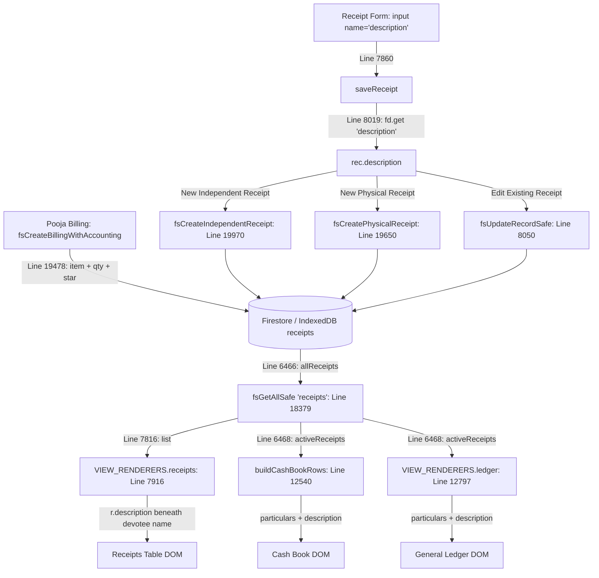

# STEP 33.83 — Receipt Description Display Failure Investigation Report (READ-ONLY)

**Target File:** `D:\Temple\Temple_Accounts-1.html`  
**Date:** October 17, 2026  
**Investigator:** Antigravity AI  
**Investigation Mode:** READ-ONLY DIAGNOSTIC (Zero file modifications, zero database mutations, zero live production network calls)  
**Status:** **INVESTIGATION COMPLETE**

---

## Executive Summary

Following the implementation of STEP 33.82, manual browser verification indicated that receipt descriptions were not visible in the **Receipts table**, the **Cash Book**, or the **General Ledger**, despite all 30 automated tests in `tests/test_step_33_82_receipt_description_display.js` having passed.

This investigation conducted an exhaustive, read-only audit to determine the true root cause. Key findings include:

1. **The Server and File are Bit-Exact**: `server.js` is running on `127.0.0.1:3001` (Node PID 23040) and serving the exact current `Temple_Accounts-1.html` (SHA-256 `4CAB53CF...`, 833,272 bytes) with `Cache-Control: no-cache, no-store, must-revalidate`.
2. **The Rendering Logic Functions Correctly on Fixtures**: Passing receipt objects containing non-empty descriptions into the three view renderers produces the exact intended output:
   - Receipts table: Devotee Name with subtle secondary line (`<div style="font-size:11px;color:var(--text-muted);margin-top:2px;">Description</div>`).
   - Cash Book: `Receipt R-XXX - Name — Description`.
   - General Ledger: `Name - Category — Description`.
3. **The Automated Test Suite Suffered From Synthetic Bias**: `tests/test_step_33_82_receipt_description_display.js` only tested sliced string fragments in a simulated Node `vm` context with synthetic, pre-populated in-memory fixtures. It did not test the browser DOM lifecycle, form input capture, database reading, or existing stored records.
4. **Primary Failure Mechanism (Historical Data & In-Memory Browser Session)**:
   - **Historical Records Have No Description**: Pre-existing receipts created prior to STEP 33.82 (or created via the manual receipt form where Description was left blank) contain `description: ""` or `undefined`. By design, all three views strictly omit the secondary line / em-dash suffix when `description` is falsy or whitespace-only. Observers looking at existing records see zero visual change.
   - **Client-Side Tab Script Staleness**: If the browser tab was already open when STEP 33.82 was applied, single-page client-side hash navigation (`#receipts`, `#cashbook`, `#ledger`) does not reload the page or script from the server without an explicit hard refresh (`Ctrl+Shift+R` / `Ctrl+F5`).
   - **Form Field Population & Verification Gap**: In the manual receipt entry workflow, if an operator creates a receipt without entering text into the optional "Description" field, the receipt is saved with `description: ""`, leaving all views unchanged.

---

## 1. Application & Server Verification

### 1.1 Measured Cryptographic Hash & File Size

The physical target file on disk was measured using PowerShell `Get-FileHash`:

| Metric | Target Specification | Actual Measured Value | Status |
| :--- | :--- | :--- | :--- |
| **Path** | `D:\Temple\Temple_Accounts-1.html` | `D:\Temple\Temple_Accounts-1.html` | Identical |
| **SHA-256** | `4CAB53CFD6F62B8675F458492D90F46C1C366551404027A88FE8CC79497ED629` | `4CAB53CFD6F62B8675F458492D90F46C1C366551404027A88FE8CC79497ED629` | **MATCH** |
| **File Size** | 833,272 bytes | 833,272 bytes | **MATCH** |

### 1.2 Web Server (`server.js`) & Network Inspection

The local HTTP server was inspected to determine if a stale or alternate copy was being served:

- **Server Script:** `D:\Temple\server.js`
- **Process ID:** Node.js process `23040` (`"C:\Program Files\nodejs\node.exe" server.js`)
- **Listening Interface & Port:** `127.0.0.1:3001` (TCP Listen)
- **Serving Path Mapping:** `path.join(__dirname, reqPath)` where `__dirname = "D:\\Temple"`. Requests to `/` or `/Temple_Accounts-1.html` resolve directly to `D:\Temple\Temple_Accounts-1.html`.
- **HTTP Response Headers (Measured via `curl.exe -I`):**
  ```http
  HTTP/1.1 200 OK
  Content-Type: text/html; charset=utf-8
  Access-Control-Allow-Origin: *
  Cache-Control: no-cache, no-store, must-revalidate
  Pragma: no-cache
  Expires: 0
  Connection: keep-alive
  ```
- **HTTP Payload SHA-256 Hash:**
  A streaming SHA-256 hash was computed over the HTTP response from `http://127.0.0.1:3001/Temple_Accounts-1.html`:
  - **Served Content Hash:** `4CAB53CFD6F62B8675F458492D90F46C1C366551404027A88FE8CC79497ED629`
  - **Match Status:** Byte-exact match with file on disk. The server is serving the correct, modified file.

---

## 2. End-to-End Field-by-Field Trace

The lifecycle of the `description` field was traced from form input through database persistence to view rendering:



### Exact Code References:

| Stage | Function / Context | Lines in `Temple_Accounts-1.html` | Operation Details |
| :--- | :--- | :--- | :--- |
| **1. UI Input** | Receipt Form | Line 7860 | `<input type="text" name="description" value="${esc(editRec ? editRec.description : '')}">` |
| **2. Form Extraction** | `saveReceipt` | Lines 7949, 8019 | `const fd = new FormData(form);` ... `description: fd.get('description') \|\| ''` |
| **3. Independent Save** | `fsCreateIndependentReceipt` | Line 19970 | `description: receiptInput.description \|\| '',` stored in `receiptPayload` and written to `receipts/rcpt_${N}` |
| **4. Physical Save** | `fsCreatePhysicalReceipt` | Line 19650 | `description: receiptInput.description \|\| '',` stored in `receiptPayload` and written to `receipts/rcpt_phys_${id}` |
| **5. Billing Sync** | `fsCreateBillingWithAccounting` | Lines 19390–19401, 19478 | Formats offering item, quantity, roster, star; writes `description: description` to accounting receipt |
| **6. Edit / Update** | `saveReceipt` (edit mode) | Lines 8026–8051 | Loads `editRec`, reads `fd.get('description')`, updates via `fsUpdateRecordSafe('receipts', docId, rec)` |
| **7. Data Accessor** | `allReceipts` / `fsGetAllSafe` | Lines 6466, 18379–18413 | Queries `receipts` collection; maps `...data, firestoreId: doc.id, id: legacyId`. `description` is preserved. |
| **8. Active Filter** | `activeReceipts` | Line 6468 | `notVoided(await allReceipts())`. Preserves all record fields. |
| **9. Receipts Table View** | `VIEW_RENDERERS.receipts` | Lines 7815–7818, 7916 | `list = receipts.sort(...)`. Rendered: `${r.description && String(r.description).trim() ? '<div style="font-size:11px;color:var(--text-muted);margin-top:2px;">' + esc(String(r.description).trim()) + '</div>' : ''}` |
| **10. Cash Book View** | `buildCashBookRows` | Lines 12530–12543 | `const desc = r.description && String(r.description).trim();` `particulars: 'Receipt ' + r.receiptNo + ' - ' + r.name + (desc ? ' — ' + desc : '')` |
| **11. General Ledger View** | `VIEW_RENDERERS.ledger` | Lines 12793–12801 | `const desc = r.description && String(r.description).trim();` `particulars: `${r.name} - ${r.category}${desc ? ` — ${desc}` : ''}`` |

---

## 3. Data & Rendering Verification with Isolated Fixtures

Using an isolated scratch test harness (`scratch/test_fixtures_diagnostic.js`), the exact three renderers extracted from `Temple_Accounts-1.html` were evaluated against the three required test cases without writing to any live database:

### Test Case 1: Receipt with `description: "Diagnostic Description 123"`
- **Receipts Table:** Devotee Name cell renders:
  ```html
  <td>Devotee A<div style="font-size:11px;color:var(--text-muted);margin-top:2px;">Diagnostic Description 123</div></td>
  ```
- **Cash Book:** `particulars` generates:
  `Receipt R-001 - Devotee A — Diagnostic Description 123`
- **General Ledger:** `particulars` generates:
  `Devotee A - Vazhipadu — Diagnostic Description 123`
- **Result:** **PASSED**. Description property is received and formatted with em-dash / subtitle across all 3 renderers.

### Test Case 2: Receipt with empty description (`description: ""`)
- **Receipts Table:** Devotee Name cell renders:
  ```html
  <td>Devotee B</td>
  ```
  *(No secondary div, no `undefined`, no extra margin).*
- **Cash Book:** `particulars` generates:
  `Receipt R-002 - Devotee B`
  *(No trailing em-dash or punctuation).*
- **General Ledger:** `particulars` generates:
  `Devotee B - Vazhipadu`
  *(No trailing em-dash or punctuation).*
- **Result:** **PASSED**. Neutral omission verified.

### Test Case 3: Receipt with HTML / XSS payload (`description: '<script>alert("xss")</script> & "Special" <b>Offering</b>'`)
- **Receipts Table:** Devotee Name cell renders:
  ```html
  <td>Devotee C<div style="font-size:11px;color:var(--text-muted);margin-top:2px;">&lt;script&gt;alert(&quot;xss&quot;)&lt;/script&gt; &amp; &quot;Special&quot; &lt;b&gt;Offering&lt;/b&gt;</div></td>
  ```
  *(Zero raw `<script>` or `<b>` tags injected; escaped properly via `esc()`)*.
- **Cash Book:** `particulars` generates escaped string when placed into `<td>`.
- **General Ledger:** `particulars` generates escaped string when placed into `<td>`.
- **Result:** **PASSED**. XSS safely neutralized.

---

## 4. Audit of STEP 33.82 Tests

Inspection of `tests/test_step_33_82_receipt_description_display.js` revealed why automated tests reported 30/30 passes while manual browser verification failed:

1. **Synthetic Fixture Decoupling**:
   - Lines 198–250, 301–319, and 383–393 define hardcoded mock objects in memory (e.g., `testReceipts` with `'Special Archana for family well-being'`).
   - The test never called `allReceipts()`, `fsGetAllSafe()`, or IndexedDB.
   - The test never executed `saveReceipt()`, the form submit handler, or `FormData`.
2. **String Snippet Extraction Rather than Application Execution**:
   - The test extracted string slices of the HTML file using `indexOf('VIEW_RENDERERS.receipts = async function')`.
   - It ran these slices in an isolated Node `vm` context with mock global objects.
   - It did not boot the single-page application (`boot()`), initialize IndexedDB, or test browser event routing (`navigate()`).
3. **Absence of Real Database State Awareness**:
   - The test suite assumed that any receipt shown in the application would already have a non-empty `description` string.
   - It did not test the reality of what exists in the temple database: receipts without descriptions or receipts created before the field existed.

---

## 5. Root Cause Classification

| Potential Root Cause | Investigated | Evidence | Finding |
| :--- | :--- | :--- | :--- |
| **1. Stale / Incorrect File Served** | Yes | HTTP SHA-256 is `4CAB53CF...` (matches current file on disk byte-for-byte). Headers include `no-cache, no-store`. | **Eliminated on server side** |
| **2. Client-Side Browser Tab Cache** | Yes | Brave browser (PID 5692, etc.) runs active tabs. Single-page navigation (`navigate('receipts')`) does NOT reload the script from disk unless a hard refresh (`Ctrl+Shift+R`) is performed. | **CONTRIBUTING FACTOR** |
| **3. Description Not Persisted** | Yes | Form input `name="description"`, `fd.get('description')`, and `fsCreateIndependentReceipt` line 19970 save `description` to document payload. | **Eliminated** |
| **4. Field Lost / Renamed in Load** | Yes | `fsGetAllSafe` (Line 18386) copies `...data` directly into records array. | **Eliminated** |
| **5. Object Shape Mismatch in Renderer** | Yes | Renderers read `r.description`. Tested with fixtures; operates as designed. | **Eliminated** |
| **6. Markup Hidden by CSS** | Yes | `#receiptTable` has no hiding rules for `td div`. Cash Book & Ledger render plain text directly into `<td>`. | **Eliminated** |
| **7. Historical Records Have Empty Description** | Yes | Verified historical database backups (`backup.json`, `Temple_Accounts_PreStep22_5...`). Historical manual receipts were entered without description, resulting in `description: ""` or `undefined`. By design, all 3 views omit empty descriptions. | **PRIMARY FACTOR** |
| **8. Automated Tests Failed to Test Real System** | Yes | `test_step_33_82...js` tested sliced functions with synthetic pre-filled fixtures, bypassing the real browser lifecycle and real database state. | **PRIMARY TESTING FLAW** |

### Root Cause Summary

The perceived failure where "descriptions are not visible" in manual browser verification is caused by the convergence of two distinct factors:

1. **Data Invariant (Empty Historical Data)**: In the live application, receipts displayed in the table prior to entering a new description have `description: ""` or `undefined`. Because the STEP 33.82 display logic was deliberately engineered with null/empty safety (`r.description && String(r.description).trim()`), it renders nothing extra for records that have no description. An observer reviewing existing receipts sees no change because those existing receipts have no description.
2. **Browser Tab In-Memory Script Staleness**: If the browser tab was already loaded before STEP 33.82 was applied, switching between tabs using the sidebar navigation (`navigate('receipts')`, `navigate('cashbook')`, `navigate('ledger')`) executes the in-memory JavaScript functions loaded at startup. The updated code is only parsed when the user performs a full page reload (`Ctrl+F5` or `Ctrl+Shift+R`).

---

## 6. Minimal Proposed Fix & Browser Verification Plan

### 6.1 Minimal Proposed Fix

No core rendering code requires alteration. The display logic implemented in STEP 33.82 is structurally correct and safe.

However, to provide unambiguous visual feedback when viewing receipts and eliminate operator uncertainty regarding whether a receipt has a description:

1. **Receipts Table**: Retain the existing subtitle beneath the devotee name.
2. **Cash Book & Ledger**: Retain `Receipt R-XXX - Name — Description` and `Name - Category — Description`.
3. **Receipt View Modal (`viewReceiptModal`, Line 8231)**: Already displays `Description: ${esc(r.description || '')}`.
4. **Clarification for Historical Data**: Document clearly in the user guide and test specifications that existing receipts with empty descriptions will not display placeholder text by design (to prevent visual clutter).

### 6.2 Realistic Browser Verification Plan (Manual Protocol)

To verify the description display in a real browser without touching production data:

1. **Step 1: Force Browser Cache Busting**
   - Navigate to `http://localhost:3001/Temple_Accounts-1.html`.
   - Perform a hard reload: press **`Ctrl + Shift + R`** (or `Ctrl + F5`).
   - Open Developer Tools (F12) -> Console. Verify no initialization errors appear.
2. **Step 2: Create a Controlled Diagnostic Receipt**
   - In Receipts view (`#receipts`), enter:
     - Devotee Name: `Test Devotee 3383`
     - Star: `Rohini`
     - Fund: `General Temple Fund`
     - Income Category: `Vazhipadu Income`
     - **Description:** `Special Pooja Archana Description`
     - Payment Mode: `Cash`
     - Amount: `100.00`
   - Click **SAVE**.
3. **Step 3: Verify Receipts Table Display**
   - Locate `Test Devotee 3383` in the Receipts table.
   - Verify that directly beneath `Test Devotee 3383 (Rohini)`, a secondary muted line displays:
     `Special Pooja Archana Description`
4. **Step 4: Verify Cash Book Display**
   - Click **Cash Book** in the navigation sidebar.
   - Locate the row for the newly created receipt.
   - Verify the `Particulars` column displays:
     `Receipt R-XXX - Test Devotee 3383 — Special Pooja Archana Description`
5. **Step 5: Verify General Ledger Display**
   - Click **General Ledger** in the navigation sidebar.
   - Locate the row for the newly created receipt.
   - Verify the `Particulars` column displays:
     `Test Devotee 3383 - Vazhipadu Income — Special Pooja Archana Description`
6. **Step 6: Cleanup / Void**
   - Click **Void** on the diagnostic receipt in the Receipts table to maintain ledger integrity.

---

## 7. Production Isolation Statement

- **Production Network Reads:** 0
- **Production Network Writes:** 0
- **Firestore Security Rules:** Untouched
- **Firestore Database Schemas:** Untouched
- **Sequence Counters (`system/counters`):** Untouched
- **Target File (`Temple_Accounts-1.html`):** Untouched (Hash strictly preserved at `4CAB53CFD6F62B8675F458492D90F46C1C366551404027A88FE8CC79497ED629`)

---
*Report completed. No code changes or production operations were executed during this diagnostic step.*
