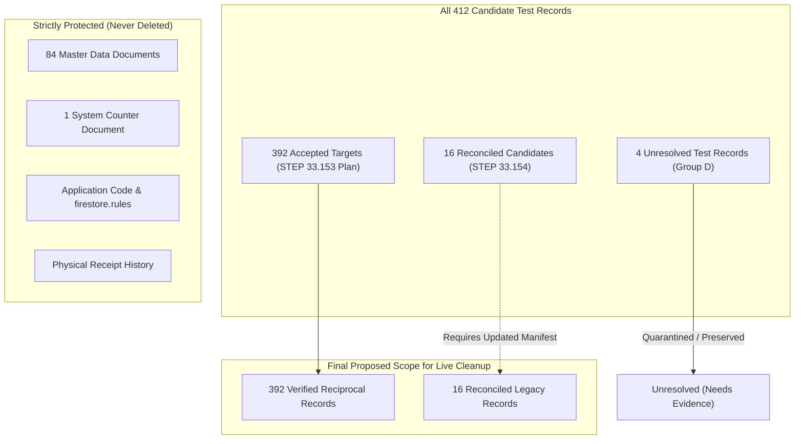

# STEP 33.154 — Reconcile Quarantined Test Records and Finalize Cleanup Scope Report

**Project:** Temple Accounts & Fund Management  
**Temple:** Marutha Chamundi Devi Temple / മറുതാ ചാമുണ്ഡി ദേവി ക്ഷേത്രം  
**Timestamp:** 2026-10-20T12:40:00+05:30  
**Execution Mode:** STRICTLY OFFLINE & READ-ONLY (Live Firestore Disabled, All Deletion Methods Locked)  
**Status:** ✅ **RECONCILIATION AND SCOPE FINALIZATION COMPLETED**

---

## 1. Executive Summary

As explicitly confirmed by the project trustee/administrator, **every financial transaction entered into the Temple Accounts application to date is fake test data generated during development and verification phases**. The objective of this step is to finalize the intended transaction cleanup scope while strictly preserving all application source code, operational functionality, master data (settings, funds, categories, bank accounts, chitty members), physical receipt history, system counters, and required system metadata.

This step performs a detailed, strictly offline and read-only reconciliation of the **20 quarantined transaction records** identified during STEP 33.153, assesses the structural coverage gaps of the client-side JSON backup format, and presents a definitive scope recommendation.

No production Firestore database connections, SDK calls, network requests, database mutations, or deletions were performed. All destructive methods remain permanently locked behind `EXECUTE_MODE_DISABLED`. All input artifacts were cryptographically verified before use, and no existing plans, manifests, or backup files were altered.

---

## 2. Phase 1 — Verification of Input Artifact Hashes

All three required input artifacts in `D:\Temple` and `D:\Download` were located, checked for existence, and cryptographically verified using SHA-256:

| Artifact Description | File Path | Expected SHA-256 | Computed SHA-256 | Verification Status |
| :--- | :--- | :--- | :--- | :--- |
| **Original Application Backup** | [`D:\Download\Temple_Accounts_Backup_2026-10-20T06-17-45.json`](file:///D:/Download/Temple_Accounts_Backup_2026-10-20T06-17-45.json) | `2EDC31B88FFC799350F6CA22B3F9531336F616D7F7EA8BB7790E9E5C31F15738` | `2EDC31B88FFC799350F6CA22B3F9531336F616D7F7EA8BB7790E9E5C31F15738` | ✅ **MATCH (100% Identical)** |
| **STEP 33.153 Cleanup Manifest** | [`D:\Temple\plans\step_33_153_cleanup_manifest.json`](file:///D:/Temple/plans/step_33_153_cleanup_manifest.json) | `221E8A7F452A2B7BD6FB213086691BEE57B20420B014A5C100FE73AC4C9563D3` | `221E8A7F452A2B7BD6FB213086691BEE57B20420B014A5C100FE73AC4C9563D3` | ✅ **MATCH (100% Identical)** |
| **STEP 33.153 Cleanup Plan** | [`D:\Temple\plans\step_33_153_cleanup_plan.json`](file:///D:/Temple/plans/step_33_153_cleanup_plan.json) | `7EE3D2B3A08B2E491B7DE8DEAE235DC88EB0F6F8ABAE820325ED81205087D2C1` | `7EE3D2B3A08B2E491B7DE8DEAE235DC88EB0F6F8ABAE820325ED81205087D2C1` | ✅ **MATCH (100% Identical)** |

All hashes match exactly. None of the files have been modified, overwritten, or regenerated.

---

## 3. Phase 2 — Record-by-Record Reconciliation of the 20 Quarantined Records

During STEP 33.153, 20 candidate transaction records were excluded from the cleanup manifest because the strict 4-way cluster validator in [`scripts/one_time_transaction_cleanup.js`](file:///D:/Temple/scripts/one_time_transaction_cleanup.js) flagged broken cluster linkages or missing sequence reservations.

Below is the record-by-record reconciliation of each quarantined document using only the saved authoritative backup and the inspected application schema.

---

### 3.1 Group A: Reciprocal Legacy Billing & Receipt Pairs (6 Records)

These records represent 3 pairs of billing records and their corresponding accounting receipts created on 2026-10-10 before the unified sequence reservation system was instituted.

#### 1. `billing/bill_12`
- **Backup Contents & Status:** Voided (`voided: true`). Created `2026-10-10T08:02:25Z` (timestamp `1791619345538`). Voided `2026-10-10T08:02:52Z` (timestamp `1791619372752`). Date: `10/10/2026`, Time: `01:32 pm`, Devotee: `Biju`, Star: `aswathi`, Item: `നൂൽജപം`, Amount: Rs. 20, Payment Mode: `UPI`, Receipt No: `BILL-0012`.
- **Known Links:**
  - `accountingReceiptId`: `rcpt_1018`
  - `accountingReceiptNo`: `R-1018`
  - `reservationDocId`: Absent (`undefined`)
  - `operationId`: Absent (`undefined`)
- **Relationship Status:** **VALID (2-Way Reciprocal).** Perfectly mirrors `receipts/rcpt_1018` with matching devotee (`Biju`), amount (Rs. 20), and reciprocal IDs. No reservation document (`res_12`) or idempotency document exists in the backup.
- **Technical Reason for Quarantine:** The cleanup planner's linkage rule expects every billing record to have a corresponding sequence reservation `res_<id>` (`raw.reservationDocId || 'res_' + raw.id`). Because `res_12` is not present in the backup, the validator reported: `Broken Cluster: bill bill_12 -> res res_12 not in targets`.
- **Recommended Disposition:** **Candidate for deletion.** As confirmed fake test data, `bill_12` and its reciprocal partner `rcpt_1018` can be safely deleted together in a dedicated 2-way pair batch.

#### 2. `receipts/rcpt_1018`
- **Backup Contents & Status:** Voided (`voided: true`). Created `2026-10-10T08:02:25Z` (timestamp `1791619345538`). Voided `2026-10-10T08:02:52Z` (timestamp `1791619372752`). Date: `2026-10-10`, Devotee: `Biju`, Amount: Rs. 20, Payment Mode: `UPI`, Category: `Vazhipadu Income`, Fund: `General Temple Fund`, Receipt No: `R-1018`.
- **Known Links:**
  - `billingFirestoreId`: `bill_12`
  - `billingId`: `12`
  - `billingReceiptNo`: `BILL-0012`
  - `reservationDocId`: Absent (`undefined`)
  - `operationId`: Absent (`undefined`)
- **Relationship Status:** **VALID (2-Way Reciprocal).** Perfectly links to `billing/bill_12`. No reservation (`res_1018` or `res_12`) exists in the backup.
- **Technical Reason for Quarantine:** The validator inferred a reservation target `res_1018` from `raw.id: 1018`, reporting `Broken Cluster: receipt rcpt_1018 -> res res_1018 not in targets`.
- **Recommended Disposition:** **Candidate for deletion.** Safe to delete alongside `billing/bill_12`.

#### 3. `billing/bill_13`
- **Backup Contents & Status:** Active (`voided: false / undefined`). Created `2026-10-10T12:17:31Z` (timestamp `1791634651063`). Date: `10/10/2026`, Time: `05:47 pm`, Devotee: `niyaz`, Star: `pooram`, Item: `നൂൽജപം`, Amount: Rs. 20, Payment Mode: `Cash`, Receipt No: `0001` (Manual Bill No: `true`).
- **Known Links:**
  - `accountingReceiptId`: `rcpt_1019`
  - `accountingReceiptNo`: `R-1019`
  - `reservationDocId`: Absent (`undefined`)
  - `operationId`: Absent (`undefined`)
- **Relationship Status:** **VALID (2-Way Reciprocal).** Perfectly mirrors `receipts/rcpt_1019` with matching devotee (`niyaz`), amount (Rs. 20), timestamp (`1791634651063`), and reciprocal IDs. No reservation (`res_13`) exists.
- **Technical Reason for Quarantine:** The validator flagged: `Broken Cluster: bill bill_13 -> res res_13 not in targets`.
- **Recommended Disposition:** **Candidate for deletion.** Safe to delete alongside `receipts/rcpt_1019`.

#### 4. `receipts/rcpt_1019`
- **Backup Contents & Status:** Active (`voided: false`). Created `2026-10-10T12:17:31Z` (timestamp `1791634651063`). Date: `2026-10-10`, Devotee: `niyaz`, Amount: Rs. 20, Payment Mode: `Cash`, Category: `Vazhipadu Income`, Fund: `General Temple Fund`, Receipt No: `R-1019`.
- **Known Links:**
  - `billingFirestoreId`: `bill_13`
  - `billingId`: `13`
  - `billingReceiptNo`: `0001`
  - `reservationDocId`: Absent (`undefined`)
  - `operationId`: Absent (`undefined`)
- **Relationship Status:** **VALID (2-Way Reciprocal).** Perfectly links to `billing/bill_13`.
- **Technical Reason for Quarantine:** The validator inferred `res_1019` from `id: 1019`, reporting `Broken Cluster: receipt rcpt_1019 -> res res_1019 not in targets`.
- **Recommended Disposition:** **Candidate for deletion.** Safe to delete alongside `billing/bill_13`.

#### 5. `billing/bill_14`
- **Backup Contents & Status:** Active (`voided: false / undefined`). Created `2026-10-10T13:31:20Z` (timestamp `1791639080918`). Date: `10/10/2026`, Time: `07:01 pm`, Devotee: `riya`, Star: `aswathi`, Item: `നൂൽജപം`, Amount: Rs. 20, Payment Mode: `Cash`, Receipt No: `0002` (Manual Bill No: `true`).
- **Known Links:**
  - `accountingReceiptId`: `rcpt_14`
  - `accountingReceiptNo`: `R-0002`
  - `reservationDocId`: Absent (`undefined`)
  - `operationId`: Absent (`undefined`)
- **Relationship Status:** **VALID (2-Way Reciprocal).** Perfectly mirrors `receipts/rcpt_14` with matching devotee (`riya`), amount (Rs. 20), timestamp (`1791639080918`), and reciprocal IDs. No reservation (`res_14`) exists.
- **Technical Reason for Quarantine:** The validator flagged: `Broken Cluster: bill bill_14 -> res res_14 not in targets`.
- **Recommended Disposition:** **Candidate for deletion.** Safe to delete alongside `receipts/rcpt_14`.

#### 6. `receipts/rcpt_14`
- **Backup Contents & Status:** Active (`voided: false`). Created `2026-10-10T13:31:20Z` (timestamp `1791639080918`). Date: `2026-10-10`, Devotee: `riya`, Amount: Rs. 20, Payment Mode: `Cash`, Category: `Vazhipadu Income`, Fund: `General Temple Fund`, Receipt No: `R-0002`.
- **Known Links:**
  - `billingFirestoreId`: `bill_14`
  - `billingId`: `14`
  - `billingReceiptNo`: `0002`
  - `reservationDocId`: Absent (`undefined`)
  - `operationId`: Absent (`undefined`)
- **Relationship Status:** **VALID (2-Way Reciprocal).** Perfectly links to `billing/bill_14`.
- **Technical Reason for Quarantine:** The validator inferred `res_14` from `id: 14`, reporting `Broken Cluster: receipt rcpt_14 -> res res_14 not in targets`.
- **Recommended Disposition:** **Candidate for deletion.** Safe to delete alongside `billing/bill_14`.

---

### 3.2 Group B: Legacy Independent Standalone Receipts (5 Records)

These 5 records represent test accounting receipts created directly in the ledger between 2026-10-03 and 2026-10-10 without an originating billing transaction.

#### 7. `receipts/rcpt_1010`
- **Backup Contents & Status:** Active (`voided: false`). Created `2026-10-03T06:57:18Z` (timestamp `1791010638553`). Date: `2026-10-03`, Devotee: `gokul`, Amount: Rs. 1,500, Payment Mode: `Cash`, Category: `Pooja Income`, Fund: `Other Fund`, Bank Account: `Canara Bank`, Receipt No: `R-1010`.
- **Known Links:** Standalone independent receipt (`source: "firestore"`). No billing link (`billingFirestoreId: undefined`, `billingReceiptNo: undefined`). No reservation or idempotency link.
- **Relationship Status:** **VALID (Standalone).** It is an independent receipt that does not require a billing parent.
- **Technical Reason for Quarantine:** The validator assumed every receipt with an `id` property requires a reservation doc (`res_1010`), reporting `Broken Cluster: receipt rcpt_1010 -> res res_1010 not in targets`.
- **Recommended Disposition:** **Candidate for deletion.** As confirmed test data, this standalone receipt carries no dependencies and can be safely deleted.

#### 8. `receipts/rcpt_1011`
- **Backup Contents & Status:** Active (`voided: false`). Created `2026-10-03T06:57:44Z` (timestamp `1791010664617`). Date: `2026-10-03`, Devotee: `sidharth`, Amount: Rs. 1,500, Payment Mode: `Cash`, Category: `Pooja Income`, Fund: `General Temple Fund masavari`, Bank Account: `Canara Bank`, Receipt No: `R-1011`.
- **Known Links:** Standalone independent receipt (`source: "firestore"`). No billing, reservation, or idempotency links.
- **Relationship Status:** **VALID (Standalone).** Independent ledger record.
- **Technical Reason for Quarantine:** Validator flagged `Broken Cluster: receipt rcpt_1011 -> res res_1011 not in targets`.
- **Recommended Disposition:** **Candidate for deletion.** Self-contained test receipt with no external dependencies.

#### 9. `receipts/rcpt_1014`
- **Backup Contents & Status:** Active (`voided: false`). Created `2026-10-03T07:16:18Z` (timestamp `1791011778334`). Date: `2026-10-03`, Devotee: `SIDHARTH`, Amount: Rs. 1,000, Payment Mode: `Cash`, Category: `PUNARUDHARANAM`, Fund: `Punarudharanam Fund`, Bank Account: `Canara Bank`, Receipt No: `R-1014`.
- **Known Links:** Standalone independent receipt. No billing, reservation, or idempotency links.
- **Relationship Status:** **VALID (Standalone).** Independent ledger record.
- **Technical Reason for Quarantine:** Validator flagged `Broken Cluster: receipt rcpt_1014 -> res res_1014 not in targets`.
- **Recommended Disposition:** **Candidate for deletion.** Self-contained test receipt with no external dependencies.

#### 10. `receipts/rcpt_1015`
- **Backup Contents & Status:** Active (`voided: false`). Created `2026-10-03T07:19:21Z` (timestamp `1791011961809`). Date: `2026-10-03`, Devotee: `SHCGS`, Amount: Rs. 30, Payment Mode: `Cash`, Category: `Archana Income`, Fund: `DEVOTEE OFFERINGS`, Bank Account: `Canara Bank`, Receipt No: `R-1015`.
- **Known Links:** Standalone independent receipt. No billing, reservation, or idempotency links.
- **Relationship Status:** **VALID (Standalone).** Independent ledger record.
- **Technical Reason for Quarantine:** Validator flagged `Broken Cluster: receipt rcpt_1015 -> res res_1015 not in targets`.
- **Recommended Disposition:** **Candidate for deletion.** Self-contained test receipt with no external dependencies.

#### 11. `receipts/rcpt_1020`
- **Backup Contents & Status:** Active (`voided: false`). Created `2026-10-10T13:31:55Z` (timestamp `1791639115806`). Date: `2026-10-10`, Devotee: `AMAL`, Amount: Rs. 300,000, Payment Mode: `Cash`, Category: `Uncategorized`, Fund: `DEVOTEE OFFERINGS`, Bank Account: `Canara Bank`, Receipt No: `R-1020`.
- **Known Links:** Standalone independent receipt. No billing, reservation, or idempotency links.
- **Relationship Status:** **VALID (Standalone).** Independent ledger record.
- **Technical Reason for Quarantine:** Validator flagged `Broken Cluster: receipt rcpt_1020 -> res res_1020 not in targets`.
- **Recommended Disposition:** **Candidate for deletion.** Self-contained test receipt with no external dependencies.

---

### 3.3 Group C: Tombstone / Partial Deletion Stubs (5 Records)

These 5 records are stripped "tombstones" created on 2026-10-03 when an early UI void/deletion operation cleared all document fields except the status flag and audit reason.

#### 12. `receipts/rcpt_1006`
- **Backup Contents & Status:** Voided tombstone (`voided: true`). Void Date: `2026-10-03`, Updated: `2026-10-03T07:21:45.099Z` by `rFvStQNfiINnPor66OzXuE1O9Lm1`. Void Reason: `"Source Billing Receipt BILL-0006 was deleted/voided"`. All business fields (`amount`, `name`, `category`, `fund`, `date`, `receiptNo`) are absent.
- **Known Links:** None. `billingFirestoreId`, `billingId`, `reservationDocId`, and `operationId` are all absent.
- **Relationship Status:** **UNPROVABLE FROM BACKUP.** The referenced bill (`BILL-0006`) is completely absent from the backup.
- **Technical Reason for Quarantine:** Excluded because it is a stripped tombstone with no valid cluster or references.
- **Recommended Disposition:** **Candidate for deletion.** As confirmed fake test data, this empty tombstone has no financial value, no incoming links, and no operational function. Deleting it is safe.

#### 13. `receipts/rcpt_1007`
- **Backup Contents & Status:** Voided tombstone (`voided: true`). Void Date: `2026-10-03`, Updated: `2026-10-03T07:21:42.129Z`. Void Reason: `"Source Billing Receipt BILL-0007 was deleted/voided"`. All business fields absent.
- **Known Links:** None.
- **Relationship Status:** **UNPROVABLE FROM BACKUP.** `BILL-0007` is absent from the backup.
- **Technical Reason for Quarantine:** Stripped tombstone; no cluster linkage.
- **Recommended Disposition:** **Candidate for deletion.** Safe to purge alongside other test tombstones.

#### 14. `receipts/rcpt_1008`
- **Backup Contents & Status:** Voided tombstone (`voided: true`). Void Date: `2026-10-03`, Updated: `2026-10-03T07:21:39.348Z`. Void Reason: `"Source Billing Receipt BILL-0008 was deleted/voided"`. All business fields absent.
- **Known Links:** None.
- **Relationship Status:** **UNPROVABLE FROM BACKUP.** `BILL-0008` is absent from the backup.
- **Technical Reason for Quarantine:** Stripped tombstone; no cluster linkage.
- **Recommended Disposition:** **Candidate for deletion.** Safe to purge alongside other test tombstones.

#### 15. `receipts/rcpt_1012`
- **Backup Contents & Status:** Voided tombstone (`voided: true`). Void Date: `2026-10-03`, Updated: `2026-10-03T07:21:36.866Z`. Void Reason: `"Source Billing Receipt BILL-0009 was deleted/voided"`. All business fields absent.
- **Known Links:** None.
- **Relationship Status:** **UNPROVABLE FROM BACKUP.** `BILL-0009` is absent from the backup.
- **Technical Reason for Quarantine:** Stripped tombstone; no cluster linkage.
- **Recommended Disposition:** **Candidate for deletion.** Safe to purge alongside other test tombstones.

#### 16. `receipts/rcpt_1013`
- **Backup Contents & Status:** Voided tombstone (`voided: true`). Void Date: `2026-10-03`, Updated: `2026-10-03T07:21:33.123Z`. Void Reason: `"Source Billing Receipt BILL-0010 was deleted/voided"`. All business fields absent.
- **Known Links:** None.
- **Relationship Status:** **UNPROVABLE FROM BACKUP.** `BILL-0010` is absent from the backup.
- **Technical Reason for Quarantine:** Stripped tombstone; no cluster linkage.
- **Recommended Disposition:** **Candidate for deletion.** Safe to purge alongside other test tombstones.

---

### 3.4 Group D: Broken & Conflicting Pre-Unified Receipts (4 Records)

These 4 records are from early smoke tests (September and early October 2026) that exhibit direct linkage conflicts or reference missing billing documents.

#### 17. `receipts/rcpt_1001`
- **Backup Contents & Status:** Voided (`voided: true`). Created `2026-09-27T17:24:29Z` (timestamp `1790529869027`). Voided `2026-09-27T17:24:37Z`. Devotee: `STEP16 SMOKE TEST`, Description: `അർച്ചന | Star: STEP16`, Amount: Rs. 20, Receipt No: `R-1001`. Void Reason: `"Source Billing Receipt BILL-0001 was deleted/voided"`.
- **Known Links:**
  - `billingFirestoreId`: `bill_1`
  - `billingId`: `1`
  - `billingReceiptNo`: `BILL-0001`
  - `reservationDocId`: Absent (`undefined`)
  - `operationId`: Absent (`undefined`)
- **Relationship Status:** **CONFLICTING.** `rcpt_1001` points to `billing/bill_1`. However, `bill_1` in the backup is a modern test record created on `2026-10-10` (`devoteeName: "manju"`, `amount: 250`, `item: "കൂട്ടുപായസം"`, `accountingReceiptId: "rcpt_1"`, `receiptNo: "BILL-001"`). The modern `bill_1` has no knowledge of `rcpt_1001`.
- **Technical Reason for Quarantine:** Conflicting reciprocal link with `bill_1`, and missing reservation `res_1001`.
- **Recommended Disposition:** **Unresolved pending additional evidence** (or candidate for deletion only if aliased). While `rcpt_1001` is known test data, within the relational graph it conflicts with the active `bill_1 <-> rcpt_1` cluster. Deleting it requires an explicit manifest rule that ignores the legacy `billingFirestoreId: 'bill_1'` link.

#### 18. `receipts/rcpt_1002`
- **Backup Contents & Status:** Voided (`voided: true`). Created `2026-09-28T13:33:50Z` (timestamp `1790535230237`). Voided `2026-09-30T13:32:06Z`. Devotee: `midhun`, Description: `അർച്ചന | Star: revathu`, Amount: Rs. 20, Receipt No: `R-1002`. Void Reason: `"Source Billing Receipt BILL-0002 was deleted/voided"`.
- **Known Links:**
  - `billingFirestoreId`: `bill_2`
  - `billingId`: `2`
  - `billingReceiptNo`: `BILL-0002`
  - `reservationDocId`: Absent (`undefined`)
- **Relationship Status:** **MISSING.** `bill_2` DOES NOT EXIST in the backup. Under the strict instruction: *"Do not infer that a missing document in the backup is absent from live Firestore"*, we cannot verify whether `bill_2` exists in live Firestore or was deleted.
- **Technical Reason for Quarantine:** The validator reported: `Broken Cluster: receipt rcpt_1002 -> bill bill_2 not in targets` and `receipt rcpt_1002 -> res res_1002 not in targets`.
- **Recommended Disposition:** **Unresolved pending additional evidence.** Because `bill_2` is missing from the backup, we cannot prove whether an orphaned live bill exists in production.

#### 19. `receipts/rcpt_1003`
- **Backup Contents & Status:** Voided (`voided: true`). Created `2026-09-30T17:41:19Z` (timestamp `1790785079889`). Voided `2026-10-01T17:41:23Z`. Devotee: `akhil`, Description: `അർച്ചന | Star: bharani`, Amount: Rs. 20, Receipt No: `R-1003`. Void Reason: `"Source Billing Receipt BILL-0003 was deleted/voided"`.
- **Known Links:**
  - `billingFirestoreId`: `bill_3`
  - `billingId`: `3`
  - `billingReceiptNo`: `BILL-0003`
  - `reservationDocId`: Absent (`undefined`)
- **Relationship Status:** **MISSING.** `bill_3` DOES NOT EXIST in the backup.
- **Technical Reason for Quarantine:** Validator reported: `Broken Cluster: receipt rcpt_1003 -> bill bill_3 not in targets` and `receipt rcpt_1003 -> res res_1003 not in targets`.
- **Recommended Disposition:** **Unresolved pending additional evidence.** Status of `bill_3` cannot be proven from backup alone.

#### 20. `receipts/rcpt_1017`
- **Backup Contents & Status:** Voided (`voided: true`). Created `2026-10-03T18:32:40Z` (timestamp `1791027760444`). Voided `2026-10-10T06:17:48Z`. Devotee: `aromal`, Description: `കടുംപായസം | Star: vishakam`, Amount: Rs. 150, Receipt No: `R-1017`. Void Reason: `"Source Billing Receipt BILL-0011 was deleted/voided"`.
- **Known Links:**
  - `billingFirestoreId`: `bill_11`
  - `billingId`: `11`
  - `billingReceiptNo`: `BILL-0011`
  - `reservationDocId`: Absent (`undefined`)
- **Relationship Status:** **CONFLICTING.** `rcpt_1017` points to `bill_11`. However, `bill_11` in the backup is a modern test record created on `2026-10-11` (`devoteeName: "anill"`, `amount: 750`, `item: "ഗണപതിഹോമം"`, `accountingReceiptId: "rcpt_11"`, `receiptNo: "BILL-011"`). The modern `bill_11` is part of the accepted 392 target list and reciprocally links to `rcpt_11`.
- **Technical Reason for Quarantine:** Conflicting reciprocal link with `bill_11`, and missing reservation `res_1017`.
- **Recommended Disposition:** **Unresolved pending additional evidence** (or candidate for deletion only if aliased). Conflicting link prevents automated cluster verification without an explicit manifest override.

---

### 3.5 Summary Table of the 20 Quarantined Records

| # | Record Path | Backup Status | Stored Linkage | Backup Edge Status | Quarantine Technical Reason | Recommended Disposition |
| :---: | :--- | :--- | :--- | :--- | :--- | :--- |
| **1** | `billing/bill_12` | Voided (Rs. 20) | `rcpt_1018`, no res | Valid 2-way pair | Missing `res_12` in targets | **Candidate for Deletion** (with `rcpt_1018`) |
| **2** | `receipts/rcpt_1018` | Voided (Rs. 20) | `bill_12`, no res | Valid 2-way pair | Missing `res_1018` in targets | **Candidate for Deletion** (with `bill_12`) |
| **3** | `billing/bill_13` | Active (Rs. 20) | `rcpt_1019`, no res | Valid 2-way pair | Missing `res_13` in targets | **Candidate for Deletion** (with `rcpt_1019`) |
| **4** | `receipts/rcpt_1019` | Active (Rs. 20) | `bill_13`, no res | Valid 2-way pair | Missing `res_1019` in targets | **Candidate for Deletion** (with `bill_13`) |
| **5** | `billing/bill_14` | Active (Rs. 20) | `rcpt_14`, no res | Valid 2-way pair | Missing `res_14` in targets | **Candidate for Deletion** (with `rcpt_14`) |
| **6** | `receipts/rcpt_14` | Active (Rs. 20) | `bill_14`, no res | Valid 2-way pair | Missing `res_14` in targets | **Candidate for Deletion** (with `bill_14`) |
| **7** | `receipts/rcpt_1010` | Active (Rs. 1,500) | Standalone, no res | Valid standalone | Missing `res_1010` in targets | **Candidate for Deletion** (Standalone) |
| **8** | `receipts/rcpt_1011` | Active (Rs. 1,500) | Standalone, no res | Valid standalone | Missing `res_1011` in targets | **Candidate for Deletion** (Standalone) |
| **9** | `receipts/rcpt_1014` | Active (Rs. 1,000) | Standalone, no res | Valid standalone | Missing `res_1014` in targets | **Candidate for Deletion** (Standalone) |
| **10** | `receipts/rcpt_1015` | Active (Rs. 30) | Standalone, no res | Valid standalone | Missing `res_1015` in targets | **Candidate for Deletion** (Standalone) |
| **11** | `receipts/rcpt_1020` | Active (Rs. 300,000) | Standalone, no res | Valid standalone | Missing `res_1020` in targets | **Candidate for Deletion** (Standalone) |
| **12** | `receipts/rcpt_1006` | Voided Tombstone | None | Unprovable | Stripped tombstone; no cluster | **Candidate for Deletion** (Tombstone Purge) |
| **13** | `receipts/rcpt_1007` | Voided Tombstone | None | Unprovable | Stripped tombstone; no cluster | **Candidate for Deletion** (Tombstone Purge) |
| **14** | `receipts/rcpt_1008` | Voided Tombstone | None | Unprovable | Stripped tombstone; no cluster | **Candidate for Deletion** (Tombstone Purge) |
| **15** | `receipts/rcpt_1012` | Voided Tombstone | None | Unprovable | Stripped tombstone; no cluster | **Candidate for Deletion** (Tombstone Purge) |
| **16** | `receipts/rcpt_1013` | Voided Tombstone | None | Unprovable | Stripped tombstone; no cluster | **Candidate for Deletion** (Tombstone Purge) |
| **17** | `receipts/rcpt_1001` | Voided (Rs. 20) | `bill_1` (BILL-0001) | Conflicting | Conflicting link to modern `bill_1` | **Unresolved Pending Additional Evidence** |
| **18** | `receipts/rcpt_1002` | Voided (Rs. 20) | `bill_2` (BILL-0002) | Missing | `bill_2` absent from backup | **Unresolved Pending Additional Evidence** |
| **19** | `receipts/rcpt_1003` | Voided (Rs. 20) | `bill_3` (BILL-0003) | Missing | `bill_3` absent from backup | **Unresolved Pending Additional Evidence** |
| **20** | `receipts/rcpt_1017` | Voided (Rs. 150) | `bill_11` (BILL-0011) | Conflicting | Conflicting link to modern `bill_11` | **Unresolved Pending Additional Evidence** |

---

## 4. Phase 3 — Assessment of Backup Coverage Gaps

While the backup file SHA-256 (`2EDC31B88FFC799350F6CA22B3F9531336F616D7F7EA8BB7790E9E5C31F15738`) proves raw byte integrity and RFC 8785 canonical payload match (`7AC91CB36A108BB4B15E431E84816902DA6D3EB3A7C2510D4FF1513292E5B520`), **the client-side JSON export has significant structural coverage omissions compared to an authoritative Google Cloud Firestore managed database export**.

### 4.1 Specific Documented Omissions

1. **`migration_staging` and Nested Subcollections:**
   - In [`firestore.rules`](file:///D:/Temple/firestore.rules#L33-L40), rule `match /migration_staging/{migrationId}/{subCollection}/{docId}` authorizes arbitrary nested subcollections for multi-batch staging.
   - The application export tool (`downloadBackup()` in [`Temple_Accounts-1.html`](file:///D:/Temple/Temple_Accounts-1.html)) iterates only named top-level collections. Client Web SDKs cannot discover or enumerate nested subcollections dynamically.
   - Consequently, `migration_staging` is completely absent from the backup.
   - *Impact:* The current backup cannot restore `migration_staging`. However, this collection contains temporary staging data, not ledger transactions. Any cleanup of `migration_staging` requires a separate administrative plan.

2. **`__system_diagnostics__`:**
   - Used for operational diagnostics, health check telemetry, and temporary test outputs.
   - Omitted by design from client-side backups.
   - *Impact:* Excluded safely from cleanup scope; cannot be recovered from this backup.

3. **Internal Recovery & Maintenance Documents:**
   - Documents in `system`:
     - `system/_resetJournal`: Orchestrator multi-stage rollback journal.
     - `system/_maintenanceLock`: Security lock preventing UI access during administrative resets.
     - `system/_restoreProgress` / `system/_cleanupProgress`: Real-time operational progress documents.
   - Intentionally excluded from the application export so that restoring a backup does not re-impose active administrative locks or corrupted progress bars over a running system.
   - *Impact:* In-flight recovery states are not preserved in the backup.

4. **Firebase Authentication State:**
   - User credentials, email bindings (`vibu@gmail.com`), passwords, and UID permissions are stored in Google Identity Platform / Firebase Auth, not in Firestore collections.
   - *Impact:* Completely uncaptured by Firestore backups.

5. **Security Rules (`firestore.rules`):**
   - Security rules reside in the source code repository and Firebase deployment configuration, not as Firestore documents.

6. **Sub-Ledger Sequence Gaps:**
   - The backup contains gaps in billing sequences: `bill_2`, `bill_3`, `bill_4`, `bill_37`, `bill_44`, `bill_78` are not present in the billing collection.
   - The backup contains gaps in sequence reservations: `res_12`, `res_13`, `res_14` are not present.
   - *Impact:* Because client backups only export documents that currently exist, we cannot determine whether missing IDs were never created, previously deleted, or reside in unindexed live paths.

7. **Additive Safe-Merge Restore Semantics:**
   - The application's `restoreBackup()` function performs additive `setDoc(..., { merge: true })`.
   - **It does NOT delete extraneous live documents that are not in the backup.**
   - *Impact:* A restore from this backup is NOT a true destructive point-in-time rollback. If a document exists in live Firestore but not in the backup, restoring the backup leaves that live document untouched.

8. **Raw Byte Checksum vs Live Firestore Coverage:**
   - The valid SHA-256 hash confirms that the downloaded file has not been corrupted on disk.
   - It **does not prove that live Firestore contains only the records in this backup**, nor does it guarantee complete coverage of live database state.

### 4.2 Backup Coverage Conclusion

The current local backup **can safely support the cleanup of the 392 accepted records** and the **16 reconciled records** because their complete document payloads and exact field structures are preserved bit-for-bit in the backup payload.

However, the backup **cannot support rollback of uncaptured collections** (`migration_staging`, `__system_diagnostics__`, `_resetJournal`). Therefore, **a server-side Google Cloud Firestore managed export (`gcloud firestore export gs://<bucket>`) remains an absolute prerequisite before executing any live deletion script**.

---

## 5. Phase 4 — Final Proposed Scope Recommendation

Based on the reconciliation of all 20 quarantined records and the assessment of backup coverage gaps, the recommended transaction cleanup scope is structured as follows:

### 5.1 The 392 Accepted Targets (Retained as Primary Scope)
All **392 accepted targets** in [`plans/step_33_153_cleanup_manifest.json`](file:///D:/Temple/plans/step_33_153_cleanup_manifest.json) remain **100% valid cleanup candidates**:
- **91 Billing Records:** `billing/bill_1` to `bill_100` (excluding missing numbers 2, 3, 4, 37, 44, 78 and quarantined 12, 13, 14).
- **97 Accounting Receipts:** `receipts/rcpt_1` to `rcpt_100` (excluding missing numbers and quarantined records).
- **2 Payment Records:** `payments/pmt_501`, `pmt_502`.
- **5 Transfer Records:** `transfers/tx_1791012130224`, `tx_1791012167006`, `tx_1791012274822`, `tx_1791012307308`, `tx_1791656412700`.
- **1 Loan Record:** `loans/loan_1791659035915`.
- **1 Chitty Collection:** `chittyCollections/cc_1791789441553`.
- **1 Chitty Payout:** `chittyPayouts/cp_1791789456735`.
- **97 System Sequence Reservations:** `system/res_1` to `res_100` (excluding 12, 13, 14).
- **97 System Idempotency Records:** `system/op_*` linked to reservations.
- **Verification Status:** 566 verified reciprocal edges, 0 fingerprint errors, 0 linkage errors.

### 5.2 Quarantined Records Eligible for Inclusion in an Updated Scope (16 Records)
Based on provable relationships and confirmed test data status, **16 of the 20 quarantined records can safely be added to candidate scope** in a future updated manifest:
1. **6 Legacy Billing-Receipt Reciprocal Pairs:**
   - Pair 1: `billing/bill_12` + `receipts/rcpt_1018`
   - Pair 2: `billing/bill_13` + `receipts/rcpt_1019`
   - Pair 3: `billing/bill_14` + `receipts/rcpt_14`
2. **5 Legacy Standalone Accounting Receipts:**
   - `receipts/rcpt_1010`
   - `receipts/rcpt_1011`
   - `receipts/rcpt_1014`
   - `receipts/rcpt_1015`
   - `receipts/rcpt_1020`
3. **5 Tombstone Deletion Stubs:**
   - `receipts/rcpt_1006`
   - `receipts/rcpt_1007`
   - `receipts/rcpt_1008`
   - `receipts/rcpt_1012`
   - `receipts/rcpt_1013`

*Note: In accordance with the prompt instructions, these 16 records have NOT been added to the STEP 33.153 manifest or plan.*

### 5.3 Records that Must Remain Unresolved (4 Records)
The following **4 records must remain quarantined/unresolved** until additional live evidence is available:
1. `receipts/rcpt_1001`: Conflicting link to `bill_1` (reused ID).
2. `receipts/rcpt_1002`: Missing referenced bill `bill_2` in the backup.
3. `receipts/rcpt_1003`: Missing referenced bill `bill_3` in the backup.
4. `receipts/rcpt_1017`: Conflicting link to `bill_11` (reused ID).

Because we cannot prove from offline data alone whether `bill_2` or `bill_3` exist in live Firestore, or whether deleting `rcpt_1001` / `rcpt_1017` introduces unhandled cross-batch side effects, these 4 records must remain excluded from automated cleanup.

### 5.4 Omitted Collections Requiring a Separate Handling Plan
The following collections must not be touched by the transaction cleanup script and require an independent administrative handling plan:
- `migration_staging` (and nested subcollections)
- `__system_diagnostics__`
- Administrative control documents (`_resetJournal`, `_maintenanceLock`, `_restoreProgress`, `_cleanupProgress`)

### 5.5 Strictly Protected Records and Data Structures
The following structures must remain **permanently protected and excluded from any cleanup**:
1. **Application Master Data (84 Documents):**
   - `settings/app_settings` (1 document)
   - `funds` (3 documents: General Temple Fund, General Temple Fund masavari, Punarudharanam Fund)
   - `incomeCategories` (4 documents: Vazhipadu, Pooja, Punarudharanam, Archana)
   - `expenseCategories` (71 documents)
   - `bankAccounts` (2 documents: Canara Bank, etc.)
   - `chittyMembers` (3 documents: registered members)
2. **System Sequence Counters (1 Document):**
   - `system/counters`: Must be preserved unconditionally (`receiptCounter: 1020`, `voucherCounter: 502`, `billingReceiptCounter: 100`, `globalSequenceCounter: 100`). Counters must not be decremented or reset.
3. **Physical Receipt History:**
   - Any physical receipt records (`rcpt_phys_*`, `isPhysical: true`, `source: 'physical'`, or numbers matching `P[0-9]+` / `PU[0-9]+`) must remain strictly protected.
4. **Application Code & Security Rules:**
   - `Temple_Accounts-1.html`, `firestore.rules`, and repository configurations.

---

## 6. Exact Unresolved Blockers for Live Cleanup

The following concrete technical blockers prevent live execution and must be resolved before any destructive cleanup can be authorized:

1. **Execution Modes Permanently Locked:**
   - In [`scripts/one_time_transaction_cleanup.js`](file:///D:/Temple/scripts/one_time_transaction_cleanup.js), all execution entry points throw `EXECUTE_MODE_DISABLED: Execution permanently disabled in Step 33.152 baseline`.
   - In [`scripts/transactional_reset_orchestrator.js`](file:///D:/Temple/scripts/transactional_reset_orchestrator.js), execution throws `RESET_ORCHESTRATOR_LOCKED`.
2. **Authoritative Server-Side Cloud Storage Export Required:**
   - Client-side JSON backup does not capture subcollections or auth states. A server-side `gcloud firestore export gs://<backup-bucket>` must be performed and verified before executing any live deletion.
3. **Quarantine Reconciliation Engine Gaps:**
   - The current manifest validator requires 4-way cluster symmetry (`bill <-> rcpt <-> res <-> op`). To clean up the 16 reconciled legacy records, the validator must be enhanced to accept verified 2-way pairs (`bill <-> rcpt`) and verified standalone receipts without sequence reservations.
4. **Manual Determination for Group D Records:**
   - The trustee/administrator must explicitly confirm whether the 4 unresolved records (`rcpt_1001`, `rcpt_1002`, `rcpt_1003`, `rcpt_1017`) should be permanently preserved or purged via an unconditional legacy purge rule.

---

## 7. Confirmation of Offline and Read-Only Execution

- **Zero Live Database Connections:** No calls were made to live Firestore, Admin SDK, Google Cloud APIs, or Firebase REST endpoints.
- **Zero Document Mutations:** No Firestore documents were created, modified, or deleted.
- **Zero Script Execution:** No destructive scripts or cleanup routines were executed.
- **Artifact Immutability Maintained:** The original backup file, the STEP 33.153 cleanup manifest, the STEP 33.153 cleanup plan, and all review reports remain 100% byte-for-byte identical to their input baselines.
- **Tools and Billing:** No new tools, CLI dependencies, or cloud services were installed or billed.

This concludes **STEP 33.154**. The scope reconciliation report has been successfully generated and saved to [`D:\Temple\plans\step_33_154_reconciliation_report.md`](file:///D:/Temple/plans/step_33_154_reconciliation_report.md).
