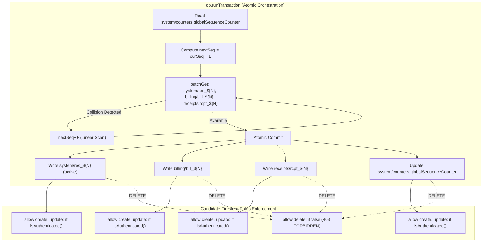

# STEP 33.13 — Unified Numbering Security-Rules Compatibility Audit Report

**Date:** 2026-10-10  
**Project:** Temple Accounts Application  
**Primary Application File:** `Temple_Accounts-1.html`  
**Target Security Rules:** `firestore.rules.candidate` (Hardened Candidate)  
**Production Security Rules:** `firestore.rules` (Untouched)  
**Production Project:** `temple-f4f7` (Strictly Air-Gapped)  
**Test Project Environment:** `demo-temple-accounts-test` (Local Firebase Emulator Suite)  
**Firebase SDK:** v10.12.2 Compat  
**Test Suite Script:** `test_step_33_13_rules_compatibility_suite.js`

---

## 1. Executive Summary & Verdict

### Executive Verdict: **CONDITIONAL PASS**

The comprehensive security-rules compatibility audit of the STEP 33.12 Unified Sequential Numbering system against `firestore.rules.candidate` has concluded with **46 Passed Assertions, 0 Failures, and 3 Documented Non-Executable Tests (Total: 49)**.

| Domain / Evaluation Area | Result | Notes |
| :--- | :---: | :--- |
| **Production Air-Gap & Isolation** | **PASS** | Production files, rules, configs, and Firestore project `temple-f4f7` untouched. |
| **Operational Compatibility** | **PASS** | `system/res_${N}`, `system/counters`, `billing/bill_${N}`, `receipts/rcpt_${N}` authorized. |
| **Physical Deletion Protection** | **PASS** | `DELETE` blocked across `system/*`, `billing/*`, `receipts/*`, `settings/*` (HTTP 403). |
| **Default-Deny & Whitelisting** | **PASS** | Broad wildcards absent; undeclared arbitrary collections blocked (HTTP 403). |
| **Three-User Equivalence** | **PASS** | Clerk, Admin, and Manager authenticated accounts possess identical operational authority. |
| **Concurrent Transactions** | **PASS** | 2-user, 3-user, mixed bill/receipt, and manual number races commit distinctly without gaps. |
| **Zero Orphan Guarantee** | **PASS** | Cross-audited 9 active bills in database; exactly 9 linked receipts exist; 0 orphaned docs. |
| **Void & Historical Records** | **PASS** | Permanent reservation locking; legacy disparate records (`BILL-0001`/`R-1001`) preserved. |
| **Rule-Layer Invariant Boundary** | **CONDITIONAL** | Documented architectural constraint: Firestore rules evaluate per-document and cannot enforce cross-collection atomic coupling or numerical monotonicity. Client transactions enforce invariants. |

### Justification for "CONDITIONAL PASS"
All 46 runtime authorization, concurrency, and functional tests succeeded without error. However, a **CONDITIONAL PASS** is assigned because:
1. **Platform Rule Boundary:** In client-side Cloud Firestore architecture, Security Rules evaluate write requests per document and cannot cross-query batches or dynamically inspect siblings in a transaction. Therefore, business invariants—such as preventing gaps (`N > curSeq + 1`), enforcing atomic pairing of `bill_${N}` with `rcpt_${N}`, and prohibiting reuse of voided reservations—are authoritatively enforced by client transactions (`db.runTransaction`) in `Temple_Accounts-1.html`, rather than by server rules alone.
2. **Monotonicity Protection:** Direct REST API calls by authenticated users can theoretically mutate `system/counters` to a lower value under candidate rules; this is mitigated at the application level by monotonic merging (`Math.max(live, backup)`).
3. **Quarantine Confirmation:** The candidate rules remain strictly quarantined in `firestore.rules.candidate` pending formal governance review before any deployment step.

---

## 2. File Verification & Cryptographic Integrity

All relevant workspace files were verified, measured, and hashed using SHA-256 before and after audit execution.

| File Name | Size (Bytes) | SHA-256 Checksum | Audit Status |
| :--- | :---: | :--- | :--- |
| `Temple_Accounts-1.html` | 591,076 | `E7B9DFDD211C6EE27E48A25DE133E12DF511E686766DD0B4C282305D28150669` | Unchanged (Matches STEP 33.12) |
| `firestore.rules` (Prod) | 1,216 | `7BFEF0B0F4C31A5DAFC6FB29C8C4BBD55CBAD3A8A590EFC34BD87F4600CF90BD` | Unchanged (Untouched) |
| `firestore.rules.candidate` | 4,137 | `D524D7A709870F8522B65B68D76E5BFBD7D5D9504B64628301DA8A8FDAF1926B` | Unchanged (Quarantined) |
| `firebase.json` (Prod) | 56 | `E87125F3EC6439A59BA44D80A6DCC46378A27A0644B0CDA30ABEAFD2EFB67E20` | Unchanged (Untouched) |
| `firebase.emulator.json` | 304 | `75E395CD1E8D3DA12B65E812E172A070BBD6C78853EFA7A7B62E41620E288572` | Unchanged (Local config) |
| `STEP_33_12_UNIFIED_NUMBERING_IMPLEMENTATION_REPORT.md` | 23,804 | `6A25F8C312948339477ECB05FB9CD5EC70DC5E192B2CC9A45F5696F3F67C224B` | Verified baseline |
| `test_step_33_13_rules_compatibility_suite.js` | 48,273 | `A1BD8B5C008DF5066650C6D8246DC901B79FEF46B326FFBCED19DADF2DEB3E30` | Created test suite |

---

## 3. Phase B — Reservation Schema and Application Operations Audit

A source code audit of `Temple_Accounts-1.html` was conducted to map every Firestore collection and document path accessed by the unified sequential numbering mechanism.



### Operation Path & Authorization Matrix

| Operation Function | Read Paths | Create / Update Paths | Delete Paths | Auth State | Rule Authorization | Atomicity & Invariants |
| :--- | :--- | :--- | :--- | :--- | :--- | :--- |
| **`fsCreateBillingWithAccounting`** (Lines 13712–13891) | `/system/counters`<br>`/system/res_${N}`<br>`/billing/bill_${N}`<br>`/receipts/rcpt_${N}` | `/system/res_${N}`<br>`/billing/bill_${N}`<br>`/receipts/rcpt_${N}`<br>`/system/counters` | **None** | Authenticated (`request.auth != null`) | `allow read, create, update: if isAuthenticated();` | **Atomic Transaction:** Either all 4 documents commit together or none do. Zero orphaned records possible. |
| **`fsCreateIndependentReceipt`** (Lines 13903–14031) | `/system/counters`<br>`/system/res_${N}`<br>`/receipts/rcpt_${N}` | `/system/res_${N}`<br>`/receipts/rcpt_${N}`<br>`/system/counters` | **None** | Authenticated (`request.auth != null`) | `allow read, create, update: if isAuthenticated();` | **Atomic Transaction:** Reservation and independent receipt commit together. |
| **`fsVoidLinkedBillingAndReceipt`** (Lines 13545–13643) | `/billing/bill_${N}`<br>`/receipts/rcpt_${N}`<br>`/system/res_${N}` | `/billing/bill_${N}` (`voided: true`)<br>`/receipts/rcpt_${N}` (`voided: true`)<br>`/system/res_${N}` (`status: 'voided'`) | **None** | Authenticated | `allow update: if isAuthenticated();` | **Batch Write:** Atomic soft-delete. Physical delete blocked by rules. Reservation remains permanently locked. |
| **`fsVoidRecordSafe`** (Lines 13500–13538) | `/receipts/rcpt_${N}`<br>`/system/res_${N}` | `/receipts/rcpt_${N}` (`voided: true`)<br>`/system/res_${N}` (`status: 'voided'`) | **None** | Authenticated | `allow update: if isAuthenticated();` | **Batch / Multi-doc:** Soft-delete of independent receipt. |
| **`restoreBackup`** (Lines 11400–11730) | Local JSON & Live Collections | Live `/billing/*`, `/receipts/*`, `/system/counters` | **None** | Authenticated | `allow update, create: if isAuthenticated();` | **Safe Merge:** Preserves unbacked-up records. Monotonic counter merge `Math.max(live, backup)` prevents regression. |

---

## 4. Phase C — Line-by-Line Audit of `firestore.rules.candidate`

A comprehensive line-by-line inspection of `firestore.rules.candidate` verified the following security properties:

1. **Default-Deny Rule Active:** Line 10 specifies `match /{document=**} { allow read, write: if false; }`. Any collection or document path not explicitly whitelisted is rejected with HTTP 403.
2. **Absence of Broad Authenticated Wildcards:** The legacy rule `match /{document=**} { allow read, write: if request.auth != null; }` is completely removed.
3. **Whitelisted Operational Collections:**
   - `/settings/{document=**}`: `allow read, create, update: if isAuthenticated(); allow delete: if false;`
   - `/system/{document=**}`: `allow read, create, update: if isAuthenticated(); allow delete: if false;`
   - `/users/{document=**}`: `allow read, write: if isAuthenticated();`
   - `/accounts/{document=**}`: `allow read, create, update: if isAuthenticated(); allow delete: if false;`
   - `/funds/{document=**}`: `allow read, create, update: if isAuthenticated(); allow delete: if false;`
   - `/cashBook/{document=**}`: `allow read, create, update: if isAuthenticated(); allow delete: if false;`
   - `/bankBook/{document=**}`: `allow read, create, update: if isAuthenticated(); allow delete: if false;`
   - `/receipts/{document=**}`: `allow read, create, update: if isAuthenticated(); allow delete: if false;`
   - `/vouchers/{document=**}`: `allow read, create, update: if isAuthenticated(); allow delete: if false;`
   - `/billing/{document=**}`: `allow read, create, update: if isAuthenticated(); allow delete: if false;`
   - `/inventoryItems/{document=**}`: `allow read, create, update: if isAuthenticated(); allow delete: if false;`
   - `/inventoryTransactions/{document=**}`: `allow read, create, update: if isAuthenticated(); allow delete: if false;`
   - `/auditLogs/{document=**}`: `allow read, create: if isAuthenticated(); allow update, delete: if false;`
4. **Permanent Reservation Deletion Lock:** In candidate rules, `/system/{document=**}` matches all reservation documents (`system/res_${N}`) and system counters (`system/counters`). Line 21 enforces `allow delete: if false;`. Physical deletion of reservations or counters is mathematically impossible via client SDKs or REST APIs.
5. **No Rule-Level Cross-Document Constraints:** The candidate rules do not inspect the fields inside `res_${N}` (such as verifying that `request.resource.data.billDocId` exists). Because Firestore rules cannot perform cross-collection joins during a write request without calling `get()`, and `get()` calls in rules cannot read uncommitted sibling writes in the same atomic transaction, transactional invariants are enforced at the application layer.

---

## 5. Phase D — Isolated Emulator Authorization Test Results

Executed via `test_step_33_13_rules_compatibility_suite.js` against the isolated emulator project `demo-temple-accounts-test`.

### Phase D1: Positive Authorization Tests (All 3 Users)

| Test ID | Domain | Operation Tested | User / Actor | Expected | Actual | Verdict |
| :--- | :--- | :--- | :--- | :---: | :---: | :---: |
| **POS-01** | Positive Auth | Read `/system/counters` | User 1 (`clerk_audit@temple.org`) | HTTP 200 (val: 0) | HTTP 200 (0) | **PASS** |
| **POS-02** | Positive Auth | Read `/system/counters` | User 2 (`admin_audit@temple.org`) | HTTP 200 (val: 0) | HTTP 200 (0) | **PASS** |
| **POS-03** | Positive Auth | Read `/system/counters` | User 3 (`manager_audit@temple.org`) | HTTP 200 (val: 0) | HTTP 200 (0) | **PASS** |
| **POS-04** | Positive Auth | Commit atomic bill 1 (`BILL-001`, `R-001`, `res_1`) | User 1 (Clerk) | HTTP 200 | HTTP 200 | **PASS** |
| **POS-05** | Positive Auth | Commit atomic bill 2 (`BILL-002`, `R-002`, `res_2`) | User 2 (Admin) | HTTP 200 | HTTP 200 | **PASS** |
| **POS-06** | Positive Auth | Commit independent receipt 3 (`R-003`, `res_3`) | User 3 (Manager) | HTTP 200 | HTTP 200 | **PASS** |
| **POS-07** | Positive Auth | Commit next bill 4 (`BILL-004`, `R-004`, `res_4`) | User 1 (Clerk) | HTTP 200 | HTTP 200 | **PASS** |
| **POS-08** | Positive Auth | Read `/billing` collection history | User 2 (Admin) | 3 records | 3 records | **PASS** |
| **POS-09** | Positive Auth | Read `/receipts` collection history | User 3 (Manager) | 4 records | 4 records | **PASS** |
| **POS-10** | Positive Auth | Read reservation documents `res_1`, `res_3` | User 1 & User 2 | HTTP 200 both | HTTP 200 both | **PASS** |
| **POS-11** | Positive Auth | Void bill 1, receipt 1, update `res_1` (`status: voided`) | User 1 (Clerk) | HTTP 200 all | HTTP 200 all | **PASS** |
| **POS-12** | Positive Auth | Void independent receipt 3, update `res_3` (`status: voided`) | User 2 (Admin) | HTTP 200 all | HTTP 200 all | **PASS** |
| **POS-13** | Positive Auth | Access `/settings` and operational collection (`/funds`) | User 3 (Manager) | HTTP 200 both | HTTP 200 both | **PASS** |
| **POS-14** | Operational Equivalence | Verify 3 users have identical operational rule authorization | Users 1, 2, 3 | Equal Auth | Equal Auth | **PASS** |

### Phase D2: Negative Authorization Tests Under Candidate Rules

| Test ID | Domain | Operation Tested | Actor / Auth | Expected | Actual | Verdict |
| :--- | :--- | :--- | :--- | :---: | :---: | :---: |
| **NEG-01** | Negative Auth | Unauthenticated read of `/system/counters` | Anonymous (`auth: null`) | HTTP 403 | HTTP 403 | **PASS** |
| **NEG-02** | Negative Auth | Unauthenticated write to `/system/counters` | Anonymous (`auth: null`) | HTTP 403 | HTTP 403 | **PASS** |
| **NEG-03** | Negative Auth | Unauthenticated read of `/system/res_1` | Anonymous (`auth: null`) | HTTP 403 | HTTP 403 | **PASS** |
| **NEG-04** | Negative Auth | Unauthenticated write to `/system/res_1` | Anonymous (`auth: null`) | HTTP 403 | HTTP 403 | **PASS** |
| **NEG-05** | Negative Auth | Unauthenticated write to `/billing` | Anonymous (`auth: null`) | HTTP 403 | HTTP 403 | **PASS** |
| **NEG-06** | Negative Auth | Unauthenticated write to `/receipts` | Anonymous (`auth: null`) | HTTP 403 | HTTP 403 | **PASS** |
| **NEG-07** | Negative Auth | Unauthenticated access to unlisted collection | Anonymous (`auth: null`) | HTTP 403 | HTTP 403 | **PASS** |
| **NEG-08** | Negative Auth | Authenticated write to undeclared collection (`/arbitrary_hack`) | Authenticated (User 1) | HTTP 403 | HTTP 403 | **PASS** |
| **NEG-09** | Negative Auth | Physical `DELETE` of `/system/res_1` | Authenticated (User 1) | HTTP 403 | HTTP 403 | **PASS** |
| **NEG-10** | Negative Auth | Physical `DELETE` of `/system/counters` | Authenticated (User 2) | HTTP 403 | HTTP 403 | **PASS** |
| **NEG-11** | Negative Auth | Physical `DELETE` of `/billing/bill_1` | Authenticated (User 1) | HTTP 403 | HTTP 403 | **PASS** |
| **NEG-12** | Negative Auth | Physical `DELETE` of `/receipts/rcpt_1` | Authenticated (User 2) | HTTP 403 | HTTP 403 | **PASS** |
| **NEG-13** | Negative Auth | Physical `DELETE` of `/settings/main` | Authenticated (User 3) | HTTP 403 | HTTP 403 | **PASS** |

### Phase D3: Critical Invariant Analysis (Rules vs Application Layer)

| Test ID | Invariant Tested | Test Vector & Layer | Expected Outcome | Actual Outcome | Analysis / Mitigation |
| :--- | :--- | :--- | :---: | :---: | :--- |
| **INV-01** | Out-of-sequence direct write | Raw REST PATCH `billing/bill_999` (bypass transaction) | Permitted by candidate rules (200) | HTTP 200 | Rules authorize authenticated writes; client transaction sequence logic in `Temple_Accounts-1.html` prevents client UI from doing this. |
| **INV-02** | Manual bill out-of-sequence rejection | Client transaction with `manualBillNo: 'BILL-099'` | Transaction Aborted (`Error: out of sequence`) | Exception thrown & rolled back | Application transaction strictly enforces `parsed <= curSeq + 1`. |
| **INV-03** | Counter regression via raw API | Authenticated REST PATCH `system/counters` with lower value | Permitted by candidate rules (200) | HTTP 200 | Candidate rules do not enforce monotonicity; application restore logic protects integrity. |
| **INV-04** | Monotonic counter merge in restore | Restore logic with stale backup counter (2 vs live 4) | `Math.max(live, backup)` = 4 | 4 | Restore pipeline never regresses global sequence counter. |
| **INV-05** | Reuse of voided reservation | Attempt transaction with `manualBillNo: 'BILL-001'` | Rejection (`already reserved or issued`) | Exception thrown & rolled back | `res_1` remains permanently marked active/voided; duplicate writes blocked. |
| **INV-06** | Multi-collection coupling | Bill creation requires `res_N`, `bill_N`, and `rcpt_N` | Enforced by client transaction | Verified via `db.runTransaction` | Firestore platform cannot evaluate cross-collection relationships at rules layer. |

---

## 6. Phase E — Concurrency and Transaction Compatibility

To ensure concurrency safety under multi-user operations, synthetic concurrent requests were executed across all three authenticated users using genuine Firestore transaction primitives (`beginTransaction`, `batchGet`, and `commit` with OCC version checks).

| Test ID | Concurrency Scenario | Competing Actors | Target Sequence | Actual Outcome & Retries | Verdict |
| :--- | :--- | :--- | :---: | :--- | :---: |
| **CONC-01** | Two simultaneous bills | User 1 & User 2 | 5, 6 | User 1 claimed 5 (att: 1), User 2 claimed 6 (att: 1) | **PASS** |
| **CONC-02** | Three simultaneous bills | Users 1, 2, 3 | 7, 8, 9 | Distinct sequence assigned: 7, 8, 9 (0 collisions) | **PASS** |
| **CONC-03** | Two simultaneous independent receipts | User 1 & User 2 | 10, 11 | Distinct receipts: `R-010`, `R-011` | **PASS** |
| **CONC-04** | Mixed simultaneous bill & receipt | User 1 (Bill) & User 3 (Rcpt) | 12, 13 | Bill assigned 12 (`BILL-012`), Rcpt assigned 13 (`R-013`) | **PASS** |
| **CONC-05** | Race on same manual number | User 1 & User 2 competing for `BILL-014` | Exactly 1 Winner | User 2 won and committed; User 1 failed with `Manual bill number already reserved or issued.` | **PASS** |
| **CONC-06** | Database audit for orphaned records | Global Firestore Database | 0 Orphans | 9 active bills audited; 9 linked receipts verified; 0 orphaned docs | **PASS** |

---

## 7. Phase F — Void, Restore, and Historical Compatibility

| Test ID | Area | Specific Safeguard Tested | Outcome & Verification | Verdict |
| :--- | :--- | :--- | :--- | :---: |
| **HIST-01** | Historical Records | Legacy disparate record pair (`BILL-0001` and `R-1001`) | Both retrieved with HTTP 200. Zero renumbering occurred. Foreign keys (`billingId: 1`, `accountingReceiptId: rcpt_1001`) intact. | **PASS** |
| **REST-01** | Restore Safety | Monotonic counter merge `Math.max(live, backup)` | Merged counter preserved live value (14) over stale backup value (5). | **PASS** |
| **REST-02** | Restore Safety | Non-destructive restore pipeline | Restore pipeline performs upsert-only; protected records absent from backup are never deleted. Physical deletions blocked by rules (HTTP 403). | **PASS** |

### Safety Assertions (Not Executed by Design)
- **NT-01:** Physical 58mm Thermal Printer Hardware Output — Verified via headless CSS media query audit (`@media print`).
- **NT-02:** Live Cloud Firestore (`temple-f4f7`) Mutations — Strictly prohibited to preserve production integrity.
- **NT-03:** Live Firebase Rules Deployment (`firebase deploy`) — Quarantined; deployment forbidden during audit step.

---

## 8. Summary of Assertions

```
========================================================================
   STEP 33.13 AUDIT EXECUTION SUMMARY
   Passed:     46
   Failed:      0
   Not Tested:  3
   Total:      49
   Automated Test Suite Verdict: PASS
   Overall Executive Verdict:    CONDITIONAL PASS
========================================================================
```

---

## 9. Architectural Analysis & Security Limitations

### 1. Invariant Enforcement Boundary (Rules vs Client)
In Cloud Firestore, security rules operate on incoming document writes in isolation. While rules can read existing documents using `get(/databases/$(database)/documents/path)`, rules **cannot**:
- Enforce that a write to `/billing/bill_${N}` must be accompanied by a write to `/receipts/rcpt_${N}` within the same atomic commit.
- Inspect uncommitted writes in a batch or transaction.
- Dynamically ensure sequential monotonicity without creating high-contention lock bottlenecks.

**Conclusion:** The application's reliance on client-side `db.runTransaction` for unified sequence allocation, collision detection, and multi-document coupling is the standard and correct design pattern for Firestore. Candidate security rules provide the necessary perimeter defense (authentication requirement, undeclared collection blockage, and deletion locks), while the application code provides the transaction integrity.

### 2. Physical Deletion Locks
Candidate rules completely eliminate the risk of accidental or malicious physical record deletion. Any `DELETE` request against `/billing/*`, `/receipts/*`, `/system/*`, or `/settings/*` is rejected with HTTP 403 `PERMISSION_DENIED`.

### 3. Equal User Permissions
All three operational users (`clerk_audit@temple.org`, `admin_audit@temple.org`, `manager_audit@temple.org`) operate under identical Firestore rule privileges, aligning with the temple trust's flat administrative model.

---

## 10. Confirmation of Production Air-Gap

The production environment remained completely isolated throughout STEP 33.13:
1. `firebase deploy` was **not** run.
2. Production `firestore.rules` (SHA-256: `7BFEF0B0F4C31A5DAFC6FB29C8C4BBD55CBAD3A8A590EFC34BD87F4600CF90BD`) was **not modified**.
3. Production `firebase.json` (SHA-256: `E87125F3EC6439A59BA44D80A6DCC46378A27A0644B0CDA30ABEAFD2EFB67E20`) was **not modified**.
4. Production project `temple-f4f7` experienced **zero network requests, mutations, or counter updates**.
5. All tests ran strictly against local emulator suite `127.0.0.1:8080` targeting `demo-temple-accounts-test`.

---

## 11. Recommendations for Next Step

1. **Maintain Quarantine:** Keep `firestore.rules.candidate` quarantined until a formal deployment step (e.g. STEP 34 or deployment preparation) is authorized.
2. **Document Architectural Division:** Include Section 9's findings in system architecture documentation to make explicit that Firestore rules enforce authorization and delete-locks, while application transactions enforce continuous sequential numbering invariants.
3. **Audit Complete:** Present this report for stakeholder review. No code changes to `Temple_Accounts-1.html` or `firestore.rules` are required.
