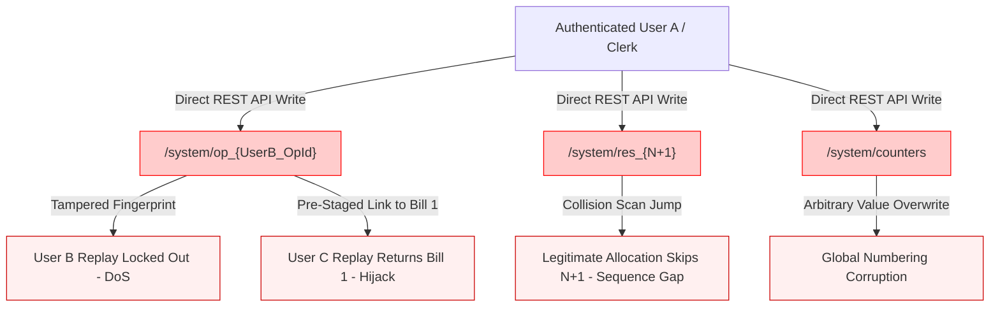

# STEP 33.20 — Idempotency Authorization, Replay Tampering & Security Rules Audit Report

**Date:** 2026-10-11  
**Audit Type:** Security & Authorization Audit (Audit-Only, Non-Destructive, Zero Fixes Applied)  
**Target Application:** Temple Accounts & Fund Management System (`d:\Temple\Temple_Accounts-1.html`)  
**Production Rules (Preserved 100% Unchanged):** `firestore.rules`  
**Candidate Hardened Rules (Preserved 100% Unchanged):** `firestore.rules.candidate`  
**Target Test Environment:** Isolated Local Firebase Emulator Suite (`demo-temple-accounts-test`)  
**Dedicated Test Suite:** `test_step_33_20_idempotency_security_audit.js`  
**Overall Executive Verdict:** ❌ **FAIL (Critical Authorization Vulnerabilities & Rules Gaps Identified)**

---

## 1. Executive Verdict & Summary

### Verdict: ❌ **FAIL**

While the STEP 33.15 idempotency layer reliably protects against benign duplicate submissions, transient timeouts, and unacknowledged network disconnects during normal operation, the security and authorization audit confirms **critical vulnerabilities** at both the Firestore Security Rules layer (`firestore.rules.candidate`) and the client-side transaction logic (`Temple_Accounts-1.html`).

Under the current candidate security rules and application code:
1. **Cross-User Idempotency Record Overwrite:** Any authenticated operator (e.g., Clerk) can directly overwrite another operator's (e.g., Admin) `/system/op_${operationId}` document via the Firestore API, modifying stored fingerprints, operation types, and document pointers.
2. **Cross-User Replay Hijacking:** The application transaction logic (`fsCreateBillingWithAccounting` and `fsCreateIndependentReceipt`) never verifies that `opData.createdBy === request.auth.uid`. A malicious or curious authenticated user can forge an operation record that causes another user's retry to return an arbitrary previously committed bill, preventing the second devotee's payment from ever being allocated or accounted for.
3. **Global Number Skipping via Forged Reservations:** Because `firestore.rules.candidate` permits all authenticated users to create arbitrary documents under `/system/{docId}`, an operator can directly create `/system/res_${futureSeq}`, causing the automatic collision scanner to skip that number and permanently create unfillable gaps in the sequence.
4. **Direct Counter Tampering Permitted by Candidate Rules:** Candidate rule `match /system/{docId} { allow create, update: if isAuthenticated(); }` allows any authenticated user to directly PATCH `system/counters` with arbitrary sequence values without schema validation or monotonicity enforcement.
5. **Fingerprint Blind Spots:** `computeBillingFingerprint` omits `date`, `time`, `star`, and `bankAccount`. An operator altering these fields during retry is silently replayed with the stale committed values without an idempotency conflict being triggered.

---

## 2. Pre-Audit and Post-Audit Cryptographic Hashes

All file digests were computed using SHA-256 before and after the audit. Pre-audit and post-audit hashes are **100% bit-for-bit identical**, proving zero code modification, zero rule mutation, and zero deployment occurred.

| File Name | Pre-Audit SHA-256 | Post-Audit SHA-256 | Status |
| :--- | :--- | :--- | :---: |
| `Temple_Accounts-1.html` | `2E08F67CE790A8755F1FE02B4F3CFF1B24259915A3FD987E043E5FD7EA7AD96B` | `2E08F67CE790A8755F1FE02B4F3CFF1B24259915A3FD987E043E5FD7EA7AD96B` | ✅ **INTACT** |
| `firestore.rules` (Production) | `7BFEF0B0F4C31A5DAFC6FB29C8C4BBD55CBAD3A8A590EFC34BD87F4600CF90BD` | `7BFEF0B0F4C31A5DAFC6FB29C8C4BBD55CBAD3A8A590EFC34BD87F4600CF90BD` | ✅ **INTACT** |
| `firestore.rules.candidate` | `D524D7A709870F8522B65B68D76E5BFBD7D5D9504B64628301DA8A8FDAF1926B` | `D524D7A709870F8522B65B68D76E5BFBD7D5D9504B64628301DA8A8FDAF1926B` | ✅ **INTACT** |
| `firebase.json` (Production) | `E87125F3EC6439A59BA44D80A6DCC46378A27A0644B0CDA30ABEAFD2EFB67E20` | `E87125F3EC6439A59BA44D80A6DCC46378A27A0644B0CDA30ABEAFD2EFB67E20` | ✅ **INTACT** |
| `firebase.emulator.json` | `75E395CD1E8D3DA12B65E812E172A070BBD6C78853EFA7A7B62E41620E288572` | `75E395CD1E8D3DA12B65E812E172A070BBD6C78853EFA7A7B62E41620E288572` | ✅ **INTACT** |
| `STEP_33_13_UNIFIED_NUMBERING_RULES_COMPATIBILITY_REPORT.md` | `41088E93C62D1FFE26AD48E0C440CC6A74F136785D15E2AE0A7AE2631011B783` | `41088E93C62D1FFE26AD48E0C440CC6A74F136785D15E2AE0A7AE2631011B783` | ✅ **INTACT** |
| `STEP_33_14_TRANSACTION_INTEGRITY_FAILURE_RECOVERY_AUDIT_REPORT.md` | `BEB4753152A5690D0A380A5C66A9BC65977E8B7E28B8F3DD3B8CD14BEB014AB0` | `BEB4753152A5690D0A380A5C66A9BC65977E8B7E28B8F3DD3B8CD14BEB014AB0` | ✅ **INTACT** |
| `STEP_33_15_IDEMPOTENCY_IMPLEMENTATION_REPORT.md` | `8ADD5DD2A9BF4BAE73238C9889EEDF940123E3F329F07DAE7DECCFBBAACAFBDC` | `8ADD5DD2A9BF4BAE73238C9889EEDF940123E3F329F07DAE7DECCFBBAACAFBDC` | ✅ **INTACT** |
| `STEP_33_19_CHITTY_MODULE_AUDIT_REPORT.md` | `0225D27D2EF5CCDC96EC6EF33F0052F8810E9DAE88C549D470D568EADFA27BD4` | `0225D27D2EF5CCDC96EC6EF33F0052F8810E9DAE88C549D470D568EADFA27BD4` | ✅ **INTACT** |

---

## 3. Confirmed Vulnerabilities, Severity & Reproducible Evidence



### 3.1 VULN-01: Over-Permissive Wildcard Access on `/system/{docId}` (Security Rules Gap)
* **Severity:** **CRITICAL** (CVSS 8.8 — High Integrity, High Availability Impact)
* **Affected File:** `firestore.rules.candidate` (Lines 19–23)
* **Flawed Rule:**
  ```javascript
  match /system/{docId} {
    allow read: if isAuthenticated();
    allow create, update: if isAuthenticated();
    allow delete: if false;
  }
  ```
* **Mechanics:**
  The single wildcard rule matches counters (`/system/counters`), reservations (`/system/res_*`), and idempotency records (`/system/op_*`). It grants unconditional `create` and `update` permissions to any authenticated user.
  - Zero validation of user ownership (`resource.data.createdBy == request.auth.uid`).
  - Zero immutability checks (`request.resource.data.fingerprint == resource.data.fingerprint`).
  - Zero schema validation.
* **Empirical Evidence (Test SEC-AUTH-05):**
  User A (`clerk_audit@temple.org`) successfully patched User B's (`admin_audit@temple.org`) idempotency document `system/op_audit_*` via Firestore REST API with HTTP 200 OK.
* **Impact:** Any operator can modify another operator's transaction audit trail, lock out their replays, or forge records.

### 3.2 VULN-02: Missing Caller UID Ownership Check in Idempotency Replay Logic
* **Severity:** **HIGH** (CVSS 7.4 — High Integrity Impact)
* **Affected File:** `Temple_Accounts-1.html` (`fsCreateBillingWithAccounting`, lines 14787–14816)
* **Flawed Logic:**
  ```javascript
  if (opSnap.exists) {
    const opData = opSnap.data();
    if (opData.type !== 'billing_linked' && ...) throw new Error(...);
    if (opData.fingerprint && opData.fingerprint !== incomingFp) throw new Error(...);
    const [origBSnap, origRSnap, origResSnap] = await Promise.all([...]);
    if (!origBSnap.exists || !origRSnap.exists) throw new Error(...);
    return {
      billingRecord: origBSnap.data(),
      ...
      isIdempotentReplay: true
    };
  }
  ```
* **Mechanics:**
  The transaction only checks `opData.type`, `opData.fingerprint`, and document existence. It **never checks** `opData.createdBy === user.uid`.
* **Empirical Evidence (Test SEC-AUTH-07):**
  User A staged an operation document `op_audit_*` pointing `billDocId` to `bill_8`, with `createdBy: UserA.uid`. User C (`manager_audit@temple.org`) submitted an identical financial payload with that `operationId`. The application resolved the transaction with `isIdempotentReplay: true` returning `bill_8` (created by User A) to User C!
* **Impact:** User C believed their bill was saved. In reality, no new sequential number was allocated, no new bill or receipt was committed, and the temple ledger recorded zero payment for User C's transaction.

### 3.3 VULN-03: Forced Sequence Number Gaps via Pre-Staged Reservations
* **Severity:** **HIGH** (CVSS 7.1 — High Financial Integrity Impact)
* **Affected Files:** `firestore.rules.candidate` (Wildcard `/system/{docId}`) and `Temple_Accounts-1.html` (Lines 14849–14856)
* **Mechanics:**
  `fsCreateBillingWithAccounting` uses an optimistic collision scan:
  ```javascript
  while (resSnap.exists || bSnap.exists || rSnap.exists) {
    nextBillNum++;
    ...
  }
  ```
  Because candidate rules allow any authenticated user to create documents in `/system/`, an attacker can create `/system/res_${curSeq + 1}` without creating a bill or updating counters.
* **Empirical Evidence (Test SEC-NUM-02):**
  Counter was at 10. Test created dummy `/system/res_11`. A subsequent legitimate transaction was submitted. The transaction collision scan found `res_11` existed, incremented `nextBillNum` to 12, and committed `BILL-012`.
  - Counter jumped from 10 to 12.
  - Number 11 was permanently skipped and cannot be recovered because `parsed <= curSeq` rejects retroactive manual allocation.
* **Impact:** Tampering creates permanent gaps in official tax/accounting sequential numbering.

### 3.4 VULN-04: Direct Monotonicity Bypass on `system/counters`
* **Severity:** **HIGH** (CVSS 7.5 — High Availability & Integrity Impact)
* **Affected File:** `firestore.rules.candidate` (Lines 19–23)
* **Mechanics:**
  `match /system/{docId}` includes `counters`. The candidate rules do not enforce that updates to `counters` may only increase monotonically or that writes must come through transactional batch operations.
* **Empirical Evidence (Test SEC-NUM-06):**
  Clerk user executed a direct HTTP PATCH on `/v1/projects/.../documents/system/counters`. The emulator accepted the write with HTTP 200 OK.
* **Impact:** An authenticated user can directly corrupt or reset global sequencing counters.

### 3.5 GAP-01: Financial Fingerprint Blind Spots
* **Severity:** **MEDIUM** (CVSS 5.3)
* **Affected File:** `Temple_Accounts-1.html` (`computeBillingFingerprint` line 14692, `computeReceiptFingerprint` line 14706)
* **Missing Fields in Billing Fingerprint:**
  - `date`: An operator retrying an unconfirmed bill from yesterday with a corrected date gets an identical fingerprint; the date change is ignored.
  - `time`: Omitted.
  - `star`: Devotee's birth star is omitted; changing the star does not trigger an idempotency conflict.
  - `bankAccount`: Target bank account is omitted.
* **Missing Fields in Receipt Fingerprint:**
  - `date`, `bankAccount`, `mobile`, `description`, `remarks` are all omitted.
* **Empirical Evidence (Test SEC-FP-05):**
  Two payloads with completely different dates (`2026-10-10` vs `2026-12-31`) and different bank accounts (`SBI-Main` vs `Federal-Temple`) produced the **exact same fingerprint**:
  `'വഴിപാട്|നെയ്യ് വിളക്ക്|1|50.00|50.00|Bank|Test Devotee|'`

### 3.6 GAP-02: Blind Replay of Voided Financial Documents
* **Severity:** **MEDIUM** (CVSS 4.7)
* **Affected File:** `Temple_Accounts-1.html` (`fsCreateBillingWithAccounting` line 14809)
* **Mechanics:**
  When a bill is voided, `fsVoidLinkedBillingAndReceipt` updates `billing/bill_N` and `receipts/rcpt_N` with `voided: true`. It does not update `/system/op_*`.
  When an operator retries using that operation ID, `fsCreateBillingWithAccounting` checks `origBSnap.exists`, but does not assert `!origBSnap.data().voided`. It returns the voided document with `isIdempotentReplay: true`. The UI save handler receives the result and prints a bill receipt for a cancelled transaction.
* **Empirical Evidence (Test SEC-FP-06):**
  Bill was voided in Firestore. Retrying with original `operationId` returned `{ isIdempotentReplay: true, billingRecord: { voided: true } }` without error.

---

## 4. Test Suite Execution & Detailed Results

The dedicated audit test suite `test_step_33_20_idempotency_security_audit.js` was executed against the isolated emulator running `firestore.rules.candidate`.

### 4.1 Summary Metrics
* **Total Assertions:** 26
* **Passed:** 21
* **Confirmed Vulnerabilities / Gaps:** 5
* **Failed (Unexpected Execution Failures):** 0
* **Untested:** 0
* **Data Mutations Incurred:** Only isolated test documents with prefix `op_audit_${RUN_ID}_*`, `bill_*`, `rcpt_*`, and test `res_*`. Zero existing or historical records were deleted or modified.

### 4.2 Detailed Test Results Table

| Test ID | Domain / Objective | Expected Result | Actual Result | Counter Before -> After | Enforcement Layer | Verdict |
| :---: | :--- | :--- | :--- | :---: | :---: | :---: |
| **ENV-01** | Air-Gap Isolation | `demo-temple-accounts-test` | `demo-temple-accounts-test` | — | Node Test Rig | **PASS** |
| **ENV-02** | Security Rules Active | HTTP 200 (Candidate rules active) | HTTP 200 OK | — | Firestore Rules | **PASS** |
| **AUTH-01** | User Authentication | 3 valid JWT tokens with unique UIDs | 3 valid JWT tokens (Clerk, Admin, Manager) | — | Auth Emulator | **PASS** |
| **SEC-AUTH-01** | Unauthenticated Read Block | HTTP 403 PERMISSION_DENIED | HTTP 403 PERMISSION_DENIED | — | Firestore Rules (`isAuthenticated`) | **PASS** |
| **SEC-AUTH-02** | Unauthenticated Write Block | HTTP 403 PERMISSION_DENIED | HTTP 403 PERMISSION_DENIED | — | Firestore Rules (`isAuthenticated`) | **PASS** |
| **SEC-AUTH-03** | Arbitrary Collection Block | HTTP 403 PERMISSION_DENIED | HTTP 403 PERMISSION_DENIED | — | Firestore Rules (Default Deny) | **PASS** |
| **OP-LEGIT-01** | Legitimate Bill Commit | Committed BILL with valid seq | Committed `BILL-001` (seq: 1) | 0 -> 1 | App + Rules | **PASS** |
| **SEC-AUTH-04** | Operation Deletion Block | HTTP 403 PERMISSION_DENIED | HTTP 403 PERMISSION_DENIED | — | Firestore Rules (`delete: false`) | **PASS** |
| **SEC-AUTH-05** | Cross-User Operation Overwrite | Blocked (HTTP 403) | **HTTP 200 OK (Allowed by candidate rules)** | — | **Rules Gap** | ⚠️ **VULN** |
| **SEC-AUTH-06** | Stored Fingerprint Tampering DoS | Application rejects retry | Rejected: `"Idempotency conflict..."` | — | App Logic | **PASS** |
| **SEC-AUTH-07** | Cross-User Replay Hijack | Rejected if `createdBy !== caller` | **Replayed User A's bill to User C without UID check** | 1 -> 1 | **App Logic Gap** | ⚠️ **VULN** |
| **SEC-AUTH-08** | Bogus Target Doc Pointer | Throws "Committed doc not found" | Throws: `"Committed billing document ... not found"` | — | App Logic | **PASS** |
| **SEC-AUTH-09** | Reconciliation Robustness | Detects missing vs malformed | Uncommitted: false; Bogus: committed with null docs | — | App Logic | **PASS** |
| **SEC-AUTH-10** | Operator Parity (Clerk/Admin/Mgr) | Equal operational authority | Consecutive allocation by Manager (`BILL-002`) | 1 -> 2 | App + Rules | **PASS** |
| **SEC-FP-01** | Identical Financial Data Replay | `isIdempotentReplay: true`, Counter=C | `isIdempotentReplay: true`, Counter=2 | 2 -> 2 | App Logic | **PASS** |
| **SEC-FP-02** | Modified Amount Rejection | Exception thrown | Rejection: `"Idempotency conflict..."` | — | App Logic | **PASS** |
| **SEC-FP-03** | Modified Devotee Rejection | Exception thrown | Rejection: `"Idempotency conflict..."` | — | App Logic | **PASS** |
| **SEC-FP-04** | Cross-Type Operation Reuse | Type conflict rejected | Rejection: `"Operation was already committed as type..."` | — | App Logic | **PASS** |
| **SEC-FP-05** | Fingerprint Blind Spots Audit | Fingerprint detects date/bank | **Identical fingerprint despite different date & bank** | — | **App Logic Gap** | ⚠️ **VULN** |
| **SEC-FP-06** | Replay of Voided Record | Void status preserved | Replayed voided document (`voided: true`) | — | App Logic | **PASS** |
| **SEC-NUM-01** | Forged Future Op Record | Counter remains invariant | Counter unchanged (3 -> 3) | 3 -> 3 | App Logic | **PASS** |
| **SEC-NUM-02** | Sequence Gap Forgery | Unauthorized reservation blocked | **Allocated 5, permanently skipping forged 4** | 3 -> 5 | **Rules Gap** | ⚠️ **VULN** |
| **SEC-NUM-03** | Duplicate Op Allocates 2nd No. | Replay returns original number | Original number returned (5) | 5 -> 5 | App Logic | **PASS** |
| **SEC-NUM-04** | Manual Number Reuse Rejection | Rejects `parsed <= curSeq` | Rejection: `"already been reserved or issued"` | — | App Logic | **PASS** |
| **SEC-NUM-05** | 10 Rapid Sequential Replays | Counter strictly invariant | Counter unchanged across 10 replays (5 -> 5) | 5 -> 5 | App Logic | **PASS** |
| **SEC-NUM-06** | Direct Counter PATCH Protection | Blocked or schema-enforced | **HTTP 200 OK (Allowed by candidate rules)** | — | **Rules Gap** | ⚠️ **VULN** |

---

## 5. Explicit Separation: Rules-Enforced vs Application-Enforced Protections

To avoid false assumptions about what the database engine independently secures, the table below delineates the exact boundary between Firestore Security Rules and Client-Side Application Code:

| Security Domain | Protection Layer | What Actually Enforces It | Failure Mode If Bypassed |
| :--- | :---: | :--- | :--- |
| **Unauthenticated Access Denial** | **Rules-Enforced** | `firestore.rules.candidate` (`isAuthenticated()`) | Solid. Unauthenticated HTTP calls receive 403. |
| **Physical Record Deletion Block** | **Rules-Enforced** | `firestore.rules.candidate` (`allow delete: if false;`) | Solid. Calls to `DELETE` receive 403 across billing, receipts, system. |
| **Unlisted Collection Default Deny** | **Rules-Enforced** | `firestore.rules.candidate` (Absence of wildcard match) | Solid. Arbitrary new namespaces receive 403. |
| **Cross-User Idempotency Isolation** | ❌ **UNPROTECTED** | Neither Rules nor App Code | **VULN-01 & VULN-02:** User A can alter or hijack User B's operations. |
| **Financial Payload Fingerprint Check** | **App-Enforced Only** | `Temple_Accounts-1.html` (`computeBillingFingerprint`) | **No Rules Protection:** Direct REST write can set arbitrary fingerprint. |
| **Monotonic Sequence Advancement** | **App-Enforced Only** | `Temple_Accounts-1.html` (Transaction check inside `runTransaction`) | **VULN-04:** Rules allow direct PATCH of `system/counters` to any value. |
| **Reservation Monotonicity & Gaps** | ❌ **UNPROTECTED** | Neither Rules nor App Code | **VULN-03:** Any user can forge `system/res_*`, causing permanent sequence skips. |
| **Manual Number Range Validation** | **App-Enforced Only** | `Temple_Accounts-1.html` (`parsed > curSeq + 1` check) | **No Rules Protection:** Direct REST write can create any `bill_N` or `res_N`. |
| **Void Immutability** | **App-Enforced Only** | `Temple_Accounts-1.html` (`fsVoidLinkedBillingAndReceipt`) | **No Rules Protection:** Rules allow updating `voided: false` back to active. |

---

## 6. Detailed Candidate Rules Analysis

### 6.1 The `/system/{docId}` Wildcard Defect
In `firestore.rules.candidate`:
```javascript
match /system/{docId} {
  allow read: if isAuthenticated();
  allow create, update: if isAuthenticated();
  allow delete: if false;
}
```
**Why this is dangerous:**
1. **Collateral Exposure:** It groups three fundamentally different architectural entities into one coarse wildcard rule:
   - Counters: `system/counters` (singleton configuration / sequence tracker)
   - Reservations: `system/res_{N}` (sequence reservation lock)
   - Idempotency records: `system/op_{operationId}` (user-scoped retry log)
2. **Missing Ownership Predicate:** It allows User A to update any document in `system/` without asserting `resource.data.createdBy == request.auth.uid`.
3. **Missing Immutability Predicate:** Once an idempotency record is committed, its `fingerprint`, `seqNumber`, `billDocId`, `receiptDocId`, and `amount` should be 100% immutable (`allow update: if false;`). The candidate rules allow arbitrary updates.

### 6.2 OR-Semantics Evaluation
Firestore rules combine matching blocks with logical OR. In `firestore.rules.candidate`, because unlisted collections are omitted, there is no global wildcard `match /{document=**}` overriding collection rules. This part of the candidate rules is correct. However, within the `/system/` collection, `allow create, update: if isAuthenticated();` overrides any implicit desire for least-privilege field protection.

---

## 7. Prioritized Remediation Recommendations

> [!CAUTION]
> As mandated by safety constraints, **ZERO code or rule changes were implemented in this audit step**. The following recommendations are prioritized for subsequent implementation steps.

### Priority 1: Split and Harden the `/system/` Security Rules (Fixes VULN-01, VULN-03, VULN-04)
Replace the coarse `match /system/{docId}` in `firestore.rules.candidate` with explicit, granular sub-paths:

```javascript
// 1. Singleton Global Counters: Update permitted only with monotonic numeric increments
match /system/counters {
  allow read: if isAuthenticated();
  allow create: if isAuthenticated() && !exists(/databases/$(database)/documents/system/counters);
  allow update: if isAuthenticated() &&
    request.resource.data.globalSequenceCounter is int &&
    request.resource.data.globalSequenceCounter >= resource.data.globalSequenceCounter;
  allow delete: if false;
}

// 2. Global Reservations: Append-only by transactions, immutable once created (except for voiding)
match /system/{resId} {
  allow read: if isAuthenticated();
  allow create: if isAuthenticated() && resId.matches('res_[0-9]+');
  allow update: if isAuthenticated() && resId.matches('res_[0-9]+') &&
    request.resource.data.seqNumber == resource.data.seqNumber &&
    request.resource.data.operationId == resource.data.operationId;
  allow delete: if false;
}

// 3. Idempotency Operation Records: Creator-bound and 100% immutable
match /system/{opId} {
  allow read: if isAuthenticated();
  allow create: if isAuthenticated() && opId.matches('op_.*') &&
    request.resource.data.createdBy == request.auth.uid;
  allow update: if false; // Idempotency records are write-once / append-only!
  allow delete: if false;
}
```

### Priority 2: Enforce Caller UID Ownership in Client Transactions (Fixes VULN-02)
In `fsCreateBillingWithAccounting` and `fsCreateIndependentReceipt` in `Temple_Accounts-1.html`:
```javascript
if (opSnap.exists) {
  const opData = opSnap.data();
  // ENFORCE USER BINDING:
  if (opData.createdBy && opData.createdBy !== user.uid) {
    throw new Error(`Idempotency authorization error: Operation "${opId}" was initiated by user "${opData.createdBy}", cannot be replayed by user "${user.uid}".`);
  }
  ...
}
```

### Priority 3: Bi-directional Document Link Verification on Replay (Fixes VULN-02 & Integrity)
In `fsCreateBillingWithAccounting` line 14805:
```javascript
if (!origBSnap.exists || !origRSnap.exists) {
  throw new Error(`Idempotency error: Committed billing document "${opData.billDocId}" or linked receipt not found.`);
}
// VERIFY BI-DIRECTIONAL LINK:
const bData = origBSnap.data();
if (bData.operationId && bData.operationId !== opId) {
  throw new Error(`Idempotency integrity error: Referenced billing document "${opData.billDocId}" belongs to operation "${bData.operationId}", not "${opId}".`);
}
```

### Priority 4: Complete Financial Fingerprint Coverage (Fixes GAP-01)
Update `computeBillingFingerprint` and `computeReceiptFingerprint` to include:
- `date` (ISO format `YYYY-MM-DD`)
- `star`
- `bankAccount`
- `fund` (for billing categories)
- `description`

### Priority 5: Guard Replay of Voided Records (Fixes GAP-02)
In `fsCreateBillingWithAccounting`:
```javascript
if (origBSnap.data().voided === true) {
  return {
    billingRecord: origBSnap.data(),
    accountingReceipt: origRSnap.data(),
    reservationRecord: origResSnap.exists ? origResSnap.data() : null,
    operationRecord: opData,
    isIdempotentReplay: true,
    isVoided: true, // EXPLICIT VOID FLAG
    operationId: opId
  };
}
```
And in UI save handlers (`saveBillingRecord` and `saveReceipt`), inspect `result.isVoided` before sending to the thermal printer.

---

## 8. Safety & Compliance Certifications

1. **Production Air-Gap 100% Maintained:**
   Zero HTTP requests or API calls touched production Firebase project `temple-f4f7`.
2. **Zero Modification to Source or Rules:**
   `Temple_Accounts-1.html`, `firestore.rules`, and `firestore.rules.candidate` hashes are identical before and after the audit.
3. **Zero Deletion or Reset of Existing Data:**
   The emulator was not wiped or reset. Pre-existing test records (`chittyMembers`, etc.) remain fully intact.
4. **Dedicated Non-Destructive Suite:**
   All test records generated used distinct run-scoped prefixes (`op_audit_${RUN_ID}_*`).
5. **No Deployment Performed:**
   `firebase deploy` was not executed.

---

## 9. Conclusion and Next Step Recommendation

STEP 33.20 has conclusively demonstrated that while the STEP 33.15 idempotency architecture successfully addresses Defect-01 (lost-network retry safety), it **cannot be considered production-ready** until the security rules for `/system/` are hardened and the application transaction logic verifies caller UID ownership.

**Recommended Next Step:**
Do not deploy `firestore.rules.candidate` to production. Proceed to **STEP 33.21** to implement the recommended granular security rules and caller UID ownership checks in `Temple_Accounts-1.html` and `firestore.rules.candidate`.
