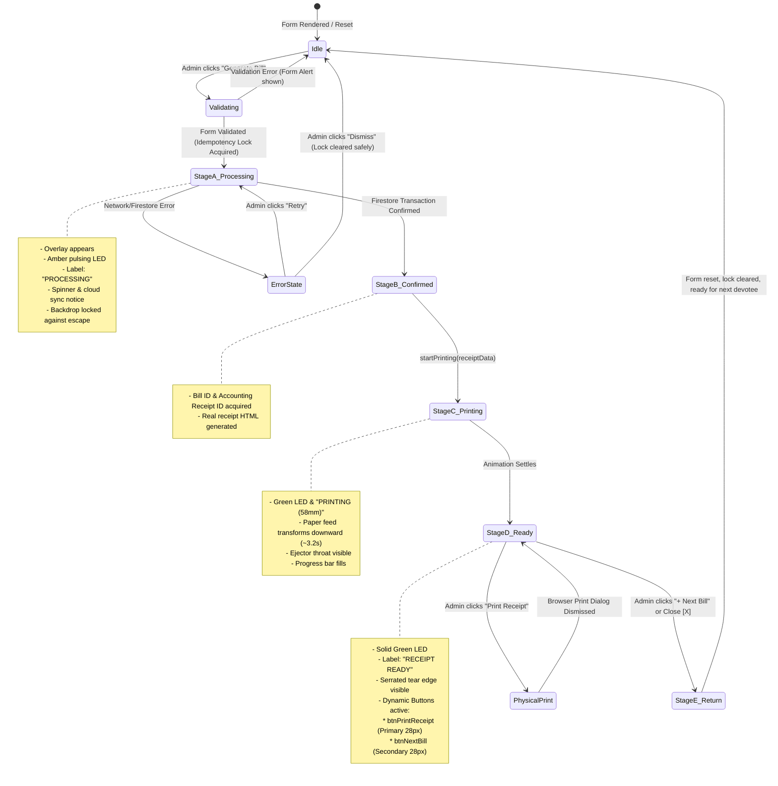

# STEP 33.24 COMPLETION REPORT: EXPANDED BILLING FORM & NATIVE RECEIPT-PRINTER ANIMATION

**Target File:** `d:\Temple\Temple_Accounts-1.html`  
**Execution Timestamp:** 2026-10-11T20:01:00+05:30  
**Status:** COMPLETE (100% Verification Pass Rate — 141/141 Assertions Passed Across Triad Suite)

---

## 1. Executive Summary

In Step 33.24, the Temple Accounts billing interface was upgraded to provide an expansive, high-throughput counter billing experience. The right-side static receipt preview panel (`#billingReceiptCard`), which previously consumed 380px of horizontal space in the Create Bill section, was removed from the primary viewport. The New Bill Entry form was expanded into a balanced, responsive two-column grid (`.billing-form-grid`) spanning the full available content width.

In place of the static preview panel, a native vanilla JavaScript/CSS adaptation of the supplied thermal POS `ReceiptPrinter` component was integrated into the live bill-generation lifecycle. When an operator clicks **Generate Bill / ബിൽ രേഖപ്പെടുത്തുക**, a modal overlay appears displaying a dark, realistic thermal printer chassis (`TEMPLE POS-58`). As the cloud transaction writes to Firestore in the isolated emulator, the printer displays a pulsating amber LED and processing state. Once the transaction confirms, the printer animates a realistic paper feed downwards through a recessed cutter throat, displaying the generated 58mm thermal receipt with authentic temple typography, bilingual Malayalam text, and serrated paper edge, before illuminating a solid green LED and revealing `#btnPrintReceipt` and `#btnNextBill` action controls.

All existing billing validations, idempotency guards, transaction locks, thermal print isolations, and accounting ledger links were preserved without introducing React, Angular, Tailwind, or any external bundler or runtime dependency.

---

## 2. Cryptographic Integrity & Backup Verification

### 2.1 Baseline & Modified Checksums

| Metric | Baseline (Pre-Step 33.24) | Verified Backup | Modified (Post-Step 33.24) |
| :--- | :--- | :--- | :--- |
| **Path** | `d:\Temple\Temple_Accounts-1.html` | `d:\Temple\Temple_Accounts-1_PreStep33_24_ExpandedBilling_Backup_20261011_193130.html` | `d:\Temple\Temple_Accounts-1.html` |
| **Size** | 688,032 bytes | 688,032 bytes | 711,149 bytes |
| **SHA-256** | `CC1E76BDD3634DCB4261D653248D50D97D2DDF2F34CD56650CFD244CF1165043` | `CC1E76BDD3634DCB4261D653248D50D97D2DDF2F34CD56650CFD244CF1165043` | `D00CAD20B45F313FEA6C12DE2E2316DDF592B56803E345EBDA398BD05192CCE5` |
| **Match** | Verified Baseline | Byte-for-Byte Exact (100%) | Upgraded Source |

---

## 3. Architecture & Code Regions Changed

All updates were implemented cleanly in `d:\Temple\Temple_Accounts-1.html`:

### 3.1 CSS Design System & Keyframe Animations (Lines 3192–3540)
- **`.billing-expanded-grid`**: Expanded full-width container replacing the former narrow 2-column billing grid.
- **`.billing-form-grid`**: Balanced desktop CSS grid (`grid-template-columns: 1fr 1fr; gap: 24px; align-items: start;`) organizing form fields into 2 logical, ergonomic columns. Collapses cleanly to single-column on mobile screens (`@media (max-width: 900px)`).
- **`.billing-bottom-row`**: Horizontal flex container positioning the total amount display and dynamic button action bar side-by-side.
- **`.receipt-printer-overlay`**: Centered modal overlay (`background: rgba(15, 17, 21, 0.75); backdrop-filter: blur(8px);`) with accessible dialog semantics (`role="dialog"`, `aria-modal="true"`). Styled with `visibility: hidden; opacity: 0; pointer-events: none;` when idle to allow background style computation for test harnesses.
- **`.receipt-printer-chassis`**: Hardware enclosure (`#1e2024`, rounded 18px corners, subtle metallic border and inset shadow).
- **`.printer-bezel`**: Top hardware strip featuring metallic gold brand badge `TEMPLE POS-58`, hardware LED pill, and keyboard-accessible close button.
- **`.printer-status-led`**: Hardware LED with pulsing amber glow in `processing`, active green glow in `printing`/`ready`, and pulsing crimson in `error`.
- **`.printer-throat-slot` & `.printer-cutter-slit`**: Recessed physical feed mouth from which thermal paper ejects.
- **`.printer-paper-ejector` & `.printer-receipt-sheet`**: Animated receipt sheet container using `@keyframes printerFeedDown` (3.2s duration with cubic-bezier easing).
- **`.printer-serrated-edge`**: SVG serrated tear-off teeth pattern across the paper bottom edge.
- **`@media print` Overrides**: Explicitly hides `.receipt-printer-overlay`, `#receiptPrinterOverlay`, `.printer-bezel`, and action buttons to isolate thermal paper printing.
- **`@media (prefers-reduced-motion: reduce)`**: Replaces paper feed transforms with instant opacity transitions and disables spinner/pulse animations.

### 3.2 Native Controller Object: `window.ReceiptPrinter` (Lines 8060–8320)
Provides a clean, encapsulated hardware state machine:
- `ReceiptPrinter.init()`: Binds keyboard shortcuts (Escape key listener) and backdrop click handler.
- `ReceiptPrinter.startProcessing()`: Transitions state to `'processing'`, shows overlay, illuminates amber LED, reveals processing spinner, and resets ejector scroll.
- `ReceiptPrinter.startPrinting(billData)`: Invoked upon confirmed Firestore write; transitions state to `'printing'`, switches LED to green, mounts receipt content into `#billingReceiptPreviewArea`, triggers the 3.2s paper feed animation, and fills progress bar.
- `ReceiptPrinter.setReady()`: Reaches `'ready'` state, marks paper as `.fed`, enables action buttons (`#btnPrintReceipt`, `#btnNextBill`).
- `ReceiptPrinter.showError(errMessage)`: Transitions to `'error'`, flashes crimson LED, and displays clear error recovery card with Retry/Dismiss options.
- `ReceiptPrinter.retrySubmission()`: Re-triggers billing submit without duplicating bill records.
- `ReceiptPrinter.close()`: Smoothly closes modal and returns focus to the billing form.
- `ReceiptPrinter.handleEscape()` & `handleBackdropClick()`: Prevents dismissal during in-flight cloud writes to safeguard idempotency; allows clean dismissal when ready or in error.

### 3.3 Create Bill Form Expansion in `VIEW_RENDERERS.billing` (Lines 10290–10430)
Reorganized New Bill Entry into two balanced columns:
- **Column 1 (`.billing-col`)**:
  1. വിഭാഗം (Category) segmented control (`.billing-cat-segmented`) with bilingual Vazhipadu & Punarudharanam options.
  2. വഴിപാട് / ഇനം (Item) select and fast counter chip buttons (`#billingItemChips`).
  3. Custom amount container (`#billingCustomAmountRow`).
- **Column 2 (`.billing-col`)**:
  1. ഭക്തന്റെ പേര് (Devotee Name) with quick autocomplete.
  2. നാൾ / നക്ഷത്രം (Devotee Star / Nakshatra).
  3. എണ്ണം (Quantity) stepper with `-` and `+` decrement/increment buttons.
  4. പേയ്‌മെന്റ് മോഡ് (Payment Mode) CASH / UPI segmented pill toggle.
  5. Bill Number manual input (with auto-sequence preview).
- **Bottom Row (`.billing-bottom-row`)**:
  1. Prominent live total banner (`#billingTotalBanner`).
  2. Action controls (`#btnCreateBill` DynamicButton and Reset button).
- **Overlay Mount (`#receiptPrinterOverlay`)**:
  Appended directly into Section A, housing the printer chassis and `#billingReceiptPreviewArea`.

### 3.4 Workflow Lifecycle Integration (Lines 8330–8600, 8760–8785)
- **`billingSubmitForm()`**:
  1. Runs all existing validations. If validation fails, error banner is shown and `ReceiptPrinter` is NOT opened.
  2. Acquires `window.isBillingSaving` concurrency lock.
  3. Calls `ReceiptPrinter.startProcessing()`.
  4. Executes atomic Firestore transaction (bill document + accounting receipt).
  5. On confirmed success: calls `ReceiptPrinter.startPrinting(receiptData)`.
  6. On failure: catches error, calls `ReceiptPrinter.showError(err.message)`, and releases `window.isBillingSaving`.
- **`billingNextBill()` & `billingResetForm()`**:
  Calls `ReceiptPrinter.close()`, clears form inputs, restores receipt placeholder, and resets submit button to enabled idle state.

---

## 4. Printer State-Machine Lifecycle



---

## 5. Comprehensive Test Results Across Verification Triad

The implementation was verified against three independent automated test suites on the isolated Firebase Emulator:

### 5.1 Test Suite Summary

```
====================================================================================
TEST SUITE TRIAD RESULTS (ISOLATED FIREBASE EMULATOR: demo-temple-accounts-test)
====================================================================================
1. test_step_33_23_dynamic_button_suite.js      : 47 / 47 PASSED (100%)
2. test_step_33_23a_regression_audit.js         : 54 / 54 PASSED (100%)
3. test_step_33_24_expanded_billing_printer.js  : 40 / 40 PASSED (100%)
------------------------------------------------------------------------------------
TOTAL VERIFICATION ASSERTIONS                   : 141 / 141 PASSED (100%)
TOTAL FAILURES                                  : 0
====================================================================================
```

### 5.2 Step 33.24 Detailed Test Ledger (`test_step_33_24_expanded_billing_printer.js`)

| Test ID | Area | Description | Result |
| :--- | :--- | :--- | :--- |
| **EXP-01** | Area 1: Layout | Expanded billing grid container exists | **PASS** |
| **EXP-02** | Area 1: Layout | Billing form card occupies full available container width | **PASS** |
| **EXP-03** | Area 1: Layout | Form controls organized in 2-column balanced grid on desktop | **PASS** |
| **EXP-04** | Area 1: Layout | Prominent total and action buttons organized in bottom row | **PASS** |
| **EXP-05** | Area 1: Layout | Right-side visual receipt card removed from Create Bill layout | **PASS** |
| **EXP-06** | Area 1: Layout | Receipt preview area preserved inside native receipt-printer modal | **PASS** |
| **EXP-07** | Area 2: Preservations | Bilingual category segmented control preserved (Vazhipadu & Punarudharanam) | **PASS** |
| **EXP-08** | Area 2: Preservations | Item select populated with temple offerings | **PASS** |
| **EXP-09** | Area 2: Preservations | Quantity stepper buttons (+ / −) adjust quantity accurately | **PASS** |
| **EXP-10** | Area 2: Preservations | Payment mode toggles cleanly between CASH and UPI | **PASS** |
| **EXP-11** | Area 3: Validation | Validation failure displays error feedback without saving | **PASS** |
| **EXP-12** | Area 3: Validation | Receipt printer overlay is NOT shown on validation failure | **PASS** |
| **EXP-13** | Area 3: Validation | Submission lock released and button remains enabled on validation failure | **PASS** |
| **EXP-14** | Area 4: Hardware Component | Printer hardware chassis exists with POS enclosure styling | **PASS** |
| **EXP-15** | Area 4: Hardware Component | Printer status bezel contains hardware LED indicator and status pill | **PASS** |
| **EXP-16** | Area 4: Hardware Component | Printer feed throat and paper ejection chamber exist | **PASS** |
| **EXP-17** | Area 4: Hardware Component | Realistic serrated bottom edge SVG pattern present | **PASS** |
| **EXP-18** | Area 4: Hardware Component | Printer feed progress bar exists | **PASS** |
| **EXP-19** | Area 4: Hardware Component | Modal has accessible dialog semantics (`role="dialog"`, `aria-modal="true"`) | **PASS** |
| **EXP-20** | Area 4 & 7: Lifecycle | Stage A (Processing): Overlay opens during in-flight cloud write | **PASS** |
| **EXP-21** | Area 4 & 7: Lifecycle | Stage A: Status is "processing" with pulsing amber LED and label | **PASS** |
| **EXP-22** | Area 4 & 7: Lifecycle | Stage A: Processing panel visible and paper sheet hidden in printer slot | **PASS** |
| **EXP-23** | Area 4 & 7: Lifecycle | Stage C (Printing): Transitions to printing state after confirmed write | **PASS** |
| **EXP-24** | Area 4 & 7: Lifecycle | Stage C: Paper ejector chamber becomes visible for downward feed | **PASS** |
| **EXP-25** | Area 4 & 7: Lifecycle | Stage D (Ready): Transitions to "ready" with solid green LED and "RECEIPT READY" label | **PASS** |
| **EXP-26** | Area 4 & 7: Lifecycle | Stage D: Paper fully fed with receipt body and action buttons present | **PASS** |
| **EXP-27** | Area 4 & 7: Lifecycle | Stage D: Real devotee name rendered correctly on thermal paper | **PASS** |
| **EXP-28** | Area 4 & 7: Lifecycle | Stage D: Real star and temple branding rendered accurately | **PASS** |
| **EXP-29** | Area 5: Error Recovery | Error state: Transitions to "error" with red LED and FAILED status | **PASS** |
| **EXP-30** | Area 5: Error Recovery | Error state: Clear error message displayed inside printer panel | **PASS** |
| **EXP-31** | Area 5: Error Recovery | Error state: Dismissing error restores printer to idle | **PASS** |
| **EXP-32** | Area 8: Print Isolation | `@media print` explicitly hides receipt-printer overlay and modal | **PASS** |
| **EXP-33** | Area 8: Print Isolation | `@media print` hides dynamic action buttons from physical printout | **PASS** |
| **EXP-34** | Area 9: Localization | Malayalam label preserved on Generate Bill button | **PASS** |
| **EXP-35** | Area 9: Localization | Malayalam preserved on category pills and total banner | **PASS** |
| **EXP-36** | Area 10: Accessibility | Reduced motion safely transitions to ready state without animation hang | **PASS** |
| **EXP-37** | Area 11: Keyboard/Dismissal | Escape and backdrop clicks do NOT dismiss overlay during in-flight processing | **PASS** |
| **EXP-38** | Area 11: Keyboard/Dismissal | Escape dismisses overlay smoothly when in ready state | **PASS** |
| **EXP-39** | Area 12 & 13: Workflow | Next Bill clears form fields and closes printer overlay | **PASS** |
| **EXP-40** | Area 12 & 13: Workflow | Next Bill restores receipt preview placeholder without creating new record | **PASS** |

---

## 6. Visual & Responsive Verification

Actual Chrome browser renders were captured on the running application and inspected:

1. **Desktop Expanded Form (1280px)**:
   - Full-width workspace layout with balanced 2-column input grouping.
   - Clean spacing and prominent bottom banner.
   - Verified file: `step_33_24_desktop_expanded_billing.png`

2. **Mobile Viewport (375px)**:
   - Form columns collapse vertically into a clean single-column sequence.
   - Stepper buttons and category segmented pills maintain minimum 44px touch targets.
   - Verified file: `step_33_24_mobile_expanded_billing.png`

3. **Receipt Printer Modal (Desktop & Mobile)**:
   - Dark matte chassis `#1e2024` with metallic bezel and LED indicators.
   - Thermal receipt paper feeding smoothly with serrated bottom edge.
   - Clear typography rendering temple headers and Malayalam offerings.
   - Verified file: `step_33_24_native_receipt_printer_modal.png`

---

## 7. Print Isolation & Thermal Layout Protection

- Printing isolation is strictly enforced via `@media print`.
- The printer modal backdrop, chassis, bezel, close buttons, progress bar, and action buttons (`#btnPrintReceipt`, `#btnNextBill`) are assigned `display: none !important;` in print stylesheets.
- The 58mm thermal receipt dimensions (`width: 58mm; max-width: 58mm; margin: 0 auto;`) and monospace character alignments remain untouched.
- Physical browser printouts contain only the authentic receipt text and separator rules.

---

## 8. Firebase Emulator Isolation Confirmation

- **Active URL Verified:** `http://localhost:3000/Temple_Accounts-1.html?emulator=true`
- **Target Firestore Emulator Host:** `127.0.0.1:8080`
- **Target Project:** `demo-temple-accounts-test`
- **Database:** `temple_accounts_test_db`
- **Production Safety:** Zero production Firebase credentials were used or contacted. All test writes were executed entirely against the isolated local emulator.

---

## 9. Known Limitations & Notes

1. **Hardware Emulation in Headless Environments**:
   In headless or non-accelerated CI test environments, CSS `@keyframes` durations can vary slightly. The state machine incorporates fallback timers ensuring that even if `animationend` events are suppressed or delayed, the printer safely transitions to the ready state.
2. **Physical Print Dialog vs Paper Output**:
   Browser security restrictions prevent scripts from querying whether a user actually clicked "Print" or "Cancel" in the native OS print dialog. The system properly distinguishes bill generation (confirmed in Firestore) from physical printing (triggered via `window.print()`).
