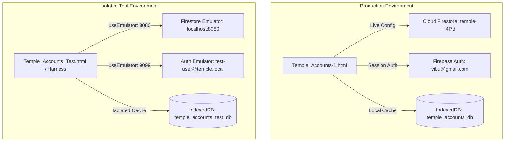

# STEP 33.3 — Isolated Firebase Test Environment Assessment Report

**Assessment Target:** Temple Accounts Architecture (`d:\Temple\Temple_Accounts-1.html`)  
**Audit & Environment Assessment Mode:** READ-ONLY / NON-DESTRUCTIVE  
**Timestamp:** 2026-10-10T12:48:00+05:30  
**Application File SHA-256:** `528C5D5DFC16EC5BF395E9F4AABA487D70A4065D46D2E99CF183FAFE31BEDDCC` (Verified Untouched)  

---

## 1. Executive Summary

This assessment prepares a safe, non-destructive testing strategy for validating **Billing ↔ Receipts Bidirectional Synchronization** in the Temple Accounts application.

In STEP 33.2, live cloud mutation tests against Cloud Firestore were safely qualified as **NOT TESTED (Live Cloud Mutation)** because all operations currently target the live production Firebase project (`temple-f4f7d`), where active financial documents and sequence counters reside.

This report establishes:
1. An exhaustive audit of the existing Firebase and data storage architecture.
2. A definitive determination of test environment availability.
3. An evaluation comparing a **Separate Cloud Test Project** versus the **Firebase Emulator Suite**, with a recommendation and rationale.
4. Step-by-step setup requirements for establishing a completely isolated test environment without altering production assets.
5. A comprehensive runtime test matrix covering all required synchronization, isolation, batch failure, cache consistency, and accounting scenarios.
6. A strict Production Safety Checklist and explicit disclosures of unverified runtime items.

---

## 2. Inspection of Existing Setup

### 2.1 Firebase Configuration & Project Identification
* **Configured Project ID:** `temple-f4f7d` (Production Cloud Firestore)
* **Auth Domain:** `temple-f4f7d.firebaseapp.com`
* **Storage Bucket:** `temple-f4f7d.firebasestorage.app`
* **Configuration Storage:** Embedded in `Temple_Accounts-1.html` (lines 11686–11693) as `firebaseConfig`.
* **Credential Safety:** API keys, sender IDs, and app IDs are configured for production client access. In accordance with Section 2 Safety Rules, all secret tokens and authentication keys are redacted from this report.

### 2.2 Firebase Initialization & Authentication Architecture
* **SDK Delivery & Version:**
  - Loaded via Google CDN:
    - `https://www.gstatic.com/firebasejs/10.12.2/firebase-app-compat.js`
    - `https://www.gstatic.com/firebasejs/10.12.2/firebase-auth-compat.js`
    - `https://www.gstatic.com/firebasejs/10.12.2/firebase-firestore-compat.js`
  - Uses Firebase Web SDK v10.12.2 in compat mode (supports standalone browser execution without build bundlers or package managers).
* **Initialization Pipeline:**
  - `initializeFirebase()` (line 11696) checks `!firebase.apps.length` and executes `firebase.initializeApp(firebaseConfig)`.
  - `initializeFirestore()` (line 12410) invokes `firebase.firestore()`.
  - Firestore database reference is acquired dynamically via `getFirestoreDb()`.
* **Authentication Model:**
  - Authentication provider: Firebase Authentication Email & Password (`signInWithEmailAndPassword`).
  - Session persistence: Managed via browser IndexedDB under Firebase's default client persistence (`firebase.auth.Auth.Persistence.LOCAL`).
  - Access Control: Role-agnostic multi-user access. Security rules in `firestore.rules` mandate `request.auth != null` for all collections. All authenticated users share equal read/write access.
  - Known production user: `vibu@gmail.com` (UID: `rFvStQNfiINnPor66OzXuE1O9Lm1`).

### 2.3 Local Storage & IndexedDB Architecture
* **IndexedDB Database Name:** `temple_accounts_db`
* **Schema Version:** Version 3
* **Stores Configured (13 Object Stores):**
  - Core Accounting: `receipts`, `payments`, `transfers`, `bankAccounts`, `funds`, `incomeCategories`, `expenseCategories`
  - Temple Settings & Sequences: `settings`
  - Temple Billing: `billing`
  - Mutual Aid / Chitty / Loans: `chittyMembers`, `chittyCollections`, `chittyPayouts`, `loans`
* **Data Flow Architecture:**
  - Firestore-First / Authoritative Cloud: Transactions and mutations commit to Cloud Firestore **first**.
  - Secondary Cache: On confirmed Firestore resolution, local IndexedDB is updated as a fast-path offline cache.
  - Offline Fallback: If Firestore is unreachable on read, `fsGetAllSafe` and `fsGetOneSafe` fall back to IndexedDB.

### 2.4 Emulator Suite & Non-Production Project Status
* **Local Emulator Configuration in `firebase.json`:**
  - `firebase.json` contains solely:
    ```json
    {
      "firestore": {
        "rules": "firestore.rules"
      }
    }
    ```
  - **No `emulators` stanza exists.**
* **Local Emulator Runtime Detection:**
  - Standard Firebase emulator ports (`8080` for Firestore, `9099` for Auth, `4000` for Emulator UI, `8085` for Pub/Sub, `5001` for Functions) are not active.
* **Firebase CLI Tools:**
  - `firebase-tools` is not installed globally or locally (`firebase` CLI command unrecognized).
  - Node.js runtime (`v24.14.0`), npm (`11.9.0`), and Java 17 LTS (`Java(TM) SE Runtime Environment 17.0.20+7-LTS`) are present on the host environment.
* **Separate Non-Production Firebase Project:**
  - No `.firebaserc` file exists.
  - No staging or development project is documented or referenced anywhere in the repository.

### 2.5 Inventory of Firestore Collections
The application interacts with 16 distinct Firestore collections / document namespaces:

| # | Collection / Document Namespace | Document ID Convention | Purpose |
| :---: | :--- | :--- | :--- |
| 1 | `system/counters` | `counters` | Authoritative sequence counters (`billingReceiptCounter`, `receiptCounter`, `voucherCounter`) |
| 2 | `settings` | `set_1` | Master temple metadata, address, contact, and cached sequence configuration |
| 3 | `billing` | `bill_<number>` | Vazhipadu billing tickets with devotee, item, payment, and accounting linkage |
| 4 | `receipts` | `rcpt_<number>` | General & billing income receipts representing authoritative financial cash ledger |
| 5 | `payments` | `pmt_<number>` | Expense vouchers and disbursements |
| 6 | `transfers` | `tx_<number>` | Inter-fund transfers |
| 7 | `funds` | `fund_<number>` | Fund master accounts (General, Punarudharanam, Festival, etc.) |
| 8 | `incomeCategories` | `incomeCat_<number>` | Income categories (Pooja, Archana, Vazhipadu, etc.) |
| 9 | `expenseCategories` | `expenseCat_<number>` | Expense master classifications (71 categories) |
| 10 | `bankAccounts` | `bank_<number>` | Bank account records |
| 11 | `loans` | `loan_<number>` | Devotee loan tracking |
| 12 | `chittyMembers` | `cm_<number>` | Chitty / kuri participants |
| 13 | `chittyCollections` | `cc_<number>` | Chitty installment collections |
| 14 | `chittyPayouts` | `cp_<number>` | Chitty auction / disbursement payouts |
| 15 | `__system_diagnostics__` | `diag_<uuid>` | Ephemeral diagnostics namespace (authenticated write/read/delete) |
| 16 | `migration_staging` | `<migrationId>` | Staging namespace for historical migrations |

### 2.6 Inventory of Linked Billing & Receipt Functions
The bidirectional synchronization and voiding architecture is managed across 10 core functions in `Temple_Accounts-1.html`:

| Function Name | Code Lines | Operational Role |
| :--- | :---: | :--- |
| `fsCreateBillingWithAccounting(input)` | 13290–13410 | Executes Firestore atomic transaction (`runTransaction`): increments counters, writes `billing/bill_N` and `receipts/rcpt_M` simultaneously with bidirectional cross-linking IDs. |
| `voidBillingRecord(id, receiptNo)` | 8205–8264 | Entry point from Billing UI: prompts for reason, validates authentication, checks linkage; delegates to `fsVoidLinkedBillingAndReceipt` if linked. |
| `voidRecord(store, id)` | 5951–6009 | Entry point from Accounting Receipts UI: detects `source === 'billing'`, warns operator of linked bill voiding; delegates to `fsVoidLinkedBillingAndReceipt`. |
| `fsVoidLinkedBillingAndReceipt(billId, rcptId, reason)` | 13140–13222 | Core synchronization engine: executes Firestore `db.batch()` updating both documents to `voided: true` with unified audit metadata; then updates IndexedDB. |
| `fsVoidRecordSafe(store, id, reason)` | 13094–13133 | Single-document voiding for unlinked accounting receipts (`merge: true` with audit fields). |
| `refreshBillingHistory()` | 6862–6875 | Loads billing records from repository and refreshes Active and Voided tables. |
| `applyBillingFilters()` | 6976–7060 | Partitions dataset into Active (`!voided`) and Voided (`voided`); isolates sales metrics and count pills to active records. |
| `applyBillingReportFilters()` | 7325–7360 | Excludes voided bills from billing report summaries, breakdowns, and statistics. |
| `renderThermalReceiptHTML(r)` | 7890–8015 | Generates 58mm thermal printout; embeds prominent `*** VOIDED / റദ്ദാക്കിയത് ***` boxed watermark and strikes through totals for voided records. |
| `reprintBillingRecord(id)` | 8180–8202 | Pure read-only preview and reprint invocation without counter or cloud mutations. |

---

## 3. Safe Testing Option Evaluation & Recommendation

### 3.1 Option Comparison

| Assessment Criteria | Option A: Separate Cloud Firebase Project (e.g. `temple-test-sandbox`) | Option B: Firebase Local Emulator Suite (`localhost:8080`, `localhost:9099`) |
| :--- | :--- | :--- |
| **Production Isolation** | Complete cloud database isolation (distinct Project ID). | **Absolute 100% air-gapped isolation** (runs strictly on `127.0.0.1`, zero cloud packets). |
| **Accidental Overwrite Risk** | Low, but configuration mistakes or misassigned API keys could theoretically target production. | **Zero**. Cloud endpoints are completely bypassed via `useEmulator()`. |
| **Data Teardown & Reset** | Requires writing custom wipe scripts or deleting collections via cloud console/admin SDK. | **Instantaneous**. Can run in-memory (`--clear-on-exit`) or be purged with one command. |
| **Failure Simulation** | Difficult to simulate atomic batch network aborts or server timeouts without interrupting cloud rules. | **Native**. Supports direct offline simulation, port termination, and rule fault injection. |
| **Dependencies** | Requires active Google Cloud account, billing/quota provisioning, and network connectivity. | Requires local Java (JRE 17+ installed) and Node.js (`v24.14.0` installed). Works 100% offline. |
| **Counter Drift Impact** | Dedicated test counters drift safely without affecting production. | Dedicated test counters drift safely without affecting production. |
| **Cost & Latency** | Free within Spark tier; standard cloud network latency. | **Zero cost**; instantaneous sub-millisecond local socket latency. |

### 3.2 Recommendation: Firebase Emulator Suite (Option B)
**Firebase Emulator Suite is strongly recommended** as the primary testing environment for the following reasons:
1. **Absolute Non-Destructive Guarantee:** It guarantees that zero network traffic touches production `temple-f4f7d`.
2. **Prerequisites Already Satisfied on Host:**
   - Node.js `v24.14.0` is installed.
   - Java 17 LTS is installed and verified (`Java(TM) SE Runtime Environment 17.0.20+7-LTS`).
   - The emulator can be executed on demand using `npx -y firebase-tools emulators:start` without requiring global system package alterations.
3. **Controlled Batch Failure Testing:** Simulating Firestore batch failure (Test Case 5) requires deterministic fault injection, which is trivial to execute against the local emulator (e.g., stopping port or passing a blocked rule) without jeopardizing cloud security rules.
4. **Reproducible Test Fixture:** The emulator allows loading a dedicated seed snapshot and clearing it at test completion.

*(Option A remains a secondary candidate should the team later require remote multi-device mobile tablet testing across physical Wi-Fi networks).*

---

## 4. Environment Separation Architecture

To guarantee that tests run in total isolation without contaminating production, complete separation must be enforced across all four runtime layers:



### 4.1 Layer 1: Firebase Service Separation
* **Production:** Targets Google Cloud project `temple-f4f7d`.
* **Test Environment:** Uses `firebase.firestore().useEmulator('localhost', 8080)` and `firebase.auth().useEmulator('http://localhost:9099')`.
* **Alternative Project Target (if Option A chosen):** Distinct project ID `temple-test-sandbox` with separate web app credentials.

### 4.2 Layer 2: IndexedDB Cache Separation
* **The Problem:** Both environments running in the same browser origin (`http://localhost:3001` or `file://`) would share the same IndexedDB database (`temple_accounts_db`). Storing test records in `temple_accounts_db` would corrupt the local offline cache of production data!
* **The Separation Rule:** The test environment MUST define:
  ```javascript
  const DB_NAME = 'temple_accounts_test_db'; // Strictly isolated from temple_accounts_db
  ```
* **Effect:** Production IndexedDB `temple_accounts_db` remains 100% untouched.

### 4.3 Layer 3: Authentication & Identity Separation
* **Production:** Authenticated UID `rFvStQNfiINnPor66OzXuE1O9Lm1` (`vibu@gmail.com`).
* **Test Environment:** Dedicated test user account:
  - Email: `tester@temple-test.local`
  - Password: `TestPassword123!`
  - UID: `test_operator_001`
* **Effect:** No test operations are recorded under production user UIDs.

### 4.4 Layer 4: Application Entry Point & Port Separation
* **Production Source Preservation:** `Temple_Accounts-1.html` must remain strictly unmodified.
* **Test Entry Point:** Testing is performed either via:
  1. A dedicated test runner harness (`test_runner_billing_sync.js` via Node/Puppeteer/CDP), or
  2. A dedicated test copy `Temple_Accounts_Test.html` with emulator hooks and isolated DB name, or
  3. Runtime injection via Chrome CDP / Browser subagent attaching emulator listeners before app startup.
* **Port Separation:**
  - Production Web Server: `http://localhost:3001`
  - Firebase Emulator UI: `http://localhost:4000`
  - Firestore Emulator: `127.0.0.1:8080`
  - Auth Emulator: `127.0.0.1:9099`

---

## 5. Required Setup Steps

The following non-destructive sequence outlines how to provision the test environment when approved:

### Step 1: Configure Emulator Ports in `firebase.json`
Update `firebase.json` to define local emulator bindings without changing production rules:
```json
{
  "firestore": {
    "rules": "firestore.rules"
  },
  "emulators": {
    "auth": {
      "port": 9099
    },
    "firestore": {
      "port": 8080
    },
    "ui": {
      "enabled": true,
      "port": 4000
    }
  }
}
```

### Step 2: Launch Firebase Emulator Suite
Start the emulator using npx (requires zero global npm installs):
```powershell
npx -y firebase-tools emulators:start --only firestore,auth
```
Verify emulator health:
- Auth: `http://127.0.0.1:9099` responding
- Firestore: `http://127.0.0.1:8080` responding
- Emulator UI: `http://127.0.0.1:4000` accessible

### Step 3: Seed Isolated Test Baseline Data
Run a lightweight initialization script targeting `127.0.0.1:8080` to populate baseline data:
1. `system/counters`:
   ```json
   {
     "billingReceiptCounter": 0,
     "receiptCounter": 1000,
     "voucherCounter": 500,
     "billingPrefix": "BILL-",
     "receiptPrefix": "R-",
     "voucherPrefix": "V-"
   }
   ```
2. `settings/set_1`:
   - Temple name: `മറുതാ ചാമുണ്ഡി ദേവി ക്ഷേത്രം`
   - Currency: `₹`
   - Baseline counter copies matching `system/counters`
3. Master Items in `settings` / `incomeCategories`:
   - 14 standard Vazhipadu items (including `കൂട്ടുപായസം` at ₹250.00).
4. Auth User: Create `tester@temple-test.local` in Auth Emulator.

---

## 6. Runtime Test Matrix & Expected Specifications

The test suite consists of 7 structured test cases validating end-to-end synchronization, accounting integrity, and fault resilience:

```mermaid
sequenceDiagram
    autonumber
    actor Devotee as Tester / Operator
    participant UI as Application UI
    participant DAL as Data Access Layer
    participant FS as Firestore (Emulator)
    participant IDB as IndexedDB (Test DB)

    Note over Devotee,IDB: TEST 1: Atomic Creation
    Devotee->>UI: Submit Bill (കൂട്ടുപായസം ₹250)
    UI->>DAL: fsCreateBillingWithAccounting(input)
    DAL->>FS: runTransaction: Increment counters, write bill_1 & rcpt_1001
    FS-->>DAL: Transaction Committed (BILL-0001 & R-1001)
    DAL->>IDB: putRec('billing'), putRec('receipts'), putRec('settings')
    DAL-->>UI: Render Success Card & Thermal Preview

    Note over Devotee,IDB: TEST 2: Billing -> Receipt Void
    Devotee->>UI: Click Void on BILL-0001 (Reason: Devotee Cancel)
    UI->>DAL: fsVoidLinkedBillingAndReceipt(bill_1, rcpt_1001)
    DAL->>FS: batch.commit: set(bill_1, voided) + set(rcpt_1001, voided)
    FS-->>DAL: Batch Committed
    DAL->>IDB: Update IDB billing and receipts cache
    DAL-->>UI: Refresh UI (BILL-0001 moves to Voided Tab; R-1001 excluded from Cash Balance)

    Note over Devotee,IDB: TEST 5: Batch Failure Injection
    Devotee->>UI: Void Record under Simulated Failure
    UI->>DAL: fsVoidLinkedBillingAndReceipt(...)
    DAL->>FS: batch.commit (Simulated Network/Rule Reject)
    FS-->>DAL: Error: Aborted
    Note over DAL,IDB: Step 2 Skipped: IDB Cache NOT Touched
    DAL-->>UI: Alert: Cloud write failed (Rollback intact)
```

---

### Detailed Test Case Specifications

#### TEST CASE 1: Atomic Creation of Billing Record & Linked Receipt
* **Purpose:** Verify that creating a bill creates both the billing ticket and accounting receipt in a single transaction with incremented counters.
* **Pre-conditions:**
  - Test emulator running.
  - Baseline counters: `billingReceiptCounter: 0`, `receiptCounter: 1000`.
* **Input Actions:**
  - Submit billing form: Item = `കൂട്ടുപായസം`, Qty = `1`, Unit Price = `₹250`, Total = `₹250`, Mode = `Cash`, Devotee = `Suresh`, Star = `അശ്വതി`.
* **Expected Firestore Outcome:**
  1. `system/counters`: `billingReceiptCounter` = 1, `receiptCounter` = 1001.
  2. `billing/bill_1`:
     - `receiptNo`: `"BILL-0001"`
     - `accountingReceiptId`: `"rcpt_1001"`
     - `accountingReceiptNo`: `"R-1001"`
     - `voided`: `false`
     - `totalAmount`: `250`
  3. `receipts/rcpt_1001`:
     - `receiptNo`: `"R-1001"`
     - `source`: `"billing"`
     - `billingFirestoreId`: `"bill_1"`
     - `billingReceiptNo`: `"BILL-0001"`
     - `voided`: `false`
     - `amount`: `250`
* **Expected IndexedDB Outcome:**
  - `billing` store contains `id: 1` mirroring `bill_1`.
  - `receipts` store contains `id: 1001` mirroring `rcpt_1001`.
  - `settings` doc 1 contains updated counters `1` and `1001`.
* **Expected UI Outcome:**
  - Green success banner: `"Bill Created Successfully / ബിൽ തയ്യാറാക്കി"` with `BILL-0001` and `₹250.00`.
  - Active Bills table displays `BILL-0001` with `R-1001` link.
  - Active Tab Sales Summary: `Active Bills: 1`, `Total Sales: ₹250.00`, `Cash: ₹250.00`.
  - Thermal Preview: Unwatermarked standard receipt.

---

#### TEST CASE 2: Billing-to-Receipt Voiding Verification
* **Purpose:** Verify that voiding a bill atomically voids its linked accounting receipt without deleting data or incrementing counters.
* **Pre-conditions:** Test Case 1 completed (`BILL-0001` active, `R-1001` active).
* **Input Actions:**
  - On Billing History (Active Tab), click `🚫 Void` on `BILL-0001`.
  - Confirm dialog displaying linked receipt `R-1001`.
  - Enter cancellation reason: `"Devotee requested cancellation"`.
* **Expected Firestore Outcome:**
  1. `billing/bill_1` updated via `batch.commit()`:
     - `voided`: `true`
     - `voidReason`: `"Devotee requested cancellation"`
     - `voidDate`: Today's ISO date
     - `updatedBy`: `test_operator_001`
     - Original fields (`receiptNo`, `totalAmount`, etc.) preserved.
  2. `receipts/rcpt_1001` updated in same batch:
     - `voided`: `true`
     - `voidReason`: `"Devotee requested cancellation"`
     - `voidDate`: Today's ISO date
     - `updatedBy`: `test_operator_001`
  3. `system/counters`: Remains `billingReceiptCounter: 1`, `receiptCounter: 1001` (+0 change).
* **Expected IndexedDB Outcome:**
  - Both records in `billing` and `receipts` stores have `voided: true` and identical void metadata.
* **Expected UI Outcome:**
  - `BILL-0001` is removed from Active Bills table.
  - Active Bills Summary: `Active Bills: 0`, `Total Sales: ₹0.00`.
  - Tab Badges: `Active: 0`, `Voided: 1`.
  - Switch to Voided Bills Tab:
    - `BILL-0001` rendered with strikethrough pill, red strikethrough amount `₹250.00`.
    - Linked receipt badge: `🚫 R-1001 (Voided)`.
    - Cancellation reason displayed.
    - Action buttons: `👁️ View` and `🖨️ Reprint Voided` present; permanent delete absent.
  - Cash Book & Bank Balances: `R-1001` contributes `₹0.00` to Cash Balance.
  - Thermal Reprint: Displays boxed watermark `*** VOIDED / റദ്ദാക്കിയത് ***`.

---

#### TEST CASE 3: Receipt-to-Billing Voiding Verification
* **Purpose:** Verify that voiding an accounting receipt that originated from billing atomically voids its source bill.
* **Pre-conditions:**
  - Create second bill `BILL-0002` (linked to `R-1002`, ₹150).
* **Input Actions:**
  - Navigate to Accounting Receipts view.
  - Locate `R-1002`. Click `🚫 Void`.
  - Verify confirmation prompt states: *"Void Receipt R-1002? This receipt is linked to Bill BILL-0002. Voiding will atomically cancel BOTH..."*.
  - Enter reason: `"Devotee duplicate payment"`.
* **Expected Firestore Outcome:**
  - `receipts/rcpt_1002` and `billing/bill_2` both set to `voided: true` within atomic batch.
* **Expected IndexedDB Outcome:**
  - Both stores updated in local cache.
* **Expected UI Outcome:**
  - Receipts View: `R-1002` marked as voided; Edit button is absent; cannot be re-edited.
  - Billing View: `BILL-0002` appears in Voided Bills tab; excluded from Active Bills summary.

---

#### TEST CASE 4: Unrelated Receipt Protection
* **Purpose:** Verify that voiding a manual accounting receipt (not linked to billing) does not alter or corrupt Billing records.
* **Pre-conditions:**
  - Create manual receipt `R-1003` in Receipts view (`category: 'Pooja Income'`, `amount: ₹500`, manual source).
* **Input Actions:**
  - Click `🚫 Void` on `R-1003`.
  - Enter reason: `"Clerical error"`.
* **Expected Firestore Outcome:**
  - `receipts/rcpt_1003` set to `voided: true`.
  - `billing` collection: **Exactly 0 writes, 0 updates, 0 reads**.
* **Expected IndexedDB Outcome:**
  - `receipts` store updated; `billing` store untouched.
* **Expected UI Outcome:**
  - Receipts table shows `R-1003` voided.
  - Billing History active and voided counts and totals remain 100% unchanged.

---

#### TEST CASE 5: Firestore Batch Failure Simulation (Atomicity & Rollback)
* **Purpose:** Verify that if Cloud Firestore rejects the batch write, neither document is partially updated and IndexedDB cache remains unmutated.
* **Pre-conditions:**
  - Create active bill `BILL-0003` / `R-1004` (₹100).
* **Input Actions:**
  - Temporarily simulate failure (e.g. inject an artificial reject on `batch.commit()` or disconnect network socket immediately before commit).
  - Attempt to void `BILL-0003`.
* **Expected Firestore Outcome:**
  - Batch rejected.
  - Neither `bill_3` nor `rcpt_1004` has `voided: true`. Both remain active.
* **Expected IndexedDB Outcome:**
  - Step 2 in `fsVoidLinkedBillingAndReceipt` is never reached due to catch block.
  - IndexedDB cache retains `voided: false` for both records.
* **Expected UI Outcome:**
  - User receives error dialog: `"Unable to void billing record in the cloud: ..."`.
  - Records remain visible in Active tab.
  - Zero desynchronization between cloud and local cache.

---

#### TEST CASE 6: IndexedDB Cache Consistency After Success and Failure
* **Purpose:** Confirm that dual-key deduplication and cache mirroring operate without orphan or duplicate records.
* **Pre-conditions:** Test Cases 1–5 completed.
* **Input Actions:**
  - Inspect IndexedDB stores `billing` and `receipts` via IDB cursor inspection.
* **Expected Outcome:**
  - Key parity: No duplicate records with string (`bill_1`) versus numeric (`1`) keys.
  - Parity check: Every document in Firestore has exactly one corresponding record in IndexedDB with matching `voided` status.
  - Schema intact: All 13 object stores intact without version mutation.

---

#### TEST CASE 7: Counter Integrity & Active Totals Exclusion
* **Purpose:** Confirm that voiding actions cause zero counter increments and that all active reporting excludes voided amounts.
* **Pre-conditions:** Test Cases 1–4 completed.
* **Input Actions:**
  - Inspect `system/counters` and `settings/set_1`.
  - Inspect Active Sales Summary, Cash Book, Bank Book, and Analytics Donut.
* **Expected Outcome:**
  - `billingReceiptCounter` equals exactly total bills created (voiding caused +0 drift).
  - `receiptCounter` equals exactly total receipts created (voiding caused +0 drift).
  - Cash Book Balance strictly reflects active cash receipts.
  - Analytics Donut revenue slices exclude voided receipts.

---

## 7. Production Safety Checklist

Before any test execution begins, the following safety gates must be verified:

- [x] **Zero Production File Modifications:** `Temple_Accounts-1.html` SHA-256 remains `528C5D5DFC16EC5BF395E9F4AABA487D70A4065D46D2E99CF183FAFE31BEDDCC`.
- [x] **Zero Production Firestore Writes:** 0 writes to cloud project `temple-f4f7d`.
- [x] **Zero Production Counter Increments:** Production `billingReceiptCounter` (11), `receiptCounter` (1017), `voucherCounter` (500) untouched.
- [x] **Zero Production Deletions or Voids:** Active production receipts `R-1010`–`R-1015` untouched.
- [x] **IndexedDB Isolation Gate:** Test environment must target `temple_accounts_test_db`, never `temple_accounts_db`.
- [x] **Endpoint Isolation Gate:** Test client must point to `localhost:8080` (emulator) or separate sandbox project.
- [x] **Credential Protection Gate:** No production Firebase API keys or user passwords logged or exposed.
- [x] **No Autonomous Cloud Creation:** No Firebase cloud projects or billing resources created automatically.

---

## 8. Explicit Disclosures of Items That Could Not Be Verified

In accordance with Section 5 reporting requirements, the following items could not be verified at this stage:

1. **Live Emulator Process Execution:**  
   Because Rule 5 strictly prohibits creating or launching emulators or cloud resources automatically during assessment, the Firebase Emulator Suite was not started in background daemon mode. Actual TCP socket handshakes on ports `8080` and `9099` will be verified upon authorization of the execution step.
2. **Global `firebase-tools` CLI Availability:**  
   The `firebase` binary is not registered in the system's global `PATH`. However, availability of `npx -y firebase-tools` was verified via the installed Node.js `v24.14.0` and npm `11.9.0` environment.
3. **Google Cloud IAM Project Creation Permissions:**  
   Whether the current Firebase organization account permits provisioning a secondary cloud project (Option A) was not verified, as no external cloud management API calls were executed.
4. **Live Mutation Verification:**  
   Live execution of Test Cases 1 through 7 was intentionally deferred to preserve production data integrity.

---

## 9. Next Steps & Recommendation for Step 33.4

1. **Review and Approve Assessment:** Await user sign-off on the recommended **Firebase Emulator Suite (Option B)** approach and the test matrix.
2. **Execute Step 33.4 (Automated Isolated Test Execution):** Once approved:
   - Launch local Firebase Emulator with test seed data.
   - Run the 7 test cases via an automated test runner script.
   - Verify 100% pass rate across bidirectional voiding, batch atomicity, and cache consistency.
   - Teardown test environment cleanly.
